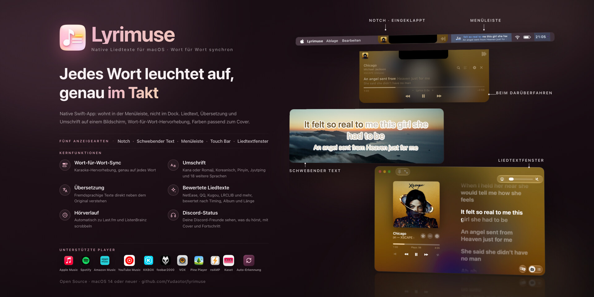

<div align="center">


# Lyrimuse

**Liedtexte auf dem Schreibtisch, neu gedacht für den Mac.**

**Language / 语言 / 語言 / 言語 / 언어 / Idioma / Langue / Sprache / Lingua / Язык / Мова:** [English](README.md) | [简体中文](README.zh-CN.md) | [繁體中文](README.zh-Hant.md) | [日本語](README.ja.md) | [한국어](README.ko.md) | [Español](README.es.md) | [Français](README.fr.md) | **Deutsch** | [Italiano](README.it.md) | [Português (Brasil)](README.pt-BR.md) | [Tiếng Việt](README.vi.md) | [Русский](README.ru.md) | [Українська](README.uk.md)


[](https://github.com/Yudaotor/lyrimuse/releases/latest)
[](https://github.com/Yudaotor/lyrimuse/commits/dev)
[](LICENSE)
[](https://github.com/sponsors/Yudaotor)
[](https://discord.gg/N7gVy66Gp3)
[](https://t.me/lyrimuse)
[](https://qm.qq.com/q/Nb4TlwfnQy)

</div>

https://github.com/user-attachments/assets/88b951ee-4ecf-4985-b1cb-eee6afdd5510

Lyrimuse ist eine Open-Source-App für Liedtexte auf dem Schreibtisch unter macOS. Sie sitzt in der Menüleiste und hebt den Liedtext Wort für Wort hervor, während der Titel läuft: schwebend über all deinen Fenstern, in der Menüleiste, in einer Kapsel im Stil der Dynamic Island unter der Notch, auf der Touch Bar oder in einem vollständigen Liedtextfenster. Sie unterstützt 15 Player, darunter Apple Music, Spotify, Amazon Music und die YouTube-Music-App Kaset, dazu Web-Player in deinem Browser, und wählt aus 15 Liedtextquellen den besten Treffer, auf Wunsch mit Übersetzung und Umschrift. Außerdem führt sie ein Last.fm-Hörprofil und scrobbelt deine Wiedergaben.

**Du kommst von LyricsX?** Seit April 2022 ist dort keine neue Version mehr erschienen. Lyrimuse kann, was LyricsX konnte, wird weiter aktualisiert und unterstützt zusätzlich chinesischsprachige Player, KKBOX, Amazon Music, Kaset, Pear Desktop, reAMP, VOX, Pine Player, foobar2000 und Web-Player. Die Details stehen im geprüften [Vergleich mit LyricsX und Lyric Fever](docs/lyrics-apps-comparison.md).

**Installiere** Lyrimuse mit Homebrew, auf Apple Silicon oder Intel. Dabei wird auch die Gatekeeper-Warnung beim ersten Start für dich erledigt. Lieber selbst herunterladen? Hol dir die [neueste Version](https://github.com/Yudaotor/lyrimuse/releases/latest) und lies [Erste Schritte](#erste-schritte).

```bash
brew tap yudaotor/lyrimuse
brew trust --cask yudaotor/lyrimuse/lyrimuse   # one-time: Homebrew asks you to trust non-official taps
brew install --cask lyrimuse
```


<p align="center"><sub>Vier Arten, den Liedtext anzuzeigen: das Liedtextfenster, die Kapsel im Stil der Dynamic Island, der schwebende Text mit Wort-für-Wort-Hervorhebung und die Menüleiste</sub></p>


<p align="center"><sub>Die Liedtext-Verwaltung, die manuelle Suche mit einer Bewertung für jedes Ergebnis und die Übersicht, die zeigt, warum ein Titel genau diesen Liedtext bekommen hat</sub></p>


<p align="center"><sub>Deine Last.fm-Zahlen und -Charts, die Übersicht, wenn nichts läuft, und eine Heatmap deines Jahres im GitHub-Stil</sub></p>


<p align="center"><sub>Jede Einstellungsseite hat eine Live-Vorschau, du kannst mehrere Player wählen (auch Web-Player), und das Menü in der Menüleiste erledigt den Rest</sub></p>

## Funktionen

> Wo jede Funktion in den Einstellungen zu finden ist und ob sie nach der Installation ein- oder ausgeschaltet ist, steht in der **[Funktionsliste](docs/feature-list.md)**.

### Wort für Wort synchronisierte Liedtexte, automatisch gefunden
- **Wort-für-Wort-Hervorhebung**, die mit dem laufenden Titel Schritt hält.
- **15 Liedtextquellen, für dich durchsucht**: NetEase Cloud Music, QQ Music, Kugou, Kuwo, Migu, Musixmatch, LRCLIB, LyricFind (über YouTube Music), Deezer, AMLL (eine von Hand gepflegte Datenbank mit Wort-für-Wort-Liedtexten), Soda Music (mit eigenem Wort-für-Wort-Timing), VIBE und Genie (beide stark bei koreanischen Titeln), PetitLyrics (stark bei japanischen Titeln) und die Liedtexte von Apple Music, wenn du in den Einstellungen deinen Account verbindest. Die Liedtexte von Apple Music setzen ein Abo voraus, und viele Titel dort haben Wort-Timing. Selbst suchen musst du nie.
- **Übersetzung und Umschrift** unter dem Originaltext. Hat die Quelle eine Community-Übersetzung, bekommst du diese. Wenn nicht, schalte in den Einstellungen „Systemübersetzung als Ersatz“ ein (standardmäßig aus): Dann übersetzt dein Mac den Liedtext mit Apples Translation-Framework, sodass er deinen Computer nie verlässt, und wo das nicht geht, springt ein Online-Übersetzer ein. Es gibt 17 Zielsprachen. Die Umschrift wird Zeile für Zeile entschieden: Ein chinesischer Titel mit einer japanischen Zeile bekommt nur in dieser Zeile eine Lesung, nicht Pinyin über den ganzen Rest. Kantonesische Titel bekommen Jyutping, das ganze Wörter erkennt. Für Japanisch kannst du stattdessen Furigana wählen: Hiragana nur über den Kanji, praktisch, wenn du mit Songs Japanisch lernst. 18 weitere Sprachen, darunter Russisch, Thai, Griechisch und Hindi, bekommen ebenfalls eine Umschrift, nach der offiziellen Romanisierung der jeweiligen Sprache oder einer ISO-Norm.
- **Duette nach Stimme getrennt.** Wenn die Quelle (oder ein AMLL-Eintrag) angibt, wer welche Zeile singt, erscheint jeder Part für sich, statt zwei Stimmen in einen Block zu werfen.
- **Die Apple-Music-Details im Liedtextfenster**: Hintergrundgesang in einer eigenen Zeile unter der Hauptstimme, sich überlappende Duettzeilen, die gemeinsam leuchten, bis beide zu Ende sind, und lang gehaltene englische Wörter, die wie in Apple Music anschwellen und glühen.
- **Vereinfachtes oder traditionelles Chinesisch** für den Liedtext, unabhängig von der Sprache der App eingestellt.
- **Liedtext-Verwaltung**, wenn du aufräumen willst. Durchsuche, bearbeite oder lösche den Liedtext jedes Titels oder suche ihn neu, lösche viele auf einmal und räume die leeren Einträge weg, die Werbung und Podcasts hinterlassen. Stimmt das Timing eines Titels nicht, verschiebe es nur für diesen Titel. Ein Button versucht es bei allen Titeln erneut, die noch keinen Liedtext haben, und ein vollständiger Neuscan wählt für deine ganze Bibliothek neu, mit den aktuellen Zuordnungsregeln. Alles, was du von Hand korrigiert hast, bleibt unangetastet. Du kannst auch .lrc-Dateien oder einen ganzen Ordner importieren, auch für Titel, die du noch nicht gehört hast, oder einen Ordner überwachen lassen.
- **Ein Titel, ein Liedtext.** Derselbe Titel, in verschiedenen Playern gespielt oder aus verschiedenen Veröffentlichungen, wird als einer erkannt: Seine Einträge teilen sich den Liedtext und deine Bearbeitungen, und ihre Wiedergaben werden zusammengezählt. „Einträge dieses Titels“ in der Liedtext-Verwaltung vergleicht sie Zeile für Zeile und trennt einen Eintrag ab, der versehentlich zugeordnet wurde.
- **Liedtext direkt im Liedtextfenster korrigieren.** Suche nach einem anderen Liedtext, ordne den Titel neu zu oder bearbeite den Text in deinem eigenen Texteditor. Beim Bearbeiten eines Wort-für-Wort-Liedtexts ändern sich nur die Wörter, jedes Wort behält sein Timing.
- **Funktioniert offline** für jeden Titel, dessen Liedtext schon im Cache liegt.

### Last.fm-Hörprofil und Scrobbeln
- **Ein vollständiges Hörprofil.** Verbinde Last.fm mit einem Klick bei den Accounts (kein Token zum Kopieren und Einfügen), und du bekommst Summen für heute, die letzten 7 Tage und insgesamt, eine Live-Anzeige „Wird gescrobbelt“ und deine letzten Wiedergaben mit Covern, jede mit einem Herz, um den Titel auf Last.fm zu lieben (oder das zurückzunehmen). Standardmäßig wird jede Wiedergabe als passender Titel aus dem Katalog von Last.fm gesendet, sodass Duett-Angaben, vereinfachte / traditionelle Schreibweisen und Anhängsel wie „ - Single“ oder „(Remastered)“ auf der echten Titelseite landen; wechsle in den Einstellungen zu „Original“, um genau das zu senden, was der Player gemeldet hat. ListenBrainz bekommt immer die ursprünglichen Tags ([so funktioniert das Scrobbeln](docs/scrobbling.de.md)).
- **Top-Künstler, -Alben und -Titel** der letzten 7 Tage, 30 Tage, des Jahres oder insgesamt, jeweils mit der Veränderung gegenüber dem vorigen Zeitraum. Klicke auf einen Künstler, um seine Titel zu sehen, die du am häufigsten hörst.
- **Spuren**, ein eigener Tab. Er beginnt mit deinen laufenden Summen: wie viele Tage seit deinem ersten Scrobble vergangen sind, an wie vielen davon du etwas gehört hast und der Tagesdurchschnitt, dein stärkster Tag, deine aktuelle und deine längste Serie, dieses Jahr bisher im Vergleich zum selben Zeitraum eines früheren Jahres und wie weit du vom nächsten runden Meilenstein entfernt bist. Darunter folgen eine Heatmap des Jahres im GitHub-Stil (klicke auf einen Tag, um zu sehen, was du am meisten gehört hast), wann du nach Uhrzeit und Wochentag hörst, woher deine Top-Künstler kommen, und „An diesem Tag“ mit dem, was du an diesem Datum in früheren Jahren gehört hast.
- **Jede Wiedergabe wird zuerst auf deinem Mac gespeichert**, schon bevor du Last.fm verbindest. Verbinde es später und sende die letzten etwa zwei Wochen mit einem Klick nach (ältere Wiedergaben nimmt Last.fm nicht an).
- **Du entscheidest, wann eine Wiedergabe zählt**: bei 50 % wie standardmäßig bei Last.fm, bei 75 % oder 90 % oder erst, wenn der Titel wirklich zu Ende ist. ListenBrainz ist davon nicht betroffen. Du kannst einen Player auch ganz von Last.fm ausschließen, sodass seine Wiedergaben nie in deinem Verlauf auftauchen.
- **Derselbe Verlauf erscheint im Liedtextfenster**, wenn nichts läuft, sodass du eine Übersicht statt eines leeren Bildschirms siehst (mehr dazu unten).

### Schwebender Text, Liedtext in der Menüleiste, Dynamic Island, Touch Bar oder ein vollständiges Liedtextfenster
- **Mehrere Player nutzen oder automatisch wählen lassen.** Apple Music, Spotify und Kaset werden über den Automationszugriff gelesen. QQ Music, NetEase Cloud Music, Kugou Music, Soda Music, KKBOX, Amazon Music und LX Music werden über MediaRemote von macOS gelesen und brauchen keine Berechtigung. Schalte in den Einstellungen eine beliebige Kombination ein oder lass die automatische Erkennung an, dann folgt Lyrimuse dem, was macOS unter „Jetzt läuft“ anzeigt.
- **Auch Apple-Music-Radio funktioniert.** Der Liedtext folgt jedem Titel eines Senders. Während der Moderator spricht, siehst du Namen und Logo des Senders, nicht den vorigen Titel. Radio hat einen eigenen Versatz, sodass du einen Sender einmal korrigierst und dann Ruhe hast.
- **Genauso Player im Browser.** Kopple deinen Browser einmal, und YouTube Music oder Spotify Web funktioniert wie jeder andere Player, mit Liedtext synchron zum Fortschrittsbalken der Seite. Ein Test mit einem Klick zeigt dir vorab, ob sich der Browser überhaupt steuern lässt. Während Werbung wird die Kapsel schwarz und zeigt, wie lange sie noch dauert und die wievielte von wie vielen Werbungen gerade läuft. Werbung in YouTube Music bekommt einen Button zum Überspringen oder lässt sich automatisch überspringen.
- **Wähle, wie du ihn sehen willst**, in jeder Kombination oder gar nicht:
  - schwebender Text auf dem Schreibtisch, den du überallhin ziehen oder oben in der Mitte oder direkt über dem Dock fixieren kannst;
  - eine Kapsel im Stil der Dynamic Island oben auf dem Bildschirm, die das Albumcover zeigen und es hinter der Kapsel unscharf darstellen kann, die Liedtextzeile beim Darüberfahren ausblendet, damit Klicks durchgehen, und auf Wunsch auf dem Sperrbildschirm erscheint;
  - die Touch Bar eines MacBook Pro, das eine hat, mit der Zeile, die beim Singen mitläuft, auf Wunsch samt Cover und Wiedergabesteuerung;
  - ein in der Größe veränderbares Liedtextfenster nach dem Vorbild der Liedtextseite von Apple Music, mit zwei Spalten, einem unscharfen Cover im Hintergrund, dem ganzen Titel, der zur aktuellen Zeile mitscrollt, bewegtem Cover, wenn Apple Music für das Album ein animiertes Cover hat, und dem in Schleife laufenden Spotify-Canvas-Video des Titels als Hintergrund, falls es eines gibt. Die Wörter füllen sich beim Singen, mit der Stärke, der Farbe für Gesungenes und der Ausrichtung deiner Wahl, und „HDR-Hervorhebung“ kann den gesungenen Teil auf einem HDR-Display heller als Weiß leuchten lassen.
- **Liedtext in der Menüleiste (Textmodus).** Die aktuelle Zeile steht direkt in der Menüleiste. Lange Zeilen scrollen, statt mittendrin abgeschnitten zu werden (du kannst zum Abschneiden zurückwechseln). Eine zweite Zeile kann die nächste Zeile, die Übersetzung oder die Umschrift zeigen, und die Kapsel kann das auch.
- **Zum Springen den Fortschrittsbalken ziehen**, im Liedtextfenster und in der Kapsel.
- **Zufallswiedergabe, Wiederholen, Favorit und Lautstärke** direkt im Liedtextfenster, wo immer der Player es zulässt: Apple Music, Spotify, Kaset, QQ Music, Amazon Music und YouTube Music im Browser unterstützen jeweils einige oder alle davon, und NetEase Cloud Music, Kugou Music, Soda Music und LX Music haben „Favorit“. „Favorit“ gibt es auch in der aufgeklappten Kapsel, und es kann einen Tastaturkurzbefehl bekommen.
- **Den Titel dort öffnen, wo er zu Hause ist**, über das Menü „⋯“ oder die Infoübersicht. Apple Music öffnet ihn in der App, Spotify springt zum laufenden Titel, und KKBOX öffnet Titel, Album oder Künstler in der eigenen App. QQ Music, Soda Music, Spotify, Amazon Music und YouTube Music (wenn du es in Kaset hörst) öffnen die Webseite des Titels, Albums oder Künstlers, und NetEase Cloud Music öffnet die Titelseite. Lyrimuse hat den Link beim Abrufen des Liedtexts gefunden oder aus den Daten des Players auf deinem Mac gelesen, du musst also nichts suchen.
- **Wenn nichts läuft**, zeigt das Liedtextfenster die Summen von heute und dieser Woche, eine Karte „An diesem Tag“ und deine letzten Wiedergaben mit Covern, jede mit einem Link zur Album- oder Künstlerseite in Apple Music.
- **Ein Mini-Liedtextfenster**: eine kleine Karte mit einer Zeile, zwei Zeilen oder dem ganzen scrollenden Liedtext, mit eigenem Hintergrund, eigener Textfarbe, Schrift, Stärke und Farbe für Gesungenes; Wort-für-Wort-Karaoke lässt sich nur dafür ausschalten.
- **Web-Liedtext auf Smartphone, Tablet oder im Stream.** Öffne das Liedtextfenster in einem Browser auf einem anderen Gerät und nutze es als zweiten Bildschirm, mit Wiedergabesteuerung und Springen per Tippen, wenn du das erlaubst. „OBS-Ausgabe“ bringt den schwebenden Text als transparente Browserquelle in deinen Stream. Beides bleibt auf diesem Mac, bis du den Zugriff im lokalen Netzwerk erlaubst, und andere Geräte verbinden sich per QR-Code.
- **Titelnotizen, Albumnotizen und Künstlerbiografien.** Klicke im Liedtextfenster oder in der aufgeklappten Kapsel auf Titel, Künstler oder Albumnamen, um mehr darüber zu lesen. Albumnotizen und Künstlerbiografien kommen von Apple Music oder, wenn dort nichts steht, von Soda Music (in Soda Music gespielte Titel, nur bei chinesischer Oberfläche), Kugou Music (in Kugou Music gespielte Titel, nur bei chinesischer Oberfläche), NetEase Cloud Music (nur bei chinesischer Oberfläche), aus den Wikipedia-Artikeln, die YouTube Music anzeigt (in der Sprache der Oberfläche), oder von Last.fm; Titelnotizen kommen von QQ Music (nur bei chinesischer Oberfläche) oder Last.fm.
- **Gestalte es nach deinem Geschmack**: Schrift (die des Systems oder eigene .ttf- / .otf-Dateien), Größe, Text-, Hintergrund- und Schattenfarbe, gesicherte Themes oder eine Farbe aus dem aktuellen Albumcover und die Breite des schwebenden Texts, dazu ein fließender Regenbogen für den Liedtext.
- **Unsichtbar in Screenshots, Aufnahmen und bei der Bildschirmfreigabe.** Du siehst ihn weiterhin. Sonst niemand.
- **Blendet sich bei Pause aus**, damit er nicht untätig auf deinem Schreibtisch herumsteht. Er kann auch bei Instrumentalstellen, Titeln ohne Liedtext und Apps im Vollbild Platz machen, und der schwebende Text kann dir auf den Bildschirm des Fensters folgen, das du gerade benutzt.

### Alltägliche Details
- **Englisch, vereinfachtes Chinesisch, traditionelles Chinesisch, Japanisch, Koreanisch, Spanisch, Französisch, Deutsch, Italienisch, brasilianisches Portugiesisch, Vietnamesisch, Russisch und Ukrainisch**, und der Wechsel wirkt sofort, ohne Neustart. Eine holprige Übersetzung entdeckt? Pull Requests sind willkommen; jede Sprache hat einen Styleguide in `lyrimuse/Localization/`.
- **Liquid Glass unter macOS 26.** Die Einstellungen, das Menüleisten-Panel, das Liedtextfenster, die Liedtext-Verwaltung und der Einrichtungsassistent sind damit gebaut, und die meisten davon können hell oder dunkel bleiben, statt dem System zu folgen.
- **Tastaturkurzbefehle** für jede Aktion, vom Ausblenden aller Liedtexte bis zum Favorisieren des Titels. Ab Werk ist keiner belegt, du wählst die Tasten also selbst. Jede Aktion hat außerdem einen `lyrimuse://`-Link, den du aus Kurzbefehle, Raycast oder Alfred aufrufen kannst, und aus Kurzbefehle heraus kann ein Link den laufenden Titel zurückgeben ([URL-Schema](docs/url-scheme.de.md)).
- **Suche in den Einstellungen.** Tippe in die Seitenleiste, und sie scrollt zur passenden Zeile und hebt sie hervor; eine zugeklappte Gruppe klappt sie dafür bei Bedarf auf.
- **Aktualisiert sich selbst.** Lyrimuse sucht von sich aus nach Updates oder wenn du es über die Menüleiste anstößt. Updates werden über die Seite „Softwareupdate“ in den Einstellungen installiert, mit Versionshinweisen und Fortschritt direkt dort, und du kannst dich für Betaversionen anmelden.
- **Zusammen mit deinen Playern starten**, pro Player einstellbar und in beide Richtungen: sie öffnen, wenn Lyrimuse öffnet, Lyrimuse öffnen, wenn sie öffnen, und auf Wunsch Lyrimuse beenden, sobald alle Player, denen Lyrimuse folgt, beendet sind.
- **Still starten**, wenn Lyrimuse lieber ganz ohne Fenster starten soll, nur mit dem Symbol in der Menüleiste.
- **Umzug auf einen neuen Mac?** Exportiere deine gesamte Einrichtung und importiere sie dort. Wenn etwas schiefgeht, gibt es auch einen Diagnose-Export mit einem Klick.

### Optionale Extras

<details>
<summary>ListenBrainz, Discord-Status, eine teilbare „Läuft gerade“-Seite und tägliche / wöchentliche / monatliche / jährliche Rückblicke</summary>

All das ist aus, bis du es in den Einstellungen einschaltest:

- **Zusätzlich zu [ListenBrainz](https://listenbrainz.org) scrobbeln.** Jede Wiedergabe geht an beide Dienste, aus demselben Auslesen deines Players, sodass beide Verläufe übereinstimmen. Wiedergaben von deinem iPhone (über Last.fm erfasst) werden ebenfalls zu ListenBrainz kopiert, sodass du einen gemeinsamen Verlauf über beide Geräte hast statt zwei.
- **Eine öffentliche „Läuft gerade“-Seite zum Teilen**: Live-Wiedergabe, Verlauf, Gästebuch, Reaktionen, Besucherzähler, eine Top-10-Künstlertafel, Vinyl-Optik, helles und dunkles Theme und richtige Linkvorschauen in Chat-Apps. Der **[Leitfaden zu den Web-Funktionen](https://github.com/Yudaotor/nowplaying-workers#readme)** erklärt sie mit Screenshots.
- **Tägliche, wöchentliche, monatliche und jährliche Hörrückblicke**, an beliebig viele Kanäle geschickt: Bark, ntfy, ServerChan, Feishu, DingTalk, WeCom, Telegram, Discord, Slack oder einen allgemeinen Webhook. Jeder Kanal kann einen Test senden, und ein Zustellverlauf zeigt, was angekommen ist.
- **Auf Discord zeigen, was du hörst.** Dein Profil und deine Freundesliste zeigen den Player, den du nutzt, den Titel, den Künstler, das Cover und einen Fortschrittsbalken, und Titel und Künstler verlinken auf ihre Seiten auf der Website dieses Players. Die Albumzeile kann die gerade gesungene Zeile zeigen, und du kannst bis zu zwei Buttons hinzufügen. Ein kleines Lyrimuse- oder Player-Abzeichen sitzt in der Ecke des Covers (oder keines), und ein pausierter Titel kann mit Pause-Symbol stehen bleiben. Du wählst, welche Player zählen, kannst nur den Player zeigen, ohne den Titel zu nennen, und die Anzeige eine Weile ausblenden.

ListenBrainz und „Web-Push“ findest du unter **Labor** in der Seitenleiste der Einstellungen, „Push-Mitteilungen“ steht bei den übrigen Bereichen, und Discord hat einen eigenen Eintrag weit oben. Jede Karte bringt ihre eigenen Einrichtungsschritte mit: wo du einen API-Schlüssel oder Token bekommst, wie du einen Account verbindest, wie du eine Webhook-URL für deinen Push-Dienst erhältst. Nur die Webseite hat einen eigenen Leitfaden, und du brauchst nicht alles davon. Schon mit ListenBrainz allein zeigt die Seite Live-Wiedergabe und Verlauf, ganz ohne Cloudflare Worker. Richte einen ein, wenn du auch Gästebuch, Reaktionen, Besucherzähler, Top-10-Tafel und schnellere Aktualisierungen willst; der Leitfaden erklärt das.

</details>

## Erste Schritte

Die Versionen sind mit dem eigenen Zertifikat des Projekts signiert, nicht mit einer Apple Developer ID, daher braucht keine der folgenden Optionen einen Apple-Developer-Account. Der Haken: Beim ersten Öffnen meldet Gatekeeper, die App stamme „von einem nicht verifizierten Entwickler“. Homebrew (Option A) erledigt das für dich. Bei den anderen Optionen ist das zu erwarten und kein Fehler, und Option B zeigt, wie du einmalig daran vorbeikommst.
### Option 0: Die Installation einer KI überlassen

Du nutzt einen KI-Agenten, der auf deinem Mac das Terminal bedienen kann (Claude Code, Codex CLI, Gemini CLI, …)? Füge den Block unten unverändert dort ein, und er erledigt alles aus Option A/B für dich. Die Anweisungen erlauben ihm nur, diese eine App zu installieren. Er verwendet kein `sudo` und rührt keine systemweiten Sicherheitseinstellungen an:

```text
Please install Lyrimuse — an open-source macOS menu-bar lyrics app
(https://github.com/Yudaotor/lyrimuse) — on this Mac, following these rules exactly:

1. Preferred path (if `brew` exists):
     brew tap yudaotor/lyrimuse
     brew trust --cask yudaotor/lyrimuse/lyrimuse
     brew install --cask lyrimuse
   If this Homebrew doesn't know the `trust` subcommand, skip that line — older
   versions don't need it.
2. If Homebrew is not installed, do NOT install Homebrew. Instead: check the CPU
   with `uname -m`, download the latest release asset from
   https://github.com/Yudaotor/lyrimuse/releases — `Lyrimuse-v<version>-macos.zip`
   for arm64, `Lyrimuse-v<version>-macos-intel.zip` for x86_64 — verify it against
   its `.sha256` file (`shasum -c`), unzip, move `Lyrimuse.app` into
   /Applications, then clear the Gatekeeper quarantine flag on that one app only:
     xattr -dr com.apple.quarantine /Applications/Lyrimuse.app
3. Safety rails: no `sudo` anywhere (nothing here needs it); never run
   `spctl --master-disable` or otherwise weaken Gatekeeper system-wide; never
   remove the quarantine flag from anything except /Applications/Lyrimuse.app.
4. Do not build from source unless I explicitly ask.
5. Launch it (`open -a Lyrimuse`) and verify it is running (`pgrep -x Lyrimuse`
   prints a PID).
6. A first-run wizard will appear — that part is mine to click through. Tell me
   it will ask me to pick a music player, to grant Automation access to
   Music.app and/or Spotify (only if I pick them), and to enable the background
   lyrics engine — then hand control back to me.
Finally, report what you did and anything that failed.
```

### Option A: Mit Homebrew installieren (empfohlen)

```bash
brew tap yudaotor/lyrimuse
brew trust --cask yudaotor/lyrimuse/lyrimuse   # one-time: Homebrew asks you to trust non-official taps
brew install --cask lyrimuse
```

Dabei wird die einmalige Gatekeeper-Quarantäne automatisch aufgehoben, ein weiterer Schritt ist also nicht nötig. Öffne Lyrimuse aus `/Applications` (oder über Spotlight), sobald `brew install` fertig ist. `brew upgrade --cask lyrimuse` holt neue Versionen auf dieselbe Weise.

### Option B: Eine fertige Version manuell herunterladen

1. Lade sie von der [Releases-Seite](https://github.com/Yudaotor/lyrimuse/releases). **Prüfe zuerst, welchen Mac du hast** ( → Über diesen Mac → „Chip“: `Apple M…` ist Apple Silicon, `Intel Core…` ist Intel):

   | Dein Mac | Download |
   | --- | --- |
   | Apple Silicon (M1 und neuer) | `Lyrimuse-*-macos.dmg` oder `.zip` |
   | Intel | `Lyrimuse-*-macos-intel.dmg` oder `.zip` |

   Beim dmg doppelklickst du, um es zu aktivieren, und ziehst `Lyrimuse.app` auf die Verknüpfung `Applications` daneben; beim zip entpackst du es und ziehst `Lyrimuse.app` nach `/Applications`. Beide Formate installieren genau dieselbe App, und zum zip gibt es eine `.sha256`, falls du den Download prüfen willst (`shasum -c Lyrimuse-*.zip.sha256` im selben Ordner).

   Der einzige Unterschied zwischen den beiden Downloads ist die Architektur: Der ohne Suffix läuft nur auf Apple Silicon, `-intel` enthält Code für Intel und Apple Silicon. `-intel` läuft zwar auch auf Apple Silicon, aber dort gibt es keinen Grund dafür: Er ist doppelt so groß, und ab macOS 27 warnt das System, die App „muss aktualisiert werden“, weil sie Intel-Code enthält (Apple entfernt Rosetta in macOS 28; mit der App ist eigentlich alles in Ordnung).

   **Beide Architekturen bekommen automatische Updates in der App.** Der Feed listet für dieselbe Version zwei Einträge, einen pro Architektur: Apple Silicon bekommt den Build ohne Suffix, Intel den mit `-intel`, und Sparkle wählt auf jedem Rechner selbst. (Bis einschließlich v1.4.0 wurde nur Apple Silicon bedient; Intel-Nutzer mussten von Hand hierher zurückkommen.)
2. Beim ersten Start weigert sich macOS, die App zu öffnen, mit „Apple konnte nicht überprüfen, ob ‚Lyrimuse‘ frei von Schadsoftware ist“ oder „stammt von einem nicht verifizierten Entwickler“. Heb das einmalig auf, auf die Art, die dir lieber ist:

   - **Terminal (empfohlen, funktioniert immer):**
     ```bash
     xattr -dr com.apple.quarantine /Applications/Lyrimuse.app
     ```
     Öffne die App danach ganz normal. Das ist pro Download nur einmal nötig.
   - **Rechtsklick → Öffnen:** Klicke im Finder mit der rechten Maustaste (oder bei gedrückter ctrl-Taste) auf `Lyrimuse.app`, wähle **Öffnen** und bestätige im Dialog noch einmal mit **Öffnen**. Das klappt nicht auf jeder macOS-Version bei jeder Art von Warnung; bleibt die Warnung, nimm den Terminal-Befehl oben.
   - **Systemeinstellungen → Datenschutz & Sicherheit:** Versuche einmal, die App zu öffnen (sie wird blockiert), öffne dann **Systemeinstellungen → Datenschutz & Sicherheit**, scrolle nach unten und klicke neben der Lyrimuse-Warnung auf **Dennoch öffnen**. Bestätige noch einmal, falls du gefragt wirst.

   Mach das nur bei einem Build, dem du wirklich vertraust: dem von der Releases-Seite dieses Repos oder einem, den du selbst gebaut hast.

### Option C: Aus dem Quellcode bauen

**Einmalige Voraussetzungen** (überspringe, was du schon hast):

```bash
xcode-select --install   # Xcode Command Line Tools, for Swift — skip if `swift --version` already works
brew install go          # any Go ≥ 1.21 — build.sh switches to 1.24.4 automatically via GOTOOLCHAIN
```

Danach baut `build.sh` die App und ihre Liedtext-Engine (den Hintergrundprozess namens `lyrimuse-engine`) in einem Durchgang:

```bash
git clone https://github.com/Yudaotor/lyrimuse.git
cd lyrimuse/lyrimuse
./build.sh              # this machine's architecture
./build.sh --universal  # arm64 + x86_64 (the compatibility build shipped for Intel)
```

`build.sh` listet am Ende die Architekturen jeder Binärdatei im Bundle auf und meldet alles, was nicht zum Ziel passt, ob eine Architektur fehlt oder eine zu viel ist. Stell Release-Dateien nicht von Hand zusammen: `./package.sh` baut jede Architektur einmal und erzeugt für jede ein zip + sha256 + dmg; bei falschen Architekturen verweigert es das Paketieren.

Für QQ Music / NetEase Cloud Music / Kugou Music / Soda Music / KKBOX / Amazon Music / LX Music / Spotify / Kaset / die automatische Erkennung wird zusätzlich [ungive/media-control](https://github.com/ungive/media-control) gebraucht. `build.sh` installiert es bei Bedarf automatisch über Homebrew, auch das musst du also nicht selbst erledigen.

### Nach jeder Option

Öffne Lyrimuse aus `/Applications`. Der Einrichtungsassistent beim ersten Start führt dich durch die Wahl eines Players (Apple Music, QQ Music, NetEase Cloud Music, Kugou Music, Soda Music, KKBOX, Amazon Music, Spotify, Kaset, Pear Desktop, reAMP, VOX, Pine Player, foobar2000, LX Music oder automatische Erkennung), das Erteilen des Automationszugriffs, falls du Apple Music, Spotify, Kaset oder VOX gewählt hast (die anderen brauchen keine Berechtigung, um grundlegende Titelinfos zu lesen), und das Aktivieren der Liedtext-Engine (damit Liedtexte und Cover auch bei geschlossenem Fenster weiter gefunden werden). Schließ den Assistenten ab, und der Liedtext erscheint sofort (weitere Build-Optionen in [lyrimuse/README.md](lyrimuse/README.md)).

Mehr brauchst du für Liedtexte nicht. Die optionalen Extras kannst du später in den Einstellungen einrichten, wann immer du sie willst.

## Häufige Fragen

### Wie bekomme ich schwebende Apple-Music-Liedtexte auf den Schreibtisch meines Macs, immer im Vordergrund?
Schalte in den Einstellungen den schwebenden Text ein. Er bleibt über allen Fenstern, in jedem Space. Zieh ihn, wohin du willst, oder fixiere ihn oben in der Mitte oder direkt über dem Dock. Hat der Liedtext Wort-Timing, füllt sich jedes Wort, während es gesungen wird. Du kannst ihn in Screenshots, Aufnahmen und bei der Bildschirmfreigabe verbergen und bei pausierter Musik verschwinden lassen. Mit QQ Music, NetEase Cloud Music, Kugou Music, Soda Music, KKBOX, Amazon Music, LX Music, Spotify, Kaset und Web-Playern funktioniert das genauso.

### Kann ich Spotify-Liedtexte in der Menüleiste des Macs anzeigen?
Ja. Schalte den Textmodus der Menüleiste ein, und die aktuelle Zeile erscheint in der Menüleiste, für Spotify oder jeden anderen unterstützten Player. Lange Zeilen scrollen, statt abgeschnitten zu werden, und eine zweite Zeile kann die nächste Zeile, die Übersetzung oder die Umschrift zeigen. Einen Spotify-Account musst du nicht verbinden. Lyrimuse fragt einmal nach Automationszugriff auf Spotify, der die genaue Wiedergabeposition liefert und die Wiedergabetasten funktionieren lässt. Lehnst du ab, erscheint der Liedtext trotzdem, aber das Timing kommt dann von MediaRemote von macOS und kann um etwa eine Sekunde danebenliegen.

### Gibt es Wort-für-Wort-Liedtexte für QQ Music, NetEase Cloud Music, Kugou oder Soda Music?
Ja, sofern der Liedtext Wort-Timing hat. NetEase Cloud Music, QQ Music, Kugou, Soda Music, Musixmatch, AMLL und Apple Music haben das oft, und diese Zeilen füllen sich Wort für Wort. Liedtexte, die nur Zeilen-Timing haben, lassen eine ganze Zeile auf einmal aufleuchten. Der Player schränkt auch nicht ein, woher der Liedtext kommt: Ein Titel, der in Soda Music läuft, kann den Wort-für-Wort-Liedtext von QQ Music bekommen, wenn dieser am besten bewertet ist.

### Brauche ich für die Installation einen Apple-Developer-Account?
Nein. Die Versionen sind mit dem eigenen Zertifikat des Projekts statt mit einer Apple Developer ID signiert, also braucht weder du noch das Projekt einen. Daher kommt auch der einmalige Gatekeeper-Schritt, der oben unter „Erste Schritte“ beschrieben ist.

### Gibt es Lyrimuse im Mac App Store?
Nein. Installiere die App mit Homebrew (Option A oben) oder lade sie von der [Releases-Seite](https://github.com/Yudaotor/lyrimuse/releases) herunter (Option B). So oder so kommen Updates danach über die App.

### Ist Lyrimuse kostenlos?
Ja. Die App ist Open Source unter der GPL-3.0. Es gibt keine kostenpflichtige Version, keine In-App-Käufe und keinen Account, den du anlegen musst. Ob du Last.fm und die anderen Dienste nutzt, entscheidest du. Wenn dir die App nützt und du sie unterstützen möchtest, kannst du sie [auf GitHub sponsern](https://github.com/sponsors/Yudaotor) oder [dem Autor einen Kaffee spendieren](https://yudaotor.github.io/donate/), per Alipay oder WeChat Pay.

### Kann ich QQ Music, NetEase Cloud Music oder Soda Music steuern, wenn eine andere App den Medienfokus des Systems hat?
Ja. Wenn etwa ein Video im Browser die „Jetzt läuft“ von macOS belegt, gehen die Medientasten des Systems dorthin; Lyrimuse drückt dann stattdessen Wiedergabe/Pause, Zurück und Weiter in der eigenen Menüleiste von QQ Music oder NetEase Cloud Music bzw. in der Wiedergabeleiste von Soda Music und lässt den Player im Hintergrund. Dafür ist der Zugriff auf Bedienungshilfen nötig (Einstellungen → Player); ohne ihn öffnen diese Tasten die entsprechende Seite. Spulen ist in diesem Zustand nicht möglich. Unter macOS 27 liegt die Berechtigung unter **Systemeinstellungen → Datenschutz & Sicherheit → Gerätesteuerung und Datenzugriff**; frühere Versionen nennen sie **Bedienungshilfen**.

### Funktioniert Lyrimuse mit Spotify, QQ Music oder NetEase Cloud Music oder nur mit Apple Music?
Mit all diesen, dazu mit Kugou Music, Soda Music, KKBOX, Amazon Music, Kaset (einer YouTube-Music-App), Pear Desktop (einer Open-Source-Desktop-App für YouTube Music), dem Winamp-artigen Player reAMP, dem verlustfreien Hi-Res-Player VOX für lokale Dateien, dem kostenlosen lokalen Player Pine Player, der fast jedes Format abspielt, dem klassischen lokalen Player foobar2000, portiert von Windows, und dem Open-Source-Player LX Music: insgesamt 15 Player. Oder lass Lyrimuse automatisch erkennen, was macOS unter „Jetzt läuft“ anzeigt. Apple Music, Spotify, Kaset und VOX fragen nach Automationszugriff (Spotify, Kaset und VOX nutzen ihn für genaues Timing und die Wiedergabetasten). Die übrigen 11 brauchen keine Berechtigung, um grundlegende Titelinfos über MediaRemote von macOS zu lesen; die Tasten für Zufallswiedergabe, Wiederholen und Favorit bei QQ Music, NetEase Cloud Music, Kugou Music, Soda Music und Amazon Music sowie Zufallswiedergabe, Wiederholen und Lautstärke von reAMP und foobar2000 brauchen den Zugriff auf Bedienungshilfen; Pine Player nutzt ihn, um seinen Fortschrittsbalken zu lesen, da er die Position nur sekundengenau meldet. Bei KKBOX, Amazon Music oder LX Music wird außerdem der Liedtext berücksichtigt, den die App schon für den Titel gespeichert hat, und keiner dieser Dienste wird je kontaktiert.

### Kann ich Liedtexte von KKBOX oder Amazon Music auf meinem Mac anzeigen?
Ja. Beide werden über MediaRemote von macOS gelesen, du musst also nichts erlauben, und ihr Liedtext erscheint im schwebenden Text, in der Menüleiste, in der Kapsel und im Liedtextfenster wie bei jedem anderen Player. Hat KKBOX oder Amazon Music schon einen Liedtext für den Titel gespeichert, wird dieser ebenfalls berücksichtigt und stärker gewichtet. Lyrimuse meldet sich nie bei einem der beiden Dienste an und schickt ihnen nichts. Die anderen Quellen werden trotzdem durchsucht; hat eine davon etwas Besseres, etwa Wort-für-Wort-Timing, gewinnt diese.


### Funktioniert Lyrimuse mit LX Music (洛雪音乐)?
Ja. LX Music wird über MediaRemote von macOS gelesen, du musst also nichts erlauben. Wenn du einen Titel in LX Music abspielst, wird der Liedtext, den LX Music dafür gespeichert hat (Wort für Wort, wenn die Plattform das hat), ebenfalls berücksichtigt und stärker gewichtet, und für die nächsten Titel der laufenden Liste wird der Liedtext schon im Voraus bereitgelegt. Lyrimuse liest nur die Daten von LX Music auf deinem Mac und schickt nie etwas dorthin.

### Funktioniert Lyrimuse mit einer YouTube-Music-App für den Desktop?
Ja, mit [Kaset](https://github.com/sozercan/kaset), einer nativen Open-Source-App für YouTube Music auf dem Mac. Kaset wird über den Automationszugriff gelesen, was genaues Timing und funktionierende Wiedergabetasten bringt, und der eigene Liedtext von YouTube Music ist unter den Treffern. [Pear Desktop](https://github.com/pear-devs/pear-desktop), ein Open-Source-Desktop-Client, funktioniert ebenfalls, über „Jetzt läuft“ von macOS und ohne zusätzliche Berechtigung. YouTube Music im Browser funktioniert auch, siehe unten.

### Wie sieht der Liedtext auf dem Schreibtisch aus?
Wie Karaoke auf deinem Schreibtisch. Die aktuelle Zeile schwebt über deinen Fenstern, jedes Wort füllt sich beim Singen, wenn der Liedtext Wort-Timing hat, und Übersetzung oder Umschrift können daneben stehen. Du kannst Schrift, Größe, Text-, Hintergrund- und Schattenfarbe sowie die Breite ändern und die Textfarbe dem Albumcover folgen lassen. Derselbe Liedtext kann auch in der Menüleiste, in einer Kapsel im Stil der Dynamic Island unter der Notch oder in einem vollständigen Liedtextfenster im Stil von Apple Music erscheinen, in jeder Kombination.

### Funktioniert die Dynamic-Island-Kapsel auf einem Mac ohne Notch?
Ja. Auf einem Bildschirm ohne Notch, etwa bei einem älteren MacBook oder einem externen Display, sitzt die Kapsel oben in der Mitte, so hoch wie die Menüleiste. Auf welchem Bildschirm sie erscheint, wählst du in den Einstellungen.

### Funktioniert der Liedtext ohne Internetverbindung?
Ja, für jeden Titel, für den Lyrimuse schon einen Liedtext gefunden hat, denn dieser liegt im Cache auf deinem Mac. Die erste Suche für einen Titel braucht eine Verbindung, ebenso die Online-Übersetzung.

### Verlassen meine Daten meinen Mac?
Um Liedtexte zu finden, muss Lyrimuse die Liedtextquellen nach dem laufenden Titel fragen: NetEase, QQ, Kugou, Kuwo, Migu, Musixmatch, LRCLIB, LyricFind, Deezer, AMLL, Soda Music, VIBE, Genie, PetitLyrics und Apple Music, wenn du es verbunden hast. Cover kommen von der iTunes Search API. Übersetzt wird standardmäßig auf deinem Mac, und Liedtext geht nur als Ersatz an einen Online-Übersetzer (Googles Web-Übersetzung, danach MyMemory). Dein Hörverlauf, die zwischengespeicherten Liedtexte und die Einstellungen bleiben in Dateien auf deinem Mac, außer du verbindest Last.fm, ListenBrainz oder das optionale Web-Relay. Anonyme Nutzungsdaten (Versionen, aktivierte Funktionen, Absturzübersichten; nie Titel oder Accounts) werden standardmäßig einmal am Tag gesendet, und du kannst das unter Einstellungen › Über ausschalten. Die vollständige Liste steht unten unter [Lizenz und Urheberrecht](#lizenz-und-urheberrecht).

### Bekomme ich eine japanische/koreanische Umschrift oder eine chinesische Übersetzung des Liedtexts?
Ja. Die Umschrift wird Zeile für Zeile entschieden, ein Titel mit gemischten Sprachen bekommt sie also nur dort, wo sie hingehört. Japanisch kann Romaji oder Furigana (Hiragana über den Kanji) zeigen. Die Übersetzung kommt aus der Community-Übersetzung der Liedtextquelle, falls es eine gibt, sonst aus maschineller Übersetzung auf dem Gerät oder online, sobald du „Systemübersetzung als Ersatz“ einschaltest (standardmäßig aus), in eine von 17 Sprachen.

### Welche macOS-Versionen werden unterstützt?
macOS 14 Sonoma oder neuer (Sequoia, Tahoe und neuer), auf Apple Silicon oder Intel. Für die Übersetzung auf dem Mac braucht es macOS 15 Sequoia oder neuer; unter macOS 14 stehen nur die Online-Übersetzer zur Verfügung.

### Werden Intel-Macs unterstützt?
Ja, mit einem eigenen Universal-Build (siehe Option B oben). Automatische Updates funktionieren seit v1.5.0 auch auf Intel, neue Versionen erscheinen also genauso wie auf Apple Silicon.

### Zeigt Lyrimuse Liedtexte für YouTube Music oder Spotify im Browser an?
Ja. Kopple deinen Browser einmal in den Einstellungen, und YouTube Music oder Spotify Web funktioniert wie jeder andere Player. Der Liedtext folgt dem Fortschrittsbalken der Seite, statt zu raten, und ein Test mit einem Klick zeigt dir, bevor du dich festlegst, ob sich dein Browser steuern lässt.

### Kann Lyrimuse Apple Music auf dem Mac zu Last.fm scrobbeln?
Ja, das ist die andere Hälfte der App. Verbinde Last.fm mit einem Klick in den Einstellungen, und jede Wiedergabe aus Apple Music (oder jedem anderen unterstützten Player) wird gescrobbelt, mit Live-Status „Läuft gerade“. Wiedergaben werden zuerst auf deinem Mac gespeichert, die aus der Zeit vor dem Verbinden gehen also nicht verloren: Klicke nach dem Verbinden auf „Nachreichen“, um die der letzten etwa zwei Wochen zu senden. Du legst fest, wann eine Wiedergabe zählt (50 %, 75 %, 90 % oder der ganze Titel), kannst einzelne Player ausschließen und gleichzeitig an ListenBrainz senden.

### Wie vermeidet Lyrimuse den falschen Liedtext?
Lyrimuse nimmt nicht einfach die erste Quelle, die antwortet. Jedes Ergebnis jeder Quelle wird gleich bewertet: wie gut Titel, Künstler, Album und Länge passen, dazu Dinge wie vorhandenes Wort-Timing. Die höchste Bewertung gewinnt. Du kannst diese Entscheidung für jeden Titel ansehen, mit der Bewertung jedes Treffers und dem Grund, warum der Gewinner gewonnen hat. Taucht später ein besserer Treffer auf, kann Lyrimuse von selbst wechseln, aber von Hand gewählte Liedtexte sind gesperrt und werden nie ersetzt. Die manuelle Suche zeigt dieselben Bewertungen und Kennzeichnungen, eine falsche Fassung fällt also auf, bevor du sie wählst.

### Was, wenn der Liedtext nicht synchron oder falsch ist?
Stimmt das Timing nicht, verschiebe es für diesen Titel; der Versatz wird gespeichert. Ist es der falsche Liedtext oder die falsche Fassung, öffne die manuelle Suche. Du siehst jedes Ergebnis jeder Quelle mit seiner Bewertung, und was du wählst, ist gesperrt, die automatische Zuordnung tauscht es also nicht aus. Den Liedtext jedes Titels kannst du außerdem in der Liedtext-Verwaltung von Hand bearbeiten.

### Kann ich die Liedtexte als .lrc-Dateien sichern?
Das sind sie schon. Jeder Titel mit Liedtext bekommt eine `.lrc`-Datei mit Zeilen-Timing, dazu `.tr.lrc` für die Übersetzung und `.roma.lrc` für die Umschrift, wenn es diese gibt. Wort-Timing wird separat gesichert, standardmäßig als TTML. In den Einstellungen kannst du auf `.yrc` (das YRC-Format von NetEase), Enhanced LRC, QRC oder KRC umstellen, damit andere Player es lesen können, und mehrere Formate behalten. Die Dateien liegen in `~/Library/Application Support/me.yudaotor.lyrimuse/lyrics/`, und den Ordner kannst du in den Einstellungen verschieben.

### Wird LyricsX noch gepflegt, und was unterscheidet Lyrimuse von LyricsX oder Lyric Fever?
Die letzte Version von LyricsX war v1.6.3 im April 2022. Es läuft ab macOS 10.11 und funktioniert mit Apple Music, Spotify und einigen älteren Playern. Lyric Fever konzentriert sich auf Spotify und Apple Music und braucht macOS 15. Lyrimuse braucht macOS 14 und bringt zusätzlich QQ Music, NetEase Cloud Music, Kugou, Soda Music, KKBOX, Amazon Music, Kaset, Pear Desktop, reAMP, VOX, Pine Player, foobar2000 und LX Music, Player im Browser, zeilenweises Pinyin / kantonesisches Jyutping / japanische und koreanische Umschrift samt Umschrift für 18 weitere Sprachen wie Russisch und Thai sowie Scrobbeln zu Last.fm / ListenBrainz mit eigener Hörstatistik. Die Vergleichstabelle steht auf [der Vergleichsseite](docs/lyrics-apps-comparison.md).
## Lizenz und Urheberrecht

- **Lyrimuse selbst steht unter der [GPL-3.0](LICENSE).** Die in der App enthaltenen Open-Source-Komponenten und Wörterbuchdaten (media-control, Sparkle, KeyboardShortcuts sowie die Wörterbücher von OpenCC und rime-cantonese) behalten ihre eigenen Lizenzen; die vollständigen Texte stehen in [THIRD_PARTY_LICENSES](THIRD_PARTY_LICENSES), das auch in der App enthalten ist und sich über **Einstellungen → Über → Lizenzen von Drittanbietern** öffnen lässt.
- **Liedtexte, Cover und Titel-Metadaten gehören den jeweiligen Rechteinhabern.** Lyrimuse sucht sie nur, speichert sie im Cache und zeigt sie an: Was die öffentlichen Liedtext-APIs zurückgeben, wird auf deinem eigenen Mac (`~/Library/Application Support/me.yudaotor.lyrimuse/`) für deine eigene Ansicht gespeichert. Lyrimuse hostet, vermittelt oder verbreitet keine Liedtexte oder Cover, und der Cache lässt sich jederzeit über die Liedtext-Verwaltung oder durch Löschen dieses Ordners entfernen.
- **Lyrimuse ist ein unabhängiges Open-Source-Projekt.** Es steht in keiner Verbindung zu Apple, Tencent (QQ Music), NetEase (NetEase Cloud Music), Kugou, Kuwo, Douyin (Soda Music), KKBOX, Amazon (Amazon Music), China Mobile (Migu Music), Spotify, Kaset, LX Music, Google (YouTube Music, Google Translate), Last.fm, ListenBrainz, MusicBrainz, Musixmatch, LRCLIB, LyricFind, Deezer, Naver (VIBE), KT (Genie), SyncPower (PetitLyrics), AMLL oder SponsorBlock und wird von keinem davon unterstützt oder empfohlen. Ihre Namen und Marken gehören ihren Inhabern und erscheinen hier nur, um anzugeben, welche Player, Liedtextquellen und Dienste beteiligt sind.
- **Das ist alles, was deinen Mac verlässt.** Bei der Liedtextsuche werden Künstler, Titel und Album des Titels (plus die Dauer, bei Quellen, die sie annehmen) an die 15 Liedtextquellen oben gesendet; passt keine davon, geht der Künstlername zusätzlich an MusicBrainz, um Aliasse nachzuschlagen (die „Smarte Zuordnung“ von Last.fm macht das Gleiche für Künstler, die sie noch nicht kennt), und die Charts schlagen ihre Künstler dort per MusicBrainz-ID nach, um Land/Region und Links zu erhalten. Cover und die Leerlaufseite senden Künstler + Titel an die iTunes Search API; bei Kaset und Pear Desktop wird das gemeldete Cover vom Bildserver von YouTube Music (googleusercontent.com) heruntergeladen, und jede neue Video-ID, die Kaset abspielt, geht einmal an YouTube Music, um zu prüfen, ob es sich um eine Podcast-Folge handelt (solche werden nicht als Titel behandelt). Ist die Open API von LX Music eingeschaltet, spricht Lyrimuse nur mit dem eigenen Port von LX Music auf diesem Mac, und hat das System kein Cover für den Titel, lädt Lyrimuse einmal das Cover herunter, auf das LX Music verweist. Albumnotizen und Künstlerbiografien rufen die öffentlichen Apple-Music-Seiten von Album und Künstler über deren Apple-Music-IDs ab — ohne Apple-Account; ist die Oberfläche auf Chinesisch und hat Apple Music weder Künstlerbiografie noch Albumnotizen, werden über die NetEase-Cloud-Music-ID des Titels die genannten Künstler und das Album nachgeschlagen, dann wird die Vorstellung dieses Künstlers oder Albums bei NetEase über deren ID abgerufen, ebenfalls ohne Anmeldung. Bei chinesischer Oberfläche fragen Titelnotizen außerdem die Details des Titels bei QQ Music über dessen QQ-Music-Titel-ID ab, ebenfalls ohne Anmeldung. Während QQ Music spielt, werden dieselben Details in jeder Oberflächensprache einmal pro Titel abgefragt, um Hörbücher und andere Wortprogramme von Titeln zu unterscheiden (deren Untertitel erscheinen weiterhin, sie werden aber weder gescrobbelt noch als Titel angezeigt). Hat Apple Music kein bewegtes Cover für das Album, wird dessen QQ-Music-Album-ID an QQ Music gesendet, um nach einem animierten Cover zu suchen; gibt es eines, wird die Adresse des Videos über seine QQ-Music-Video-ID abgefragt, während das Liedtextfenster offen ist, und das Video wird vom Videoserver von QQ Music (tencentmusic.com) heruntergeladen, ohne Anmeldung. Hat auch QQ Music keines, wird die NetEase-Cloud-Music-ID des Titels an NetEase gesendet, um nach einem zu suchen, unter der anonymen Gastidentität, die NetEase Besuchern ohne Account gibt; das Video kommt vom Videoserver von NetEase (126.net). Während Kugou spielt, gehen Künstler und Titel einmal an die Websuche von Kugou, um die Webseite des Titels zu finden, ohne Anmeldung. Der Spotify-Canvas-Hintergrund des Liedtextfensters liest nur den Cache, den Spotify auf deinem Mac anlegt, und fragt Spotify nach nichts; ein dort gefundenes Video wird einmal vom CDN von Spotify (canvaz.scdn.co) heruntergeladen, wobei nur die Adresse des Videos gesendet wird. Albumnotizen und Künstlerbiografien können außerdem YouTube Music nach Künstler- und Albumname nach dem Album durchsuchen (für Titel, die in Kaset oder in YouTube Music im Web laufen, werden die Album- und Künstler-IDs verwendet, die der Player meldet) und die Wikipedia-Beschreibung auf den Album- und Künstlerseiten abrufen; für Titel, die in Soda Music laufen, werden die öffentlichen Teilen-Seiten von Album und Künstler über die IDs abgerufen, die Soda Music meldet. Keines von beiden braucht einen Account. Bei chinesischer Oberfläche wird für Titel, die LX Music von Kuwo abspielt, die Kuwo-ID des Titels an Kuwo gesendet, um die IDs von Album und Künstler nachzuschlagen, und die Vorstellungen von Album und Künstler werden dann über diese IDs abgefragt, ebenfalls ohne Anmeldung. Für Titel, die in Kugou Music laufen, fragt die Engine Kugou einmal, zu welchem Album die laufende Datei gehört; bei chinesischer Oberfläche wird dann die Albumvorstellung von Kugou über diese Album-ID abgefragt und die des Künstlers über die ID des Albumkünstlers, ebenfalls ohne Anmeldung. Die maschinelle Ersatzübersetzung (standardmäßig aus und nur genutzt, wenn Apples Übersetzung auf dem Gerät nicht verfügbar ist) sendet **den Liedtext selbst** in Abschnitten zuerst an den Web-Übersetzungsendpunkt von Google und alles, was danach noch unübersetzt ist, an MyMemory; die Anfrage an MyMemory enthält einen zufällig erzeugten E-Mail-Parameter — nie deine Adresse. Während in YouTube Music ein Musikvideo läuft, gehen die ersten vier Zeichen des SHA-256-Hashes der Video-ID an SponsorBlock, um die musikfreien Abschnitte des Videos zu finden, damit der Liedtext zum Bild passt; SponsorBlock kann daraus nicht ablesen, um welches Video es geht. Die Domain von Musixmatch wird per DNS-over-HTTPS über Cloudflare (1.1.1.1) und Google (8.8.8.8) aufgelöst. Die Seite „Über“ fragt die GitHub-API höchstens alle sechs Stunden nach der Anzahl der Sterne und, wenn du Beta-Updates gewählt hast, höchstens einmal pro Stunde nach der Versionsliste; Update-Prüfungen holen den Appcast von GitHub Releases und senden kein Systemprofil. „Anonyme Nutzungsdaten senden“ ist standardmäßig an (Einstellungen › Über › Diagnose & Daten; der Willkommensbildschirm beim ersten Start hat denselben Schalter). Höchstens einmal am Tag gehen dann an den eigenen Server des Autors (telemetry.yudaotor.me, ein Cloudflare Worker): eine zufällige, auf deinem Mac erzeugte Installations-ID, ob Lyrimuse neu installiert oder von einer älteren Version aktualisiert wurde, die Versionen von Lyrimuse und macOS, der Chip, die Sprachen von Oberfläche und System, die in den macOS-Einstellungen gewählte Region, welche Funktionen eingeschaltet sind (Anzeigeflächen, ausgewählte Player, wie viele Liedtextquellen aktiviert sind, die Schalter für Übersetzung und Aussprache, ob Accounts wie Last.fm verbunden sind, welchen Playern und Browsern von Drittanbietern du vertraust (nur Bundle-IDs), welche Web-Player du gekoppelt hast, ob Lyrimuse per Homebrew oder per direktem Download installiert wurde, die Namen der Einstellungen, die du gegenüber dem Standard geändert hast (nicht ihre Werte), und welche Berechtigungen den ausgewählten Playern fehlen), welche Player an den Vortagen Musik gespielt haben, wie oft die App hing und wie oft du das Liedtextfenster geöffnet, selbst einen Liedtext ausgewählt, das Timing angepasst oder eine Liedtextkarte geteilt hast, und wie viele der gespielten Songs wortgenaue, zeilengenaue oder reine Text-Liedtexte bekamen, instrumental waren oder keinen Liedtext fanden, und wie viele der Songs mit Liedtext in welcher Sprache waren (nach dem Liedtext bestimmt); stürzt Lyrimuse oder die Liedtext-Engine ab, außerdem eine Absturzzusammenfassung (der Ausnahmetyp und die Funktionsnamen auf dem Stack, ohne Pfade). Titelnamen, Künstler, Alben, lokale Pfade, Account-Namen oder Zugangsdaten werden nie gesendet; der Server speichert keine IP-Adressen, nur das Land oder die Region, die Cloudflare daraus ableitet. Schaltest du die Option aus, wird nichts gesendet. Darüber hinaus nur die Dienste, die du selbst verbindest: Last.fm, ListenBrainz, Push-Plattformen, das optionale Web-Relay (dessen Top-10-Künstlerseite Künstlerbilder bei Deezer nachschlägt). Ist in den Discord-Einstellungen „Auf Discord anzeigen“ eingeschaltet, werden Titel, Künstler, Album, Playername, Wiedergabefortschritt, Cover-URL und Links zum Titel und zum Künstler (plus die gerade gesungene Zeile und die Links deiner Buttons, wenn du diese einschaltest) an die Discord-App auf deinem Mac übergeben, die sie in deinem Profil zeigt; das Cover ist nach Möglichkeit das, das dein Player selbst liefert, das schon auf deinem eigenen Web-Relay liegende oder dasselbe Bild bei NetEase Cloud Music, QQ Music oder Apple Music (wenn die Engine auf das eigene Cover deines Players wechselt, lädt sie einmal eine Miniatur dieses Bildes herunter, um zu prüfen, ob beide übereinstimmen); andernfalls wird es bei iTunes über die Titel- oder Album-ID von Apple Music (oder über Künstler + Titel) nachgeschlagen, und bei einem Video ohne alles andere wird die URL des YouTube-Vorschaubilds des Videos verwendet. Bei Apple Music läuft die Suche über die Titel-ID auch dann, wenn das Relay das Cover schon hat, um die Künstlerseite zu bekommen. Nach dem Verbinden wird der in den Einstellungen gezeigte Discord-Avatar (und, falls du eine trägst, deine Avatar-Dekoration für die Vorschau) vom Bildserver von Discord (cdn.discordapp.com) heruntergeladen, und solange die Discord-Seite in den Einstellungen offen ist, lädt ihre Vorschau das Cover von der URL in deinem Status, um es darzustellen. Ist das eigene Cover des Players klein, lädt die Engine Miniaturen des passenden Covers bei NetEase Cloud Music, QQ Music oder Apple Music herunter, des Covers, das der Player selbst vorhält (einschließlich der Bildserver von KKBOX und Amazon Music sowie der Bildserver von Kuwo und Migu hinter den Covern von LX Music), und der Cover, die mit den Ergebnissen der Liedtextquellen kommen (etwa von den Bildservern von Kugou, Soda Music, Deezer und Musixmatch), um zu prüfen, ob es dasselbe Bild ist; nennt eine Cover-URL ihre Größe nicht, lädt sie außerdem den Anfang des Bildes, um die Abmessungen zu lesen. Gesendet wird nur die Bild-URL. Mit „Web-Liedtext“ oder „OBS-Ausgabe“ (beide standardmäßig aus) stellt Lyrimuse auf diesem Mac eine Seite bereit (Ports 3939 und 3940, sofern du sie nicht änderst); nur dieser Mac kann sie öffnen, bis du „Zugriff im lokalen Netzwerk erlauben“ einschaltest, danach können Geräte in deinem Netzwerk, die den Link haben (er enthält einen zufälligen Schlüssel), den aktuellen Liedtext, das Cover und den Fortschritt sehen und, mit eingeschaltetem „Fernsteuerung erlauben“, die Wiedergabe steuern. Von sich aus sendet die Seite nichts nach außen. Jede ausgehende Anfrage wird in ein lokales Prüfprotokoll geschrieben — nur Host und Vorgang, nie Parameter oder Zugangsdaten —, das in „Diagnose exportieren“ enthalten ist.

## Fehlerbehebung

Wenn kein Liedtext erscheint, öffne in den Einstellungen **Liedtextquellen** und klicke auf **Testen**, um zu sehen, welche Quelle nicht erreichbar ist. Hilft das nicht weiter, nutze **Diagnose exportieren** und häng die Datei an ein [Issue](https://github.com/Yudaotor/lyrimuse/issues) an; sie enthält bereits den vollständigen Selbsttest des Hintergrunddienstes.

<details>
<summary>Selbsttest über die Befehlszeile</summary>

Derselbe Test, im Terminal ausgeführt:

```sh
/Applications/Lyrimuse.app/Contents/Resources/lyrimuse-engine healthcheck
/Applications/Lyrimuse.app/Contents/Resources/lyrimuse-engine healthcheck -local-only  # no network
/Applications/Lyrimuse.app/Contents/Resources/lyrimuse-engine healthcheck -json
```

</details>

## Feedback

- **Probleme und Ideen**: Öffne in der App Einstellungen › Über › **Problem melden** oder klicke mit der rechten Maustaste auf das Menüleistensymbol und wähle **Hilfe › Problem melden …**. Dadurch öffnet sich ein neues GitHub-Issue, in dem deine Version, macOS und der aktuelle Player schon eingetragen sind; wähle die Art der Meldung: Fehler, fehlender oder falscher Liedtext, Player-Wunsch oder Funktionswunsch.
- **Falscher Liedtext bei einem Titel**: Öffne für diesen Titel in der **Liedtext-Verwaltung** **Liedtext suchen** und klicke unten links auf **Nicht den richtigen Liedtext gefunden? Melde es auf GitHub**. Die Titelangaben, die verwendete Liedtextquelle und die Quellen, die Ergebnisse geliefert haben, werden mitgeschickt.
- **Fragen**: Stell sie in der [Q&A-Kategorie](https://github.com/Yudaotor/lyrimuse/discussions/categories/q-a) der Discussions.
- **Mit anderen Nutzern chatten**: Tritt dem [Discord-Server](https://discord.gg/N7gVy66Gp3), der [Telegram-Gruppe](https://t.me/lyrimuse) oder der [QQ-Gruppe](https://qm.qq.com/q/Nb4TlwfnQy) (791558369, auf Chinesisch) bei. Dort kannst du auch Fragen stellen, Probleme melden oder Funktionen vorschlagen; Chinesisch hat auf Discord einen eigenen Chatkanal und ein eigenes Feedback-Forum.
- **Kein GitHub-Account**: Schreib an yudaotor@qq.com. Der Umschlag-Button in der Zeile **Problem melden** unter Einstellungen › Über trägt deine Version und macOS ein; klicke ihn mit der rechten Maustaste an, um die Adresse zu kopieren.
- **Sicherheitsprobleme**: Melde sie vertraulich wie in [SECURITY.md](SECURITY.md) beschrieben, nicht in einem öffentlichen Issue.

## Deinstallation

`Lyrimuse.app` in den Papierkorb zu ziehen, reicht **nicht**. Die Liedtext-Engine (Prozessname `lyrimuse-engine`) ist
bei launchd als `KeepAlive`-Job registriert, daher bleibt ihr LaunchAgent zurück, und
launchd versucht weiter, eine Binärdatei zu starten, die es nicht mehr gibt.

```sh
lyrimuse/scripts/uninstall.sh              # report only — shows what is installed
lyrimuse/scripts/uninstall.sh --services   # unregister both launchd jobs, keep your data
lyrimuse/scripts/uninstall.sh --purge      # also delete config, caches, logs and settings
```

Ohne Argumente ausgeführt, ändert das Skript nichts; es zeigt nur, was auf deinem
System installiert ist. `--purge` listet alles auf, was es gleich löschen wird, warnt dich, wie viele exportierte
Liedtextdateien darunter sind, und verlangt, dass du `yes` eintippst.

`--services` lässt deine Einstellungen in Ruhe. `--purge` entfernt sie ebenfalls
(`defaults delete me.yudaotor.lyrimuse`), denn wenn sie zurückbleiben, landet eine
Neuinstallation in einer Sackgasse: Der LaunchAgent ist weg, also ist die Liedtext-Engine nicht
installiert, aber die App hält die Einrichtung noch für abgeschlossen — der Assistent, der
sie installieren würde, erscheint also nie, und auf dem Schreibtisch steht dauerhaft „Liedtext wird gesucht …“.

## Projektaufbau

Dieses Repo ist die App:

- [`lyrimuse/`](lyrimuse) — die App selbst (Swift, SwiftUI + AppKit)
- [`lyrimuse-engine/`](lyrimuse-engine) — die Hintergrund-Engine, die Liedtexte und Cover findet und an die App liefert (Go); wird automatisch gebaut und in die App gepackt

<details>
<summary>Die optionale Webseite: zwei Schwester-Repos</summary>

Das optionale Web-Angebot liegt in zwei Schwester-Repos, sodass du jedes davon forken kannst, ohne die App anzufassen:

| Repo | Aufgabe |
|---|---|
| [`Yudaotor/nowplaying`](https://github.com/Yudaotor/nowplaying) | Die teilbare „Läuft gerade“-Webseite selbst, dazu eine Vorlage, die sich direkt forken lässt |
| [`Yudaotor/nowplaying-workers`](https://github.com/Yudaotor/nowplaying-workers) | Das Cloudflare-Worker-Relay und das Live-README-Badge dahinter, mit einer vollständigen Einrichtungsanleitung von Grund auf |

```
this repo (app + engine)  ──push──▶  nowplaying-workers (relay)  ◀──read──  nowplaying (web page)
```

</details>

## Danksagung

Danke an [LyricsX](https://github.com/ddddxxx/LyricsX), das gezeigt hat, was Liedtexte auf dem Mac-Schreibtisch sein können.

<details>
<summary>Open-Source-Projekte und Community-Daten, auf denen Lyrimuse aufbaut</summary>

- [media-control](https://github.com/ungive/media-control) und [mediaremote-adapter](https://github.com/ungive/mediaremote-adapter): auslesen, was unter macOS läuft
- [Sparkle](https://github.com/sparkle-project/Sparkle): Updates in der App
- [KeyboardShortcuts](https://github.com/sindresorhus/KeyboardShortcuts): globale Tastaturkurzbefehle
- [OpenCC](https://github.com/BYVoid/OpenCC): Umwandlung zwischen vereinfachtem und traditionellem Chinesisch
- [rime-cantonese](https://github.com/rime/rime-cantonese): kantonesisches Jyutping
- [AMLL TTML DB](https://github.com/amll-dev/amll-ttml-db): von der Community erstellte Wort-für-Wort-Liedtexte
- [LRCLIB](https://lrclib.net): offene Datenbank synchronisierter Liedtexte
- [SponsorBlock](https://sponsor.ajay.app): musikfreie Abschnitte in Musikvideos

</details>

Die Lizenztexte stehen in [THIRD_PARTY_LICENSES](THIRD_PARTY_LICENSES).
