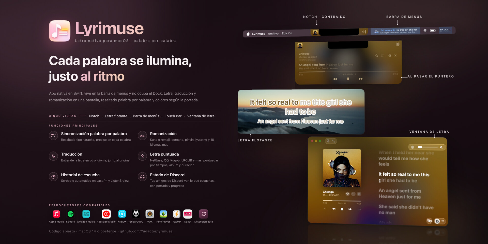

<div align="center">


# Lyrimuse

**La letra en el escritorio, reinventada para Mac.**

**Language / 语言 / 語言 / 言語 / 언어 / Idioma / Langue / Sprache / Lingua:** [English](README.md) | [简体中文](README.zh-CN.md) | [繁體中文](README.zh-Hant.md) | [日本語](README.ja.md) | [한국어](README.ko.md) | **Español** | [Français](README.fr.md) | [Deutsch](README.de.md) | [Italiano](README.it.md) | [Português (Brasil)](README.pt-BR.md) | [Tiếng Việt](README.vi.md)


[](https://github.com/Yudaotor/lyrimuse/releases/latest)
[](https://github.com/Yudaotor/lyrimuse/commits/dev)
[](LICENSE)
[](https://github.com/sponsors/Yudaotor)
[](https://discord.gg/N7gVy66Gp3)
[](https://t.me/lyrimuse)
[](https://qm.qq.com/q/Nb4TlwfnQy)

</div>

https://github.com/user-attachments/assets/88b951ee-4ecf-4985-b1cb-eee6afdd5510

Lyrimuse es una app de código abierto que muestra la letra de las canciones en el escritorio de macOS. Vive en la barra de menús y resalta la letra palabra por palabra mientras suena la canción: flotando siempre por encima de tus ventanas, en la barra de menús, en una cápsula al estilo Dynamic Island bajo el notch, en la Touch Bar o en una ventana de letra completa. Funciona con catorce reproductores, entre ellos Apple Music, Spotify, Amazon Music y Kaset, la app de YouTube Music, además de reproductores web en tu navegador, y elige la mejor coincidencia entre quince fuentes de letras, con traducción y romanización cuando las quieras. También mantiene un perfil de escucha de Last.fm y hace scrobble de lo que escuchas.

**¿Vienes de LyricsX?** No ha tenido ninguna versión nueva desde abril de 2022. Lyrimuse cubre lo que hacía, sigue recibiendo actualizaciones y añade compatibilidad con reproductores chinos, KKBOX, Amazon Music, Kaset, reAMP, VOX, Pine Player, foobar2000 y reproductores web. Para más detalles, consulta la [comparación con LyricsX y Lyric Fever](docs/lyrics-apps-comparison.md), con los datos verificados.

**Instálalo** con Homebrew, en Apple Silicon o Intel. Además, se encarga por ti del aviso de Gatekeeper del primer inicio. ¿Prefieres descargarlo tú mismo? Descarga la [última versión](https://github.com/Yudaotor/lyrimuse/releases/latest) y consulta [Cómo empezar](#cómo-empezar).

```bash
brew tap yudaotor/lyrimuse
brew trust --cask yudaotor/lyrimuse/lyrimuse   # one-time: Homebrew asks you to trust non-official taps
brew install --cask lyrimuse
```


<p align="center"><sub>Cuatro formas de mostrar la letra: la ventana de letra, la cápsula al estilo Dynamic Island, la letra flotante con resaltado palabra por palabra y la barra de menús</sub></p>


<p align="center"><sub>El gestor de letras, la búsqueda manual con una puntuación en cada resultado y el panel que explica por qué una canción tiene la letra que tiene</sub></p>


<p align="center"><sub>Tus cifras y rankings de Last.fm, el resumen que ves cuando no suena nada y un mapa de calor de tu año al estilo de GitHub</sub></p>


<p align="center"><sub>Cada página de ajustes tiene vista previa en directo, puedes elegir más de un reproductor (también reproductores web) y el menú desplegable de la barra de menús tiene el resto</sub></p>

## Funciones

> Dónde está cada función en Ajustes y si está activada o desactivada tras instalar: consulta la **[lista de funciones](docs/feature-list.es.md)**.

### Letra palabra por palabra sincronizada y encontrada automáticamente
- **Resaltado palabra por palabra** que sigue el ritmo de la canción mientras suena.
- **Quince fuentes de letras, en las que busca por ti**: NetEase Cloud Music, QQ Music, Kugou, Kuwo, Migu, Musixmatch, LRCLIB, LyricFind (a través de YouTube Music), Deezer, AMLL (una base de datos de letras palabra por palabra revisadas a mano), Soda Music (con su propia sincronización palabra por palabra), VIBE y Genie (ambas fuertes en canciones coreanas), PetitLyrics (fuerte en canciones japonesas) y las letras de Apple Music si conectas tu cuenta en Ajustes. Las letras de Apple Music requieren suscripción, y muchas de sus canciones tienen sincronización por palabra. Nunca tienes que buscar tú.
- **Traducción y romanización** bajo la letra original. Si la fuente tiene una traducción de la comunidad, recibes esa. Si no, activa «Traducción de respaldo del sistema» en Ajustes (está desactivada por defecto) y tu Mac traduce la letra con el framework Translation de Apple, así que nunca sale de tu equipo; cuando eso no es posible, entra un traductor online. Hay 17 idiomas de destino. La romanización se decide línea a línea: una canción china con una línea en japonés recibe la lectura solo en esa línea, no pinyin en todo lo demás. Las canciones en cantonés reciben Jyutping que entiende palabras completas. Para el japonés puedes elegir furigana: hiragana solo sobre los kanji, útil si aprendes japonés con canciones. Otros dieciocho idiomas, entre ellos ruso, tailandés, griego e hindi, también reciben lectura, según la romanización oficial de cada idioma o una norma ISO.
- **Dúos separados por cantante.** Cuando la fuente (o una entrada de AMLL) indica quién canta cada línea, cada parte se muestra por separado en lugar de juntar dos voces en un solo bloque.
- **Los detalles de Apple Music en la ventana de letra**: los coros en su propia línea bajo la principal, las líneas de dúo que se solapan iluminadas a la vez hasta que terminan ambas, y las palabras inglesas largas y sostenidas que crecen y brillan como en Apple Music.
- **Chino simplificado o tradicional** para la letra, independiente del idioma de la propia app.
- **Gestor de letras**, para cuando quieras poner orden. Explora, edita, elimina o vuelve a buscar la letra de cualquier canción, elimina muchas a la vez y limpia las entradas vacías que dejan los anuncios y los pódcasts. Si la sincronización de una canción no cuadra, desplaza solo esa canción. Un botón vuelve a intentarlo con todas las canciones que aún no tienen letra, y un reescaneo completo vuelve a elegir la letra de toda tu biblioteca con las reglas de coincidencia actuales. Lo que hayas corregido a mano no se toca. También puedes importar archivos .lrc o una carpeta entera, incluso de canciones que aún no has escuchado, o dejar que vigile una carpeta.
- **Una canción, una letra.** La misma canción reproducida en distintos reproductores o de distintas ediciones se reconoce como una sola: sus entradas comparten la letra y tus ediciones a mano, y sus reproducciones se suman. «Entradas de esta canción», en el gestor de letras, las compara línea a línea y separa la que se asignó por error.
- **Corrige la letra desde la ventana de letra.** Busca otras letras, vuelve a buscar la coincidencia de la canción o edítala en tu propio editor de texto. Al editar una letra palabra por palabra solo cambian las palabras, así que cada palabra conserva su sincronización.
- **Funciona sin conexión** con cualquier canción cuya letra ya esté en caché.

### Perfil de escucha de Last.fm y scrobble
- **Un perfil de escucha completo.** Conecta Last.fm con un clic desde la sección «Plataformas vinculadas» (sin copiar ni pegar ningún token) y tendrás los totales de hoy, de los últimos 7 días y de siempre, un indicador en directo de «Haciendo scrobble» y tus reproducciones recientes con portada, cada una con un corazón para marcarla como «Me encanta» en Last.fm (o quitarlo). Por defecto, cada reproducción se envía como la canción que le corresponde en el catálogo de Last.fm, de modo que los créditos de dúo, las grafías en chino simplificado o tradicional y coletillas como « - Single» o «(Remastered)» acaban en la página real de la canción; cambia a «Sin procesar» en Ajustes para enviar exactamente lo que informó el reproductor. ListenBrainz siempre recibe las etiquetas originales ([cómo funciona el scrobble](docs/scrobbling.es.md)).
- **Artistas, álbumes y canciones más escuchados** de los últimos 7 días, 30 días, del año o de siempre, cada uno con cuánto ha subido o bajado respecto al periodo anterior. Haz clic en un artista para ver las canciones suyas que más escuchas.
- **Huella**, una pestaña propia. Empieza con tus totales acumulados: cuántos días han pasado desde tu primer scrobble, en cuántos hubo reproducciones y la media diaria, tu mejor día, tu racha actual y la más larga, lo que llevas de año frente al mismo tramo de un año anterior y cuánto te falta para el siguiente hito redondo. Debajo vienen un mapa de calor del año al estilo de GitHub (haz clic en un día para ver qué escuchaste más), cuándo escuchas por hora y día de la semana, de dónde son tus artistas favoritos y «Un día como hoy», con lo que escuchaste en esta fecha en años anteriores.
- **Cada reproducción se guarda primero en tu Mac**, incluso antes de conectar Last.fm. Conéctalo más tarde y envía con un clic las de más o menos las dos últimas semanas (Last.fm no acepta reproducciones más antiguas).
- **Tú decides cuándo cuenta una reproducción**: al 50 %, como hace Last.fm por defecto, al 75 % o al 90 %, o solo cuando la canción termina de verdad. ListenBrainz no se ve afectado. También puedes dejar un reproductor totalmente fuera de Last.fm, para que sus reproducciones nunca aparezcan en tu historial.
- **El mismo historial aparece en la ventana de letra** cuando no suena nada, así que ves un resumen en lugar de una pantalla vacía (más sobre eso abajo).

### Letra flotante, letra en la barra de menús, Dynamic Island, Touch Bar o una ventana de letra completa
- **Usa varios reproductores o deja que elija.** Apple Music, Spotify y Kaset se leen con acceso de automatización. QQ Music, NetEase Cloud Music, Kugou Music, Soda Music, KKBOX, Amazon Music y LX Music se leen a través de MediaRemote de macOS y no necesitan ningún permiso. Activa la combinación que quieras en Ajustes, o déjalo en detección automática y seguirá lo que macOS muestre como «En reproducción».
- **La radio de Apple Music también funciona.** La letra sigue cada canción de una emisora. Mientras habla el locutor, ves el nombre y el logotipo de la emisora, no la canción anterior. La radio tiene su propio desfase de sincronización, así que puedes ajustar una emisora una vez y olvidarte.
- **Y los reproductores de tu navegador.** Vincula tu navegador una vez y YouTube Music o Spotify Web funcionan como cualquier otro reproductor, con la letra sincronizada con la propia barra de progreso de la página. Una prueba de un clic te dice de antemano si el navegador se puede controlar. Durante un anuncio, la cápsula se vuelve negra y muestra cuánto falta y qué anuncio es de cuántos. Los anuncios de YouTube Music tienen un botón para saltarlos, o pueden saltarse automáticamente.
- **Elige cómo quieres verla**, en cualquier combinación o en ninguna:
  - una letra flotante en el escritorio que puedes arrastrar a cualquier sitio, o fijar arriba en el centro o justo encima del Dock;
  - una cápsula al estilo Dynamic Island en la parte superior de la pantalla, que puede mostrar la portada del álbum y difuminarla detrás de la cápsula, atenuar la fila de la letra para que los clics pasen a través y mostrarse en la pantalla bloqueada si lo activas;
  - la Touch Bar de un MacBook Pro que la tenga, con la línea desplazándose a medida que se canta, y además la portada del álbum y los controles de reproducción si los quieres;
  - una ventana de letra redimensionable inspirada en la página de letras de Apple Music, con dos columnas, una portada difuminada de fondo, toda la canción desplazándose hasta la línea actual, la portada animada cuando Apple Music tiene una para el disco, y el vídeo en bucle de Spotify Canvas de la canción como fondo cuando lo tiene. Las palabras se rellenan a medida que se cantan, con el grosor, el color de lo cantado y la alineación que elijas, y el «Resaltado HDR» puede iluminar la parte cantada por encima del blanco en una pantalla HDR.
- **Letra en la barra de menús (modo texto).** La línea actual aparece directamente en la barra de menús. Las líneas largas se desplazan en lugar de cortarse a la mitad (puedes volver a cortarlas). Una segunda fila puede mostrar la línea siguiente, la traducción o la romanización, y la cápsula puede hacer lo mismo.
- **Arrastra la barra de progreso para saltar** a otro punto, en la ventana de letra y en la cápsula.
- **Aleatorio, repetir, «Favorito» y volumen** directamente en la ventana de letra, siempre que el reproductor lo permita: Apple Music, Spotify, Kaset, QQ Music, Amazon Music y YouTube Music en el navegador admiten algunos o todos, y NetEase Cloud Music, Kugou Music, Soda Music y LX Music tienen «Favorito». «Favorito» también está en la cápsula expandida y puede tener un atajo.
- **Abre la canción donde está**, desde el menú «⋯» o el panel de información. Apple Music la abre en la app, Spotify salta a la canción que está sonando y KKBOX abre la canción, el álbum o el artista en su propia app. QQ Music, Soda Music, Spotify, Amazon Music y YouTube Music (cuando lo escuchas en Kaset) abren la página web de la canción, el álbum o el artista, y NetEase Cloud Music abre la página de la canción. Lyrimuse encontró el enlace al buscar la letra o lo leyó de los propios datos del reproductor en tu Mac, así que no hay nada que buscar.
- **Cuando no suena nada**, la ventana de letra muestra los totales de hoy y de esta semana, una tarjeta de «Un día como hoy» y tus reproducciones recientes con portada, cada una con un enlace a la página de su álbum o artista en Apple Music.
- **Una ventana de letra mini**: una tarjeta pequeña que muestra una línea, dos líneas o toda la letra desplazándose, con su propio fondo, color de texto, fuente, grosor y color de lo cantado; el karaoke palabra por palabra se puede desactivar solo para ella.
- **Letra web en tu teléfono, tableta o directo.** Abre la ventana de letra en un navegador de otro dispositivo y úsala como segunda pantalla, con controles de reproducción y toque para saltar si lo permites. «Salida a OBS» pone la letra flotante en tu directo como fuente de navegador transparente. Ambas se quedan en este Mac hasta que permitas el acceso desde la red local, y los demás dispositivos se conectan escaneando un código QR.
- **Notas de la canción, notas del álbum y biografías de artistas.** Haz clic en el título, el artista o el nombre del álbum en la ventana de letra o en la cápsula expandida para leer sobre ellos. Las notas del álbum y las biografías de artistas vienen de Apple Music o, cuando no tiene nada, de Soda Music (canciones reproducidas en Soda Music, solo con la interfaz en chino), Kugou Music (canciones reproducidas en Kugou Music, solo con la interfaz en chino), NetEase Cloud Music (solo con la interfaz en chino), los artículos de Wikipedia que muestra YouTube Music (en el idioma de la interfaz) o Last.fm; las notas de la canción vienen de QQ Music (solo con la interfaz en chino) o de Last.fm.
- **Dale el aspecto que te guste**: la fuente (la del sistema o tus propios archivos .ttf / .otf), el tamaño, los colores de texto, fondo y sombra, temas guardados o un color tomado de la portada del álbum actual, y el ancho de la letra flotante, además de un arcoíris que fluye por la letra.
- **Oculta en capturas, grabaciones y pantallas compartidas.** Tú la sigues viendo. Nadie más.
- **Se oculta cuando pausas**, para no quedarse en el escritorio sin hacer nada. También puede apartarse en los instrumentales, las canciones sin letra y las apps a pantalla completa, y la letra flotante puede seguirte a la pantalla de la ventana que estés usando.

### Detalles del día a día
- **Inglés, chino simplificado, chino tradicional, japonés, coreano, español, francés, alemán, italiano, portugués de Brasil y vietnamita**, y el cambio se aplica al instante, sin reiniciar. ¿Has visto una traducción torpe? Los pull requests son bienvenidos; cada idioma tiene una guía de estilo en `lyrimuse/Localization/`.
- **Liquid Glass en macOS 26.** Ajustes, el panel de la barra de menús, la ventana de letra, el gestor de letras y el asistente de configuración usan este diseño, y la mayoría pueden quedarse en modo claro u oscuro en lugar de seguir al sistema.
- **Atajos de teclado** para cada acción, desde ocultar toda la letra hasta marcar la canción como favorita. No viene ninguno configurado, así que tú eliges las teclas. Cada acción tiene además un enlace `lyrimuse://` que puedes llamar desde Atajos, Raycast o Alfred, y desde Atajos un enlace puede devolver la canción que está sonando ([URL Scheme](docs/url-scheme.es.md)).
- **Búsqueda en Ajustes.** Escribe en la barra lateral y se desplaza hasta la fila que coincide y la resalta, abriendo un grupo plegado si hace falta.
- **Se actualiza solo.** Busca actualizaciones por su cuenta o cuando se lo pides desde la barra de menús. Las actualizaciones se instalan desde la página «Actualización de software» de Ajustes, con las notas de la versión y el progreso ahí mismo, y puedes apuntarte a las versiones beta.
- **Se abre junto con tus reproductores**, por reproductor y en cualquier sentido: ábrelos cuando se abra Lyrimuse, abre Lyrimuse cuando se abran ellos y, si quieres, cierra Lyrimuse cuando se hayan cerrado todos los reproductores que sigue.
- **«Inicio silencioso»**, si prefieres que arranque sin ninguna ventana, solo con el icono de la barra de menús.
- **¿Te cambias de Mac?** Exporta toda tu configuración e impórtala allí. Si algo va mal, también puedes exportar un diagnóstico con un clic.

### Extras opcionales

<details>
<summary>ListenBrainz, estado en Discord, una página «en reproducción» para compartir y resúmenes diarios, semanales, mensuales y anuales</summary>

Todo esto está desactivado hasta que lo actives en Ajustes:

- **Haz scrobble también en [ListenBrainz](https://listenbrainz.org).** Cada reproducción va a los dos servicios a partir de la misma lectura de tu reproductor, así que los dos historiales coinciden. Las reproducciones de tu iPhone (registradas a través de Last.fm) también se copian a ListenBrainz, de modo que acabas con un solo historial para ambos dispositivos en lugar de dos.
- **Una página pública «en reproducción» que puedes compartir**: reproducción en directo, historial, libro de visitas, reacciones, contador de visitas, un ranking de los 10 artistas más escuchados, un aspecto de disco de vinilo, temas claro y oscuro, y vistas previas de enlace correctas en las apps de chat. La **[guía de funciones web](https://github.com/Yudaotor/nowplaying-workers#readme)** la explica con capturas.
- **Resúmenes de escucha diarios, semanales, mensuales y anuales**, enviados a tantos canales como quieras: Bark, ntfy, ServerChan, Feishu, DingTalk, WeCom, Telegram, Discord, Slack o un webhook genérico. Cada canal puede enviar una prueba, y un historial de envíos muestra lo que ha llegado.
- **Muestra en Discord lo que estás escuchando.** Tu perfil y tu lista de amigos muestran el reproductor que usas, la canción, el artista, la portada del álbum y una barra de progreso, y el título de la canción y el artista enlazan a sus páginas en la web de ese reproductor. La línea del álbum puede mostrar la línea que se está cantando, y puedes añadir hasta dos botones. Una pequeña insignia de Lyrimuse o del reproductor va en la esquina de la portada (o ninguna), y una canción en pausa puede seguir visible con un icono de pausa. Tú eliges qué reproductores cuentan, puedes mostrar solo el reproductor sin decir la canción y puedes ocultarlo durante un rato.

ListenBrainz y «Push web» están en **Laboratorio**, en la barra lateral de Ajustes; «Avisos push» está con las demás secciones, y Discord tiene su propia entrada cerca de arriba. Cada tarjeta trae sus propios pasos de configuración: dónde conseguir una clave de API o un token, cómo conectar una cuenta, cómo obtener la URL del webhook de tu servicio de avisos. La página web es la única con una guía aparte, y no la necesitas entera. Con solo ListenBrainz configurado, la página ya muestra la reproducción en directo y el historial, sin necesidad de un Cloudflare Worker. Despliega uno si también quieres el libro de visitas, las reacciones, el contador de visitas, el ranking de los 10 más escuchados y actualizaciones más rápidas; la guía lo explica.

</details>

## Cómo empezar

Las versiones se firman con el certificado propio del proyecto, no con un Apple Developer ID, así que ninguna de las opciones de abajo requiere una cuenta de Apple Developer. La contrapartida es que la primera vez que abres la app, Gatekeeper dice que es «de un desarrollador no identificado». Homebrew (opción A) lo resuelve por ti. Con las demás opciones es lo esperado, no un error, y la opción B explica cómo saltarlo una sola vez.
### Opción 0: Deja la instalación en manos de una IA

¿Usas un agente de IA que puede usar el Terminal de tu Mac (Claude Code, Codex CLI, Gemini CLI…)? Pega en él el bloque de abajo tal cual y hará por ti todo lo de las opciones A/B. Las instrucciones solo le permiten instalar esta app. No usará `sudo` ni tocará los ajustes de seguridad de todo el sistema:

```text
Please install Lyrimuse — an open-source macOS menu-bar lyrics app
(https://github.com/Yudaotor/lyrimuse) — on this Mac, following these rules exactly:

1. Preferred path (if `brew` exists):
     brew tap yudaotor/lyrimuse
     brew trust --cask yudaotor/lyrimuse/lyrimuse
     brew install --cask lyrimuse
   If this Homebrew doesn't know the `trust` subcommand, skip that line — older
   versions don't need it.
2. If Homebrew is not installed, do NOT install Homebrew. Instead: check the CPU
   with `uname -m`, download the latest release asset from
   https://github.com/Yudaotor/lyrimuse/releases — `Lyrimuse-v<version>-macos.zip`
   for arm64, `Lyrimuse-v<version>-macos-intel.zip` for x86_64 — verify it against
   its `.sha256` file (`shasum -c`), unzip, move `Lyrimuse.app` into
   /Applications, then clear the Gatekeeper quarantine flag on that one app only:
     xattr -dr com.apple.quarantine /Applications/Lyrimuse.app
3. Safety rails: no `sudo` anywhere (nothing here needs it); never run
   `spctl --master-disable` or otherwise weaken Gatekeeper system-wide; never
   remove the quarantine flag from anything except /Applications/Lyrimuse.app.
4. Do not build from source unless I explicitly ask.
5. Launch it (`open -a Lyrimuse`) and verify it is running (`pgrep -x Lyrimuse`
   prints a PID).
6. A first-run wizard will appear — that part is mine to click through. Tell me
   it will ask me to pick a music player, to grant Automation access to
   Music.app and/or Spotify (only if I pick them), and to enable the background
   lyrics engine — then hand control back to me.
Finally, report what you did and anything that failed.
```

### Opción A: Instalar con Homebrew (recomendado)

```bash
brew tap yudaotor/lyrimuse
brew trust --cask yudaotor/lyrimuse/lyrimuse   # one-time: Homebrew asks you to trust non-official taps
brew install --cask lyrimuse
```

Esto elimina automáticamente la cuarentena de Gatekeeper durante la instalación, así que no hay ningún paso posterior. Abre Lyrimuse desde `/Applications` (o con Spotlight) en cuanto termine `brew install`. `brew upgrade --cask lyrimuse` instala las nuevas versiones de la misma forma.

### Opción B: Descargar manualmente una versión compilada

1. Descárgala de la [página de versiones](https://github.com/Yudaotor/lyrimuse/releases). **Comprueba primero qué Mac tienes** ( → Acerca de este Mac → «Chip»: `Apple M…` es Apple Silicon, `Intel Core…` es Intel):

   | Tu Mac | Descarga |
   | --- | --- |
   | Apple Silicon (M1 y posteriores) | `Lyrimuse-*-macos.dmg` o `.zip` |
   | Intel | `Lyrimuse-*-macos-intel.dmg` o `.zip` |

   Con el dmg, haz doble clic para montarlo y arrastra `Lyrimuse.app` al acceso directo `Applications` que hay al lado; con el zip, descomprímelo y arrastra `Lyrimuse.app` a `/Applications`. Los dos formatos instalan exactamente la misma app, y el zip trae un `.sha256` si quieres verificar la descarga (`shasum -c Lyrimuse-*.zip.sha256` desde la misma carpeta).

   La única diferencia entre las dos descargas es la arquitectura: la que no lleva sufijo es solo para Apple Silicon, mientras que `-intel` incluye código para Intel y para Apple Silicon. `-intel` funciona en Apple Silicon, pero no hay motivo para usarla ahí: ocupa el doble, y macOS 27 y posteriores avisarán de que la app «necesita actualizarse» porque contiene código para Intel (Apple retirará Rosetta en macOS 28; a la app no le pasa nada).

   **Las dos arquitecturas reciben actualizaciones automáticas desde la app.** El feed tiene dos entradas para la misma versión, una por arquitectura: a Apple Silicon se le sirve la compilación sin sufijo, a Intel la `-intel`, y Sparkle elige la de cada equipo por su cuenta. (Hasta la v1.4.0 solo se servía la de Apple Silicon; los usuarios de Intel tenían que volver aquí a mano).
2. En el primer inicio, macOS se negará a abrirla con «No se puede abrir Lyrimuse porque Apple no puede comprobar si contiene software malicioso» o «es de un desarrollador no identificado». Resuélvelo una vez con la opción con la que te sientas más cómodo:

   - **Terminal (recomendado, siempre funciona):**
     ```bash
     xattr -dr com.apple.quarantine /Applications/Lyrimuse.app
     ```
     Después abre la app con normalidad. Solo tienes que hacerlo una vez por descarga.
   - **Clic derecho → Abrir:** En el Finder, haz clic derecho (o Control + clic) en `Lyrimuse.app` y elige **Abrir**; después confirma de nuevo con **Abrir** en el cuadro de diálogo. No funciona en todas las versiones de macOS para todos los tipos de aviso, así que si el aviso sigue, usa el comando del Terminal de arriba.
   - **Ajustes del Sistema → Privacidad y seguridad:** Intenta abrir la app una vez (se bloqueará), abre **Ajustes del Sistema → Privacidad y seguridad**, desplázate hasta abajo y haz clic en **Abrir igualmente** junto al aviso de Lyrimuse. Confirma una vez más si te lo pide.

   Haz esto solo con una compilación de la que te fíes de verdad: la de la página de versiones de este repositorio o una que hayas compilado tú.

### Opción C: Compilar desde el código fuente

**Requisitos previos, una sola vez** (sáltate lo que ya tengas):

```bash
xcode-select --install   # Xcode Command Line Tools, for Swift — skip if `swift --version` already works
brew install go          # any Go ≥ 1.21 — build.sh switches to 1.24.4 automatically via GOTOOLCHAIN
```

Después, `build.sh` compila de una vez la app y su motor de letras (el proceso en segundo plano llamado `lyrimuse-engine`):

```bash
git clone https://github.com/Yudaotor/lyrimuse.git
cd lyrimuse/lyrimuse
./build.sh              # this machine's architecture
./build.sh --universal  # arm64 + x86_64 (the compatibility build shipped for Intel)
```

Al terminar, `build.sh` lista las arquitecturas de cada binario del paquete y señala todo lo que no coincida con el objetivo, tanto si falta una parte como si sobra alguna. No montes a mano los archivos de una versión: `./package.sh` compila cada arquitectura una vez y genera un zip, un sha256 y un dmg para cada una, y se niega a empaquetar si las arquitecturas no son las correctas.

La compatibilidad con QQ Music / NetEase Cloud Music / Kugou Music / Soda Music / KKBOX / Amazon Music / LX Music / Spotify / Kaset / detección automática necesita además [ungive/media-control](https://github.com/ungive/media-control). `build.sh` lo instala automáticamente con Homebrew si falta, así que tampoco es un paso que tengas que hacer tú.

### Después de cualquier opción

Abre Lyrimuse desde `/Applications`. El asistente del primer inicio te guía para elegir un reproductor (Apple Music, QQ Music, NetEase Cloud Music, Kugou Music, Soda Music, KKBOX, Amazon Music, Spotify, Kaset, reAMP, VOX, Pine Player, foobar2000, LX Music o detección automática), conceder acceso de automatización si elegiste Apple Music, Spotify, Kaset o VOX (los demás no necesitan permisos para leer la información básica de la canción) y activar su motor de letras (para que la letra y la portada se sigan obteniendo aunque la ventana esté cerrada). Completa el asistente y la letra aparecerá enseguida (consulta [lyrimuse/README.md](lyrimuse/README.md) para más opciones de compilación).

Eso es todo lo que necesitas para la letra. Los extras opcionales se pueden configurar más adelante desde Ajustes, cuando los quieras.

## Preguntas frecuentes

### ¿Cómo tengo en el escritorio de mi Mac la letra flotante de Apple Music, siempre encima?
Activa la letra flotante en el escritorio en Ajustes. Se queda por encima de todas las ventanas, en todos los espacios. Arrástrala donde quieras o fíjala arriba en el centro o justo encima del Dock. Si la letra tiene sincronización por palabra, cada palabra se rellena a medida que se canta. Puedes ocultarla en capturas, grabaciones y pantallas compartidas, y hacer que desaparezca mientras la música está en pausa. Funciona igual con QQ Music, NetEase Cloud Music, Kugou Music, Soda Music, KKBOX, Amazon Music, LX Music, Spotify, Kaset y los reproductores web.

### ¿Puedo mostrar la letra de Spotify en la barra de menús del Mac?
Sí. Activa el modo texto de la barra de menús y la línea actual aparecerá en ella, con Spotify o con cualquier otro reproductor compatible. Las líneas largas se desplazan en lugar de cortarse, y una segunda fila puede mostrar la línea siguiente, la traducción o la romanización. No hace falta conectar una cuenta de Spotify. Lyrimuse pide una vez acceso de automatización a Spotify, lo que le da la posición exacta de reproducción y hace que funcionen los botones de reproducción. Si dices que no, la letra se sigue mostrando, pero la sincronización viene de MediaRemote de macOS y puede desviarse alrededor de un segundo.

### ¿Muestra letra palabra por palabra con QQ Music, NetEase Cloud Music, Kugou o Soda Music?
Sí, siempre que la letra tenga sincronización por palabra. NetEase Cloud Music, QQ Music, Kugou, Soda Music, Musixmatch, AMLL y Apple Music la tienen a menudo, y esas líneas se rellenan palabra por palabra. La letra que solo tiene sincronización por línea ilumina la línea entera de una vez. Además, el reproductor no limita de dónde viene la letra: una canción que suena en Soda Music puede acabar con la letra palabra por palabra de QQ Music si es la que mejor puntúa.

### ¿Necesito una cuenta de Apple Developer para instalarla?
No. Las versiones se firman con el certificado propio del proyecto en lugar de con un Apple Developer ID, así que no la necesitas tú ni la necesita el proyecto. Por eso también hay un paso de Gatekeeper que se hace una sola vez, descrito arriba en Cómo empezar.

### ¿Está Lyrimuse en la Mac App Store?
No. Instálala con Homebrew (opción A, arriba) o descárgala de la [página de versiones](https://github.com/Yudaotor/lyrimuse/releases) (opción B). En ambos casos, a partir de ahí las actualizaciones llegan desde la app.

### ¿Lyrimuse es gratis?
Sí. Es de código abierto con licencia GPL-3.0. No hay versión de pago, ni compras dentro de la app, ni ninguna cuenta que crear. Last.fm y los demás servicios son opcionales. Si te resulta útil y quieres apoyarla, puedes [patrocinarla en GitHub](https://github.com/sponsors/Yudaotor) o [invitar a un café al autor](https://yudaotor.github.io/donate/) con Alipay o WeChat Pay.

### ¿Puedo controlar QQ Music, NetEase Cloud Music o Soda Music cuando otra app tiene el control multimedia del sistema?
Sí. Cuando algo como un vídeo del navegador ocupa «En reproducción» de macOS, las teclas multimedia del sistema van a él; entonces Lyrimuse pulsa reproducir/pausa, anterior y siguiente en la propia barra de menús de QQ Music o NetEase Cloud Music, o en la barra de reproducción de Soda Music, y deja el reproductor en segundo plano. Esto necesita acceso de accesibilidad (Ajustes → Reproductor); sin él, esos botones abren esa página. En este estado no se puede saltar a otro punto de la canción. En macOS 27 el permiso está en **Ajustes del Sistema → Privacidad y seguridad → Control del dispositivo y acceso a datos**; las versiones anteriores lo llaman **Accesibilidad**.

### ¿Funciona con Spotify, QQ Music o NetEase Cloud Music, o solo con Apple Music?
Con todos ellos, además de Kugou Music, Soda Music, KKBOX, Amazon Music, Kaset (una app de YouTube Music), reAMP (un reproductor al estilo de Winamp), VOX (un reproductor local sin pérdida y de alta resolución), Pine Player (un reproductor local gratuito que reproduce casi cualquier formato), foobar2000 (el clásico reproductor local, adaptado desde Windows) y LX Music, de código abierto: catorce reproductores en total. O deja que detecte automáticamente lo que macOS muestre como «En reproducción». Apple Music, Spotify, Kaset y VOX piden acceso de automatización (Spotify, Kaset y VOX lo usan para la sincronización exacta y los botones de reproducción). Los otros diez no necesitan permisos para leer la información básica de la canción a través de MediaRemote de macOS; los botones de aleatorio, repetir y «me gusta» de QQ Music, NetEase Cloud Music, Kugou Music, Soda Music y Amazon Music, y el aleatorio, la repetición y el volumen de reAMP y foobar2000, necesitan acceso de accesibilidad; Pine Player lo usa para leer su barra de progreso, ya que solo informa de la posición al segundo. Con KKBOX, Amazon Music o LX Music, también se tiene en cuenta la letra que esa app ya guardó para la canción, y nunca se contacta con ninguno de ellos.

### ¿Puedo mostrar la letra de KKBOX o Amazon Music en mi Mac?
Sí. Los dos se leen a través de MediaRemote de macOS, así que no hay nada que conceder, y su letra se muestra en la letra flotante, la barra de menús, la cápsula y la ventana de letra como la de cualquier otro reproductor. Si KKBOX o Amazon Music ya guardaron la letra de la canción, también se tiene en cuenta y recibe un peso extra. Lyrimuse nunca inicia sesión en ninguno de los dos servicios ni les envía nada. Las demás fuentes se siguen consultando, así que si una de ellas tiene algo mejor, como sincronización palabra por palabra, gana esa.


### ¿Funciona con LX Music (洛雪音乐)?
Sí. LX Music se lee a través de MediaRemote de macOS, así que no hay nada que conceder. Cuando reproduces una canción en LX Music, la letra que guardó para ella (palabra por palabra cuando la plataforma la tiene) también se tiene en cuenta y recibe un peso extra, y las siguientes canciones de la lista que estás escuchando tienen su letra preparada de antemano. Lyrimuse solo lee los datos de LX Music en tu Mac y nunca le envía nada.

### ¿Funciona con una app de escritorio de YouTube Music?
Sí, con [Kaset](https://github.com/sozercan/kaset), una app nativa y de código abierto de YouTube Music para Mac. Kaset se lee con acceso de automatización, lo que da una sincronización exacta y botones de reproducción que funcionan, y la propia letra de YouTube Music está entre las candidatas. YouTube Music en el navegador también funciona, consulta más abajo.

### ¿Qué aspecto tiene la letra en el escritorio?
Como un karaoke en tu escritorio. La línea actual flota sobre tus ventanas, cada palabra se rellena a medida que se canta cuando la letra tiene sincronización por palabra, y la traducción o la romanización pueden ir al lado. Puedes cambiar la fuente, el tamaño, los colores de texto, fondo y sombra, y el ancho, y hacer que el color del texto siga a la portada del álbum. La misma letra también puede ir en la barra de menús, en una cápsula al estilo Dynamic Island bajo el notch o en una ventana de letra completa al estilo Apple Music, en cualquier combinación.

### ¿Funciona la cápsula Dynamic Island en un Mac sin notch?
Sí. En una pantalla sin notch, como un MacBook más antiguo o una pantalla externa, la cápsula se coloca arriba en el centro, con la misma altura que la barra de menús. En Ajustes eliges en qué pantalla va.

### ¿Funciona la letra sin conexión a internet?
Sí, con cualquier canción para la que ya haya encontrado letra, porque se guarda en caché en tu Mac. La primera búsqueda de una canción necesita conexión, y la traducción online también.

### ¿Sale alguno de mis datos de mi Mac?
Para encontrar la letra, tiene que preguntar a las fuentes de letras por la canción que está sonando: NetEase, QQ, Kugou, Kuwo, Migu, Musixmatch, LRCLIB, LyricFind, Deezer, AMLL, Soda Music, VIBE, Genie, PetitLyrics y Apple Music si la conectaste. Las portadas vienen de la iTunes Search API. Por defecto, la traducción se hace en tu Mac, y el texto de la letra solo va a un traductor online (la traducción web de Google y, después, MyMemory) como alternativa. Tu historial de escucha, las letras en caché y los ajustes se quedan en archivos en tu Mac, salvo que conectes Last.fm, ListenBrainz o el relé web opcional. Los datos de uso anónimos (versiones, funciones activadas, resúmenes de fallos; nunca títulos de canciones ni cuentas) se envían una vez al día por defecto, y puedes desactivarlos en Ajustes › Acerca de. La lista completa está más abajo, en [Licencia y derechos de autor](#licencia-y-derechos-de-autor).

### ¿Puedo tener la romanización del japonés o del coreano, o la traducción al chino de la letra?
Sí. La romanización se decide línea a línea, así que una canción que mezcla idiomas solo recibe lectura donde corresponde. El japonés puede mostrar romaji o furigana (hiragana sobre los kanji). La traducción viene de la traducción de la comunidad de la fuente de letras cuando la hay; si no, de la traducción automática en el propio equipo u online una vez que actives «Traducción de respaldo del sistema» (desactivada por defecto), a cualquiera de 17 idiomas.

### ¿Qué versiones de macOS admite?
macOS 14 Sonoma o posterior (Sequoia, Tahoe y siguientes), en Apple Silicon o Intel. Traducir en tu Mac requiere macOS 15 Sequoia o posterior; en macOS 14 solo están disponibles los traductores online.

### ¿Es compatible con Mac con Intel?
Sí, con una compilación universal aparte (consulta la opción B, arriba). Las actualizaciones automáticas también funcionan en Intel desde la v1.5.0, así que las nuevas versiones aparecen igual que en Apple Silicon.

### ¿Puede mostrar la letra de YouTube Music o Spotify cuando suenan en un navegador?
Sí. Vincula tu navegador una vez en Ajustes y YouTube Music o Spotify Web funcionan como cualquier otro reproductor. La letra sigue la propia barra de progreso de la página en lugar de hacer suposiciones, y una prueba de un clic te dice, antes de comprometerte, si tu navegador se puede controlar.

### ¿Puede hacer scrobble de Apple Music en Last.fm en un Mac?
Sí, esa es la otra mitad de la app. Conecta Last.fm con un clic desde Ajustes y cada reproducción de Apple Music (o de cualquier otro reproductor compatible) recibe su scrobble, con un estado de «en reproducción» en directo. Las reproducciones se guardan primero en tu Mac, así que las de antes de conectar no se pierden: una vez conectado, haz clic en «Enviar pendientes» para enviar las de más o menos las dos últimas semanas. Tú eliges cuándo cuenta una reproducción (50 %, 75 %, 90 % o la canción entera), puedes dejar fuera algunos reproductores y puedes enviar a ListenBrainz al mismo tiempo.

### ¿Cómo evita Lyrimuse elegir la letra equivocada?
No se queda sin más con la primera fuente que responde. Todos los resultados de todas las fuentes se puntúan de la misma forma: cuánto coinciden el título, el artista, el álbum y la duración, además de cosas como si tiene sincronización por palabra. Gana la puntuación más alta. Puedes ver esa decisión para cualquier canción, con la puntuación de cada candidata y el motivo por el que ganó la ganadora. Si más adelante aparece una coincidencia mejor, Lyrimuse puede cambiarse a ella por su cuenta, pero la letra que elegiste a mano queda bloqueada y nunca se sustituye. La búsqueda manual muestra las mismas puntuaciones y etiquetas, así que es fácil detectar una versión equivocada antes de elegirla.

### ¿Y si la letra está desincronizada o es incorrecta?
Si la sincronización no cuadra, desplázala para esa canción; el desfase se recuerda. Si es la letra equivocada o la versión equivocada, abre la búsqueda manual. Verás todos los resultados de todas las fuentes con su puntuación, y lo que elijas queda bloqueado, así que la búsqueda automática no lo cambiará. También puedes editar a mano la letra de cualquier canción en el gestor de letras.

### ¿Puedo guardar la letra como archivos .lrc?
Ya se guarda así. Cada canción con letra tiene un archivo `.lrc` con sincronización por línea, además de `.tr.lrc` para la traducción y `.roma.lrc` para la romanización cuando existen. La sincronización palabra por palabra se guarda aparte, en TTML por defecto. En Ajustes puedes cambiarla a `.yrc` (el formato YRC de NetEase), Enhanced LRC, QRC o KRC para que otros reproductores puedan leerla, y conservar más de uno. Los archivos están en `~/Library/Application Support/me.yudaotor.lyrimuse/lyrics/`, y puedes mover la carpeta en Ajustes.

### ¿Sigue manteniéndose LyricsX y en qué se diferencia Lyrimuse de LyricsX o de Lyric Fever?
La última versión de LyricsX fue la v1.6.3, en abril de 2022. Funciona en macOS 10.11 y posteriores, con Apple Music, Spotify y algunos reproductores más antiguos. Lyric Fever se centra en Spotify y Apple Music y necesita macOS 15. Lyrimuse necesita macOS 14 y añade QQ Music, NetEase Cloud Music, Kugou, Soda Music, KKBOX, Amazon Music, Kaset, reAMP, VOX, Pine Player, foobar2000 y LX Music, reproductores en tu navegador, pinyin / Jyutping cantonés / romanización del japonés y del coreano línea a línea, además de lecturas para otros dieciocho idiomas como el ruso y el tailandés, y scrobble en Last.fm / ListenBrainz con tus propias estadísticas de escucha. La tabla comparativa está en [la página de comparación](docs/lyrics-apps-comparison.md).
## Licencia y derechos de autor

- **Lyrimuse en sí es [GPL-3.0](LICENSE).** Los componentes de código abierto y los datos de diccionario incluidos en la app (media-control, Sparkle, KeyboardShortcuts y los diccionarios de OpenCC y rime-cantonese) conservan sus propias licencias; los textos completos están en [THIRD_PARTY_LICENSES](THIRD_PARTY_LICENSES), que también viene dentro de la app y se puede abrir desde **Ajustes → Acerca de → Licencias de terceros**.
- **Las letras, las portadas y los metadatos de las canciones pertenecen a sus respectivos titulares de derechos.** Lyrimuse solo los busca, los guarda en caché y los muestra: lo que devuelven las API públicas de letras se guarda en tu propio Mac (`~/Library/Application Support/me.yudaotor.lyrimuse/`) para que lo veas tú. No aloja, retransmite ni redistribuye letras ni portadas, y la caché se puede eliminar en cualquier momento desde el gestor de letras o borrando esa carpeta.
- **Lyrimuse es un proyecto independiente de código abierto.** No está afiliado a, respaldado por ni relacionado con Apple, Tencent (QQ Music), NetEase (NetEase Cloud Music), Kugou, Kuwo, Douyin (Soda Music), KKBOX, Amazon (Amazon Music), China Mobile (Migu Music), Spotify, Kaset, LX Music, Google (YouTube Music, Google Translate), Last.fm, ListenBrainz, MusicBrainz, Musixmatch, LRCLIB, LyricFind, Deezer, Naver (VIBE), KT (Genie), SyncPower (PetitLyrics), AMLL ni SponsorBlock. Sus nombres y marcas comerciales pertenecen a sus propietarios y aparecen aquí solo para indicar qué reproductores, fuentes de letras y servicios intervienen.
- **Esto es todo lo que sale de tu Mac.** La búsqueda de letras envía el artista, el título y el álbum de la canción (y la duración, a las fuentes que la aceptan) a las quince fuentes de letras de arriba; cuando ninguna coincide, el nombre del artista también se envía a MusicBrainz para buscar sus alias (la coincidencia «Inteligente» de Last.fm hace lo mismo con los artistas que aún no ha visto), y los rankings consultan allí a sus artistas por su ID de MusicBrainz para obtener el país o la región y los enlaces. Las portadas y la página en reposo envían artista + título a la iTunes Search API; con Kaset, la portada que informa se descarga del servidor de imágenes de YouTube Music (googleusercontent.com), y cada ID de vídeo nuevo que reproduce se envía una vez a YouTube Music para comprobar si es un episodio de pódcast (esos no se tratan como canciones). Con la Open API de LX Music activada, Lyrimuse solo se comunica con el puerto propio de LX Music en este Mac, y cuando el sistema no tiene portada para la canción, descarga una vez la que indica LX Music. Las notas del álbum y las biografías de artistas solicitan las páginas públicas de Apple Music del álbum y del artista por sus ID de Apple Music, sin ninguna cuenta de Apple de por medio; cuando la interfaz está en chino y Apple Music no tiene biografía del artista ni notas del álbum, se usa el ID de NetEase Cloud Music de la canción para buscar sus artistas acreditados y su álbum, y después se obtiene por su ID la presentación de ese artista o álbum en NetEase, de nuevo sin iniciar sesión. Con la interfaz en chino, las notas de la canción también solicitan a QQ Music los detalles de la canción por su ID de canción de QQ Music, igualmente sin iniciar sesión. Mientras suena QQ Music, esos mismos detalles se solicitan una vez por canción en cualquier idioma de la interfaz, para distinguir los audiolibros y otros programas hablados de las canciones (sus subtítulos se siguen mostrando, pero no se hace scrobble de ellos ni se muestran como canción). Cuando Apple Music no tiene portada animada para el álbum, su ID de álbum de QQ Music se envía a QQ Music para comprobar si hay una portada animada; si la hay, la dirección del vídeo se solicita por su ID de vídeo de QQ Music mientras la ventana de letra está abierta, y el vídeo se descarga del servidor de vídeo de QQ Music (tencentmusic.com), sin iniciar sesión. Si QQ Music tampoco tiene ninguna, el ID de NetEase Cloud Music de la canción se envía a NetEase para buscar una, con la identidad anónima de invitado que NetEase da a los visitantes sin cuenta; el vídeo viene del servidor de vídeo de NetEase (126.net). Mientras suena Kugou, el artista y el título van una vez a la búsqueda web de Kugou para encontrar la página web de la canción, sin iniciar sesión. El fondo de Spotify Canvas de la ventana de letra solo lee la caché que Spotify guarda en tu Mac y no pide nada a Spotify; un vídeo encontrado ahí se descarga una vez de la CDN de Spotify (canvaz.scdn.co), enviando solo la dirección del vídeo. Las notas del álbum y las biografías de artistas también pueden buscar el álbum en YouTube Music por nombre de artista y de álbum (las canciones reproducidas en Kaset o en YouTube Music en la web usan los ID de álbum y de artista que informa el reproductor) y obtener la descripción de Wikipedia de sus páginas de álbum y de artista; para las canciones reproducidas en Soda Music, se solicitan las páginas públicas para compartir del álbum y del artista por los ID que informa Soda Music. Ninguna de las dos necesita cuenta. Con la interfaz en chino, para las canciones que LX Music reproduce desde Kuwo, el ID de Kuwo de la canción se envía a Kuwo para buscar los ID de su álbum y su artista, y después se solicitan por esos ID las presentaciones del álbum y del artista, de nuevo sin iniciar sesión. Para las canciones reproducidas en Kugou Music, el motor pregunta una vez a Kugou a qué álbum pertenece el archivo que suena; con la interfaz en chino, después se solicita la presentación del álbum en Kugou por ese ID de álbum y la del artista por el ID del artista del álbum, de nuevo sin iniciar sesión. La traducción automática de respaldo (desactivada por defecto, y usada solo cuando la traducción de Apple en el propio equipo no está disponible) envía **el propio texto de la letra**, por fragmentos, primero al endpoint de traducción web de Google y lo que siga sin traducir a MyMemory; la petición a MyMemory lleva un parámetro de correo electrónico generado al azar, nunca el tuyo. Mientras suena un videoclip en YouTube Music, los cuatro primeros caracteres del hash SHA-256 del ID del vídeo van a SponsorBlock para encontrar los segmentos del vídeo que no son música, de modo que la letra cuadre con la imagen; con eso, SponsorBlock no puede saber de qué vídeo se trata. El dominio de Musixmatch se resuelve mediante DNS sobre HTTPS a través de Cloudflare (1.1.1.1) y Google (8.8.8.8). La página «Acerca de» pide a la API de GitHub el número de estrellas como máximo una vez cada seis horas y, si te apuntas a las actualizaciones beta, la lista de versiones como máximo una vez por hora; las comprobaciones de actualizaciones descargan el appcast de GitHub Releases y no envían ningún perfil del sistema. «Compartir datos de uso anónimos» está activado por defecto (Ajustes › Acerca de › Diagnóstico y datos; la pantalla de bienvenida del primer inicio tiene el mismo interruptor). Como máximo una vez al día envía al propio servidor del autor (telemetry.yudaotor.me, un Cloudflare Worker) un ID de instalación aleatorio generado en tu Mac, si Lyrimuse se instaló desde cero o se actualizó desde una versión anterior, las versiones de Lyrimuse y de macOS, el chip, los idiomas de la interfaz y del sistema, qué funciones están activadas (formas de mostrar la letra, reproductores seleccionados, cuántas fuentes de letras están activadas, los interruptores de traducción y pronunciación, si hay cuentas como Last.fm conectadas, en qué reproductores y navegadores de terceros confías (solo su ID de paquete) y qué plataformas web emparejaste), en qué reproductores se reprodujo música en días anteriores y cuántas veces se bloqueó la app; cuando Lyrimuse o el motor de letras fallan, también envía un resumen del fallo (el tipo de excepción y los nombres de las funciones de la pila, sin rutas). Nunca envía títulos de canciones, artistas, álbumes, rutas locales, nombres de cuenta ni credenciales; el servidor no guarda direcciones IP, solo el país o la región que Cloudflare deduce de ellas. Si lo desactivas, no se envía nada. Aparte de eso, solo los servicios que conectes tú: Last.fm, ListenBrainz, las plataformas de notificaciones push y el relé web opcional (cuya página de los 10 artistas más escuchados busca los avatares de los artistas en Deezer). Con «Mostrar en Discord» activado en los ajustes de Discord, el título, el artista, el álbum, el nombre del reproductor, el progreso de reproducción, la URL de la portada y los enlaces a la canción y al artista (además de la línea que se está cantando y los enlaces de tus botones, si los activas) se pasan a la app de Discord de tu Mac, que los muestra en tu perfil; la portada es la que proporciona el propio reproductor, la que ya está en tu propio relé web o, cuando es posible, la misma imagen en NetEase Cloud Music, QQ Music o Apple Music (cuando el motor cambia a la portada propia de tu reproductor, descarga una vez una miniatura de esa imagen para comprobar que coinciden); si no, se busca en iTunes por el ID de canción o de álbum de Apple Music (o por artista + título), y para un vídeo sin nada más se usa la URL de la miniatura de YouTube del vídeo. Con Apple Music, la búsqueda por ID de canción también se hace cuando el relé ya tiene la portada, para obtener la página del artista. Una vez conectado, el avatar de Discord que se muestra en Ajustes (y, si llevas una, la decoración de tu avatar para la vista previa) se descarga del servidor de imágenes de Discord (cdn.discordapp.com), y mientras la página de Discord de Ajustes está abierta, su vista previa descarga la portada desde la URL de tu estado para dibujarla. Cuando la portada propia del reproductor es pequeña, el motor descarga miniaturas de la portada que coincide en NetEase Cloud Music, QQ Music o Apple Music, de la portada que guarda el propio reproductor (incluidos los servidores de imágenes de KKBOX y Amazon Music, y los de Kuwo y Migu que hay detrás de las portadas de LX Music) y de las portadas que vienen con los resultados de las fuentes de letras (como los servidores de imágenes de Kugou, Soda Music, Deezer y Musixmatch), para comprobar si son la misma imagen; cuando la URL de una portada no indica su tamaño, también descarga el principio de la imagen para leer sus dimensiones. Solo se envía la URL de la imagen. Con «Letra web» o «Salida a OBS» activados (ambos desactivados por defecto), Lyrimuse sirve una página en este Mac (puertos 3939 y 3940, salvo que los cambies); solo este Mac puede abrirla hasta que actives «Permitir acceso desde la red local», y a partir de ahí los dispositivos de tu red que tengan el enlace (lleva una clave aleatoria) pueden ver la letra actual, la portada y el progreso y, con «Permitir control remoto» activado, controlar la reproducción. No envía nada a ningún sitio por su cuenta. Cada petición saliente se escribe en un registro de auditoría local (solo el host y la operación, nunca parámetros ni credenciales), que se incluye en «Exportar diagnóstico».

## Solución de problemas

Si la letra no aparece, abre **Fuentes de letras** en Ajustes y haz clic en **Probar** para ver qué fuente no se puede alcanzar. Si eso no lo resuelve, usa **Exportar diagnóstico** y adjunta el archivo a un [issue](https://github.com/Yudaotor/lyrimuse/issues); ya incluye la comprobación completa del servicio en segundo plano.

<details>
<summary>Comprobación desde la línea de comandos</summary>

La misma comprobación, desde el Terminal:

```sh
/Applications/Lyrimuse.app/Contents/Resources/lyrimuse-engine healthcheck
/Applications/Lyrimuse.app/Contents/Resources/lyrimuse-engine healthcheck -local-only  # no network
/Applications/Lyrimuse.app/Contents/Resources/lyrimuse-engine healthcheck -json
```

</details>

## Comentarios

- **Problemas e ideas**: en la app, abre Ajustes › Acerca de › **Informar de un problema**, o haz clic derecho en el icono de la barra de menús y elige **Ayuda › Informar de un problema…**. Abre un nuevo issue de GitHub con tu versión, tu macOS y el reproductor actual ya rellenados; elige el tipo de informe: error, letra que falta o es incorrecta, petición de reproductor o petición de función.
- **Letra incorrecta en una canción**: abre **Buscar letra** para esa canción en el **Gestor de letras** y haz clic en **¿No encuentras la letra correcta? Infórmalo en GitHub**, abajo a la izquierda. Se adjuntan los datos de la canción, la fuente de letras en uso y las fuentes que devolvieron resultados.
- **Preguntas**: pregunta en la [categoría Q&A](https://github.com/Yudaotor/lyrimuse/discussions/categories/q-a) de Discussions.
- **Charla con otros usuarios**: únete al [servidor de Discord](https://discord.gg/N7gVy66Gp3), al [grupo de Telegram](https://t.me/lyrimuse) o al [grupo de QQ](https://qm.qq.com/q/Nb4TlwfnQy) (791558369, en chino). Ahí también puedes hacer preguntas, informar de problemas o proponer funciones; el chino tiene su propio canal de chat y foro de comentarios en Discord.
- **Sin cuenta de GitHub**: escribe a yudaotor@qq.com. El botón del sobre en la fila **Informar de un problema** de Ajustes › Acerca de rellena tu versión y tu macOS; haz clic derecho en él para copiar la dirección.
- **Problemas de seguridad**: infórmalos en privado como se explica en [SECURITY.md](SECURITY.md), no en un issue público.

## Desinstalación

Arrastrar `Lyrimuse.app` a la Papelera **no** basta. El motor de letras (proceso `lyrimuse-engine`) está
registrado en launchd como tarea `KeepAlive`, así que su LaunchAgent se queda y
launchd sigue intentando iniciar un binario que ya no existe.

```sh
lyrimuse/scripts/uninstall.sh              # report only — shows what is installed
lyrimuse/scripts/uninstall.sh --services   # unregister both launchd jobs, keep your data
lyrimuse/scripts/uninstall.sh --purge      # also delete config, caches, logs and settings
```

Sin argumentos no cambia nada; solo te dice qué hay en tu
sistema. `--purge` lista todo lo que va a eliminar, te avisa de cuántos archivos
de letras exportados hay entre ellos y te pide que escribas `yes`.

`--services` no toca tus ajustes. `--purge` también los elimina
(`defaults delete me.yudaotor.lyrimuse`), porque dejarlos lleva a un callejón sin salida al
reinstalar: el LaunchAgent ya no está, así que el motor de letras no está
instalado, pero la app sigue creyendo que la configuración inicial está hecha, de modo que el asistente que lo
instalaría nunca aparece y el escritorio se queda en «buscando letra».

## Estructura del proyecto

Este repositorio es la app:

- [`lyrimuse/`](lyrimuse): la app en sí (Swift, SwiftUI + AppKit)
- [`lyrimuse-engine/`](lyrimuse-engine): el motor en segundo plano que obtiene la letra y la portada y se las pasa a la app (Go); se compila e incluye en la app automáticamente

<details>
<summary>La página web opcional: dos repositorios hermanos</summary>

La experiencia web opcional vive en dos repositorios hermanos, así que puedes hacer fork de cualquiera de ellos sin tocar la app:

| Repositorio | Función |
|---|---|
| [`Yudaotor/nowplaying`](https://github.com/Yudaotor/nowplaying) | La propia página web «en reproducción» para compartir, más una plantilla lista para hacer fork |
| [`Yudaotor/nowplaying-workers`](https://github.com/Yudaotor/nowplaying-workers) | El relé de Cloudflare Worker + la insignia de README en directo que hay detrás, con una guía completa de configuración desde cero |

```
this repo (app + engine)  ──push──▶  nowplaying-workers (relay)  ◀──read──  nowplaying (web page)
```

</details>

## Créditos

Gracias a [LyricsX](https://github.com/ddddxxx/LyricsX), que mostró lo que podía ser la letra en el escritorio del Mac.

<details>
<summary>Proyectos de código abierto y datos de la comunidad sobre los que se construye Lyrimuse</summary>

- [media-control](https://github.com/ungive/media-control) y [mediaremote-adapter](https://github.com/ungive/mediaremote-adapter): leer lo que suena en macOS
- [Sparkle](https://github.com/sparkle-project/Sparkle): actualizaciones desde la app
- [KeyboardShortcuts](https://github.com/sindresorhus/KeyboardShortcuts): atajos globales
- [OpenCC](https://github.com/BYVoid/OpenCC): conversión entre chino simplificado y tradicional
- [rime-cantonese](https://github.com/rime/rime-cantonese): Jyutping cantonés
- [AMLL TTML DB](https://github.com/amll-dev/amll-ttml-db): letras palabra por palabra hechas por la comunidad
- [LRCLIB](https://lrclib.net): base de datos abierta de letras sincronizadas
- [SponsorBlock](https://sponsor.ajay.app): segmentos no musicales en los videoclips

</details>

Los textos de las licencias están en [THIRD_PARTY_LICENSES](THIRD_PARTY_LICENSES).
