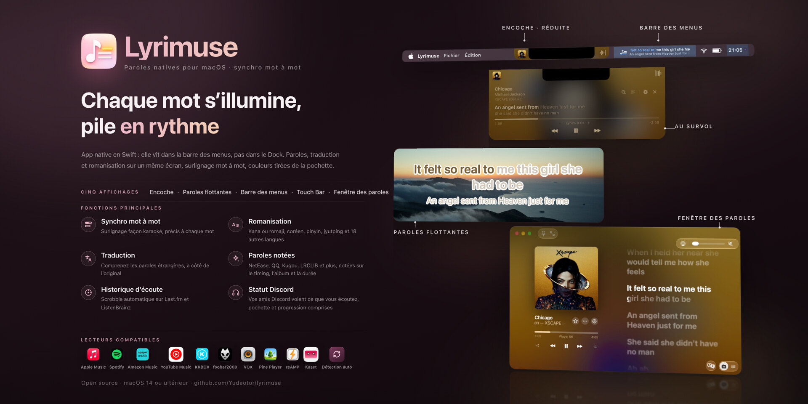

<div align="center">


# Lyrimuse

**Les paroles sur le bureau, repensées pour le Mac.**

**Language / 语言 / 語言 / 言語 / 언어 / Idioma / Langue / Sprache / Lingua / Язык:** [English](README.md) | [简体中文](README.zh-CN.md) | [繁體中文](README.zh-Hant.md) | [日本語](README.ja.md) | [한국어](README.ko.md) | [Español](README.es.md) | **Français** | [Deutsch](README.de.md) | [Italiano](README.it.md) | [Português (Brasil)](README.pt-BR.md) | [Tiếng Việt](README.vi.md) | [Русский](README.ru.md)


[](https://github.com/Yudaotor/lyrimuse/releases/latest)
[](https://github.com/Yudaotor/lyrimuse/commits/dev)
[](LICENSE)
[](https://github.com/sponsors/Yudaotor)
[](https://discord.gg/N7gVy66Gp3)
[](https://t.me/lyrimuse)
[](https://qm.qq.com/q/Nb4TlwfnQy)

</div>

https://github.com/user-attachments/assets/88b951ee-4ecf-4985-b1cb-eee6afdd5510

Lyrimuse est une app open source de paroles pour le bureau de macOS. Elle se loge dans la barre des menus et surligne les paroles mot à mot au fil de la lecture : en surimpression au-dessus de toutes vos fenêtres, dans la barre des menus, dans une capsule façon Dynamic Island sous l’encoche, sur la Touch Bar ou dans une fenêtre de paroles complète. Elle fonctionne avec 15 lecteurs, dont Apple Music, Spotify, Amazon Music et Kaset, l’app YouTube Music, ainsi qu’avec les lecteurs web de votre navigateur, et choisit la meilleure correspondance parmi 15 sources de paroles, avec traduction et romanisation si vous le souhaitez. Elle tient aussi un profil d’écoute Last.fm et scrobble vos écoutes.

**Vous venez de LyricsX ?** Il n’a connu aucune nouvelle version depuis avril 2022. Lyrimuse couvre ce qu’il faisait, continue d’évoluer et prend en charge en plus les lecteurs chinois, KKBOX, Amazon Music, Kaset, Pear Desktop, reAMP, VOX, Pine Player, foobar2000 et les lecteurs web. Pour le détail, consultez la [comparaison vérifiée avec LyricsX et Lyric Fever](docs/lyrics-apps-comparison.md).

**Installez-la** avec Homebrew, sur Apple Silicon ou Intel. Homebrew lève aussi pour vous l’avertissement de Gatekeeper au premier lancement. Vous préférez la télécharger vous-même ? Récupérez la [dernière version](https://github.com/Yudaotor/lyrimuse/releases/latest) et consultez [Démarrage rapide](#démarrage-rapide).

```bash
brew tap yudaotor/lyrimuse
brew trust --cask yudaotor/lyrimuse/lyrimuse   # one-time: Homebrew asks you to trust non-official taps
brew install --cask lyrimuse
```


<p align="center"><sub>Quatre façons d’afficher les paroles : la Fenêtre des paroles, la capsule façon Dynamic Island, les paroles flottantes surlignées mot à mot et la barre des menus</sub></p>


<p align="center"><sub>Le Gestionnaire de paroles, la recherche manuelle avec un score pour chaque résultat, et le panneau qui explique pourquoi un morceau a reçu ces paroles-là</sub></p>


<p align="center"><sub>Vos chiffres et classements Last.fm, l’aperçu affiché quand rien ne joue, et une carte de chaleur de votre année façon GitHub</sub></p>


<p align="center"><sub>Chaque page des réglages a un aperçu en direct, vous pouvez choisir plusieurs lecteurs (lecteurs web compris), et le menu de la barre des menus s’occupe du reste</sub></p>

## Fonctionnalités

> Où se trouve chaque fonctionnalité dans les réglages, et si elle est activée ou non après l’installation : consultez la **[liste des fonctionnalités](docs/feature-list.md)**.

### Paroles synchronisées mot à mot, trouvées automatiquement
- **Surlignage mot à mot** qui suit le morceau pendant la lecture.
- **15 sources de paroles, interrogées pour vous** : NetEase Cloud Music, QQ Music, Kugou, Kuwo, Migu, Musixmatch, LRCLIB, LyricFind (via YouTube Music), Deezer, AMLL (une base de paroles mot à mot constituée à la main), Soda Music (avec son propre minutage mot à mot), VIBE et Genie (tous deux solides sur les chansons coréennes), PetitLyrics (solide sur les chansons japonaises), et les paroles d’Apple Music si vous connectez votre compte dans les réglages. Les paroles d’Apple Music nécessitent un abonnement, et beaucoup de ses morceaux ont un minutage mot à mot. Vous n’avez jamais à chercher vous-même.
- **Traduction et romanisation** sous les paroles d’origine. Si la source propose une traduction de la communauté, c’est celle-là que vous obtenez. Sinon, activez « Traduction de secours du système » dans les réglages (désactivée par défaut) : votre Mac traduit alors les paroles avec le framework Translation d’Apple, sans qu’elles quittent votre ordinateur, et un traducteur en ligne prend le relais quand ce n’est pas possible. Il y a 17 langues cibles. La romanisation se décide ligne par ligne : une chanson chinoise avec une ligne en japonais n’a de transcription que sur cette ligne, pas du pinyin sur tout le reste. Les chansons en cantonais reçoivent un Jyutping qui reconnaît les mots entiers. Pour le japonais, vous pouvez choisir les furigana : des hiragana au-dessus des kanji seulement, pratique pour apprendre le japonais en chansons. Et 18 autres langues, dont le russe, le thaï, le grec et l’hindi, ont aussi leur transcription, selon la romanisation officielle de chaque langue ou une norme ISO.
- **Duos séparés par interprète.** Quand la source (ou une entrée AMLL) indique qui chante quelle ligne, chaque partie s’affiche séparément au lieu de mêler deux voix dans un seul bloc.
- **Les détails d’Apple Music dans la Fenêtre des paroles** : les chœurs sur leur propre ligne sous la voix principale, les lignes de duo qui se chevauchent allumées ensemble jusqu’à ce que les deux se terminent, et les mots anglais longuement tenus qui gonflent et brillent comme dans Apple Music.
- **Chinois simplifié ou traditionnel** pour les paroles, réglé indépendamment de la langue de l’app.
- **Le Gestionnaire de paroles**, pour faire du rangement. Parcourez, modifiez, supprimez ou relancez la recherche pour n’importe quel morceau, supprimez-en plusieurs à la fois et faites le ménage dans les entrées vides laissées par les publicités et les podcasts. Si le minutage d’un morceau est décalé, corrigez-le pour ce seul morceau. Un bouton relance tous les morceaux encore sans paroles, et une réanalyse complète refait le choix pour toute votre bibliothèque avec les règles de correspondance actuelles. Tout ce que vous avez corrigé à la main reste intact. Vous pouvez aussi importer des fichiers .lrc ou un dossier entier, même pour des morceaux pas encore écoutés, ou lui faire surveiller un dossier.
- **Un morceau, une seule version des paroles.** Le même morceau joué dans différents lecteurs ou issu de différentes éditions est reconnu comme un seul : ses entrées partagent les paroles et vos modifications manuelles, et leurs nombres d’écoutes s’additionnent. « Entrées de ce morceau », dans le Gestionnaire de paroles, les compare ligne par ligne et sépare celle qui a été associée par erreur.
- **Corrigez les paroles directement depuis la Fenêtre des paroles.** Cherchez d’autres paroles, réassociez le morceau ou modifiez-les dans votre propre éditeur de texte. Modifier des paroles mot à mot ne change que les mots : chaque mot garde son minutage.
- **Fonctionne hors ligne** pour tout morceau dont les paroles sont déjà en cache.

### Profil d’écoute Last.fm et scrobble
- **Un profil d’écoute complet.** Connectez Last.fm en un clic depuis la section des comptes (aucun jeton à copier-coller) et vous obtenez les totaux du jour, des 7 derniers jours et depuis toujours, un indicateur « scrobble en cours » en direct, et vos écoutes récentes avec leurs illustrations, chacune avec un cœur pour l’adorer (ou ne plus l’adorer) sur Last.fm. Par défaut, chaque écoute est envoyée comme le morceau correspondant du catalogue Last.fm : les duos crédités, les graphies simplifiées / traditionnelles et les suffixes comme « - Single » ou « (Remastered) » aboutissent sur la vraie page du morceau. Passez à « Brut » dans les réglages pour envoyer exactement ce que le lecteur a indiqué. ListenBrainz reçoit toujours les tags d’origine ([fonctionnement du scrobble](docs/scrobbling.fr.md)).
- **Artistes, albums et morceaux les plus écoutés** sur les 7 derniers jours, 30 jours, l’année ou depuis toujours, chacun avec son évolution depuis la période précédente. Cliquez sur un artiste pour voir ses morceaux que vous écoutez le plus.
- **Empreinte**, un onglet à part entière. Il s’ouvre sur vos totaux cumulés : le nombre de jours depuis votre premier scrobble, combien d’entre eux comptent des écoutes et la moyenne quotidienne, votre plus grosse journée, votre série actuelle et la plus longue, cette année jusqu’ici face à la même période d’une année précédente, et la distance qui vous sépare du prochain palier rond. En dessous viennent une carte de chaleur de l’année façon GitHub (cliquez sur un jour pour voir ce que vous avez le plus écouté), vos heures et jours d’écoute, l’origine de vos artistes préférés, et « Ce jour-là », avec ce que vous écoutiez à cette date les années passées.
- **Chaque écoute est d’abord enregistrée sur votre Mac**, même avant de connecter Last.fm. Connectez-le plus tard et envoyez en un clic les deux dernières semaines environ (Last.fm n’accepte pas les écoutes plus anciennes).
- **Vous décidez quand une écoute compte** : à 50 % comme par défaut sur Last.fm, à 75 % ou 90 %, ou seulement quand le morceau se termine vraiment. ListenBrainz n’est pas concerné. Vous pouvez aussi exclure complètement un lecteur de Last.fm, pour que ses écoutes n’apparaissent jamais dans votre historique.
- **Le même historique apparaît dans la Fenêtre des paroles** quand rien ne joue : vous obtenez un aperçu plutôt qu’un écran vide (voir plus bas).

### Paroles flottantes, paroles dans la barre des menus, Dynamic Island, Touch Bar ou fenêtre des paroles complète
- **Utilisez plusieurs lecteurs, ou laissez-la choisir.** Apple Music, Spotify et Kaset sont lus grâce à l’autorisation d’automatisation. QQ Music, NetEase Cloud Music, Kugou Music, Soda Music, KKBOX, Amazon Music et LX Music sont lus via MediaRemote de macOS, sans aucune autorisation. Activez la combinaison de votre choix dans les réglages, ou laissez la détection automatique suivre ce que macOS affiche dans « À l’écoute ».
- **La radio d’Apple Music fonctionne aussi.** Les paroles suivent chaque morceau d’une station. Pendant que l’animateur parle, vous voyez le nom et le logo de la station, pas le morceau précédent. La radio a son propre décalage : vous réglez une station une fois pour toutes.
- **Les lecteurs de votre navigateur aussi.** Jumelez votre navigateur une fois et YouTube Music ou Spotify Web fonctionne comme n’importe quel autre lecteur, avec des paroles synchronisées sur la barre de progression de la page. Un test en un clic vous dit d’emblée si le navigateur peut être piloté. Pendant une publicité, la capsule passe au noir et indique le temps restant et le rang de la publicité sur le total. Les publicités de YouTube Music ont un bouton pour les passer, ou peuvent être passées automatiquement.
- **Choisissez comment les afficher**, dans n’importe quelle combinaison, ou pas du tout :
  - des paroles flottantes sur le bureau, à déplacer où vous voulez ou à épingler en haut au centre ou juste au-dessus du Dock ;
  - une capsule façon Dynamic Island en haut de l’écran, qui peut afficher l’illustration de l’album et la flouter derrière la capsule, estomper la ligne des paroles pour laisser passer les clics, et s’afficher sur l’écran verrouillé si vous l’activez ;
  - la Touch Bar d’un MacBook Pro qui en est équipé, avec la ligne qui défile au fil du chant, plus l’illustration et les commandes de lecture si vous le souhaitez ;
  - une Fenêtre des paroles redimensionnable inspirée de la page des paroles d’Apple Music, avec deux colonnes, une illustration floutée en fond, tout le morceau qui défile jusqu’à la ligne en cours, une illustration animée quand Apple Music en a une pour l’album, et la vidéo Spotify Canvas du morceau en boucle en fond quand il en a une. Les mots se remplissent au fil du chant, avec la graisse, la couleur chantée et l’alignement de votre choix, et « Surbrillance HDR » peut éclairer la partie chantée au-delà du blanc sur un écran HDR.
- **Paroles dans la barre des menus (mode texte).** La ligne en cours s’affiche directement dans la barre des menus. Les lignes longues défilent au lieu d’être coupées au milieu (vous pouvez revenir à la coupure). Une seconde rangée peut afficher la ligne suivante, la traduction ou la romanisation, et la capsule peut faire de même.
- **Faites glisser la barre de progression pour vous déplacer dans le morceau**, dans la Fenêtre des paroles et dans la capsule.
- **Aléatoire, répétition, Favori et volume** directement dans la Fenêtre des paroles, là où le lecteur le permet : Apple Music, Spotify, Kaset, QQ Music, Amazon Music et YouTube Music dans le navigateur prennent chacun en charge tout ou partie de ces commandes, et NetEase Cloud Music, Kugou Music, Soda Music et LX Music ont Favori. Favori se trouve aussi dans la capsule déployée, et peut avoir un raccourci.
- **Ouvrez le morceau là où il se trouve** depuis le menu « ⋯ » ou le panneau d’infos. Apple Music l’ouvre dans l’app, Spotify passe au morceau en cours, et KKBOX ouvre le morceau, l’album ou l’artiste dans sa propre app. QQ Music, Soda Music, Spotify, Amazon Music et YouTube Music (quand vous l’écoutez dans Kaset) ouvrent la page web du morceau, de l’album ou de l’artiste, et NetEase Cloud Music ouvre la page du morceau. Lyrimuse a trouvé le lien en récupérant les paroles ou l’a lu dans les données du lecteur sur votre Mac : il n’y a rien à chercher.
- **Quand rien ne joue**, la Fenêtre des paroles affiche les totaux du jour et de la semaine, une carte « Ce jour-là » et vos écoutes récentes avec leurs illustrations, chacune renvoyant à la page de son album ou de son artiste dans Apple Music.
- **Une mini Fenêtre des paroles** : une petite carte qui affiche une ligne, deux lignes ou toutes les paroles qui défilent, avec son propre fond, sa couleur de texte, sa police, sa graisse et sa couleur chantée ; le karaoké mot à mot peut y être désactivé indépendamment.
- **Paroles web sur votre téléphone, votre tablette ou votre stream.** Ouvrez la Fenêtre des paroles dans un navigateur sur un autre appareil et utilisez-la comme second écran, avec les commandes de lecture et le saut d’un simple toucher si vous les autorisez. « Sortie OBS » place les paroles flottantes dans votre stream comme source navigateur transparente. Les deux restent sur ce Mac tant que vous n’autorisez pas l’accès au réseau local, et les autres appareils se connectent en scannant un code QR.
- **Notes de morceau, notes d’album et biographies d’artistes.** Cliquez sur le titre, l’artiste ou le nom de l’album dans la Fenêtre des paroles ou dans la capsule déployée pour en savoir plus. Les notes d’album et les biographies d’artistes viennent d’Apple Music ou, à défaut, de Soda Music (morceaux écoutés dans Soda Music, interface en chinois uniquement), de Kugou Music (morceaux écoutés dans Kugou Music, interface en chinois uniquement), de NetEase Cloud Music (interface en chinois uniquement), des articles Wikipédia affichés par YouTube Music (dans la langue de l’interface) ou de Last.fm ; les notes de morceau viennent de QQ Music (interface en chinois uniquement) ou de Last.fm.
- **Personnalisez l’apparence** : la police (celle du système, ou vos propres fichiers .ttf / .otf), la taille, les couleurs du texte, du fond et de l’ombre, des thèmes enregistrés ou une couleur tirée de l’illustration en cours, et la largeur des paroles flottantes, ainsi qu’un arc-en-ciel qui défile sur les paroles.
- **Invisibles dans les captures d’écran, les enregistrements et les partages d’écran.** Vous les voyez toujours. Personne d’autre ne les voit.
- **Se masquent quand vous mettez en pause**, pour ne pas rester sur votre bureau sans rien faire. Elles peuvent aussi s’effacer pendant les passages instrumentaux, les morceaux sans paroles et les apps en plein écran, et les paroles flottantes peuvent vous suivre sur l’écran de la fenêtre que vous utilisez.

### Détails du quotidien
- **Anglais, chinois simplifié, chinois traditionnel, japonais, coréen, espagnol, français, allemand, italien, portugais du Brésil, vietnamien et russe**, et le changement s’applique immédiatement, sans redémarrage. Une traduction vous semble maladroite ? Les pull requests sont les bienvenues ; chaque langue a un guide de style dans `lyrimuse/Localization/`.
- **Liquid Glass sous macOS 26.** Les réglages, le panneau de la barre des menus, la Fenêtre des paroles, le Gestionnaire de paroles et l’assistant de configuration l’utilisent, et la plupart peuvent rester en clair ou en sombre au lieu de suivre le système.
- **Raccourcis clavier** pour chaque action, du masquage de toutes les paroles au « j’aime » sur le morceau. Aucun n’est défini d’origine : c’est vous qui choisissez les touches. Chaque action a aussi un lien `lyrimuse://` que vous pouvez appeler depuis Raccourcis, Raycast ou Alfred, et depuis Raccourcis, un lien peut renvoyer le morceau en cours ([schéma d’URL](docs/url-scheme.fr.md)).
- **Recherche dans les réglages.** Tapez dans la barre latérale : elle fait défiler jusqu’à la ligne correspondante et la met en évidence, en dépliant un groupe replié si nécessaire.
- **Se met à jour toute seule.** Elle vérifie d’elle-même, ou quand vous le demandez depuis la barre des menus. Les mises à jour s’installent depuis la page « Mise à jour de logiciels » des réglages, avec les notes de version et la progression sur place, et vous pouvez choisir de recevoir les versions bêta.
- **Démarrez en même temps que vos lecteurs**, réglable par lecteur et dans les deux sens : les ouvrir quand Lyrimuse s’ouvre, ouvrir Lyrimuse quand ils s’ouvrent et, si vous le souhaitez, quitter Lyrimuse une fois que tous les lecteurs qu’elle suit sont fermés.
- **Lancement silencieux** si vous préférez qu’elle démarre sans aucune fenêtre, avec seulement l’icône dans la barre des menus.
- **Vous changez de Mac ?** Exportez toute votre configuration et importez-la sur le nouveau. En cas de problème, un export du diagnostic en un clic est aussi disponible.

### Extras facultatifs

<details>
<summary>ListenBrainz, statut Discord, une page « en cours de lecture » à partager, et des récaps quotidiens / hebdomadaires / mensuels / annuels</summary>

Tout ceci reste désactivé tant que vous ne l’activez pas dans les réglages :

- **Scrobblez aussi vers [ListenBrainz](https://listenbrainz.org).** Chaque écoute part vers les deux services à partir des mêmes informations lues dans votre lecteur, si bien que les deux historiques restent alignés. Les écoutes de votre iPhone (enregistrées via Last.fm) sont aussi copiées dans ListenBrainz : vous avez un seul historique pour les deux appareils au lieu de deux.
- **Une page publique « en cours de lecture » à partager** : lecture en direct, historique, livre d’or, réactions, compteur de visites, palmarès des 10 artistes les plus écoutés, look disque vinyle, thèmes clair et sombre, et de vrais aperçus de lien dans les apps de messagerie. Le **[guide des fonctionnalités web](https://github.com/Yudaotor/nowplaying-workers#readme)** la présente avec des captures d’écran.
- **Récaps d’écoute quotidiens, hebdomadaires, mensuels et annuels**, envoyés sur autant de canaux que vous voulez : Bark, ntfy, ServerChan, Feishu, DingTalk, WeCom, Telegram, Discord, Slack ou un webhook générique. Chaque canal peut envoyer un test, et un historique d’envoi montre ce qui est arrivé.
- **Montrez ce que vous écoutez sur Discord.** Votre profil et votre liste d’amis affichent le lecteur utilisé, le morceau, l’artiste, l’illustration et une barre de progression, et le titre et l’artiste renvoient à leurs pages sur le site de ce lecteur. La ligne de l’album peut afficher la ligne chantée, et vous pouvez ajouter jusqu’à deux boutons. Un petit badge Lyrimuse ou du lecteur se place dans le coin de l’illustration (ou aucun), et un morceau en pause peut rester affiché avec une icône de pause. Vous choisissez quels lecteurs comptent, pouvez n’afficher que le lecteur sans nommer le morceau, et pouvez masquer le statut pendant un moment.

ListenBrainz et « Push web » se trouvent sous **Labo** dans la barre latérale des réglages, « Alertes push » est avec les autres sections, et Discord a sa propre entrée près du haut. Chaque carte fournit ses propres étapes de configuration : où obtenir une clé d’API ou un jeton, comment connecter un compte, comment obtenir l’URL de webhook de votre service de push. La page web est la seule à avoir un guide séparé, et vous n’avez pas besoin de tout suivre. Avec ListenBrainz seul, la page affiche déjà la lecture en direct et l’historique, sans Cloudflare Worker. Déployez-en un si vous voulez aussi le livre d’or, les réactions, le compteur de visites, le palmarès des 10 artistes et des mises à jour plus rapides ; le guide l’explique.

</details>

## Démarrage rapide

Les versions sont signées avec le certificat propre au projet, pas avec un Developer ID d’Apple : aucune des options ci-dessous ne nécessite de compte Apple Developer. La contrepartie, c’est qu’à la première ouverture de l’app, Gatekeeper indique qu’elle « provient d’un développeur non identifié ». Homebrew (option A) règle cela pour vous. Avec les autres options, c’est normal et ce n’est pas un bug ; l’option B montre comment passer outre une fois pour toutes.
### Option 0 : Confier l’installation à une IA

Vous utilisez un agent IA qui a accès au Terminal de votre Mac (Claude Code, Codex CLI, Gemini CLI…) ? Collez-lui le bloc ci-dessous tel quel, et il fera tout ce que décrivent les options A/B à votre place. Les instructions ne l’autorisent qu’à installer cette app. Il n’utilisera pas `sudo` et ne touchera pas aux réglages de sécurité du système :

```text
Please install Lyrimuse — an open-source macOS menu-bar lyrics app
(https://github.com/Yudaotor/lyrimuse) — on this Mac, following these rules exactly:

1. Preferred path (if `brew` exists):
     brew tap yudaotor/lyrimuse
     brew trust --cask yudaotor/lyrimuse/lyrimuse
     brew install --cask lyrimuse
   If this Homebrew doesn't know the `trust` subcommand, skip that line — older
   versions don't need it.
2. If Homebrew is not installed, do NOT install Homebrew. Instead: check the CPU
   with `uname -m`, download the latest release asset from
   https://github.com/Yudaotor/lyrimuse/releases — `Lyrimuse-v<version>-macos.zip`
   for arm64, `Lyrimuse-v<version>-macos-intel.zip` for x86_64 — verify it against
   its `.sha256` file (`shasum -c`), unzip, move `Lyrimuse.app` into
   /Applications, then clear the Gatekeeper quarantine flag on that one app only:
     xattr -dr com.apple.quarantine /Applications/Lyrimuse.app
3. Safety rails: no `sudo` anywhere (nothing here needs it); never run
   `spctl --master-disable` or otherwise weaken Gatekeeper system-wide; never
   remove the quarantine flag from anything except /Applications/Lyrimuse.app.
4. Do not build from source unless I explicitly ask.
5. Launch it (`open -a Lyrimuse`) and verify it is running (`pgrep -x Lyrimuse`
   prints a PID).
6. A first-run wizard will appear — that part is mine to click through. Tell me
   it will ask me to pick a music player, to grant Automation access to
   Music.app and/or Spotify (only if I pick them), and to enable the background
   lyrics engine — then hand control back to me.
Finally, report what you did and anything that failed.
```

### Option A : Installer avec Homebrew (recommandé)

```bash
brew tap yudaotor/lyrimuse
brew trust --cask yudaotor/lyrimuse/lyrimuse   # one-time: Homebrew asks you to trust non-official taps
brew install --cask lyrimuse
```

L’installation lève automatiquement la mise en quarantaine Gatekeeper, qui n’a lieu qu’une fois : il n’y a rien d’autre à faire. Ouvrez Lyrimuse depuis `/Applications` (ou Spotlight) dès que `brew install` a terminé. `brew upgrade --cask lyrimuse` récupère les nouvelles versions de la même façon.

### Option B : Télécharger manuellement une version compilée

1. Récupérez-la sur la [page Releases](https://github.com/Yudaotor/lyrimuse/releases). **Vérifiez d’abord quel Mac vous avez** ( → À propos de ce Mac → « Puce » : `Apple M…` correspond à Apple Silicon, `Intel Core…` à Intel) :

   | Votre Mac | Téléchargement |
   | --- | --- |
   | Apple Silicon (M1 et ultérieurs) | `Lyrimuse-*-macos.dmg` ou `.zip` |
   | Intel | `Lyrimuse-*-macos-intel.dmg` ou `.zip` |

   Avec le dmg, double-cliquez pour le monter et faites glisser `Lyrimuse.app` sur le raccourci `Applications` juste à côté ; avec le zip, décompressez-le et faites glisser `Lyrimuse.app` dans `/Applications`. Les deux formats installent exactement la même app, et le zip est accompagné d’un `.sha256` si vous voulez vérifier le téléchargement (`shasum -c Lyrimuse-*.zip.sha256` depuis le même dossier).

   La seule différence entre les deux téléchargements est l’architecture : celui sans suffixe est réservé à Apple Silicon, tandis que `-intel` contient à la fois le code Intel et Apple Silicon. `-intel` fonctionne bien sur Apple Silicon, mais il n’y a aucune raison de l’y utiliser : il est deux fois plus lourd, et macOS 27 et ultérieur avertiront que l’app « doit être mise à jour » parce qu’elle contient du code Intel (Apple supprime Rosetta dans macOS 28 ; l’app n’a en réalité aucun problème).

   **Les deux architectures bénéficient des mises à jour automatiques dans l’app.** Le flux liste deux entrées pour la même version, une par architecture : Apple Silicon reçoit la version sans suffixe, Intel reçoit la version `-intel`, et Sparkle choisit tout seul selon la machine. (Jusqu’à la v1.4.0 incluse, seul Apple Silicon était servi ; les utilisateurs Intel devaient revenir ici à la main.)
2. Au premier lancement, macOS refusera de l’ouvrir, avec « Impossible d’ouvrir “Lyrimuse”, car Apple ne peut pas vérifier qu’il ne contient pas de logiciel malveillant » ou « provient d’un développeur non identifié ». Levez ce blocage une fois, avec la méthode qui vous convient le mieux :

   - **Terminal (recommandé, fonctionne toujours) :**
     ```bash
     xattr -dr com.apple.quarantine /Applications/Lyrimuse.app
     ```
     Ouvrez ensuite l’app normalement. Il suffit de le faire une fois par téléchargement.
   - **Clic droit → Ouvrir :** dans le Finder, cliquez avec le bouton droit (ou en maintenant la touche Contrôle) sur `Lyrimuse.app` et choisissez **Ouvrir**, puis confirmez à nouveau **Ouvrir** dans la boîte de dialogue. Cela ne fonctionne pas sur toutes les versions de macOS ni pour tous les types d’avertissement : si l’avertissement persiste, utilisez la commande Terminal ci-dessus.
   - **Réglages Système → Confidentialité et sécurité :** essayez d’ouvrir l’app une fois (elle sera bloquée), puis ouvrez **Réglages Système → Confidentialité et sécurité**, faites défiler jusqu’en bas et cliquez sur **Ouvrir quand même** à côté de l’avertissement concernant Lyrimuse. Confirmez encore une fois si on vous le demande.

   Ne le faites que pour une version en laquelle vous avez vraiment confiance : celle de la page Releases de ce dépôt, ou une que vous avez compilée vous-même.

### Option C : Compiler depuis les sources

**Prérequis, à installer une fois** (sautez ce que vous avez déjà) :

```bash
xcode-select --install   # Xcode Command Line Tools, for Swift — skip if `swift --version` already works
brew install go          # any Go ≥ 1.21 — build.sh switches to 1.24.4 automatically via GOTOOLCHAIN
```

Ensuite, `build.sh` compile d’un coup l’app et son moteur de paroles (le processus d’arrière-plan nommé `lyrimuse-engine`) :

```bash
git clone https://github.com/Yudaotor/lyrimuse.git
cd lyrimuse/lyrimuse
./build.sh              # this machine's architecture
./build.sh --universal  # arm64 + x86_64 (the compatibility build shipped for Intel)
```

`build.sh` se termine en listant les architectures de chaque binaire du bundle et signale tout ce qui ne correspond pas à la cible, qu’il manque une tranche ou qu’il y en ait une de trop. N’assemblez pas les fichiers de version à la main : `./package.sh` compile chaque architecture une fois et produit un zip + sha256 + dmg pour chacune, et refuse d’empaqueter si les architectures sont incorrectes.

La prise en charge de QQ Music / NetEase Cloud Music / Kugou Music / Soda Music / KKBOX / Amazon Music / LX Music / Spotify / Kaset / de la détection automatique nécessite en plus [ungive/media-control](https://github.com/ungive/media-control). `build.sh` l’installe automatiquement via Homebrew s’il manque : ce n’est pas non plus une étape à faire vous-même.

### Après n’importe quelle option

Ouvrez Lyrimuse depuis `/Applications`. L’assistant de premier lancement vous guide pour choisir un lecteur (Apple Music, QQ Music, NetEase Cloud Music, Kugou Music, Soda Music, KKBOX, Amazon Music, Spotify, Kaset, Pear Desktop, reAMP, VOX, Pine Player, foobar2000, LX Music ou la détection automatique), accorder l’autorisation d’automatisation si vous avez choisi Apple Music, Spotify, Kaset ou VOX (les autres n’ont besoin d’aucune autorisation pour lire les informations de base du morceau), et activer son moteur de paroles (pour que paroles et illustrations continuent d’être récupérées même fenêtre fermée). Terminez l’assistant et les paroles s’affichent aussitôt (voir [lyrimuse/README.md](lyrimuse/README.md) pour plus d’options de compilation).

C’est tout ce qu’il faut pour les paroles. Les extras facultatifs peuvent être configurés plus tard depuis les réglages, quand vous le souhaitez.

## Questions fréquentes

### Comment afficher les paroles d’Apple Music en flottant sur le bureau de mon Mac, toujours au premier plan ?
Activez les paroles flottantes dans les réglages. Elles restent au-dessus de toutes les fenêtres, sur chaque Space. Faites-les glisser où vous voulez, ou épinglez-les en haut au centre ou juste au-dessus du Dock. Si les paroles ont un minutage mot à mot, chaque mot se remplit au fil du chant. Vous pouvez les masquer dans les captures d’écran, les enregistrements et les partages d’écran, et les faire disparaître quand la musique est en pause. Cela fonctionne de la même façon avec QQ Music, NetEase Cloud Music, Kugou Music, Soda Music, KKBOX, Amazon Music, LX Music, Spotify, Kaset et les lecteurs web.

### Puis-je afficher les paroles de Spotify dans la barre des menus du Mac ?
Oui. Activez le mode texte de la barre des menus et la ligne en cours apparaît dans la barre des menus, pour Spotify ou tout autre lecteur pris en charge. Les lignes longues défilent au lieu d’être coupées, et une seconde rangée peut afficher la ligne suivante, la traduction ou la romanisation. Inutile de connecter un compte Spotify. Lyrimuse demande une fois l’autorisation d’automatisation pour Spotify, qui lui donne la position de lecture exacte et fait fonctionner les boutons de lecture. Si vous refusez, les paroles s’affichent quand même, mais le minutage vient de MediaRemote de macOS et peut être décalé d’environ une seconde.

### Affiche-t-elle des paroles mot à mot pour QQ Music, NetEase Cloud Music, Kugou ou Soda Music ?
Oui, dès lors que les paroles ont un minutage mot à mot. NetEase Cloud Music, QQ Music, Kugou, Soda Music, Musixmatch, AMLL et Apple Music en ont souvent, et ces lignes se remplissent mot à mot. Les paroles minutées seulement à la ligne allument toute la ligne d’un coup. Le lecteur ne limite pas non plus la provenance des paroles : un morceau joué dans Soda Music peut recevoir les paroles mot à mot de QQ Music si elles obtiennent le meilleur score.

### Faut-il un compte Apple Developer pour l’installer ?
Non. Les versions sont signées avec le certificat propre au projet plutôt qu’avec un Developer ID d’Apple : ni vous ni le projet n’en avez besoin. C’est aussi pourquoi il y a une étape Gatekeeper à faire une fois, décrite plus haut dans « Démarrage rapide ».

### Lyrimuse est-elle sur le Mac App Store ?
Non. Installez-la avec Homebrew (option A ci-dessus) ou téléchargez-la depuis la [page Releases](https://github.com/Yudaotor/lyrimuse/releases) (option B). Dans les deux cas, les mises à jour arrivent ensuite par l’app.

### Lyrimuse est-elle gratuite ?
Oui. Elle est open source, sous licence GPL-3.0. Il n’y a ni version payante, ni achat intégré, ni compte à créer. Last.fm et les autres services sont à votre discrétion. Si elle vous est utile et que vous souhaitez la soutenir, vous pouvez [la parrainer sur GitHub](https://github.com/sponsors/Yudaotor) ou [offrir un café à l’auteur](https://yudaotor.github.io/donate/) avec Alipay ou WeChat Pay.

### Puis-je contrôler QQ Music, NetEase Cloud Music ou Soda Music quand une autre app a la main sur les commandes multimédias du système ?
Oui. Quand quelque chose comme une vidéo dans le navigateur occupe « À l’écoute » de macOS, les touches multimédias du système lui reviennent ; Lyrimuse appuie alors à la place sur lecture/pause, précédent et suivant dans la barre des menus de QQ Music ou de NetEase Cloud Music, ou dans la barre de lecture de Soda Music, en laissant le lecteur en arrière-plan. Cela nécessite l’accès Accessibilité (Réglages → Lecteur) ; sans lui, ces boutons ouvrent cette page. Le déplacement dans le morceau n’est pas disponible dans ce cas. Sous macOS 27, l’autorisation se trouve dans **Réglages Système → Confidentialité et sécurité → Contrôle de l’appareil et accès aux données** ; les versions précédentes l’appellent **Accessibilité**.

### Fonctionne-t-elle avec Spotify, QQ Music ou NetEase Cloud Music, ou seulement avec Apple Music ?
Avec tous ceux-là, plus Kugou Music, Soda Music, KKBOX, Amazon Music, Kaset (une app YouTube Music), Pear Desktop (une app de bureau open source pour YouTube Music), le lecteur reAMP façon Winamp, le lecteur local sans perte et haute résolution VOX, le lecteur local gratuit Pine Player, qui lit presque tous les formats, le lecteur local classique foobar2000, venu de Windows, et LX Music, open source : 15 lecteurs en tout. Vous pouvez aussi laisser la détection automatique suivre ce que macOS affiche dans « À l’écoute ». Apple Music, Spotify, Kaset et VOX demandent l’autorisation d’automatisation (Spotify, Kaset et VOX s’en servent pour un minutage exact et les boutons de lecture). Les 11 autres n’ont besoin d’aucune autorisation pour lire les informations de base du morceau via MediaRemote de macOS ; les boutons aléatoire, répétition et « j’aime » de QQ Music, NetEase Cloud Music, Kugou Music, Soda Music et Amazon Music, ainsi que l’aléatoire, la répétition et le volume de reAMP et foobar2000, nécessitent l’accès Accessibilité ; Pine Player s’en sert pour lire sa barre de progression, car il n’indique la position qu’à la seconde près. Avec KKBOX, Amazon Music ou LX Music, les paroles que l’app a déjà enregistrées pour le morceau sont aussi prises en compte, et aucun de ces services n’est jamais contacté.

### Puis-je afficher les paroles de KKBOX ou d’Amazon Music sur mon Mac ?
Oui. Les deux sont lus via MediaRemote de macOS : il n’y a rien à autoriser, et leurs paroles s’affichent en flottant, dans la barre des menus, dans la capsule et dans la Fenêtre des paroles comme pour n’importe quel autre lecteur. Si KKBOX ou Amazon Music ont déjà enregistré des paroles pour le morceau, elles sont aussi prises en compte et pèsent davantage. Lyrimuse ne se connecte jamais à l’un ou l’autre service et ne leur envoie rien. Les autres sources sont toujours interrogées : si l’une d’elles a mieux, par exemple un minutage mot à mot, c’est elle qui l’emporte.


### Fonctionne-t-elle avec LX Music (洛雪音乐) ?
Oui. LX Music est lu via MediaRemote de macOS : il n’y a rien à autoriser. Quand vous écoutez un morceau dans LX Music, les paroles qu’il a enregistrées pour ce morceau (mot à mot quand la plateforme en a) sont aussi prises en compte et pèsent davantage, et les morceaux suivants de la liste en cours ont leurs paroles préparées à l’avance. Lyrimuse se contente de lire les données de LX Music sur votre Mac et ne lui envoie jamais rien.

### Fonctionne-t-elle avec une app de bureau YouTube Music ?
Oui, avec [Kaset](https://github.com/sozercan/kaset), une app YouTube Music native et open source pour Mac. Kaset est lu grâce à l’autorisation d’automatisation, qui donne un minutage exact et des boutons de lecture fonctionnels, et les propres paroles de YouTube Music font partie des candidats. [Pear Desktop](https://github.com/pear-devs/pear-desktop), un client de bureau open source, fonctionne aussi, via « À l’écoute » de macOS et sans autorisation supplémentaire. YouTube Music dans le navigateur fonctionne aussi, voir plus bas.

### À quoi ressemblent les paroles sur le bureau ?
À du karaoké sur votre bureau. La ligne en cours flotte au-dessus de vos fenêtres, chaque mot se remplit au fil du chant quand les paroles ont un minutage mot à mot, et la traduction ou la romanisation peut s’afficher à côté. Vous pouvez changer la police, la taille, les couleurs du texte, du fond et de l’ombre, ainsi que la largeur, et accorder la couleur du texte à l’illustration. Les mêmes paroles peuvent aussi aller dans la barre des menus, dans une capsule façon Dynamic Island sous l’encoche ou dans une fenêtre de paroles complète façon Apple Music, dans n’importe quelle combinaison.

### La capsule Dynamic Island fonctionne-t-elle sur un Mac sans encoche ?
Oui. Sur un écran sans encoche, comme un ancien MacBook ou un écran externe, la capsule se place en haut au centre, à la hauteur de la barre des menus. Vous choisissez son écran dans les réglages.

### Les paroles fonctionnent-elles sans connexion à Internet ?
Oui, pour tout morceau dont elle a déjà trouvé les paroles, puisqu’elles sont en cache sur votre Mac. La première recherche d’un morceau nécessite une connexion, tout comme la traduction en ligne.

### Mes données quittent-elles mon Mac ?
Pour trouver les paroles, elle doit interroger les sources de paroles sur le morceau en cours : NetEase, QQ, Kugou, Kuwo, Migu, Musixmatch, LRCLIB, LyricFind, Deezer, AMLL, Soda Music, VIBE, Genie, PetitLyrics, et Apple Music si vous l’avez connecté. Les illustrations viennent de l’iTunes Search API. Par défaut, la traduction se fait sur votre Mac, et le texte des paroles ne part vers un traducteur en ligne (la traduction web de Google, puis MyMemory) qu’en secours. Votre historique d’écoute, les paroles en cache et les réglages restent dans des fichiers sur votre Mac, sauf si vous connectez Last.fm, ListenBrainz ou le relais web facultatif. Les données d’utilisation anonymes (versions, fonctions activées, résumés de plantage ; jamais de titres ni de comptes) sont envoyées une fois par jour par défaut, et vous pouvez les désactiver dans Réglages › À propos. La liste complète se trouve plus bas, dans [Licence et droits d’auteur](#licence-et-droits-dauteur).

### Puis-je obtenir la romanisation du japonais ou du coréen, ou une traduction chinoise des paroles ?
Oui. La romanisation se décide ligne par ligne : un morceau qui mélange les langues n’a de transcription que là où il le faut. Le japonais peut afficher le romaji ou les furigana (des hiragana au-dessus des kanji). La traduction vient de la traduction de la communauté de la source de paroles quand il y en a une, sinon d’une traduction automatique sur l’appareil ou en ligne une fois « Traduction de secours du système » activée (désactivée par défaut), vers l’une des 17 langues disponibles.

### Quelles versions de macOS sont prises en charge ?
macOS 14 Sonoma ou ultérieur (Sequoia, Tahoe et plus récents), sur Apple Silicon ou Intel. La traduction sur votre Mac nécessite macOS 15 Sequoia ou ultérieur ; sous macOS 14, seuls les traducteurs en ligne sont disponibles.

### Prend-elle en charge les Mac Intel ?
Oui, avec une version universelle séparée (voir l’option B ci-dessus). Les mises à jour automatiques fonctionnent aussi sur Intel depuis la v1.5.0 : les nouvelles versions apparaissent comme sur Apple Silicon.

### Peut-elle afficher les paroles de YouTube Music ou de Spotify écoutés dans un navigateur ?
Oui. Jumelez votre navigateur une fois dans les réglages et YouTube Music ou Spotify Web fonctionne comme n’importe quel autre lecteur. Les paroles suivent la barre de progression de la page au lieu de deviner, et un test en un clic vous dit, avant de vous engager, si votre navigateur peut être piloté.

### Peut-elle scrobbler Apple Music sur Last.fm sur un Mac ?
Oui, c’est l’autre moitié de l’app. Connectez Last.fm en un clic depuis les réglages et chaque écoute d’Apple Music (ou de tout autre lecteur pris en charge) est scrobblée, avec un statut « en cours de lecture » en direct. Les écoutes sont d’abord enregistrées sur votre Mac, donc celles d’avant la connexion ne sont pas perdues : une fois connecté, cliquez sur « Rattraper » pour envoyer celles des deux dernières semaines environ. Vous choisissez quand une écoute compte (50 %, 75 %, 90 % ou le morceau entier), pouvez exclure certains lecteurs et pouvez envoyer en même temps vers ListenBrainz.

### Comment Lyrimuse évite-t-elle de choisir les mauvaises paroles ?
Elle ne se contente pas de la première source qui répond. Chaque résultat de chaque source est noté de la même façon : la correspondance du titre, de l’artiste, de l’album et de la durée, plus des critères comme la présence d’un minutage mot à mot. Le meilleur score l’emporte. Vous pouvez consulter cette décision pour n’importe quel morceau, avec le score de chaque candidat et la raison pour laquelle le gagnant l’a emporté. Si une meilleure correspondance apparaît plus tard, Lyrimuse peut basculer dessus d’elle-même, mais les paroles choisies à la main sont verrouillées et jamais remplacées. La recherche manuelle affiche les mêmes scores et étiquettes : une mauvaise version se repère facilement avant de la choisir.

### Et si les paroles sont décalées ou incorrectes ?
Si le minutage est décalé, corrigez-le pour ce morceau ; le décalage est mémorisé. Si ce sont les mauvaises paroles ou la mauvaise version, ouvrez la recherche manuelle. Vous verrez chaque résultat de chaque source avec son score, et ce que vous choisissez est verrouillé : la correspondance automatique ne le remplacera pas. Vous pouvez aussi modifier à la main les paroles de n’importe quel morceau dans le Gestionnaire de paroles.

### Puis-je enregistrer les paroles en fichiers .lrc ?
C’est déjà le cas. Chaque morceau avec des paroles a un fichier `.lrc` minuté à la ligne, plus `.tr.lrc` pour la traduction et `.roma.lrc` pour la romanisation quand elles existent. Le minutage mot à mot est enregistré à part, en TTML par défaut. Dans les réglages, vous pouvez passer à `.yrc` (le format YRC de NetEase), Enhanced LRC, QRC ou KRC pour que d’autres lecteurs puissent le lire, et en garder plusieurs. Les fichiers se trouvent dans `~/Library/Application Support/me.yudaotor.lyrimuse/lyrics/`, et vous pouvez déplacer le dossier dans les réglages.

### LyricsX est-il toujours maintenu, et en quoi Lyrimuse diffère-t-elle de LyricsX ou de Lyric Fever ?
La dernière version de LyricsX est la v1.6.3, d’avril 2022. Il fonctionne sous macOS 10.11 et ultérieur, avec Apple Music, Spotify et quelques lecteurs plus anciens. Lyric Fever se concentre sur Spotify et Apple Music et nécessite macOS 15. Lyrimuse nécessite macOS 14 et ajoute QQ Music, NetEase Cloud Music, Kugou, Soda Music, KKBOX, Amazon Music, Kaset, Pear Desktop, reAMP, VOX, Pine Player, foobar2000 et LX Music, les lecteurs du navigateur, la romanisation ligne par ligne en pinyin / Jyutping cantonais / japonais et coréen, plus des transcriptions pour 18 autres langues comme le russe et le thaï, et le scrobble vers Last.fm / ListenBrainz avec vos propres statistiques d’écoute. Le tableau comparatif se trouve sur [la page de comparaison](docs/lyrics-apps-comparison.md).
## Licence et droits d’auteur

- **Lyrimuse elle-même est sous licence [GPL-3.0](LICENSE).** Les composants open source et les données de dictionnaire intégrés à l’app (media-control, Sparkle, KeyboardShortcuts, et les dictionnaires OpenCC et rime-cantonese) conservent leurs propres licences ; les textes complets se trouvent dans [THIRD_PARTY_LICENSES](THIRD_PARTY_LICENSES), également inclus dans l’app et accessible depuis **Réglages → À propos → Licences de tiers**.
- **Les paroles, illustrations et métadonnées des morceaux appartiennent à leurs ayants droit respectifs.** Lyrimuse se contente de les rechercher, de les mettre en cache et de les afficher : ce que renvoient les API publiques de paroles est stocké sur votre propre Mac (`~/Library/Application Support/me.yudaotor.lyrimuse/`) pour votre usage personnel. Elle n’héberge, ne relaie ni ne redistribue de paroles ou d’illustrations, et le cache peut être supprimé à tout moment depuis le Gestionnaire de paroles ou en supprimant ce dossier.
- **Lyrimuse est un projet open source indépendant.** Il n’est ni affilié à, ni approuvé par, ni lié à Apple, Tencent (QQ Music), NetEase (NetEase Cloud Music), Kugou, Kuwo, Douyin (Soda Music), KKBOX, Amazon (Amazon Music), China Mobile (Migu Music), Spotify, Kaset, LX Music, Google (YouTube Music, Google Translate), Last.fm, ListenBrainz, MusicBrainz, Musixmatch, LRCLIB, LyricFind, Deezer, Naver (VIBE), KT (Genie), SyncPower (PetitLyrics), AMLL ou SponsorBlock. Leurs noms et marques appartiennent à leurs propriétaires et ne figurent ici que pour indiquer quels lecteurs, sources de paroles et services sont concernés.
- **Voici tout ce qui quitte votre Mac.** La recherche de paroles envoie l’artiste, le titre et l’album du morceau (plus la durée, pour les sources qui l’acceptent) aux 15 sources de paroles ci-dessus ; quand aucune ne correspond, le nom de l’artiste est aussi envoyé à MusicBrainz pour chercher ses alias (l’« Association intelligente » de Last.fm fait de même pour les artistes qu’elle n’a encore jamais vus), et les classements y recherchent leurs artistes par identifiant MusicBrainz pour obtenir pays/région et liens. Les illustrations et la page de repos envoient artiste + titre à l’iTunes Search API ; avec Kaset, l’illustration qu’il indique est téléchargée depuis le serveur d’images de YouTube Music (googleusercontent.com), et chaque nouvel identifiant de vidéo qu’il lit est envoyé une fois à YouTube Music pour vérifier s’il s’agit d’un épisode de podcast (ceux-ci ne sont pas traités comme des morceaux). Avec l’Open API de LX Music activée, Lyrimuse ne communique qu’avec le port de LX Music sur ce Mac, et quand le système n’a pas d’illustration pour le morceau, elle télécharge une fois celle qu’indique LX Music. Les notes d’album et les biographies d’artistes demandent les pages Apple Music publiques de l’album et de l’artiste par leurs identifiants Apple Music — sans compte Apple ; quand l’interface est en chinois et qu’Apple Music n’a ni biographie d’artiste ni notes d’album, l’identifiant NetEase Cloud Music du morceau sert à retrouver ses artistes crédités et son album, puis la présentation de cet artiste ou de cet album par NetEase est récupérée par son identifiant, là encore sans connexion. Avec l’interface en chinois, les notes de morceau demandent aussi les détails du morceau à QQ Music par son identifiant de morceau QQ Music, également sans connexion. Pendant la lecture dans QQ Music, ces mêmes détails sont demandés une fois par morceau quelle que soit la langue de l’interface, pour distinguer des morceaux les livres audio et autres programmes parlés (leurs sous-titres s’affichent toujours, mais ils ne sont ni scrobblés ni affichés comme des morceaux). Quand Apple Music n’a pas d’illustration animée pour l’album, son identifiant d’album QQ Music est envoyé à QQ Music pour chercher une pochette animée ; s’il y en a une, l’adresse de la vidéo est demandée par son identifiant de vidéo QQ Music pendant que la Fenêtre des paroles est ouverte, et la vidéo est téléchargée depuis le serveur vidéo de QQ Music (tencentmusic.com), sans connexion. Si QQ Music n’en a pas non plus, l’identifiant NetEase Cloud Music du morceau est envoyé à NetEase pour en chercher une, sous l’identité d’invité anonyme que NetEase attribue aux visiteurs sans compte ; la vidéo provient du serveur vidéo de NetEase (126.net). Pendant la lecture dans Kugou, l’artiste et le titre sont envoyés une fois à la recherche web de Kugou pour trouver la page web du morceau, sans connexion. Le fond Spotify Canvas de la Fenêtre des paroles lit seulement le cache que Spotify conserve sur votre Mac et ne demande rien à Spotify ; une vidéo trouvée là est téléchargée une fois depuis le CDN de Spotify (canvaz.scdn.co), en n’envoyant que l’adresse de la vidéo. Les notes d’album et les biographies d’artistes peuvent aussi chercher l’album sur YouTube Music par nom d’artiste et d’album (les morceaux joués dans Kaset ou dans YouTube Music sur le web utilisent les identifiants d’album et d’artiste fournis par le lecteur) et récupérer la description Wikipédia de ses pages d’album et d’artiste ; pour les morceaux joués dans Soda Music, les pages de partage publiques de l’album et de l’artiste sont demandées par les identifiants fournis par Soda Music. Aucun des deux ne nécessite de compte. Avec l’interface en chinois, pour les morceaux que LX Music joue depuis Kuwo, l’identifiant Kuwo du morceau est envoyé à Kuwo pour retrouver les identifiants de son album et de son artiste, puis les présentations de l’album et de l’artiste sont demandées par ces identifiants, là encore sans connexion. Pour les morceaux joués dans Kugou Music, le moteur demande une fois à Kugou à quel album appartient le fichier en cours ; avec l’interface en chinois, la présentation de l’album par Kugou est ensuite demandée par cet identifiant d’album, et celle de l’artiste par l’identifiant de l’artiste de l’album, là encore sans connexion. La traduction automatique de secours (désactivée par défaut, et utilisée seulement quand la traduction Apple sur l’appareil n’est pas disponible) envoie **le texte même des paroles**, par blocs, d’abord au point d’accès de traduction web de Google, puis ce qui reste non traduit à MyMemory ; la requête MyMemory comporte un paramètre e-mail généré aléatoirement — jamais le vôtre. Pendant la lecture d’un clip dans YouTube Music, les quatre premiers caractères du hachage SHA-256 de l’identifiant de la vidéo sont envoyés à SponsorBlock pour trouver les segments non musicaux de la vidéo, afin que les paroles s’alignent sur l’image ; SponsorBlock ne peut pas en déduire de quelle vidéo il s’agit. Le domaine de Musixmatch est résolu en DNS-over-HTTPS via Cloudflare (1.1.1.1) et Google (8.8.8.8). La page « À propos » demande à l’API GitHub le nombre d’étoiles au plus une fois toutes les six heures et, si vous avez choisi les mises à jour bêta, la liste des versions au plus une fois par heure ; les vérifications de mise à jour récupèrent l’appcast depuis GitHub Releases et n’envoient aucun profil système. « Partager des données d’utilisation anonymes » est activé par défaut (Réglages › À propos › Diagnostic et données ; l’écran d’accueil du premier lancement a le même interrupteur). Au plus une fois par jour, il envoie au serveur de l’auteur (telemetry.yudaotor.me, un Cloudflare Worker) un identifiant d’installation aléatoire généré sur votre Mac, si Lyrimuse a été installé pour la première fois ou mis à jour depuis une version antérieure, les versions de Lyrimuse et de macOS, la puce, les langues de l’interface et du système, la région choisie dans les réglages de macOS, les fonctionnalités activées (surfaces d’affichage, lecteurs sélectionnés, nombre de sources de paroles activées, interrupteurs de traduction et de prononciation, comptes connectés comme Last.fm, lecteurs et navigateurs tiers auxquels vous faites confiance (identifiants de bundle uniquement), lecteurs web jumelés, installation via Homebrew ou téléchargement direct, noms des réglages modifiés par rapport à leur valeur par défaut (sans leur valeur), autorisations manquantes aux lecteurs sélectionnés), les lecteurs qui ont joué de la musique les jours précédents, le nombre de blocages de l’app et le nombre de fois où vous avez ouvert la fenêtre des paroles, choisi des paroles vous-même, ajusté la synchronisation ou partagé une carte de paroles, ainsi que le nombre de morceaux écoutés qui ont eu des paroles synchronisées au mot, à la ligne ou en texte seul, qui étaient instrumentaux ou sans paroles trouvées, et parmi ceux qui avaient des paroles, combien étaient dans chaque langue (d’après les paroles) ; quand Lyrimuse ou le moteur de paroles plante, il envoie aussi un résumé du plantage (le type d’exception et les noms des fonctions de la pile, sans les chemins). Il n’envoie jamais de titres de morceaux, d’artistes, d’albums, de chemins locaux, de noms de compte ni d’identifiants de connexion ; le serveur ne conserve aucune adresse IP, seulement le pays ou la région que Cloudflare en déduit. Désactivez-le et rien n’est envoyé. Au-delà, seuls les services que vous connectez vous-même : Last.fm, ListenBrainz, les plateformes de notifications push, le relais web facultatif (dont la page du top 10 des artistes cherche les avatars des artistes sur Deezer). Avec « Afficher sur Discord » activé dans les réglages Discord, le titre, l’artiste, l’album, le nom du lecteur, la progression de lecture, l’URL de l’illustration et les liens vers le morceau et l’artiste (plus la ligne chantée et les liens de vos boutons, si vous les activez) sont transmis à l’app Discord sur votre Mac, qui les affiche sur votre profil ; l’illustration est, si possible, celle que fournit votre lecteur, celle déjà présente sur votre propre relais web, ou la même image sur NetEase Cloud Music, QQ Music ou Apple Music (quand le moteur passe à l’illustration propre de votre lecteur, il en télécharge une fois une miniature pour vérifier qu’elles correspondent) ; sinon, elle est recherchée sur iTunes par l’identifiant de morceau ou d’album Apple Music (ou par artiste + titre), et pour une vidéo sans rien d’autre, l’URL de la miniature YouTube de la vidéo est utilisée. Avec Apple Music, la recherche par identifiant de morceau a lieu même quand le relais a déjà l’illustration, pour obtenir la page de l’artiste. Une fois connecté, l’avatar Discord affiché dans les réglages (et, si vous en portez une, la décoration d’avatar pour l’aperçu) est téléchargé depuis le serveur d’images de Discord (cdn.discordapp.com), et tant que la page Discord des réglages est ouverte, son aperçu télécharge l’illustration depuis l’URL de votre statut pour l’afficher. Quand l’illustration propre du lecteur est petite, le moteur télécharge des miniatures de l’illustration correspondante sur NetEase Cloud Music, QQ Music ou Apple Music, de l’illustration que le lecteur conserve lui-même (y compris sur les serveurs d’images de KKBOX et d’Amazon Music, et sur ceux de Kuwo et de Migu derrière les illustrations de LX Music), et des illustrations fournies avec les résultats des sources de paroles (comme les serveurs d’images de Kugou, de Soda Music, de Deezer et de Musixmatch), pour vérifier s’il s’agit de la même image ; quand l’URL d’une illustration n’indique pas sa taille, il récupère aussi le début de l’image pour en lire les dimensions. Seule l’URL de l’image est envoyée. Avec « Paroles web » ou « Sortie OBS » activé (tous deux désactivés par défaut), Lyrimuse sert une page sur ce Mac (ports 3939 et 3940, sauf si vous les changez) ; seul ce Mac peut l’ouvrir tant que vous n’activez pas « Autoriser l’accès du réseau local », après quoi les appareils de votre réseau qui ont le lien (il contient une clé aléatoire) peuvent voir les paroles, l’illustration et la progression en cours et, avec « Autoriser le contrôle à distance » activé, piloter la lecture. Elle n’envoie rien nulle part d’elle-même. Chaque requête sortante est inscrite dans un journal d’audit local — hôte et opération uniquement, jamais les paramètres ni les identifiants — qu’inclut « Exporter le diagnostic ».

## Dépannage

Si les paroles ne s’affichent pas, ouvrez **Sources de paroles** dans les réglages et cliquez sur **Tester** pour voir quelle source est injoignable. Si cela ne suffit pas, utilisez **Exporter le diagnostic** et joignez le fichier à une [issue](https://github.com/Yudaotor/lyrimuse/issues) ; il contient déjà l’autodiagnostic complet du service d’arrière-plan.

<details>
<summary>Autodiagnostic en ligne de commande</summary>

Le même contrôle, lancé depuis le Terminal :

```sh
/Applications/Lyrimuse.app/Contents/Resources/lyrimuse-engine healthcheck
/Applications/Lyrimuse.app/Contents/Resources/lyrimuse-engine healthcheck -local-only  # no network
/Applications/Lyrimuse.app/Contents/Resources/lyrimuse-engine healthcheck -json
```

</details>

## Retours

- **Problèmes et idées** : dans l’app, ouvrez Réglages › À propos › **Signaler un problème**, ou cliquez avec le bouton droit sur l’icône de la barre des menus et choisissez **Aide › Signaler un problème…**. Une nouvelle issue GitHub s’ouvre, avec votre version, macOS et le lecteur en cours déjà renseignés ; choisissez le type de signalement : bug, paroles absentes ou incorrectes, demande de lecteur ou demande de fonctionnalité.
- **Mauvaises paroles pour un morceau** : ouvrez **Rechercher des paroles** pour ce morceau dans le **Gestionnaire de paroles** et cliquez sur **Pas les bonnes paroles ? Signalez-le sur GitHub** en bas à gauche. Les détails du morceau, la source de paroles utilisée et les sources ayant renvoyé des résultats sont joints.
- **Questions** : posez-les dans la [catégorie Q&A](https://github.com/Yudaotor/lyrimuse/discussions/categories/q-a) des Discussions.
- **Discuter avec d’autres utilisateurs** : rejoignez le [serveur Discord](https://discord.gg/N7gVy66Gp3), le [groupe Telegram](https://t.me/lyrimuse) ou le [groupe QQ](https://qm.qq.com/q/Nb4TlwfnQy) (791558369, en chinois). Vous pouvez aussi y poser des questions, signaler des problèmes ou suggérer des fonctionnalités ; le chinois a son propre salon de discussion et son forum de retours sur Discord.
- **Pas de compte GitHub** : écrivez à yudaotor@qq.com. Le bouton enveloppe de la ligne **Signaler un problème** dans Réglages › À propos renseigne votre version et macOS ; cliquez dessus avec le bouton droit pour copier l’adresse.
- **Problèmes de sécurité** : signalez-les en privé comme décrit dans [SECURITY.md](SECURITY.md), pas dans une issue publique.

## Désinstallation

Faire glisser `Lyrimuse.app` dans la Corbeille ne suffit **pas**. Le moteur de paroles (processus `lyrimuse-engine`) est
enregistré auprès de launchd comme tâche `KeepAlive` : son LaunchAgent reste en place et
launchd continue d’essayer de lancer un binaire qui n’existe plus.

```sh
lyrimuse/scripts/uninstall.sh              # report only — shows what is installed
lyrimuse/scripts/uninstall.sh --services   # unregister both launchd jobs, keep your data
lyrimuse/scripts/uninstall.sh --purge      # also delete config, caches, logs and settings
```

Lancé sans argument, il ne change rien ; il indique seulement ce qui est installé sur votre
système. `--purge` liste tout ce qu’il s’apprête à supprimer, vous indique combien de fichiers de paroles
exportés en font partie, et vous demande de taper `yes`.

`--services` ne touche pas à vos réglages. `--purge` les supprime aussi
(`defaults delete me.yudaotor.lyrimuse`), car les laisser en place mène une
réinstallation dans une impasse : le LaunchAgent a disparu, donc le moteur de paroles n’est pas
installé, mais l’app considère toujours la configuration initiale comme terminée — l’assistant qui
l’installerait n’apparaît donc jamais, et le bureau reste bloqué sur « Recherche des paroles… ».

## Organisation du projet

Ce dépôt contient l’app :

- [`lyrimuse/`](lyrimuse) — l’app elle-même (Swift, SwiftUI + AppKit)
- [`lyrimuse-engine/`](lyrimuse-engine) — le moteur d’arrière-plan qui trouve paroles et illustrations et les transmet à l’app (Go) ; compilé et intégré à l’app automatiquement

<details>
<summary>La page web facultative : deux dépôts frères</summary>

L’expérience web facultative se trouve dans deux dépôts frères, que vous pouvez forker sans toucher à l’app :

| Dépôt | Rôle |
|---|---|
| [`Yudaotor/nowplaying`](https://github.com/Yudaotor/nowplaying) | La page web « en cours de lecture » à partager elle-même, plus un modèle prêt à forker |
| [`Yudaotor/nowplaying-workers`](https://github.com/Yudaotor/nowplaying-workers) | Le relais Cloudflare Worker et le badge README en direct qui la font fonctionner, avec un guide d’installation complet depuis zéro |

```
this repo (app + engine)  ──push──▶  nowplaying-workers (relay)  ◀──read──  nowplaying (web page)
```

</details>

## Remerciements

Merci à [LyricsX](https://github.com/ddddxxx/LyricsX), qui a montré ce que pouvaient être les paroles sur le bureau du Mac.

<details>
<summary>Projets open source et données communautaires sur lesquels repose Lyrimuse</summary>

- [media-control](https://github.com/ungive/media-control) et [mediaremote-adapter](https://github.com/ungive/mediaremote-adapter) : lecture de ce qui joue sur macOS
- [Sparkle](https://github.com/sparkle-project/Sparkle) : mises à jour dans l’app
- [KeyboardShortcuts](https://github.com/sindresorhus/KeyboardShortcuts) : raccourcis globaux
- [OpenCC](https://github.com/BYVoid/OpenCC) : conversion chinois simplifié / traditionnel
- [rime-cantonese](https://github.com/rime/rime-cantonese) : Jyutping cantonais
- [AMLL TTML DB](https://github.com/amll-dev/amll-ttml-db) : paroles mot à mot créées par la communauté
- [LRCLIB](https://lrclib.net) : base ouverte de paroles synchronisées
- [SponsorBlock](https://sponsor.ajay.app) : segments non musicaux des clips

</details>

Les textes de licence se trouvent dans [THIRD_PARTY_LICENSES](THIRD_PARTY_LICENSES).
