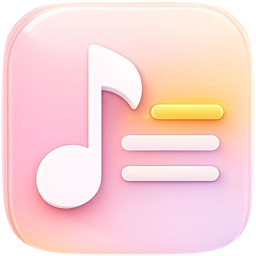
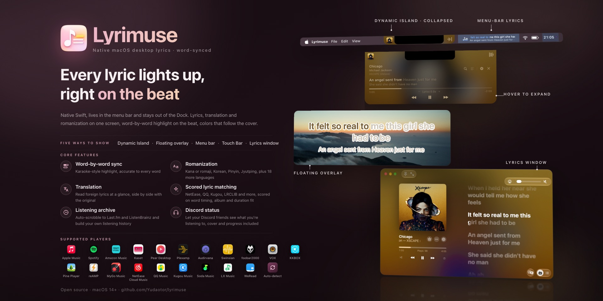
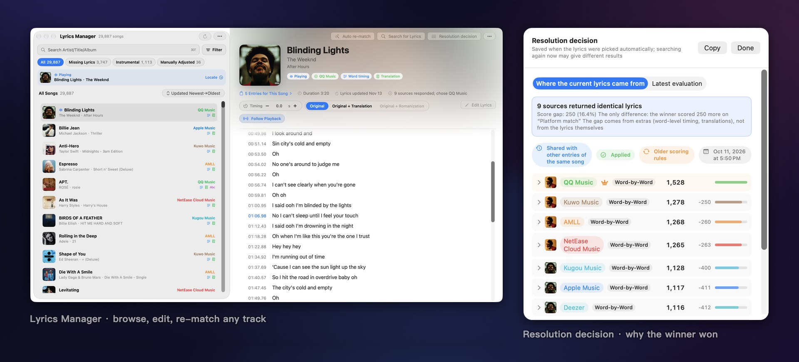
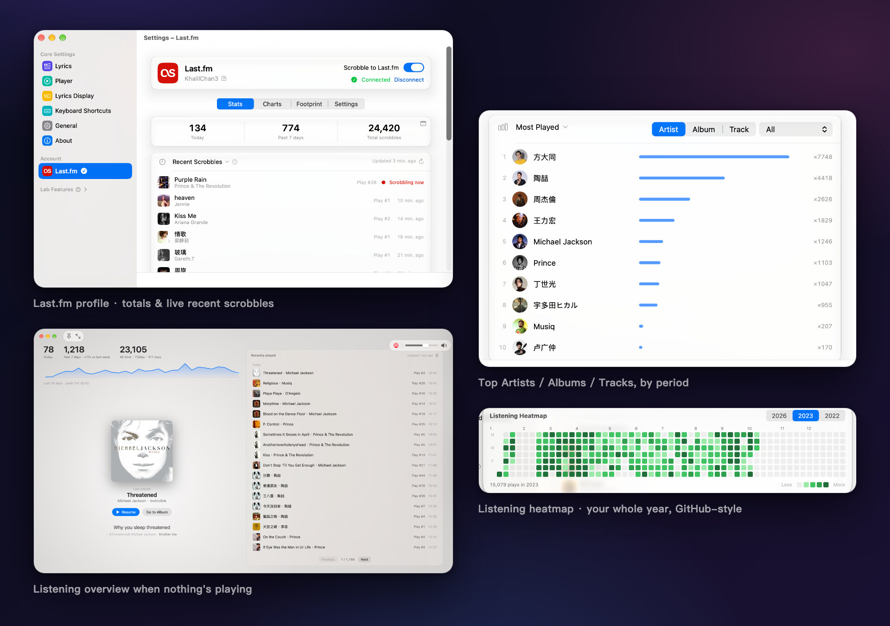
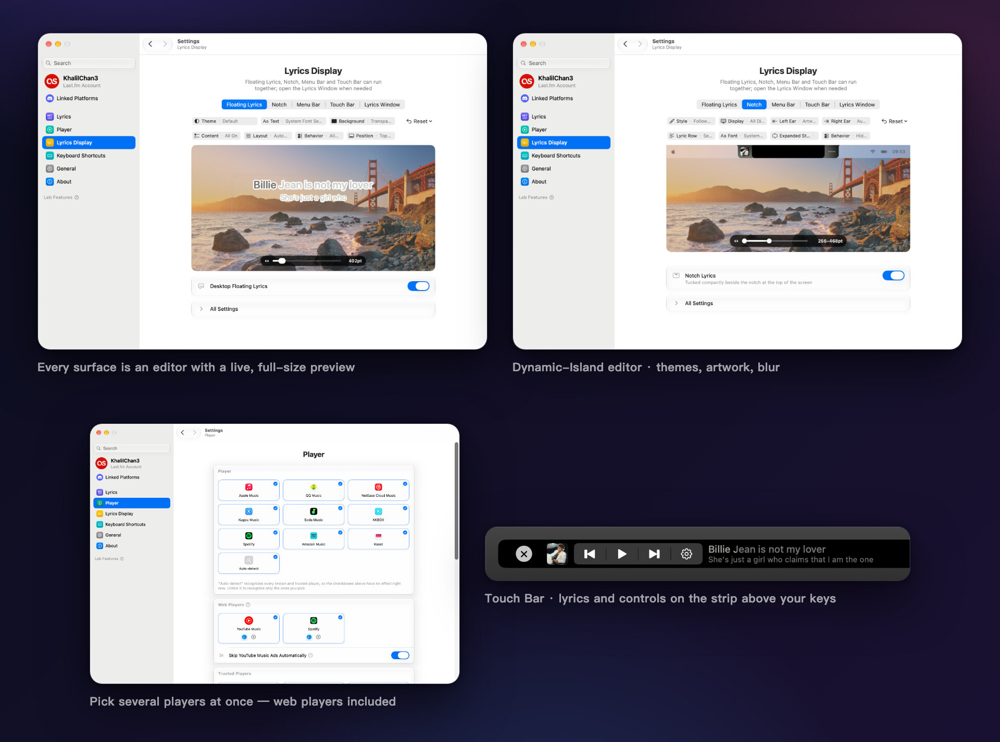

<div align="center">



# Lyrimuse

**Mac के लिए डेस्कटॉप पर गीत के बोल, एक नए अंदाज़ में।**

**Language / 语言 / 語言 / 言語 / 언어 / Idioma / Langue / Sprache / Lingua / Язык / Мова / ภาษา / Dil / भाषा:** [English](README.md) | [简体中文](README.zh-CN.md) | [繁體中文](README.zh-Hant.md) | [日本語](README.ja.md) | [한국어](README.ko.md) | [Español](README.es.md) | [Français](README.fr.md) | [Deutsch](README.de.md) | [Italiano](README.it.md) | [Português (Brasil)](README.pt-BR.md) | [Tiếng Việt](README.vi.md) | [Русский](README.ru.md) | [Українська](README.uk.md) | [ไทย](README.th.md) | [Türkçe](README.tr.md) | **हिन्दी**


[](https://github.com/Yudaotor/lyrimuse/releases/latest)
[](https://github.com/Yudaotor/lyrimuse/commits/dev)
[](LICENSE)
[](https://github.com/sponsors/Yudaotor)
[](https://discord.gg/N7gVy66Gp3)
[](https://t.me/lyrimuse)
[](https://qm.qq.com/q/Nb4TlwfnQy)

</div>

https://github.com/user-attachments/assets/88b951ee-4ecf-4985-b1cb-eee6afdd5510

Lyrimuse macOS के लिए गीत के बोल दिखाने वाला एक ओपन-सोर्स डेस्कटॉप ऐप है। यह मेन्यू बार में रहता है और गीत चलते समय बोल को शब्द-दर-शब्द हाइलाइट करता है : आपकी सभी विंडो के ऊपर तैरते हुए, मेन्यू बार में, नॉच के नीचे Dynamic Island जैसे कैप्सूल में, Touch Bar पर या पूरी बोल विंडो में। यह Apple Music, Spotify, Amazon Music और YouTube Music ऐप Kaset समेत कुल 22 प्लेयर के साथ काम करता है, साथ ही आपके ब्राउज़र के वेब प्लेयर के साथ भी, और बोल के 16 स्रोत खोजकर सबसे सही मैच चुनता है। चाहें तो अनुवाद और उच्चारण भी मिलता है। यह Last.fm पर आपकी सुनने की प्रोफ़ाइल भी रखता है और आपके प्ले स्क्रॉबल करता है।

**LyricsX से स्विच करना है?** अप्रैल 2022 के बाद से उसका कोई नया रिलीज़ नहीं आया है। Lyrimuse वह सब करता है जो LyricsX करता था, लगातार अपडेट होता रहता है, और चीनी भाषा के प्लेयर, KKBOX, Amazon Music, Kaset, Pear Desktop, reAMP, Pine Player, foobar2000, Cog, Plexamp, MyGo Music, WeRead और वेब प्लेयर का सपोर्ट भी जोड़ता है। विस्तार से जानने के लिए तथ्यों की जाँच के साथ लिखी गई [LyricsX और Lyric Fever से तुलना](docs/lyrics-apps-comparison.md) देखें।

Apple Silicon या Intel पर Homebrew से **इंस्टॉल करें**। यह पहली बार खोलने पर आने वाली Gatekeeper चेतावनी भी आपके लिए हटा देता है। ख़ुद डाउनलोड करना पसंद है? [नवीनतम रिलीज़](https://github.com/Yudaotor/lyrimuse/releases/latest) लें और [शुरुआत करें](#शुरुआत-करें) देखें।

```bash
brew tap yudaotor/lyrimuse
brew trust --cask yudaotor/lyrimuse/lyrimuse   # one-time: Homebrew asks you to trust non-official taps
brew install --cask lyrimuse
```


<p align="center"><sub>बोल दिखाने के चार तरीक़े : बोल विंडो, Dynamic Island जैसा कैप्सूल, शब्द-दर-शब्द हाइलाइट वाले फ़्लोटिंग बोल और मेन्यू बार</sub></p>


<p align="center"><sub>बोल मैनेजर, हर नतीजे पर स्कोर दिखाने वाली मैन्युअल खोज, और वह पैनल जो बताता है कि किसी गीत को यही बोल क्यों मिले</sub></p>


<p align="center"><sub>आपके Last.fm आँकड़े और चार्ट, कुछ न चलने पर दिखने वाला सारांश, और आपके पूरे साल का GitHub जैसा हीटमैप</sub></p>


<p align="center"><sub>हर सेटिंग पेज पर लाइव प्रीव्यू है, एक से ज़्यादा प्लेयर (वेब प्लेयर भी) चुने जा सकते हैं, और बाक़ी सब मेन्यू बार के ड्रॉपडाउन में है</sub></p>

## फ़ीचर

> सेटिंग में हर फ़ीचर कहाँ है और इंस्टॉल करने के बाद वह चालू है या बंद, यह **[फ़ीचर सूची](docs/feature-list.hi.md)** में देखें।

### शब्द-दर-शब्द सिंक किए गए बोल, अपने-आप मैच
- **शब्द-दर-शब्द हाइलाइटिंग**, जो गीत चलने के साथ-साथ आगे बढ़ती है।
- **बोल के 16 स्रोत, जिन्हें आपके लिए खोजा जाता है** : NetEase Cloud Music, QQ Music, Kugou, Kuwo, Migu, LRCLIB, LyricFind (YouTube Music के ज़रिए), Deezer, AMLL (हाथ से चुने गए शब्द-दर-शब्द बोल का डेटाबेस), Soda Music (इसकी अपनी शब्द-दर-शब्द टाइमिंग), VIBE और Genie (दोनों कोरियाई गीतों में मज़बूत), PetitLyrics (जापानी गीतों में मज़बूत), Zing MP3 (वियतनामी गीतों में मज़बूत), Megalobiz (उपयोगकर्ताओं के सिंक किए बोल, सिर्फ़ उन्हीं गीतों के लिए जो आप सुन रहे हैं), और सेटिंग में अपना खाता कनेक्ट करने पर Apple Music के बोल। Apple Music के बोल के लिए सब्सक्रिप्शन चाहिए, और उसके कई गीतों में शब्दों की टाइमिंग होती है। आपको ख़ुद कभी खोजना नहीं पड़ता।
- मूल बोल के नीचे **अनुवाद और उच्चारण**। अगर स्रोत में कम्युनिटी अनुवाद है, तो वही मिलता है। अगर नहीं, तो सेटिंग में “सिस्टम से अनुवाद” चालू करें (डिफ़ॉल्ट रूप से यह बंद है); तब आपका Mac Apple के Translation फ़्रेमवर्क से बोल का अनुवाद करता है, इसलिए बोल आपके कंप्यूटर से बाहर नहीं जाते, और जब यह संभव न हो तो एक ऑनलाइन अनुवादक काम संभालता है। 17 लक्ष्य भाषाएँ उपलब्ध हैं। उच्चारण पंक्ति-दर-पंक्ति तय होता है : किसी चीनी गीत में एक जापानी पंक्ति हो, तो सिर्फ़ उसी पंक्ति को उसका उच्चारण मिलता है, बाक़ी पूरे गीत पर पिनयिन नहीं। कैंटोनीज़ गीतों को Jyutping मिलता है, जो पूरे शब्दों को समझता है। जापानी के लिए इसके बजाय फ़ुरिगाना चुना जा सकता है : सिर्फ़ कांजी के ऊपर हिरागाना, जो गीतों से जापानी सीखते समय काम आता है। रूसी, थाई, ग्रीक और हिन्दी समेत 18 और भाषाओं को भी उच्चारण मिलता है, जो हर भाषा के आधिकारिक रोमनाइज़ेशन या किसी ISO मानक के अनुसार होता है।
- **डुएट गायक के हिसाब से बँटे हुए।** जब स्रोत (या AMLL की कोई एंट्री) बताता है कि कौन-सी पंक्ति कौन गाता है, तो हर हिस्सा अलग दिखता है, दो आवाज़ें एक ही ब्लॉक में घुली-मिली नहीं।
- **बोल विंडो में Apple Music वाली बारीकियाँ** : बैकग्राउंड वोकल मुख्य पंक्ति के नीचे अपनी अलग पंक्ति में, एक-दूसरे पर चढ़ती डुएट पंक्तियाँ दोनों के ख़त्म होने तक साथ-साथ रोशन, और देर तक खिंचे अंग्रेज़ी शब्द जो Apple Music की तरह फूलते और चमकते हैं।
- बोल के लिए **सरलीकृत या पारंपरिक चीनी**, जो ऐप की अपनी भाषा से अलग सेट होती है।
- **बोल मैनेजर**, जब आप चीज़ें व्यवस्थित करना चाहें। किसी भी गीत के बोल देखें, एडिट करें, डिलीट करें या फिर से खोजें, एक साथ कई डिलीट करें, और विज्ञापनों और पॉडकास्ट से बनी ख़ाली एंट्री साफ़ करें। किसी एक गीत की टाइमिंग गड़बड़ हो, तो सिर्फ़ उसी गीत की टाइमिंग खिसकाएँ। एक बटन उन सभी गीतों के लिए फिर से कोशिश करता है जिनके बोल अब भी नहीं मिले, और पूरा रीस्कैन मौजूदा मैचिंग नियमों से आपकी पूरी लाइब्रेरी के बोल फिर से चुनता है। आपने जो कुछ हाथ से ठीक किया है, उसे छुआ नहीं जाता। .lrc फ़ाइलें या पूरा फ़ोल्डर भी इंपोर्ट किया जा सकता है, उन गीतों के लिए भी जिन्हें आपने अभी तक नहीं चलाया, या किसी फ़ोल्डर पर नज़र रखवाई जा सकती है।
- **एक गीत, बोल का एक ही सेट।** अलग-अलग प्लेयर में या अलग-अलग रिलीज़ से चलाया गया एक ही गीत एक ही माना जाता है : उसकी सभी एंट्री एक ही बोल और आपके हाथ से किए बदलाव साझा करती हैं, और उनके प्ले की गिनती जोड़ दी जाती है। बोल मैनेजर में “इस गीत की एंट्री” उनकी पंक्ति-दर-पंक्ति तुलना करता है और ग़लती से मैच हुई एंट्री को अलग कर देता है।
- **बोल विंडो से ही बोल ठीक करें।** दूसरे बोल खोजें, गीत को फिर से मैच करें या उसे अपने टेक्स्ट एडिटर में एडिट करें। शब्द-दर-शब्द बोल एडिट करने पर सिर्फ़ शब्द बदलते हैं, इसलिए हर शब्द की टाइमिंग बनी रहती है।
- जिन गीतों के बोल पहले से कैश में हैं, उनके लिए **ऑफ़लाइन भी काम करता है**।

### Last.fm पर सुनने की प्रोफ़ाइल और स्क्रॉबलिंग
- **सुनने की पूरी प्रोफ़ाइल।** “लिंक की गई सेवाएँ” सेक्शन से एक क्लिक में Last.fm कनेक्ट करें (कोई टोकन कॉपी-पेस्ट नहीं करना पड़ता), फिर आपको आज, पिछले 7 दिन और अब तक के कुल आँकड़े, लाइव “अभी स्क्रॉबल हो रहा है” संकेत, और कवर के साथ आपके हाल के प्ले मिलते हैं, हर प्ले के साथ Last.fm पर उसे पसंद करने (या पसंद हटाने) के लिए दिल का निशान। डिफ़ॉल्ट रूप से हर प्ले Last.fm के कैटलॉग में मेल खाते गीत के रूप में भेजा जाता है, ताकि डुएट के क्रेडिट, सरलीकृत / पारंपरिक चीनी की लिखावट और “ - Single” या “(Remastered)” जैसे पुछल्ले होने पर भी प्ले सही गीत पेज पर पहुँचे; प्लेयर ने जो बताया ठीक वही भेजने के लिए सेटिंग में “मूल” चुनें। ListenBrainz को हमेशा मूल टैग मिलते हैं ([स्क्रॉबलिंग कैसे काम करती है](docs/scrobbling.hi.md))।
- पिछले 7 दिन, 30 दिन, साल या अब तक के **टॉप कलाकार, ऐल्बम और गीत**, हर एक के साथ यह भी कि पिछली अवधि के मुक़ाबले वह कितना ऊपर-नीचे हुआ। किसी कलाकार पर क्लिक करके उसके वे गीत देखें जिन्हें आपने सबसे ज़्यादा सुना है।
- **संगीत का सफ़र**, जिसका अपना अलग टैब है। इसकी शुरुआत आपके कुल आँकड़ों से होती है : आपके पहले स्क्रॉबल को कितने दिन हुए, उनमें से कितने दिन कुछ सुना गया और रोज़ का औसत, आपका सबसे ज़्यादा सुनने वाला दिन, लगातार सुनने का मौजूदा और सबसे लंबा सिलसिला, इस साल अब तक के आँकड़े बनाम किसी पिछले साल की इसी अवधि के, और अगली गोल संख्या वाली उपलब्धि से आप कितनी दूर हैं। उसके नीचे साल का GitHub जैसा हीटमैप है (किसी दिन पर क्लिक करके देखें कि उस दिन आपने सबसे ज़्यादा क्या सुना), दिन के किस घंटे और हफ़्ते के किस दिन सुना जाता है, आपके टॉप कलाकार कहाँ से हैं, और “आज के दिन”, जिसमें दिखता है कि पिछले सालों में इसी तारीख़ को आपने क्या सुना।
- **हर प्ले पहले आपके Mac पर सहेजा जाता है**, Last.fm कनेक्ट करने से पहले भी। बाद में कनेक्ट करें और लगभग पिछले दो हफ़्तों के प्ले एक क्लिक में भेज दें (Last.fm इससे पुराने प्ले स्वीकार नहीं करता)।
- **प्ले कब गिना जाए, यह ख़ुद तय करें** : Last.fm के डिफ़ॉल्ट की तरह 50% पर, 75% या 90% पर, या सिर्फ़ तब जब गीत सच में पूरा हो जाए। ListenBrainz पर इसका असर नहीं पड़ता। किसी प्लेयर को Last.fm से पूरी तरह बाहर भी रखा जा सकता है, ताकि उसके प्ले कभी आपकी हिस्ट्री में न दिखें।
- कुछ न चलने पर **यही हिस्ट्री बोल विंडो में भी दिखती है**, ताकि ख़ाली स्क्रीन के बजाय आपको एक सारांश मिले (इसके बारे में नीचे और जानकारी है)।

### फ़्लोटिंग बोल, मेन्यू बार में बोल, Dynamic Island, Touch Bar या पूरी बोल विंडो
- **कई प्लेयर इस्तेमाल करें, या इसे ख़ुद चुनने दें।** Apple Music, Spotify और Kaset को ऑटोमेशन ऐक्सेस से पढ़ा जाता है। QQ Music, NetEase Cloud Music, Kugou Music, Kuwo Music, Soda Music, KKBOX, Amazon Music और LX Music को macOS के MediaRemote से पढ़ा जाता है और इनके लिए किसी अनुमति की ज़रूरत नहीं। सेटिंग में इनमें से कोई भी मेल चालू करें, या इसे “ऑटोमैटिक पहचान” पर छोड़ दें, तब यह उसी को फ़ॉलो करता है जिसे macOS “अभी चल रहा है” में दिखाता है।
- **Apple Music रेडियो भी चलता है।** स्टेशन पर हर गीत के साथ बोल चलते रहते हैं। होस्ट के बोलते समय आपको पिछले गीत की जगह स्टेशन का नाम और लोगो दिखता है। रेडियो का अपना अलग टाइमिंग ऑफ़सेट होता है, इसलिए किसी स्टेशन को एक बार ठीक करें और फिर भूल जाएँ।
- **ब्राउज़र के प्लेयर भी।** अपने ब्राउज़र को एक बार पेयर करें, फिर YouTube Music या Spotify Web किसी भी दूसरे प्लेयर की तरह काम करते हैं, और बोल पेज की अपनी प्रोग्रेस बार के साथ सिंक रहते हैं। एक क्लिक वाली जाँच पहले ही बता देती है कि ब्राउज़र को कंट्रोल किया जा सकता है या नहीं। विज्ञापन के दौरान कैप्सूल काला हो जाता है और दिखाता है कि कितना समय बचा है और यह कुल कितने में से कौन-सा विज्ञापन है। YouTube Music के विज्ञापनों पर स्किप बटन मिलता है, या उन्हें अपने-आप स्किप किया जा सकता है।
- **चुनें कि बोल कैसे दिखें**, कोई भी मेल या कुछ भी नहीं :
  - डेस्कटॉप पर तैरते बोल, जिन्हें कहीं भी खींचकर रखा जा सकता है, या ऊपर बीच में या Dock के ठीक ऊपर पिन किया जा सकता है;
  - स्क्रीन के ऊपर Dynamic Island जैसा कैप्सूल, जो ऐल्बम कवर दिखा सकता है और उसे कैप्सूल के पीछे धुंधला कर सकता है, बोल वाली पंक्ति को फीका कर सकता है ताकि क्लिक आर-पार चले जाएँ, और चालू करने पर लॉक स्क्रीन पर भी दिख सकता है, साथ में क्विक-ऐक्शन बटनों की एक पंक्ति जिसे ख़ुद सजाया जा सकता है;
  - Touch Bar वाले MacBook Pro पर Touch Bar, जिसमें गाई जा रही पंक्ति साथ-साथ स्क्रॉल होती है, चाहें तो ऐल्बम कवर और प्लेबैक कंट्रोल भी, और टाइप करते समय यह हट जाता है ताकि टाइपिंग सुझाव दिखें;
  - Apple Music के बोल पेज जैसी, आकार बदलने लायक बोल विंडो, जिसमें दो कॉलम, बैकग्राउंड में धुंधला कवर, मौजूदा पंक्ति के साथ स्क्रॉल होता पूरा गीत, Apple Music पर रिकॉर्ड का मोशन कवर होने पर चलता हुआ ऐल्बम कवर, और गीत का Spotify Canvas लूप वीडियो होने पर वही बैकग्राउंड में होता है। शब्द गाए जाते ही भरते जाते हैं, आपकी चुनी मोटाई, गाए हिस्से के रंग और अलाइनमेंट के साथ, और “HDR हाइलाइट” HDR डिस्प्ले पर गाए हुए हिस्से को सफ़ेद से भी ज़्यादा चमका सकता है।
- **मेन्यू बार में बोल (टेक्स्ट मोड)।** मौजूदा पंक्ति सीधे मेन्यू बार में दिखती है। लंबी पंक्तियाँ बीच में कटने के बजाय स्क्रॉल होती हैं (चाहें तो फिर से काटने वाला तरीक़ा चुना जा सकता है)। दूसरी पंक्ति में अगली पंक्ति, अनुवाद या उच्चारण दिख सकता है, और कैप्सूल भी यही कर सकता है।
- **कंट्रोल सेंटर की तरह सजाया जाने वाला मेन्यू बार पैनल।** गीत, प्लेबैक कंट्रोल और टाइल का ग्रिड देखने के लिए मेन्यू बार आइकन पर क्लिक करें। टाइल खींचें, उनका आकार बदलें, जोड़ें या हटाएँ, किसी टाइल को देर तक दबाकर उसकी सेटिंग खोलें और नीचे की बार को फिर से सजाएँ। एक शॉर्टकट पैनल खोलता है, और पैनल कीबोर्ड से भी चलता है।
- बोल विंडो और कैप्सूल में **प्रोग्रेस बार खींचकर आगे-पीछे जाएँ**।
- बोल विंडो में ही **शफ़ल, रिपीट, पसंदीदा और वॉल्यूम**, जहाँ भी प्लेयर इसकी अनुमति देता है : Apple Music, Spotify, Kaset, QQ Music, Kuwo Music, Amazon Music और ब्राउज़र में YouTube Music इनमें से कुछ या सभी को सपोर्ट करते हैं, और NetEase Cloud Music, Kugou Music, Kuwo Music, Soda Music और LX Music में “पसंदीदा” है। “पसंदीदा” बड़े किए गए कैप्सूल में भी है, और इसके लिए शॉर्टकट भी सेट किया जा सकता है।
- “⋯” मेन्यू या जानकारी पैनल से **गीत को वहीं खोलें जहाँ वह है**। Apple Music में गीत ऐप में खुलता है, Spotify उसी गीत पर पहुँचता है जो चल रहा है, और KKBOX गीत, ऐल्बम या कलाकार को अपने ऐप में खोलता है। QQ Music, Soda Music, Spotify, Amazon Music और YouTube Music (Kaset में चलाने पर) गीत, ऐल्बम या कलाकार का पेज वेब पर खोलते हैं, और NetEase Cloud Music गीत का पेज खोलता है। Lyrimuse को यह लिंक बोल लाते समय मिला या उसने इसे आपके Mac पर प्लेयर के अपने डेटा से पढ़ा, इसलिए कुछ खोजना नहीं पड़ता।
- **कुछ न चलने पर** बोल विंडो आज और इस हफ़्ते के कुल आँकड़े, “आज के दिन” कार्ड, और कवर के साथ आपके हाल के प्ले दिखाती है, और हर प्ले Apple Music में अपने ऐल्बम या कलाकार पेज से लिंक होता है।
- **मिनी बोल विंडो** : एक छोटा कार्ड जो एक पंक्ति, दो पंक्तियाँ या पूरे स्क्रॉल होते बोल दिखाता है, अपने बैकग्राउंड, टेक्स्ट रंग, फ़ॉन्ट, मोटाई और गाए हिस्से के रंग के साथ; सिर्फ़ इसके लिए शब्द-दर-शब्द कराओके बंद किया जा सकता है।
- **फ़ोन, टैबलेट या स्ट्रीम पर “ब्राउज़र में बोल”।** दूसरे डिवाइस के ब्राउज़र में बोल विंडो खोलें और उसे दूसरी स्क्रीन की तरह इस्तेमाल करें, अनुमति देने पर प्लेबैक कंट्रोल और टैप करके किसी पंक्ति पर जाने की सुविधा के साथ। “OBS आउटपुट” फ़्लोटिंग बोल को पारदर्शी ब्राउज़र सोर्स के रूप में आपकी स्ट्रीम में डालता है। जब तक स्थानीय नेटवर्क ऐक्सेस की अनुमति न दी जाए, दोनों इसी Mac तक सीमित रहते हैं, और दूसरे डिवाइस QR कोड स्कैन करके जुड़ते हैं।
- **गीत का परिचय, ऐल्बम का परिचय और कलाकार का परिचय।** बोल विंडो या बड़े किए गए कैप्सूल में शीर्षक, कलाकार या ऐल्बम के नाम पर क्लिक करके उनके बारे में पढ़ें। ऐल्बम का परिचय और कलाकार का परिचय Apple Music से आते हैं, या उसके पास कुछ न हो तो Soda Music (Soda Music में चलाए गए गीत, सिर्फ़ चीनी इंटरफ़ेस में), Kugou Music (Kugou Music में चलाए गए गीत, सिर्फ़ चीनी इंटरफ़ेस में), NetEase Cloud Music (सिर्फ़ चीनी इंटरफ़ेस में), YouTube Music में दिखने वाले Wikipedia लेखों (इंटरफ़ेस की भाषा में) या Last.fm से; गीत का परिचय QQ Music (सिर्फ़ चीनी इंटरफ़ेस में) या Last.fm से आता है।
- **जैसा पसंद हो वैसा रूप दें** : फ़ॉन्ट (सिस्टम का, या आपकी अपनी .ttf / .otf फ़ाइलें), आकार, टेक्स्ट / बैकग्राउंड / छाया के रंग, सहेजी गई थीम या मौजूदा ऐल्बम कवर से लिया गया रंग, और फ़्लोटिंग बोल की चौड़ाई, साथ में बहता हुआ इंद्रधनुषी बोल रंग।
- **स्क्रीनशॉट, रिकॉर्डिंग और स्क्रीन शेयर में छिपा रहता है।** आपको दिखता है, किसी और को नहीं।
- **पॉज़ करने पर ख़ुद छिप जाता है**, ताकि आपके डेस्कटॉप पर बेकार न पड़ा रहे। यह इंस्ट्रुमेंटल गीतों, बिना बोल वाले गीतों और फ़ुल-स्क्रीन ऐप्स के लिए भी हट सकता है, और फ़्लोटिंग बोल उस स्क्रीन पर आपके साथ जा सकते हैं जिस पर आपकी इस्तेमाल हो रही विंडो है।

### रोज़मर्रा की बारीकियाँ
- **अंग्रेज़ी, सरलीकृत चीनी, पारंपरिक चीनी, जापानी, कोरियाई, स्पेनिश, फ़्रेंच, जर्मन, इतालवी, ब्राज़ीलियाई पुर्तगाली, वियतनामी, रूसी, यूक्रेनी, थाई, तुर्की और हिन्दी**, और भाषा बदलना तुरंत लागू होता है, रीस्टार्ट की ज़रूरत नहीं। कोई अटपटा अनुवाद दिखा? पुल रिक्वेस्ट का स्वागत है; हर भाषा की स्टाइल गाइड `lyrimuse/Localization/` में है।
- **macOS 26 पर Liquid Glass।** सेटिंग, मेन्यू बार पैनल, बोल विंडो, बोल मैनेजर और सेटअप गाइड इसी से बने हैं, और इनमें से ज़्यादातर सिस्टम को फ़ॉलो करने के बजाय हमेशा लाइट या डार्क रह सकते हैं।
- हर क्रिया के लिए **कीबोर्ड शॉर्टकट**, सारे बोल छिपाने से लेकर गीत को पसंद करने तक। शुरू में कोई शॉर्टकट सेट नहीं होता, कुंजियाँ ख़ुद चुनें। हर क्रिया का एक `lyrimuse://` लिंक भी है जिसे शॉर्टकट ऐप, Raycast या Alfred से चलाया जा सकता है, और शॉर्टकट ऐप से चलाने पर लिंक अभी चल रहा गीत लौटा सकता है ([URL स्कीम](docs/url-scheme.hi.md))।
- **सेटिंग में खोज।** साइडबार में टाइप करें, यह मिलती-जुलती पंक्ति तक स्क्रॉल करके उसे हाइलाइट करता है, और ज़रूरत हो तो बंद ग्रुप खोल देता है।
- **ख़ुद को अपडेट करता है।** यह अपने-आप जाँच करता है, या तब जब आप मेन्यू बार से कहें। अपडेट सेटिंग के “सॉफ़्टवेयर अपडेट” पेज से इंस्टॉल होते हैं, रिलीज़ नोट्स और प्रोग्रेस वहीं दिखते हैं, और बीटा बिल्ड भी चुने जा सकते हैं।
- **अपने प्लेयर के साथ ही शुरू करें**, हर प्लेयर के लिए अलग से और किसी भी दिशा में : Lyrimuse खुलने पर प्लेयर खोलें, प्लेयर खुलने पर Lyrimuse खोलें, और चाहें तो Lyrimuse जिन प्लेयर को फ़ॉलो करता है उन सभी के बंद होने पर Lyrimuse भी बंद कर दें।
- अगर यह बिना किसी विंडो के, सिर्फ़ मेन्यू बार आइकन के साथ शुरू होना चाहिए, तो **चुपचाप लॉन्च करें** चुनें।
- **नए Mac पर शिफ़्ट करना है?** अपना पूरा सेटअप एक्सपोर्ट करें और वहाँ इंपोर्ट करें। कुछ गड़बड़ हो, तो एक क्लिक में डायग्नॉस्टिक एक्सपोर्ट करने की सुविधा भी है।

### वैकल्पिक सुविधाएँ

<details>
<summary>ListenBrainz, Discord स्टेटस, शेयर करने लायक “अभी चल रहा है” पेज, और दैनिक / साप्ताहिक / मासिक / वार्षिक रिपोर्ट</summary>

ये सभी तब तक बंद रहती हैं जब तक इन्हें सेटिंग में चालू न किया जाए :

- **साथ में [ListenBrainz](https://listenbrainz.org) पर भी स्क्रॉबल करें।** आपके प्लेयर से एक ही बार पढ़ी गई जानकारी से हर प्ले दोनों सेवाओं पर जाता है, इसलिए दोनों हिस्ट्री एक जैसी रहती हैं। आपके iPhone के प्ले (जो Last.fm के ज़रिए दर्ज होते हैं) भी ListenBrainz में कॉपी हो जाते हैं, इसलिए दोनों डिवाइस की दो अलग हिस्ट्री के बजाय आपके पास एक ही हिस्ट्री रहती है।
- **एक सार्वजनिक “अभी चल रहा है” पेज, जिसे शेयर किया जा सकता है** : लाइव प्लेबैक, हिस्ट्री, गेस्टबुक, रिएक्शन, विज़िटर काउंटर, टॉप-10 कलाकारों का बोर्ड, विनाइल रिकॉर्ड जैसा रूप, लाइट और डार्क थीम, और चैट ऐप्स में ठीक से दिखने वाले लिंक प्रीव्यू। **[वेब फ़ीचर गाइड](https://github.com/Yudaotor/nowplaying-workers#readme)** स्क्रीनशॉट के साथ इसे समझाती है।
- **दैनिक, साप्ताहिक, मासिक और वार्षिक सुनने की रिपोर्ट**, जितने चाहें उतने चैनल पर भेजी जाती है : Bark, ntfy, ServerChan, Feishu, DingTalk, WeCom, Telegram, Discord, Slack या कोई सामान्य Webhook। हर चैनल से टेस्ट भेजा जा सकता है, और डिलीवरी हिस्ट्री दिखाती है कि क्या पहुँचा।
- **Discord पर दिखाएँ कि अभी क्या सुना जा रहा है।** आपकी प्रोफ़ाइल और दोस्तों की सूची में आपका प्लेयर, गीत, कलाकार, ऐल्बम कवर और प्रोग्रेस बार दिखता है, और गीत का शीर्षक और कलाकार उस प्लेयर की साइट पर अपने-अपने पेज से लिंक होते हैं। ऐल्बम वाली पंक्ति में गाई जा रही पंक्ति दिख सकती है, और ज़्यादा से ज़्यादा दो बटन जोड़े जा सकते हैं। कवर के कोने में Lyrimuse या प्लेयर का छोटा बैज रहता है (या कोई नहीं), और पॉज़ किया गया गीत पॉज़ आइकन के साथ दिखता रह सकता है। कौन-से प्लेयर गिने जाएँ, यह ख़ुद चुनें; गीत का नाम बताए बिना सिर्फ़ प्लेयर भी दिखाया जा सकता है, और इसे कुछ समय के लिए छिपाया भी जा सकता है।

ListenBrainz और “वेब पुश” सेटिंग के साइडबार में **प्रयोग** के अंदर हैं, “पुश सूचनाएँ” बाक़ी सेक्शन के साथ है, और Discord की अपनी अलग एंट्री ऊपर की ओर है। हर कार्ड के साथ उसके अपने सेटअप स्टेप आते हैं : API की या टोकन कहाँ से लें, खाता कैसे कनेक्ट करें, अपनी पुश सेवा के लिए Webhook URL कैसे पाएँ। सिर्फ़ वेब पेज की अलग गाइड है, और उसकी भी पूरी ज़रूरत नहीं पड़ती। सिर्फ़ ListenBrainz सेट करने पर ही पेज लाइव प्लेबैक और हिस्ट्री दिखाने लगता है, Cloudflare Worker की ज़रूरत नहीं। अगर आपको गेस्टबुक, रिएक्शन, विज़िटर काउंटर, टॉप-10 बोर्ड और तेज़ अपडेट भी चाहिए, तो एक Worker डिप्लॉय करें; गाइड में इसका तरीक़ा दिया है।

</details>

## शुरुआत करें

रिलीज़ प्रोजेक्ट के अपने सर्टिफ़िकेट से साइन किए जाते हैं, Apple Developer ID से नहीं, इसलिए नीचे के किसी भी विकल्प में Apple Developer खाते की ज़रूरत नहीं पड़ती। बस इतनी सी बात है कि पहली बार ऐप खोलने पर Gatekeeper कहता है कि यह “अनजान डेवलपर से है”। Homebrew (विकल्प A) यह आपके लिए हटा देता है। बाक़ी विकल्पों में ऐसा होना अपेक्षित है, यह कोई बग नहीं, और विकल्प B बताता है कि इसे एक बार कैसे पार करें।
### विकल्प 0 — इंस्टॉल का काम किसी AI को सौंपें

क्या आपके Mac पर कोई ऐसा AI एजेंट चल रहा है जो टर्मिनल इस्तेमाल कर सकता है (Claude Code, Codex CLI, Gemini CLI, …)? नीचे का ब्लॉक जैसा है वैसा उसमें पेस्ट करें, और वह विकल्प A/B का सारा काम आपके लिए कर देगा। निर्देश उसे सिर्फ़ यही एक ऐप इंस्टॉल करने देते हैं। वह `sudo` इस्तेमाल नहीं करेगा और पूरे सिस्टम की सुरक्षा सेटिंग को नहीं छुएगा :

```text
Please install Lyrimuse — an open-source macOS menu-bar lyrics app
(https://github.com/Yudaotor/lyrimuse) — on this Mac, following these rules exactly:

1. Preferred path (if `brew` exists):
     brew tap yudaotor/lyrimuse
     brew trust --cask yudaotor/lyrimuse/lyrimuse
     brew install --cask lyrimuse
   If this Homebrew doesn't know the `trust` subcommand, skip that line — older
   versions don't need it.
2. If Homebrew is not installed, do NOT install Homebrew. Instead: check the CPU
   with `uname -m`, download the latest release asset from
   https://github.com/Yudaotor/lyrimuse/releases — `Lyrimuse-v<version>-macos.zip`
   for arm64, `Lyrimuse-v<version>-macos-intel.zip` for x86_64 — verify it against
   its `.sha256` file (`shasum -c`), unzip, move `Lyrimuse.app` into
   /Applications, then clear the Gatekeeper quarantine flag on that one app only:
     xattr -dr com.apple.quarantine /Applications/Lyrimuse.app
3. Safety rails: no `sudo` anywhere (nothing here needs it); never run
   `spctl --master-disable` or otherwise weaken Gatekeeper system-wide; never
   remove the quarantine flag from anything except /Applications/Lyrimuse.app.
4. Do not build from source unless I explicitly ask.
5. Launch it (`open -a Lyrimuse`) and verify it is running (`pgrep -x Lyrimuse`
   prints a PID).
6. A first-run wizard will appear — that part is mine to click through. Tell me
   it will ask me to pick a music player, to grant Automation access to
   Music.app and/or Spotify (only if I pick them), and to enable the background
   lyrics engine — then hand control back to me.
Finally, report what you did and anything that failed.
```

### विकल्प A — Homebrew से इंस्टॉल करें (सुझाया गया)

```bash
brew tap yudaotor/lyrimuse
brew trust --cask yudaotor/lyrimuse/lyrimuse   # one-time: Homebrew asks you to trust non-official taps
brew install --cask lyrimuse
```

इंस्टॉल के दौरान ही यह एक बार वाला Gatekeeper क्वारंटीन अपने-आप हटा देता है, इसलिए बाद में कोई स्टेप नहीं बचता। `brew install` पूरा होते ही Lyrimuse को `/Applications` (या Spotlight) से खोलें। `brew upgrade --cask lyrimuse` नए रिलीज़ भी इसी तरह ले आता है।

### विकल्प B — पहले से बना रिलीज़ ख़ुद डाउनलोड करें

1. इसे [Releases पेज](https://github.com/Yudaotor/lyrimuse/releases) से लें। **पहले देख लें कि आपका Mac कौन-सा है** ( → इस Mac का परिचय → “चिप” : `Apple M…` का मतलब Apple Silicon, `Intel Core…` का मतलब Intel) :

   | आपका Mac | डाउनलोड |
   | --- | --- |
   | Apple Silicon (M1 और बाद के) | `Lyrimuse-*-macos.dmg` या `.zip` |
   | Intel | `Lyrimuse-*-macos-intel.dmg` या `.zip` |

   dmg हो तो डबल-क्लिक करके माउंट करें और `Lyrimuse.app` को बगल वाले `Applications` शॉर्टकट पर खींचें; zip हो तो अनज़िप करके `Lyrimuse.app` को `/Applications` में खींचें। दोनों फ़ॉर्मेट बिल्कुल एक ही ऐप इंस्टॉल करते हैं, और डाउनलोड जाँचना चाहें तो zip के साथ एक `.sha256` फ़ाइल आती है (उसी फ़ोल्डर में `shasum -c Lyrimuse-*.zip.sha256` चलाएँ)।

   दोनों डाउनलोड में फ़र्क़ सिर्फ़ आर्किटेक्चर का है : बिना सफ़िक्स वाला सिर्फ़ Apple Silicon के लिए है, जबकि `-intel` में Intel और Apple Silicon दोनों का कोड है। `-intel` Apple Silicon पर चलता तो है, पर वहाँ इसे इस्तेमाल करने की कोई वजह नहीं : इसका आकार दोगुना है, और macOS 27 और उसके बाद के संस्करण चेतावनी देंगे कि ऐप को “अपडेट करने की ज़रूरत है”, क्योंकि उसमें Intel कोड है (Apple macOS 28 में Rosetta हटा रहा है; ऐप में असल में कोई ख़राबी नहीं है)।

   **दोनों आर्किटेक्चर को ऐप के अंदर से अपने-आप अपडेट मिलते हैं।** फ़ीड में एक ही संस्करण की दो एंट्री होती हैं, हर आर्किटेक्चर के लिए एक : Apple Silicon को बिना सफ़िक्स वाला बिल्ड मिलता है, Intel को `-intel` वाला, और Sparkle हर मशीन के लिए ख़ुद सही वाला चुन लेता है। (v1.4.0 और उससे पहले के संस्करण सिर्फ़ Apple Silicon को अपडेट देते थे; Intel उपयोगकर्ताओं को हाथ से यहाँ वापस आना पड़ता था।)
2. पहली बार खोलने पर macOS इसे खोलने से मना कर देगा और “Apple द्वारा यह सत्यापित नहीं किया जा सका कि ‘Lyrimuse’ में ऐसा मालवेयर नहीं है जो आपके Mac को नुक़सान पहुँचा सकता है या आपकी गोपनीयता प्रभावित कर सकता है” या “अनजान डेवलपर से है” जैसा संदेश दिखाएगा। इसे एक बार हटाएँ, नीचे के तरीक़ों में से जो आपको ज़्यादा सहज लगे :

   - **टर्मिनल (सुझाया गया, हमेशा काम करता है) :**
     ```bash
     xattr -dr com.apple.quarantine /Applications/Lyrimuse.app
     ```
     इसके बाद ऐप को सामान्य तरीक़े से खोलें। हर डाउनलोड के लिए यह सिर्फ़ एक बार करना होता है।
   - **राइट-क्लिक → खोलें :** Finder में `Lyrimuse.app` पर राइट-क्लिक (या Control-क्लिक) करें और **खोलें** चुनें, फिर डायलॉग में दोबारा **खोलें** से पुष्टि करें। यह हर macOS संस्करण पर हर तरह की चेतावनी के लिए काम नहीं करता, इसलिए अगर चेतावनी बनी रहे तो ऊपर वाला टर्मिनल कमांड इस्तेमाल करें।
   - **सिस्टम सेटिंग → गोपनीयता और सुरक्षा :** ऐप को एक बार खोलने की कोशिश करें (वह ब्लॉक हो जाएगा), फिर **सिस्टम सेटिंग → गोपनीयता और सुरक्षा** खोलें, सबसे नीचे तक स्क्रॉल करें, और Lyrimuse वाली चेतावनी के बगल में **फिर भी खोलें** पर क्लिक करें। पूछा जाए तो एक बार और पुष्टि करें।

   यह सिर्फ़ उसी बिल्ड के लिए करें जिस पर आपको सच में भरोसा है : इस रिपॉज़िटरी के Releases पेज वाला, या जिसे आपने ख़ुद बिल्ड किया है।

### विकल्प C — सोर्स से बिल्ड करें

**एक बार की तैयारी** (जो पहले से है उसे छोड़ दें) :

```bash
xcode-select --install   # Xcode Command Line Tools, for Swift — skip if `swift --version` already works
brew install go          # any Go ≥ 1.21 — build.sh switches to 1.24.4 automatically via GOTOOLCHAIN
```

इसके बाद `build.sh` एक ही बार में ऐप और उसका बोल इंजन (`lyrimuse-engine` नाम की बैकग्राउंड प्रोसेस) दोनों बिल्ड करता है :

```bash
git clone https://github.com/Yudaotor/lyrimuse.git
cd lyrimuse/lyrimuse
./build.sh              # this machine's architecture
./build.sh --universal  # arm64 + x86_64 (the compatibility build shipped for Intel)
```

`build.sh` आख़िर में बंडल की हर बाइनरी के आर्किटेक्चर की सूची देता है और लक्ष्य से मेल न खाने वाली हर चीज़ को चिह्नित करता है, चाहे कोई स्लाइस कम हो या कोई फ़ालतू हो। रिलीज़ फ़ाइलें हाथ से न जोड़ें : `./package.sh` हर आर्किटेक्चर को एक बार बिल्ड करता है और हर एक के लिए zip + sha256 + dmg बनाता है, और आर्किटेक्चर ग़लत होने पर पैकेज बनाने से मना कर देता है।

QQ Music / NetEase Cloud Music / Kugou Music / Kuwo Music / Soda Music / KKBOX / Amazon Music / LX Music / Spotify / Kaset / Pear Desktop / reAMP / VOX / Pine Player / foobar2000 / Cog / Swinsian / Plexamp / MyGo Music / WeRead / “ऑटोमैटिक पहचान” के सपोर्ट के लिए इसके अलावा [ungive/media-control](https://github.com/ungive/media-control) भी चाहिए। अगर यह मौजूद न हो तो `build.sh` इसे Homebrew से अपने-आप इंस्टॉल कर देता है, इसलिए यह भी कोई ऐसा स्टेप नहीं जो आपको ख़ुद करना पड़े।

### किसी भी विकल्प के बाद

Lyrimuse को `/Applications` से खोलें। पहली बार चलने वाला विज़ार्ड आपको एक-एक करके ये स्टेप कराता है : प्लेयर चुनना (Apple Music, QQ Music, NetEase Cloud Music, Kugou Music, Kuwo Music, Soda Music, KKBOX, Amazon Music, Spotify, Kaset, Pear Desktop, reAMP, VOX, Pine Player, foobar2000, Cog, Swinsian, Plexamp, MyGo Music, Audirvana, LX Music, WeRead या “ऑटोमैटिक पहचान”), Apple Music, Spotify, Kaset, VOX, Swinsian या Audirvana चुनने पर ऑटोमेशन ऐक्सेस देना (बाक़ी प्लेयर को गीत की बुनियादी जानकारी पढ़ने के लिए किसी अनुमति की ज़रूरत नहीं), और उसका बोल इंजन चालू करना (ताकि विंडो बंद होने पर भी बोल/कवर मिलते रहें)। विज़ार्ड पूरा करें और बोल तुरंत दिखने लगेंगे (बिल्ड के और विकल्पों के लिए [lyrimuse/README.md](lyrimuse/README.md) देखें)।

बोल के लिए बस इतना ही चाहिए। वैकल्पिक सुविधाएँ बाद में जब चाहें सेटिंग से सेट की जा सकती हैं।

## अक्सर पूछे जाने वाले सवाल

### Mac डेस्कटॉप पर हमेशा सबसे ऊपर तैरते Apple Music के बोल कैसे पाएँ?
सेटिंग में डेस्कटॉप पर फ़्लोटिंग बोल चालू करें। ये हर विंडो के ऊपर, हर Space पर रहते हैं। इन्हें जहाँ चाहें खींचकर रखें, या ऊपर बीच में या Dock के ठीक ऊपर पिन करें। अगर बोल में शब्दों की टाइमिंग है, तो हर शब्द गाए जाते ही भर जाता है। इन्हें स्क्रीनशॉट, रिकॉर्डिंग और स्क्रीन शेयर से छिपाया जा सकता है, और संगीत पॉज़ होने पर ग़ायब भी करवाया जा सकता है। QQ Music, NetEase Cloud Music, Kugou Music, Kuwo Music, Soda Music, KKBOX, Amazon Music, LX Music, Spotify, Kaset, Pear Desktop, reAMP, VOX, Pine Player, foobar2000, Cog, Swinsian, Plexamp, MyGo Music, Audirvana, WeRead और वेब प्लेयर के साथ भी यह इसी तरह काम करता है।

### क्या Mac के मेन्यू बार में Spotify के बोल दिखाए जा सकते हैं?
हाँ। मेन्यू बार का टेक्स्ट मोड चालू करें, फिर मौजूदा पंक्ति मेन्यू बार में दिखती है, Spotify या किसी भी दूसरे समर्थित प्लेयर के लिए। लंबी पंक्तियाँ कटने के बजाय स्क्रॉल होती हैं, और दूसरी पंक्ति में अगली पंक्ति, अनुवाद या उच्चारण दिख सकता है। Spotify खाता कनेक्ट करने की ज़रूरत नहीं। Lyrimuse एक बार Spotify के लिए ऑटोमेशन ऐक्सेस माँगता है, जिससे उसे प्लेबैक की सटीक स्थिति मिलती है और प्लेबैक बटन काम करते हैं। अगर अनुमति न दी जाए, तो बोल फिर भी दिखते हैं, पर टाइमिंग macOS के MediaRemote से आती है और लगभग एक सेकंड आगे-पीछे हो सकती है।

### क्या QQ Music, NetEase Cloud Music, Kugou या Soda Music के लिए शब्द-दर-शब्द बोल दिखते हैं?
हाँ, बशर्ते बोल में शब्दों की टाइमिंग हो। NetEase Cloud Music, QQ Music, Kugou, Soda Music, AMLL और Apple Music में अक्सर होती है, और वे पंक्तियाँ शब्द-दर-शब्द भरती हैं। सिर्फ़ पंक्ति की टाइमिंग वाले बोल में पूरी पंक्ति एक साथ रोशन होती है। प्लेयर यह भी तय नहीं करता कि बोल कहाँ से आएँ : Soda Music में चल रहे गीत को QQ Music के शब्द-दर-शब्द बोल मिल सकते हैं, अगर उनका स्कोर सबसे अच्छा हो।

### क्या इसे इंस्टॉल करने के लिए Apple Developer खाते की ज़रूरत है?
नहीं। रिलीज़ Apple Developer ID के बजाय प्रोजेक्ट के अपने सर्टिफ़िकेट से साइन किए जाते हैं, इसलिए न आपको और न प्रोजेक्ट को इसकी ज़रूरत है। इसी वजह से एक बार का Gatekeeper स्टेप भी है, जो ऊपर “शुरुआत करें” में बताया गया है।

### क्या Lyrimuse Mac App Store पर है?
नहीं। इसे Homebrew से इंस्टॉल करें (ऊपर विकल्प A) या [Releases पेज](https://github.com/Yudaotor/lyrimuse/releases) से डाउनलोड करें (विकल्प B)। दोनों ही तरीकों में उसके बाद अपडेट ऐप के ज़रिए आते हैं।

### क्या Lyrimuse मुफ़्त है?
हाँ। यह GPL-3.0 के तहत ओपन सोर्स है। न कोई पेड संस्करण है, न इन-ऐप ख़रीदारी, न साइन अप करने के लिए कोई खाता। Last.fm और दूसरी सेवाएँ इस्तेमाल करना आपकी मर्ज़ी है। अगर यह आपके काम आता है और इसका साथ देना हो, तो [GitHub पर स्पॉन्सर करें](https://github.com/sponsors/Yudaotor) या Alipay या WeChat Pay से [लेखक को एक कॉफ़ी पिलाएँ](https://yudaotor.github.io/donate/)।

### जब कोई दूसरा ऐप सिस्टम का मीडिया फ़ोकस ले ले, तब क्या QQ Music, NetEase Cloud Music या Soda Music को कंट्रोल किया जा सकता है?
हाँ। जब ब्राउज़र का कोई वीडियो जैसा कुछ macOS का “अभी चल रहा है” ले लेता है, तो सिस्टम की मीडिया कुंजियाँ उसी पर जाती हैं; तब Lyrimuse इसके बजाय QQ Music, NetEase Cloud Music, Kuwo Music, MyGo Music या Cog के अपने मेन्यू बार में, या Soda Music के प्ले बार पर, प्ले/पॉज़, पिछला और अगला दबाता है, और प्लेयर बैकग्राउंड में ही रहता है। इसके लिए ऐक्सेसिबिलिटी ऐक्सेस चाहिए (सेटिंग → प्लेयर); इसके बिना ये बटन वह पेज खोल देते हैं। इस स्थिति में आगे-पीछे जाना (सीक) उपलब्ध नहीं है। macOS 27 पर यह अनुमति **सिस्टम सेटिंग → गोपनीयता और सुरक्षा → डिवाइस नियंत्रण और डेटा ऐक्सेस** में है; पिछले संस्करण इसे **ऐक्सेसिबिलिटी** कहते हैं।

### क्या यह Spotify, QQ Music या NetEase Cloud Music के साथ काम करता है, या सिर्फ़ Apple Music के साथ?
इन सभी के साथ, और साथ ही Kugou Music, Kuwo Music, Soda Music, KKBOX, Amazon Music, Kaset (एक YouTube Music ऐप), ओपन-सोर्स YouTube Music डेस्कटॉप ऐप Pear Desktop, Winamp जैसा प्लेयर reAMP, लॉसलेस और हाई-रेज़ लोकल प्लेयर VOX, लगभग हर फ़ॉर्मेट चलाने वाला मुफ़्त लोकल प्लेयर Pine Player, Windows से आया क्लासिक लोकल प्लेयर foobar2000, chiptune और ट्रैकर फ़ॉर्मैट तक चलाने वाला ओपन-सोर्स लोकल प्लेयर Cog, बड़ी लाइब्रेरी के लिए बना लोकल प्लेयर Swinsian, आपके अपने सर्वर के लिए Plex का संगीत प्लेयर Plexamp, लोकल फ़ाइलें चलाने वाला और प्लगइन से दूसरे स्रोत जोड़ने वाला ओपन-सोर्स MyGo Music, ऑडियोफ़ाइल के लिए हाई-रेज़ प्लेयर Audirvana, ओपन-सोर्स LX Music, और ऑडियोबुक के लिए WeRead के साथ भी, यानी कुल 22 प्लेयर। या macOS में “अभी चल रहा है” में जो भी दिखे, उसे अपने-आप पहचानने दें। Apple Music, Spotify, Kaset, VOX, Swinsian और Audirvana ऑटोमेशन ऐक्सेस माँगते हैं (Spotify, Kaset, VOX और Swinsian इसका इस्तेमाल सटीक टाइमिंग और प्लेबैक बटन के लिए करते हैं; Audirvana “अभी चल रहा है” को कुछ नहीं बताता, इसलिए गीत, उसकी स्थिति और प्लेबैक बटन सब इसी से चलते हैं)। शेष 16 प्लेयर को macOS के MediaRemote से गीत की बुनियादी जानकारी पढ़ने के लिए किसी अनुमति की ज़रूरत नहीं; QQ Music, NetEase Cloud Music, Kugou Music, Kuwo Music, Soda Music और Amazon Music के शफ़ल, रिपीट और पसंद वाले बटन, और reAMP, foobar2000 और Cog के शफ़ल, रिपीट और वॉल्यूम के लिए ऐक्सेसिबिलिटी ऐक्सेस चाहिए; Pine Player इसका इस्तेमाल अपनी प्रोग्रेस बार पढ़ने के लिए करता है, क्योंकि वह स्थिति सिर्फ़ सेकंड तक बताता है। KKBOX, Amazon Music या LX Music के साथ, उस ऐप ने गीत के लिए जो बोल पहले से सहेजे हैं उन पर भी विचार किया जाता है, और इनमें से किसी से भी कभी संपर्क नहीं किया जाता।

### क्या Mac पर KKBOX या Amazon Music के बोल दिखाए जा सकते हैं?
हाँ। दोनों को macOS के MediaRemote से पढ़ा जाता है, इसलिए कोई अनुमति नहीं देनी पड़ती, और उनके बोल किसी भी दूसरे प्लेयर की तरह फ़्लोटिंग बोल, मेन्यू बार, कैप्सूल और बोल विंडो में दिखते हैं। अगर KKBOX या Amazon Music ने गीत के लिए पहले से बोल सहेजे हैं, तो उन पर भी विचार किया जाता है और उन्हें ज़्यादा वज़न मिलता है। Lyrimuse कभी भी इनमें से किसी सेवा में साइन इन नहीं करता और न उन्हें कुछ भेजता है। दूसरे स्रोत फिर भी खोजे जाते हैं, इसलिए अगर उनमें से किसी के पास कुछ बेहतर हो, जैसे शब्द-दर-शब्द टाइमिंग, तो वही चुना जाता है।


### क्या यह LX Music (洛雪音乐) के साथ काम करता है?
हाँ। LX Music को macOS के MediaRemote से पढ़ा जाता है, इसलिए कोई अनुमति नहीं देनी पड़ती। LX Music में कोई गीत चलाने पर, उसने उस गीत के लिए जो बोल सहेजे हैं (प्लैटफ़ॉर्म के पास हों तो शब्द-दर-शब्द) उन पर भी विचार किया जाता है और उन्हें ज़्यादा वज़न मिलता है, और चल रही सूची के अगले गीतों के बोल पहले से तैयार कर लिए जाते हैं। Lyrimuse आपके Mac पर सिर्फ़ LX Music का डेटा पढ़ता है और उसे कभी कुछ नहीं भेजता।

### क्या यह YouTube Music के किसी डेस्कटॉप ऐप के साथ काम करता है?
हाँ, [Kaset](https://github.com/sozercan/kaset) के साथ, जो Mac के लिए एक नेटिव, ओपन-सोर्स YouTube Music ऐप है। Kaset को ऑटोमेशन ऐक्सेस से पढ़ा जाता है, जिससे सटीक टाइमिंग और काम करने वाले प्लेबैक बटन मिलते हैं, और YouTube Music के अपने बोल भी विकल्पों में शामिल होते हैं। ओपन-सोर्स डेस्कटॉप क्लाइंट [Pear Desktop](https://github.com/pear-devs/pear-desktop) भी काम करता है, macOS के “अभी चल रहा है” के ज़रिए, बिना किसी अतिरिक्त अनुमति के। ब्राउज़र में YouTube Music भी काम करता है, नीचे देखें।

### डेस्कटॉप पर बोल कैसे दिखते हैं?
डेस्कटॉप पर कराओके जैसे। मौजूदा पंक्ति आपकी विंडो के ऊपर तैरती है, बोल में शब्दों की टाइमिंग हो तो हर शब्द गाए जाते ही भरता है, और साथ में अनुवाद या उच्चारण भी रह सकता है। फ़ॉन्ट, आकार, टेक्स्ट, बैकग्राउंड और छाया के रंग और चौड़ाई बदले जा सकते हैं, और टेक्स्ट का रंग ऐल्बम कवर के हिसाब से रखा जा सकता है। यही बोल मेन्यू बार में, नॉच के नीचे Dynamic Island जैसे कैप्सूल में, या Apple Music जैसी पूरी बोल विंडो में भी दिख सकते हैं, किसी भी मेल में।

### क्या Dynamic Island कैप्सूल बिना नॉच वाले Mac पर काम करता है?
हाँ। बिना नॉच वाली स्क्रीन पर, जैसे पुराने MacBook या बाहरी डिस्प्ले पर, कैप्सूल ऊपर बीच में रहता है और उसकी ऊँचाई मेन्यू बार जितनी होती है। यह किस स्क्रीन पर दिखे, यह सेटिंग में चुनें।

### क्या इंटरनेट कनेक्शन के बिना बोल काम करेंगे?
हाँ, उन सभी गीतों के लिए जिनके बोल यह पहले ही ढूँढ चुका है, क्योंकि वे आपके Mac पर कैश रहते हैं। किसी गीत के बोल पहली बार ढूँढने के लिए कनेक्शन चाहिए, और ऑनलाइन अनुवाद के लिए भी।

### क्या मेरा कोई डेटा मेरे Mac से बाहर जाता है?
बोल ढूँढने के लिए इसे बोल के स्रोतों से चल रहे गीत के बारे में पूछना पड़ता है : NetEase, QQ, Kugou, Kuwo, Migu, LRCLIB, LyricFind, Deezer, AMLL, Soda Music, VIBE, Genie, PetitLyrics, Zing MP3, Megalobiz, और कनेक्ट करने पर Apple Music। कवर iTunes Search API से आते हैं। अनुवाद डिफ़ॉल्ट रूप से आपके Mac पर होता है, और बोल का टेक्स्ट सिर्फ़ फ़ॉलबैक के तौर पर किसी ऑनलाइन अनुवादक (पहले Google का वेब अनुवाद, फिर MyMemory) को जाता है। आपकी सुनने की हिस्ट्री, कैश किए गए बोल और सेटिंग आपके Mac की फ़ाइलों में ही रहते हैं, जब तक Last.fm, ListenBrainz या वैकल्पिक वेब रिले कनेक्ट न किया जाए। अनाम उपयोग डेटा (संस्करण, कौन-से फ़ीचर चालू हैं, क्रैश सारांश; गीतों के नाम या खाते कभी नहीं) डिफ़ॉल्ट रूप से दिन में एक बार भेजा जाता है, और इसे सेटिंग › जानकारी में बंद किया जा सकता है। पूरी सूची नीचे [लाइसेंस और कॉपीराइट](#लाइसेंस-और-कॉपीराइट) में है।

### क्या बोल का जापानी/कोरियाई उच्चारण या चीनी अनुवाद मिल सकता है?
हाँ। उच्चारण पंक्ति-दर-पंक्ति तय होता है, इसलिए कई भाषाओं वाले गीत में उच्चारण सिर्फ़ वहीं मिलता है जहाँ उसकी ज़रूरत है। जापानी के लिए रोमाजी या फ़ुरिगाना (कांजी के ऊपर हिरागाना) दिख सकता है। अनुवाद बोल के स्रोत के कम्युनिटी अनुवाद से आता है, अगर वह हो; नहीं तो “सिस्टम से अनुवाद” (डिफ़ॉल्ट रूप से बंद) चालू करने पर डिवाइस पर होने वाले या ऑनलाइन मशीन अनुवाद से, 17 भाषाओं में से किसी में भी।

### यह macOS के कौन-से संस्करण सपोर्ट करता है?
macOS 14 Sonoma या उसके बाद के संस्करण (Sequoia, Tahoe और नए), Apple Silicon या Intel पर। Mac पर ही अनुवाद के लिए macOS 15 Sequoia या उसके बाद का संस्करण चाहिए; macOS 14 पर सिर्फ़ ऑनलाइन अनुवादक उपलब्ध हैं।

### क्या यह Intel Mac को सपोर्ट करता है?
हाँ, एक अलग यूनिवर्सल बिल्ड के साथ (ऊपर विकल्प B देखें)। v1.5.0 से Intel पर भी ऑटो-अपडेट काम करते हैं, इसलिए नए संस्करण वैसे ही दिखते हैं जैसे Apple Silicon पर।

### क्या यह ब्राउज़र में चल रहे YouTube Music या Spotify के बोल दिखा सकता है?
हाँ। सेटिंग में एक बार अपना ब्राउज़र पेयर करें, फिर YouTube Music या Spotify Web किसी भी दूसरे प्लेयर की तरह काम करते हैं। बोल अंदाज़ा लगाने के बजाय पेज की अपनी प्रोग्रेस बार को फ़ॉलो करते हैं, और एक क्लिक वाली जाँच पहले ही बता देती है कि आपका ब्राउज़र कंट्रोल किया जा सकता है या नहीं।

### क्या यह Mac पर Apple Music को Last.fm पर स्क्रॉबल कर सकता है?
हाँ, यह ऐप का दूसरा आधा हिस्सा है। सेटिंग से एक क्लिक में Last.fm कनेक्ट करें, फिर Apple Music (या किसी भी दूसरे समर्थित प्लेयर) का हर प्ले लाइव “अभी चल रहा है” स्टेटस के साथ स्क्रॉबल होता है। प्ले पहले आपके Mac पर सहेजे जाते हैं, इसलिए कनेक्ट करने से पहले वाले प्ले खोते नहीं : कनेक्ट होने के बाद लगभग पिछले दो हफ़्तों के प्ले भेजने के लिए “बाक़ी भेजें” पर क्लिक करें। प्ले कब गिना जाए (50%, 75%, 90% या पूरा गीत) यह ख़ुद चुनें; कुछ प्लेयर को बाहर रखा जा सकता है, और साथ ही ListenBrainz पर भी भेजा जा सकता है।

### Lyrimuse ग़लत बोल चुनने से कैसे बचता है?
यह जवाब देने वाला पहला स्रोत ही नहीं ले लेता। हर स्रोत के हर नतीजे को एक ही तरीक़े से स्कोर किया जाता है : शीर्षक, कलाकार, ऐल्बम और लंबाई कितनी मेल खाती है, और साथ में यह कि उसमें शब्दों की टाइमिंग है या नहीं, जैसी बातें। सबसे ज़्यादा स्कोर वाला चुना जाता है। किसी भी गीत के लिए यह फ़ैसला देखा जा सकता है, हर विकल्प के स्कोर और विजेता के चुने जाने की वजह के साथ। अगर बाद में बेहतर मैच मिले, तो Lyrimuse ख़ुद उस पर जा सकता है, पर हाथ से चुने गए बोल लॉक रहते हैं और कभी नहीं बदले जाते। मैन्युअल खोज में भी वही स्कोर और लेबल दिखते हैं, इसलिए ग़लत वर्शन चुनने से पहले ही आसानी से पहचान में आ जाता है।

### अगर बोल सिंक में न हों या ग़लत हों तो क्या करें?
अगर टाइमिंग गड़बड़ है, तो उस गीत के लिए उसे खिसकाएँ; ऑफ़सेट याद रखा जाता है। अगर बोल ग़लत हैं या वर्शन ग़लत है, तो मैन्युअल खोज खोलें। आपको हर स्रोत का हर नतीजा उसके स्कोर के साथ दिखेगा, और आप जो भी चुनें वह लॉक हो जाता है, ताकि ऑटोमैटिक मैचिंग उसे बदल न दे। बोल मैनेजर में किसी भी गीत के बोल हाथ से एडिट भी किए जा सकते हैं।

### क्या बोल को .lrc फ़ाइलों के रूप में सहेजा जा सकता है?
वे पहले से सहेजे जाते हैं। बोल वाले हर गीत की पंक्ति-टाइमिंग के साथ एक `.lrc` फ़ाइल बनती है, और अनुवाद और उच्चारण हों तो उनके लिए `.tr.lrc` और `.roma.lrc` भी। शब्द-दर-शब्द टाइमिंग अलग से सहेजी जाती है, डिफ़ॉल्ट रूप से TTML में। सेटिंग में इसे `.yrc` (NetEase का YRC फ़ॉर्मेट), Enhanced LRC, QRC या KRC पर बदला जा सकता है ताकि दूसरे प्लेयर इसे पढ़ सकें, और एक से ज़्यादा फ़ॉर्मेट रखे जा सकते हैं। फ़ाइलें `~/Library/Application Support/me.yudaotor.lyrimuse/lyrics/` में हैं, और सेटिंग में फ़ोल्डर की जगह बदली जा सकती है।

### क्या LyricsX अब भी मेंटेन होता है, और Lyrimuse, LyricsX या Lyric Fever से कैसे अलग है?
LyricsX का आख़िरी रिलीज़ v1.6.3 था, अप्रैल 2022 में। यह macOS 10.11 और उसके बाद पर चलता है और Apple Music, Spotify और कुछ पुराने प्लेयर के साथ काम करता है। Lyric Fever का फ़ोकस Spotify और Apple Music पर है और उसे macOS 15 चाहिए। Lyrimuse को macOS 14 चाहिए और यह QQ Music, NetEase Cloud Music, Kugou, Kuwo, Soda Music, KKBOX, Amazon Music, Kaset, Pear Desktop, reAMP, Pine Player, foobar2000, Cog, Plexamp, MyGo Music, WeRead और LX Music, ब्राउज़र के प्लेयर, पंक्ति-दर-पंक्ति पिनयिन / कैंटोनीज़ Jyutping / जापानी और कोरियाई उच्चारण के साथ रूसी और थाई जैसी 18 और भाषाओं के उच्चारण, और आपके अपने सुनने के आँकड़ों के साथ Last.fm / ListenBrainz स्क्रॉबलिंग जोड़ता है। आमने-सामने की तुलना तालिका [तुलना पेज](docs/lyrics-apps-comparison.md) पर है।
## लाइसेंस और कॉपीराइट

- **Lyrimuse ख़ुद [GPL-3.0](LICENSE) के तहत है।** ऐप के अंदर शामिल ओपन-सोर्स कंपोनेंट और डिक्शनरी डेटा (media-control, Sparkle, KeyboardShortcuts, और OpenCC और rime-cantonese डिक्शनरी) अपने-अपने लाइसेंस के तहत हैं; उनके पूरे टेक्स्ट [THIRD_PARTY_LICENSES](THIRD_PARTY_LICENSES) में हैं, जो ऐप में भी शामिल है और **सेटिंग → जानकारी → थर्ड-पार्टी लाइसेंस** से खोला जा सकता है।
- **बोल, कवर और गीत की जानकारी अपने-अपने अधिकारधारकों की है।** Lyrimuse उन्हें सिर्फ़ खोजता, कैश करता और दिखाता है : सार्वजनिक बोल API जो लौटाते हैं, वह सिर्फ़ आपके देखने के लिए आपके अपने Mac (`~/Library/Application Support/me.yudaotor.lyrimuse/`) पर रखा जाता है। कैश बोल मैनेजर से या वह फ़ोल्डर हटाकर कभी भी डिलीट किया जा सकता है। बोल आपके Mac से सिर्फ़ उन्हीं फ़ीचर के ज़रिए बाहर जाते हैं जिन्हें आप ख़ुद चालू करते हैं : ListenBrainz को भेजी गई सुनने की हिस्ट्री में गीत के बोल होते हैं, वेब रिले मौजूदा बोल आपके अपने नाउ-प्लेइंग पेज पर भेजता है, Discord स्टेटस में गाई जा रही पंक्ति दिख सकती है, और ऑनलाइन बैकअप अनुवाद पंक्तियाँ अनुवाद सेवा को भेजता है। Megalobiz के बोल उसके सार्वजनिक API से आते हैं, जो सिर्फ़ निजी, गैर-व्यावसायिक इस्तेमाल के लिए है: Lyrimuse उससे सिर्फ़ उन्हीं गीतों के बारे में पूछता है जो आप सुन रहे हैं या ख़ुद खोजते हैं, उसका कैटलॉग कभी थोक में डाउनलोड नहीं करता, और बोल विंडो की गीत जानकारी, वेब बोल, बोल मैनेजर और बोल खोज में megalobiz.com पर उस गीत के बोल वाले पेज का लिंक देता है।
- **Lyrimuse एक स्वतंत्र ओपन-सोर्स प्रोजेक्ट है।** यह Apple, Tencent (QQ Music), NetEase (NetEase Cloud Music), Kugou, Kuwo, Douyin (Soda Music), KKBOX, Amazon (Amazon Music), China Mobile (Migu Music), Spotify, Kaset, LX Music, Google (YouTube Music, Google Translate), Last.fm, ListenBrainz, MusicBrainz, LRCLIB, LyricFind, Deezer, Naver (VIBE), KT (Genie), SyncPower (PetitLyrics), VNG (Zing MP3), Megalobiz, AMLL या SponsorBlock से संबद्ध नहीं है, न उनके द्वारा समर्थित है और न उनसे जुड़ा है। उनके नाम और ट्रेडमार्क उनके मालिकों के हैं और यहाँ सिर्फ़ यह बताने के लिए आते हैं कि कौन-से प्लेयर, बोल के स्रोत और सेवाएँ इसमें शामिल हैं।
- **आपके Mac से बाहर जाने वाली हर चीज़ यही है।** बोल ढूँढते समय गीत का कलाकार, शीर्षक और ऐल्बम (और जो स्रोत अवधि लेते हैं उनके लिए अवधि भी) ऊपर बताए बोल के 16 स्रोतों को भेजे जाते हैं; जब इनमें से कोई मैच नहीं होता, तो उपनाम खोजने के लिए कलाकार का नाम MusicBrainz को भी भेजा जाता है (Last.fm का “स्मार्ट” मैचिंग उन कलाकारों के लिए भी यही करता है जिन्हें उसने पहले नहीं देखा), और चार्ट अपने कलाकारों का देश/क्षेत्र और लिंक जानने के लिए उन्हें वहाँ MusicBrainz ID से खोजते हैं। कवर और कुछ न चलने पर दिखने वाला पेज कलाकार + शीर्षक iTunes Search API को भेजते हैं; Kaset या Pear Desktop के साथ, प्लेयर जो कवर बताता है वह YouTube Music के इमेज सर्वर (googleusercontent.com) से डाउनलोड होता है, और वह जो भी नया वीडियो ID चलाता है उसे एक बार YouTube Music को भेजा जाता है, यह जाँचने के लिए कि वह पॉडकास्ट एपिसोड है या नहीं (उन्हें गीत नहीं माना जाता)। LX Music का Open API चालू होने पर Lyrimuse सिर्फ़ इसी Mac पर LX Music के अपने पोर्ट से बात करता है, और जब सिस्टम के पास गीत का कवर न हो, तो LX Music जिस कवर की ओर इशारा करता है उसे एक बार डाउनलोड करता है। ऐल्बम के परिचय और कलाकार के परिचय के लिए ऐल्बम और कलाकार के सार्वजनिक Apple Music पेज उनके Apple Music ID से माँगे जाते हैं — कोई Apple खाता शामिल नहीं; जब इंटरफ़ेस चीनी में हो और Apple Music के पास कलाकार का परिचय या ऐल्बम का परिचय न हो, तो गीत के NetEase Cloud Music ID से उसके क्रेडिट वाले कलाकार और उसका ऐल्बम खोजा जाता है, फिर उस कलाकार या ऐल्बम का NetEase वाला परिचय उसके ID से लाया जाता है, यह भी बिना साइन इन किए। इंटरफ़ेस चीनी में होने पर गीत के परिचय के लिए भी गीत का ब्योरा QQ Music से उसके QQ Music गीत ID से माँगा जाता है, यह भी बिना साइन इन किए। QQ Music चलते समय, इंटरफ़ेस किसी भी भाषा में हो, यही ब्योरा हर गीत के लिए एक बार माँगा जाता है, ताकि ऑडियोबुक और दूसरे बोले जाने वाले कार्यक्रमों को गीतों से अलग पहचाना जा सके (उनके सबटाइटल फिर भी दिखते हैं, पर उन्हें स्क्रॉबल नहीं किया जाता और गीत के रूप में नहीं दिखाया जाता)। जब Apple Music के पास ऐल्बम का चलता हुआ कवर न हो, तो ऐनिमेटेड कवर है या नहीं, यह जाँचने के लिए उसका QQ Music ऐल्बम ID QQ Music को भेजा जाता है; अगर हो, तो बोल विंडो खुली रहने पर वीडियो का पता उसके QQ Music वीडियो ID से माँगा जाता है, और वीडियो QQ Music के वीडियो सर्वर (tencentmusic.com) से बिना साइन इन किए डाउनलोड होता है। अगर QQ Music के पास भी न हो, तो ऐसा कवर जाँचने के लिए गीत का NetEase Cloud Music ID NetEase को भेजा जाता है, उस अनाम गेस्ट पहचान के साथ जो NetEase बिना खाते वाले विज़िटर को देता है; वीडियो NetEase के वीडियो सर्वर (126.net) से आता है। Kugou चलते समय, गीत का वेब पेज ढूँढने के लिए कलाकार और शीर्षक एक बार Kugou की वेब खोज को जाते हैं, बिना साइन इन के। जब Kuwo Music कुछ ऐसा चला रहा हो जिसका ऐल्बम वह नहीं बताता, तो कलाकार और शीर्षक Kuwo की खोज को जाते हैं, और वहाँ मिला ऐल्बम ID उस ऐल्बम के ब्योरे के लिए एक बार Kuwo को जाता है, ताकि कहानियों और ऑडियोबुक जैसे बोले जाने वाले कॉन्टेंट को पहचाना जा सके (उन्हें सुनने में नहीं गिना जाता और गीत नहीं माना जाता), बिना साइन इन के। बोल विंडो का Spotify Canvas बैकग्राउंड सिर्फ़ वह कैश पढ़ता है जो Spotify आपके Mac पर रखता है और Spotify से कुछ नहीं माँगता; वहाँ मिला वीडियो Spotify के CDN (canvaz.scdn.co) से एक बार डाउनलोड होता है, और इसमें सिर्फ़ वीडियो का पता भेजा जाता है। ऐल्बम के परिचय और कलाकार के परिचय के लिए YouTube Music पर कलाकार और ऐल्बम के नाम से ऐल्बम खोजा भी जा सकता है (Kaset में या वेब पर YouTube Music में चलाए गए गीतों के लिए प्लेयर के बताए ऐल्बम और कलाकार ID इस्तेमाल होते हैं) और उसके ऐल्बम और कलाकार पेज से Wikipedia का विवरण लाया जा सकता है; Soda Music में चलाए गए गीतों के लिए, ऐल्बम और कलाकार के सार्वजनिक शेयर पेज Soda Music के बताए ID से माँगे जाते हैं। दोनों में से किसी के लिए खाते की ज़रूरत नहीं। इंटरफ़ेस चीनी में होने पर, LX Music जो गीत Kuwo से चलाता है उनके लिए, गीत का Kuwo ID उसके ऐल्बम और कलाकार ID जानने के लिए Kuwo को भेजा जाता है, और फिर ऐल्बम और कलाकार के परिचय उन्हीं ID से माँगे जाते हैं, यह भी बिना साइन इन किए। Kugou Music में चलाए गए गीतों के लिए इंजन एक बार Kugou से पूछता है कि चल रही फ़ाइल किस ऐल्बम की है; इंटरफ़ेस चीनी में होने पर Kugou का ऐल्बम परिचय उस ऐल्बम ID से और कलाकार का परिचय ऐल्बम कलाकार के ID से माँगा जाता है, यह भी बिना साइन इन किए। मशीन अनुवाद वाला फ़ॉलबैक (डिफ़ॉल्ट रूप से बंद, और सिर्फ़ तब इस्तेमाल होता है जब डिवाइस पर Apple का अनुवाद उपलब्ध न हो) **बोल का टेक्स्ट ही** टुकड़ों में पहले Google के वेब अनुवाद एंडपॉइंट को भेजता है, और जो फिर भी अनूदित न हो उसे MyMemory को; MyMemory वाले अनुरोध में रैंडम तरीक़े से बनाया गया एक ई-मेल पैरामीटर होता है — आपका कभी नहीं। YouTube Music में म्यूज़िक वीडियो चलते समय, वीडियो ID के SHA-256 हैश के पहले चार अक्षर SponsorBlock को जाते हैं, ताकि वीडियो के ग़ैर-संगीत हिस्से मिल सकें और बोल तस्वीर के साथ मेल खाएँ; SponsorBlock इससे यह नहीं जान सकता कि वह कौन-सा वीडियो है। जब सिस्टम DNS किसी बोल के स्रोत का डोमेन रिज़ॉल्व नहीं कर पाता, तो उसे Cloudflare (1.1.1.1) और Google (8.8.8.8) के ज़रिए DNS-over-HTTPS से खोजा जाता है। “जानकारी” पेज GitHub API से स्टार की संख्या ज़्यादा से ज़्यादा हर छह घंटे में एक बार पूछता है, और अगर आपने बीटा अपडेट चुने हैं तो रिलीज़ सूची ज़्यादा से ज़्यादा हर घंटे में एक बार; अपडेट जाँच GitHub Releases से appcast लाती है और कोई सिस्टम प्रोफ़ाइल नहीं भेजती। “अनाम उपयोग डेटा भेजें” डिफ़ॉल्ट रूप से चालू है (सेटिंग › जानकारी › डायग्नॉस्टिक और डेटा; पहली बार खोलने पर स्वागत स्क्रीन में भी यही स्विच है)। यह दिन में ज़्यादा से ज़्यादा एक बार लेखक के अपने सर्वर (telemetry.yudaotor.me, एक Cloudflare Worker) को ये चीज़ें भेजता है : आपके Mac पर बनाया गया एक रैंडम इंस्टॉल ID, Lyrimuse नया इंस्टॉल हुआ या किसी पुराने संस्करण से अपग्रेड हुआ, Lyrimuse और macOS के संस्करण, चिप, इंटरफ़ेस और सिस्टम की भाषाएँ, macOS सेटिंग में चुना गया क्षेत्र, कौन-से फ़ीचर चालू हैं (बोल दिखाने की जगहें, चुने गए प्लेयर, कितने बोल के स्रोत चालू हैं, अनुवाद और उच्चारण के स्विच, Last.fm जैसे खाते कनेक्ट हैं या नहीं, किन थर्ड-पार्टी प्लेयर और ब्राउज़र पर भरोसा किया गया है (सिर्फ़ bundle ID), आपने कौन-से वेब प्लेयर पेयर किए, Lyrimuse Homebrew से आया या सीधे डाउनलोड से, शब्द-दर-शब्द टाइमिंग किन फ़ॉर्मेट में सहेजी जाती है (TTML, YRC वग़ैरह), जिन सेटिंग को आपने डिफ़ॉल्ट से बदला उनके नाम (मान नहीं), और चुने गए प्लेयर के पास कौन-सी अनुमतियाँ नहीं हैं), पिछले दिनों में किन प्लेयर ने संगीत चलाया, ऐप कितनी बार अटका (हर दिन के पहले कुछ बार अटकने के लिए यह भी कि वह कितनी देर अटका रहा, लॉन्च या स्लीप से जागने के कितनी देर बाद हुआ, आख़िरी बार इस्तेमाल हुआ प्लेयर, Lyrimuse की कौन-सी विंडो खुली थीं, सिस्टम की थर्मल स्थिति और मेमोरी दबाव, इस दौरान Lyrimuse को डिस्क से कितनी मेमोरी पेज वापस पढ़ने पड़े, और मुख्य थ्रेड का कॉल स्टैक : सिस्टम फ़ंक्शन के नाम और Lyrimuse के अंदर कोड ऑफ़सेट), और आपने कितनी बार बोल विंडो खोली, ख़ुद बोल चुने, टाइमिंग ठीक की या बोल कार्ड शेयर किया, आपके चलाए गीतों में से कितनों के बोल शब्द-सिंक, पंक्ति-सिंक या सादे टेक्स्ट वाले थे, कितने इंस्ट्रुमेंटल थे या किन्हें बोल नहीं मिले, शब्द-सिंक, पंक्ति-सिंक और सादे टेक्स्ट वाले बोल किस बोल के स्रोत से आए, और बोल वाले गीतों में से कितने किस भाषा में थे (बोल से तय किया गया); Lyrimuse या बोल इंजन क्रैश होने पर यह एक क्रैश सारांश भी भेजता है (एक्सेप्शन का प्रकार और स्टैक पर फ़ंक्शन के नाम, पाथ हटाकर)। यह कभी गीतों के नाम, कलाकार, ऐल्बम, लोकल पाथ, खाते के नाम या क्रेडेंशियल नहीं भेजता; सर्वर IP पते नहीं रखता, सिर्फ़ वह देश या क्षेत्र रखता है जो Cloudflare उनसे निकालता है। इसे बंद करने पर कुछ नहीं भेजा जाता। इसके अलावा सिर्फ़ वे सेवाएँ जिन्हें आपने ख़ुद कनेक्ट किया हो : Last.fm, ListenBrainz, पुश सूचना प्लैटफ़ॉर्म, और वैकल्पिक वेब रिले (जिसका टॉप-10 कलाकार पेज कलाकारों के अवतार Deezer पर खोजता है)। Discord सेटिंग में “Discord पर दिखाएँ” चालू होने पर शीर्षक, कलाकार, ऐल्बम, प्लेयर का नाम, प्लेबैक की प्रगति, कवर URL और गीत और कलाकार के लिंक (और चालू करने पर गाई जा रही पंक्ति और आपके बटनों के लिंक भी) आपके Mac पर Discord ऐप को दिए जाते हैं, जो उन्हें आपकी प्रोफ़ाइल पर दिखाता है; कवर, जहाँ संभव हो, वही होता है जो आपका प्लेयर ख़ुद देता है, जो आपके अपने वेब रिले पर पहले से है, या NetEase Cloud Music, QQ Music या Apple Music पर मौजूद वही तस्वीर (जब इंजन आपके प्लेयर के अपने कवर की जगह यह लेता है, तो दोनों मेल खाते हैं यह जाँचने के लिए वह उस तस्वीर का थंबनेल एक बार डाउनलोड करता है); नहीं तो उसे Apple Music गीत या ऐल्बम ID से (या कलाकार + शीर्षक से) iTunes पर खोजा जाता है, और जिस वीडियो के लिए और कुछ न हो, उसके लिए वीडियो का YouTube थंबनेल URL इस्तेमाल होता है। Apple Music के साथ, कलाकार का पेज पाने के लिए गीत ID वाली खोज तब भी चलती है जब रिले के पास कवर पहले से हो। कनेक्ट होने के बाद सेटिंग में दिखने वाला Discord अवतार (और अवतार डेकोरेशन लगा हो, तो प्रीव्यू के लिए वह भी) Discord के इमेज सर्वर (cdn.discordapp.com) से डाउनलोड होता है, और सेटिंग में Discord पेज खुला रहने पर उसका प्रीव्यू कवर दिखाने के लिए उसे आपके स्टेटस वाले URL से डाउनलोड करता है। जब प्लेयर का अपना कवर छोटा हो, तो इंजन ये थंबनेल डाउनलोड करता है, यह जाँचने के लिए कि वे एक ही तस्वीर हैं या नहीं : NetEase Cloud Music, QQ Music या Apple Music पर मेल खाता कवर, प्लेयर का अपना रखा कवर (KKBOX और Amazon Music के इमेज सर्वर, और LX Music के कवर के पीछे के Kuwo और Migu इमेज सर्वर समेत), और बोल के स्रोतों के नतीजों के साथ आने वाले कवर (जैसे Kugou, Soda Music और Deezer के इमेज सर्वर); जब किसी कवर URL में उसका आकार न लिखा हो, तो उसकी लंबाई-चौड़ाई पढ़ने के लिए वह इमेज का शुरुआती हिस्सा भी लाता है। सिर्फ़ इमेज URL भेजा जाता है। “ब्राउज़र में बोल” या “OBS आउटपुट” चालू होने पर (दोनों डिफ़ॉल्ट रूप से बंद) Lyrimuse इस Mac पर एक पेज चलाता है (पोर्ट 3939 और 3940, जब तक आप उन्हें न बदलें); जब तक “स्थानीय नेटवर्क ऐक्सेस की अनुमति दें” चालू न किया जाए, उसे सिर्फ़ यही Mac खोल सकता है, उसके बाद आपके नेटवर्क पर जिन डिवाइस के पास लिंक है (उसमें एक रैंडम की होती है) वे मौजूदा बोल, कवर और प्रगति देख सकते हैं, और “रिमोट कंट्रोल की अनुमति दें” चालू होने पर प्लेबैक कंट्रोल कर सकते हैं। यह ख़ुद से कहीं कुछ नहीं भेजता। हर बाहर जाने वाला अनुरोध एक लोकल ऑडिट लॉग में लिखा जाता है — सिर्फ़ होस्ट और ऑपरेशन, पैरामीटर या क्रेडेंशियल कभी नहीं — और “डायग्नॉस्टिक एक्सपोर्ट करें” में यह लॉग शामिल होता है।

## समस्या निवारण

अगर बोल नहीं दिखते, तो सेटिंग में **बोल के स्रोत** खोलें और **जाँच करें** पर क्लिक करके देखें कि किस स्रोत तक पहुँचा नहीं जा सकता। अगर इससे बात न बने, तो **डायग्नॉस्टिक एक्सपोर्ट करें** इस्तेमाल करें और फ़ाइल को किसी [issue](https://github.com/Yudaotor/lyrimuse/issues) के साथ अटैच करें; इसमें बैकग्राउंड सेवा की पूरी सेल्फ़-चेक पहले से शामिल है।

<details>
<summary>कमांड लाइन से सेल्फ़-चेक</summary>

यही जाँच, टर्मिनल से :

```sh
/Applications/Lyrimuse.app/Contents/Resources/lyrimuse-engine healthcheck
/Applications/Lyrimuse.app/Contents/Resources/lyrimuse-engine healthcheck -local-only  # no network
/Applications/Lyrimuse.app/Contents/Resources/lyrimuse-engine healthcheck -json
```

</details>

## फ़ीडबैक

- **समस्याएँ और सुझाव** : ऐप में सेटिंग › जानकारी › **समस्या की रिपोर्ट करें** खोलें, या मेन्यू बार आइकन पर राइट-क्लिक करके **सहायता › समस्या की रिपोर्ट करें…** चुनें। इससे GitHub पर एक नया issue खुलता है जिसमें आपका संस्करण, macOS और मौजूदा प्लेयर पहले से भरे होते हैं; रिपोर्ट का प्रकार चुनें : बग, बोल नहीं मिले या ग़लत हैं, प्लेयर का अनुरोध, या फ़ीचर का अनुरोध।
- **किसी एक गीत के ग़लत बोल** : **बोल मैनेजर** में उस गीत के लिए **गीत के बोल खोजें** खोलें और नीचे बाईं ओर **सही बोल नहीं मिल रहे? GitHub पर बताएँ** पर क्लिक करें। गीत का ब्योरा, इस्तेमाल हो रहा बोल का स्रोत और नतीजे देने वाले स्रोत अपने-आप साथ जुड़ जाते हैं।
- **सवाल** : Discussions की [Q&A श्रेणी](https://github.com/Yudaotor/lyrimuse/discussions/categories/q-a) में पूछें।
- **दूसरे उपयोगकर्ताओं से बातचीत** : [Discord सर्वर](https://discord.gg/N7gVy66Gp3), [Telegram ग्रुप](https://t.me/lyrimuse) या [QQ ग्रुप](https://qm.qq.com/q/Nb4TlwfnQy) (791558369, चीनी में) से जुड़ें। वहाँ भी सवाल पूछे जा सकते हैं, समस्याएँ बताई जा सकती हैं या फ़ीचर सुझाए जा सकते हैं; Discord पर चीनी भाषा का अपना चैट चैनल और फ़ीडबैक फ़ोरम है।
- **GitHub खाता नहीं है** : yudaotor@qq.com पर ईमेल करें। सेटिंग › जानकारी में **समस्या की रिपोर्ट करें** वाली पंक्ति का लिफ़ाफ़े वाला बटन आपका संस्करण और macOS भर देता है; पता कॉपी करने के लिए उस पर राइट-क्लिक करें।
- **सुरक्षा से जुड़ी समस्याएँ** : इन्हें सार्वजनिक issue में नहीं, बल्कि [SECURITY.md](SECURITY.md) में बताए तरीक़े से निजी तौर पर रिपोर्ट करें।

## अनइंस्टॉल करना

`Lyrimuse.app` को ट्रैश में खींचना काफ़ी **नहीं** है। बोल इंजन (प्रोसेस का नाम `lyrimuse-engine`)
launchd में `KeepAlive` जॉब के रूप में रजिस्टर है, इसलिए उसका LaunchAgent पीछे रह जाता है और
launchd ऐसी बाइनरी को चलाने की कोशिश करता रहता है जो अब मौजूद ही नहीं है।

```sh
lyrimuse/scripts/uninstall.sh              # report only — shows what is installed
lyrimuse/scripts/uninstall.sh --services   # unregister both launchd jobs, keep your data
lyrimuse/scripts/uninstall.sh --purge      # also delete config, caches, logs and settings
```

बिना आर्ग्युमेंट के चलाने पर यह कुछ नहीं बदलता; यह सिर्फ़ बताता है कि आपके
सिस्टम पर क्या-क्या है। `--purge` वह सब कुछ सूची में दिखाता है जिसे वह डिलीट करने वाला है, चेतावनी देता है कि उनमें
एक्सपोर्ट की गई बोल की कितनी फ़ाइलें हैं, और आपसे `yes` टाइप करवाता है।

`--services` आपकी सेटिंग को नहीं छूता। `--purge` उन्हें भी हटाता है
(`defaults delete me.yudaotor.lyrimuse`), क्योंकि उन्हें छोड़ देने पर दोबारा इंस्टॉल करना
एक बंद गली में फँस जाता है : LaunchAgent हट चुका है, इसलिए बोल इंजन इंस्टॉल नहीं है,
पर ऐप अब भी मानता है कि ऑनबोर्डिंग पूरी हो चुकी है — इसलिए वह विज़ार्ड जो इंजन इंस्टॉल करता, कभी
आता ही नहीं, और डेस्कटॉप बस “गीत के बोल खोजे जा रहे हैं…” पर अटका रहता है।

## प्रोजेक्ट की संरचना

यह रिपॉज़िटरी ऐप की है :

- [`lyrimuse/`](lyrimuse) — ख़ुद ऐप (Swift, SwiftUI + AppKit)
- [`lyrimuse-engine/`](lyrimuse-engine) — बैकग्राउंड इंजन जो बोल/कवर ढूँढकर ऐप को देता है (Go); यह अपने-आप बिल्ड होकर ऐप में शामिल हो जाता है

<details>
<summary>वैकल्पिक वेब पेज : दो सहयोगी रिपॉज़िटरी</summary>

वैकल्पिक वेब अनुभव दो सहयोगी रिपॉज़िटरी में है, ताकि आप ऐप को छुए बिना इनमें से किसी को भी फ़ोर्क कर सकें :

| रिपॉज़िटरी | भूमिका |
|---|---|
| [`Yudaotor/nowplaying`](https://github.com/Yudaotor/nowplaying) | शेयर करने लायक “अभी चल रहा है” वेब पेज, और फ़ोर्क के लिए तैयार एक टेम्पलेट |
| [`Yudaotor/nowplaying-workers`](https://github.com/Yudaotor/nowplaying-workers) | इसके पीछे का Cloudflare Worker रिले + लाइव README बैज, शुरू से पूरे सेटअप की गाइड के साथ |

```
this repo (app + engine)  ──push──▶  nowplaying-workers (relay)  ◀──read──  nowplaying (web page)
```

</details>

## आभार

[LyricsX](https://github.com/ddddxxx/LyricsX) का धन्यवाद, जिसने दिखाया कि Mac पर डेस्कटॉप बोल कैसे हो सकते हैं।

<details>
<summary>वे ओपन-सोर्स प्रोजेक्ट और कम्युनिटी डेटा जिन पर Lyrimuse बना है</summary>

- [media-control](https://github.com/ungive/media-control) और [mediaremote-adapter](https://github.com/ungive/mediaremote-adapter) : macOS पर क्या चल रहा है, यह पढ़ना
- [Sparkle](https://github.com/sparkle-project/Sparkle) : ऐप के अंदर अपडेट
- [KeyboardShortcuts](https://github.com/sindresorhus/KeyboardShortcuts) : ग्लोबल शॉर्टकट
- [OpenCC](https://github.com/BYVoid/OpenCC) : सरल / पारंपरिक चीनी के बीच बदलाव
- [rime-cantonese](https://github.com/rime/rime-cantonese) : कैंटोनीज़ Jyutping
- [AMLL TTML DB](https://github.com/amll-dev/amll-ttml-db) : कम्युनिटी के बनाए शब्द-दर-शब्द बोल
- [LRCLIB](https://lrclib.net) : सिंक किए गए बोल का खुला डेटाबेस
- [SponsorBlock](https://sponsor.ajay.app) : म्यूज़िक वीडियो में ग़ैर-संगीत हिस्से

</details>

लाइसेंस के टेक्स्ट [THIRD_PARTY_LICENSES](THIRD_PARTY_LICENSES) में हैं।
