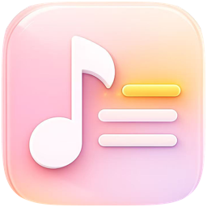
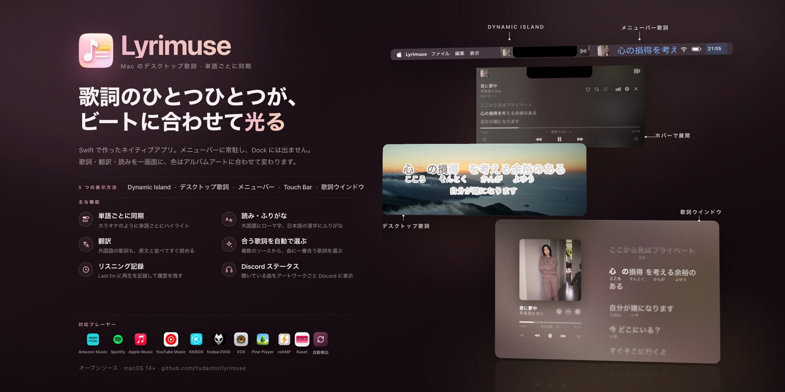
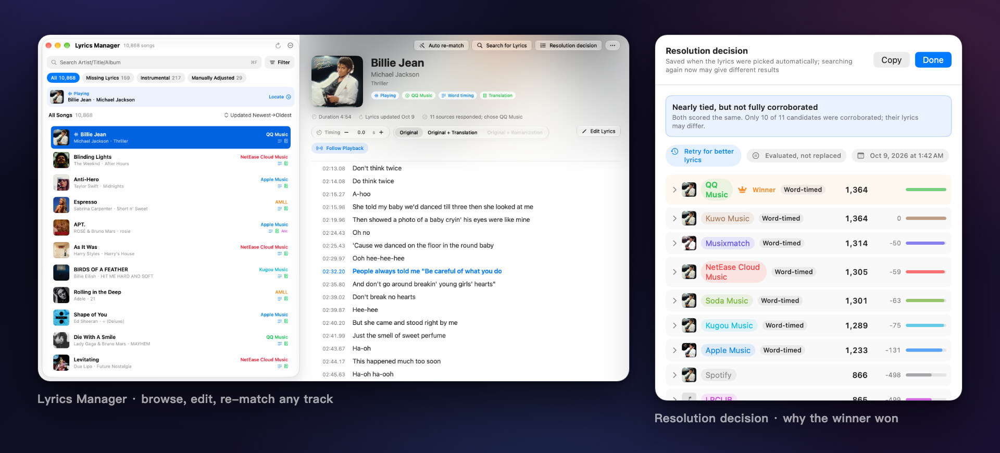
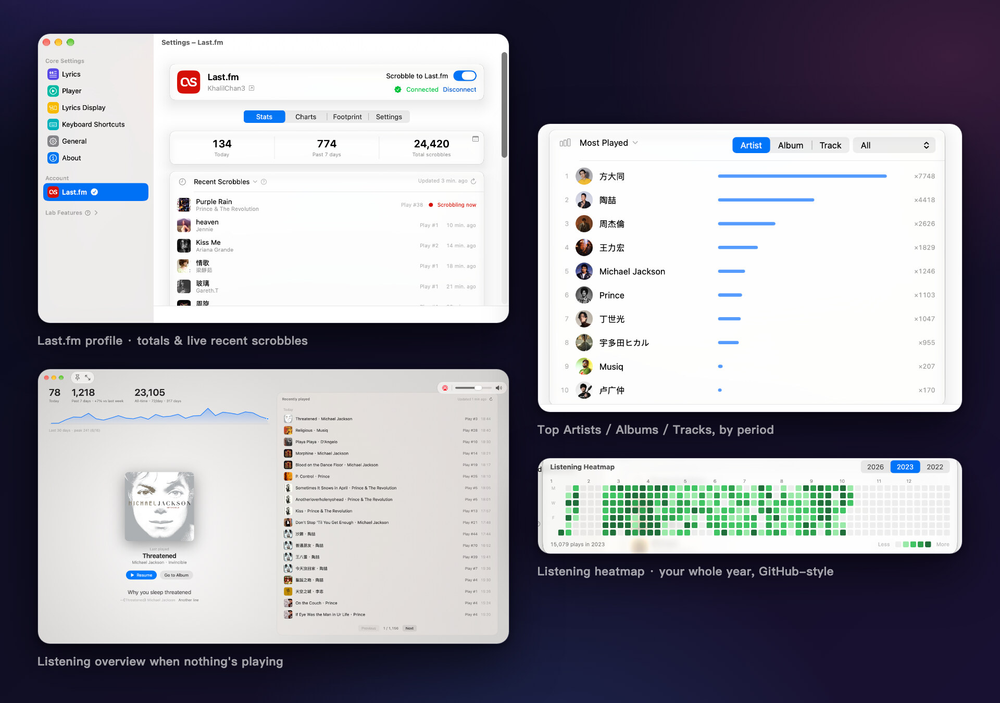
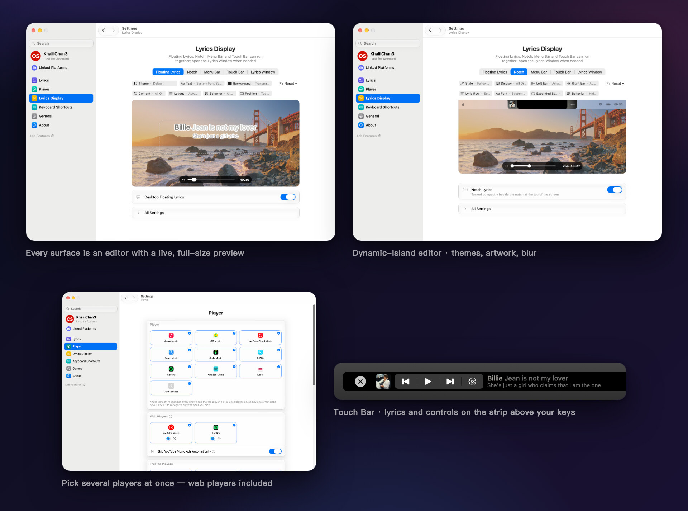

<div align="center">



# Lyrimuse

**Macのために生まれ変わったデスクトップ歌詞**

**Language / 语言 / 語言 / 言語 / 언어 / Idioma / Langue / Sprache / Lingua / Язык:** [English](README.md) | [简体中文](README.zh-CN.md) | [繁體中文](README.zh-Hant.md) | **日本語** | [한국어](README.ko.md) | [Español](README.es.md) | [Français](README.fr.md) | [Deutsch](README.de.md) | [Italiano](README.it.md) | [Português (Brasil)](README.pt-BR.md) | [Tiếng Việt](README.vi.md) | [Русский](README.ru.md)


[](https://github.com/Yudaotor/lyrimuse/releases/latest)
[](https://github.com/Yudaotor/lyrimuse/commits/dev)
[](LICENSE)
[](https://github.com/sponsors/Yudaotor)
[](https://discord.gg/N7gVy66Gp3)
[](https://t.me/lyrimuse)
[](https://qm.qq.com/q/Nb4TlwfnQy)

</div>

https://github.com/user-attachments/assets/88b951ee-4ecf-4985-b1cb-eee6afdd5510

Lyrimuseは、macOS向けのオープンソースのデスクトップ歌詞アプリです。メニューバーに常駐し、曲の再生に合わせて歌詞を単語ごとにハイライトします。表示場所は、すべてのウインドウの最前面に浮かぶフローティング表示、メニューバー、ノッチ下のDynamic Island風カプセル、Touch Bar、そして独立した歌詞ウインドウから選べます。Apple Music、Spotify、Amazon Music、YouTube MusicアプリのKasetなど15のプレーヤーと、ブラウザのWebプレーヤーに対応し、15の歌詞ソースから最も合う歌詞を選びます。必要なら翻訳やローマ字も表示できます。さらに、Last.fmのリスニングプロフィールを表示し、再生をScrobbleします。

**LyricsXからの乗り換えにも**。LyricsXは2022年4月以降、新しいリリースが出ていません。Lyrimuseは、LyricsXでできたことをカバーしたうえでアップデートを続けており、中国語圏のプレーヤー、KKBOX、Amazon Music、Kaset、Pear Desktop、reAMP、VOX、Pine Player、foobar2000、Webプレーヤーにも対応しています。詳しくは、事実確認済みの[LyricsXおよびLyric Feverとの比較](docs/lyrics-apps-comparison.md)をご覧ください。

**インストール**はHomebrewで行えます（Apple Silicon、Intelの両方に対応）。初回起動時のGatekeeperの警告も自動で解除されます。自分でダウンロードしたい場合は、[最新リリース](https://github.com/Yudaotor/lyrimuse/releases/latest)を入手し、[はじめに](#はじめに)をご覧ください。

```bash
brew tap yudaotor/lyrimuse
brew trust --cask yudaotor/lyrimuse/lyrimuse   # one-time: Homebrew asks you to trust non-official taps
brew install --cask lyrimuse
```


<p align="center"><sub>歌詞の表示方法は4通り：歌詞ウインドウ、Dynamic Island風カプセル、単語ごとにハイライトするフローティング表示、メニューバー</sub></p>


<p align="center"><sub>歌詞マネージャ、すべての結果にスコアが付く手動検索、そしてその曲がなぜその歌詞になったのかを示すパネル</sub></p>


<p align="center"><sub>Last.fmの数字とチャート、何も再生していないときに表示される概要、そしてGitHub風の年間ヒートマップ</sub></p>


<p align="center"><sub>どの設定ページにもライブプレビューがあり、プレーヤーは（Webプレーヤーも含めて）複数選べます。そのほかの操作はメニューバーのドロップダウンにまとまっています</sub></p>

## 機能

> 各機能が設定のどこにあり、インストール直後にオンかオフかは、こちらをご覧ください：**[機能一覧](docs/feature-list.ja.md)**

### 自動でマッチする、単語ごとに同期した歌詞
- **単語ごとのハイライト**が、再生中の曲に遅れずについていきます。
- **15の歌詞ソースを自動で検索**：NetEase Cloud Music、QQ Music、Kugou、Kuwo、Migu、Musixmatch、LRCLIB、LyricFind（YouTube Music経由）、Deezer、AMLL（有志が手作業で整えた単語ごとの歌詞データベース）、Soda Music（独自の単語ごとのタイミング）、VIBEとGenie（どちらも韓国語の曲に強い）、PetitLyrics（日本語の曲に強い）、そして設定でアカウントを接続すればApple Musicの歌詞も使えます。Apple Musicの歌詞はサブスクリプションが必要で、多くの曲に単語ごとのタイミングがあります。自分で検索する必要はありません。
- **翻訳とローマ字**を元の歌詞の下に表示します。ソースにコミュニティ翻訳があればそれを使います。ない場合は、設定で「システムによる代替翻訳」をオンにすると（デフォルトはオフ）、MacがAppleのTranslationフレームワークで歌詞を翻訳するので、歌詞がコンピュータの外に出ることはありません。それができないときはオンライン翻訳が代わりに使われます。翻訳先は17言語です。ローマ字は行ごとに判断します。中国語の曲に日本語の行が1行だけあれば、その行にだけ読みが付き、残りの行にピンインが付くことはありません。広東語の曲には、単語単位で読みを判断する粤拼（Jyutping）が付きます。日本語の曲は、ローマ字の代わりに漢字にだけふりがな（ひらがな）を付けることもできます。さらにロシア語、タイ語、ギリシャ語、ヒンディー語など18言語にも、各言語の公式ローマ字表記またはISO規格に沿った読みが付きます。
- **デュエットを歌い手ごとに分けて表示**：ソース（またはAMLLのエントリ）にどの行を誰が歌うかの指定があれば、2人の声を1つのブロックにまとめず、パートごとに分けて表示します。
- **歌詞ウインドウのApple Musicらしい演出**：バックグラウンドボーカルはメインの行の下に別の行で表示し、重なり合うデュエットの行は両方が歌い終わるまで一緒に光り、長く伸ばす英語の単語はApple Musicと同じようにふくらんで輝きます。
- 歌詞の**簡体字・繁体字**を、アプリ自体の言語とは別に設定できます。
- **歌詞マネージャ**で歌詞を整理できます。どの曲の歌詞も閲覧、編集、削除、再検索ができ、まとめて削除したり、広告やポッドキャストが残した空のエントリを片付けたりもできます。1曲だけタイミングがずれていれば、その曲だけずらせます。歌詞がまだない曲はボタン1つですべて再試行でき、フルスキャンをかければ現在のマッチング規則でライブラリ全体の歌詞を選び直します。手で直したものはそのまま残ります。.lrcファイルやフォルダごと読み込むこともでき（まだ再生していない曲の歌詞も保存できます）、フォルダを監視させることもできます。
- **1曲に1つの歌詞**：同じ曲を別のプレーヤーや別のリリースで再生しても、1曲として認識されます。それらのエントリは歌詞と手動の編集を共有し、再生回数は合算されます。歌詞マネージャの「同じ曲のエントリ」では、エントリを行ごとに比較し、誤ってマッチしたものを切り離せます。
- **歌詞ウインドウから直接歌詞を修正**できます。別の歌詞を検索したり、曲をマッチし直したり、お使いのテキストエディタで編集したりできます。単語ごとの歌詞を編集しても変わるのは単語だけなので、各単語のタイミングはそのまま保たれます。
- 歌詞がすでにキャッシュされている曲なら**オフラインでも動作**します。

### Last.fmのリスニングプロフィールとScrobble
- **充実したリスニングプロフィール**：「連携サービス」セクションからワンクリックでLast.fmに接続でき（トークンをコピー＆ペーストする必要はありません）、今日・過去7日間・全期間の合計、リアルタイムの「Scrobble中」表示、アートワーク付きの最近の再生が見られます。各曲のハートで、Last.fmのLoveを付けたり外したりできます。デフォルトでは、各再生はLast.fmのカタログ上で一致する曲として送信されるので、デュエットのクレジット、簡体字・繁体字の表記違い、「 - Single」や「(Remastered)」のような末尾があっても、本来の曲ページに記録されます。設定で「そのまま」に切り替えると、プレーヤーが報告した内容をそのまま送ります。ListenBrainzには常に元のタグを送ります（[Scrobbleの仕組み](docs/scrobbling.ja.md)）。
- **トップアーティスト、アルバム、曲**を過去7日間・30日間・1年間・全期間で表示し、それぞれ前の期間からどれだけ順位が動いたかも示します。アーティストをクリックすると、そのアーティストの曲のうちよく聴いているものが見られます。
- **足跡**は独立したタブです。最初に通算の数字が並びます：最初のScrobbleから何日経ったか、そのうち再生があった日数と1日平均、最も多く聴いた日、現在と最長の連続記録、今年ここまでの合計と過去の年の同じ期間との比較、次のキリのいい節目までの残り。その下には、GitHub風の年間ヒートマップ（日をクリックすると、その日に最もよく聴いた曲が見られます）、時間帯・曜日ごとの聴き方、トップアーティストの出身地、そして過去の同じ日付に聴いた曲を振り返る「過去のこの日」があります。
- **すべての再生はまずMacに保存**されます。Last.fmに接続する前でも同じです。後から接続しても、直近およそ2週間分をワンクリックで送信できます（Last.fmはそれより古い再生を受け付けません）。
- **再生をカウントするタイミングを選べます**：Last.fmのデフォルトと同じ50%、75%、90%、または曲を最後まで聴いたときだけ。ListenBrainzには影響しません。特定のプレーヤーをLast.fmから完全に除外して、その再生が履歴に残らないようにすることもできます。
- 何も再生していないときは、**同じ履歴が歌詞ウインドウにも表示**されるので、空白の画面ではなく概要が見られます（詳しくは後述）。

### フローティング表示、メニューバーの歌詞、Dynamic Island、Touch Bar、または歌詞ウインドウ
- **複数のプレーヤーに対応、自動選択も可能**：Apple Music、Spotify、Kasetはオートメーション権限で読み取ります。QQ Music、NetEase Cloud Music、Kugou Music、Soda Music、KKBOX、Amazon Music、LX MusicはmacOSのMediaRemote経由で読み取るため、権限は不要です。設定で好きな組み合わせをオンにするか、自動検出のままにしておけば、macOSが「再生中」として表示しているものに追従します。
- **Apple Musicのラジオにも対応**：ステーションで流れる曲ごとに歌詞が追従します。ホストが話している間は、前の曲ではなくステーションの名前とロゴを表示します。ラジオには専用のタイミングオフセットがあるので、ステーションごとに一度合わせれば、あとは気にする必要はありません。
- **ブラウザのプレーヤーにも対応**：ブラウザを一度ペアリングすれば、YouTube MusicやSpotify Webもほかのプレーヤーと同じように使え、歌詞はページ自体の再生バーに同期します。ブラウザを操作できるかどうかは、ワンクリックのテストで事前に確認できます。広告の間はカプセルが黒くなり、残り時間と、何本中何本目の広告かを表示します。YouTube Musicの広告にはスキップボタンが付き、自動でスキップすることもできます。
- **表示方法を選べます**。どれを組み合わせても、どれも使わなくてもかまいません：
  - デスクトップのフローティング表示。好きな場所にドラッグでき、画面上部中央やDockのすぐ上に固定することもできます。
  - 画面上部のDynamic Island風カプセル。アルバムアートを表示したり、カプセルの背後にぼかして敷いたりできます。歌詞の行にポインタを重ねると薄くなってクリックを下に通す設定や、ロック画面への表示もできます。
  - Touch Bar搭載のMacBook ProではTouch Bar。歌われるのに合わせて行がスクロールし、必要ならアルバムアートと再生コントロールも表示できます。
  - サイズを変えられる歌詞ウインドウ。Apple Musicの歌詞ページを手本にした2カラム構成で、背景にはぼかしたアートワークを敷き、現在の行に合わせて曲全体がスクロールします。Apple Musicにそのレコードのモーションアートワークがあればアルバムアートが動き、曲にループするSpotify Canvasの動画があればそれを背景に表示します。単語は歌われるのに合わせて塗られ、太さ、歌唱済みの色、揃え方は自由に設定できます。HDRディスプレイでは「HDRハイライト」で歌唱済みの部分を白よりも明るく光らせることができます。
- **メニューバーの歌詞（テキストモード）**：現在の行がメニューバーに直接表示されます。長い行は途中で切れずにスクロールします（切って表示する方式に戻すこともできます）。2行目に次の行、翻訳、ローマ字を表示でき、カプセルでも同じことができます。
- 歌詞ウインドウとカプセルでは、**再生バーをドラッグしてシーク**できます。
- 歌詞ウインドウで**シャッフル、リピート、お気に入り、音量**を直接操作できます（プレーヤーが対応している範囲で）。Apple Music、Spotify、Kaset、QQ Music、Amazon Music、ブラウザのYouTube Musicはそれぞれその一部またはすべてに対応し、NetEase Cloud Music、Kugou Music、Soda Music、LX Musicはお気に入りに対応しています。お気に入りは展開したカプセルにもあり、ショートカットを割り当てることもできます。
- 「⋯」メニューや情報パネルから**曲を元のサービスで開けます**。Apple Musicはアプリで開き、Spotifyは再生中の曲にジャンプし、KKBOXは曲、アルバム、アーティストをKKBOX自身のアプリで開きます。QQ Music、Soda Music、Spotify、Amazon Music、YouTube Music（Kasetで再生している場合）はWeb上の曲、アルバム、アーティストのページを開き、NetEase Cloud Musicは曲のページを開きます。リンクはLyrimuseが歌詞の取得時に見つけたもの、またはMac上のプレーヤー自身のデータから読み取ったものなので、検索する必要はありません。
- **何も再生していないとき**は、歌詞ウインドウに今日と今週の合計、「過去のこの日」カード、アートワーク付きの最近の再生が表示されます。それぞれの再生は、Apple Musicのアルバムやアーティストのページにリンクしています。
- **歌詞ウインドウのミニサイズ**：1行、2行、またはスクロールする歌詞全体を表示する小さなカードです。背景、文字の色、フォント、太さ、歌唱済みの色を個別に設定でき、単語ごとのカラオケ表示はミニサイズだけオフにすることもできます。
- **スマートフォンやタブレット、配信でWeb歌詞**：別のデバイスのブラウザで歌詞ウインドウを開き、セカンドスクリーンとして使えます。許可すれば、再生コントロールやタップでのジャンプも使えます。「OBS出力」を使えば、フローティング歌詞を透明なブラウザソースとして配信に載せられます。どちらもローカルネットワークからのアクセスを許可するまではこのMac内だけで動作し、ほかのデバイスはQRコードを読み取って接続します。
- **曲の解説、アルバムの解説、アーティストの紹介**：歌詞ウインドウや展開したカプセルで曲名、アーティスト名、アルバム名をクリックすると、それぞれの説明を読めます。アルバムの解説とアーティストの紹介はApple Musicから取得し、Apple Musicにない場合はSoda Music（Soda Musicで再生した曲、中国語インターフェイスのみ）、Kugou Music（Kugou Musicで再生した曲、中国語インターフェイスのみ）、NetEase Cloud Music（中国語インターフェイスのみ）、YouTube Musicが表示するWikipediaの記事（インターフェイスの言語）、またはLast.fmから取得します。曲の解説はQQ Music（中国語インターフェイスのみ）またはLast.fmから取得します。
- **見た目を好みに合わせて**：フォント（システムフォント、またはお手持ちの.ttf／.otfファイル）、サイズ、文字・背景・影の色、保存したテーマや現在のアルバムアートから取った色、フローティング表示の幅を変えられます。歌詞の色には流れるレインボーもあります。
- **スクリーンショット、録画、画面共有には映りません**。自分には見えますが、ほかの人には見えません。
- **一時停止すると自動で隠れる**ので、何もしないままデスクトップに居座ることはありません。インストゥルメンタル、歌詞のない曲、フルスクリーンのアプリのときに隠すこともでき、フローティング表示を、使用中のウインドウがある画面に追従させることもできます。

### 日々の使い勝手
- **英語、簡体字中国語、繁体字中国語、日本語、韓国語、スペイン語、フランス語、ドイツ語、イタリア語、ポルトガル語（ブラジル）、ベトナム語、ロシア語**に対応し、切り替えは再起動なしですぐに反映されます。不自然な訳を見つけたら、プルリクエストを歓迎します。各言語のスタイルガイドは`lyrimuse/Localization/`にあります。
- **macOS 26のLiquid Glass**：設定、メニューバーのパネル、歌詞ウインドウ、歌詞マネージャ、セットアップガイドはLiquid Glassで作られており、その多くはシステムに合わせず、ライトまたはダークに固定することもできます。
- すべての操作に**キーボードショートカット**を割り当てられます。すべての歌詞を隠す操作から、曲をお気に入りにする操作まで対応しています。初期状態では何も設定されていないので、キーは自分で選べます。また、すべての操作に`lyrimuse://`リンクがあり、ショートカット、Raycast、Alfredから呼び出せます。ショートカットからなら、リンクで再生中の曲の情報を受け取ることもできます（[URL Scheme](docs/url-scheme.ja.md)）。
- **設定内を検索**：サイドバーに入力すると、該当する行までスクロールしてハイライトし、必要なら折りたたまれたグループも開きます。
- **自動アップデート**：自動で確認するほか、メニューバーから手動で確認することもできます。アップデートは設定の「ソフトウェアアップデート」ページからインストールでき、リリースノートと進行状況もそこに表示されます。ベータ版を受け取るよう選ぶこともできます。
- **プレーヤーと連動して起動**：プレーヤーごとに、どちら向きにも設定できます。Lyrimuseを開いたときにプレーヤーを開く、プレーヤーを開いたときにLyrimuseを開く、そして必要なら、追従しているプレーヤーがすべて終了したらLyrimuseも終了する、という設定です。
- **サイレント起動**を使えば、ウインドウを一切開かず、メニューバーのアイコンだけで起動できます。
- **新しいMacへの移行**：設定一式を書き出して、新しいMacで読み込めます。問題が起きたときのために、ワンクリックで診断情報を書き出す機能もあります。

### オプションの追加機能

<details>
<summary>ListenBrainz、Discordのステータス、共有できる再生中ページ、日次・週次・月次・年次のまとめ</summary>

以下はすべて、設定でオンにするまでオフのままです：

- **[ListenBrainz](https://listenbrainz.org)にもScrobble**：すべての再生を、プレーヤーの同じ読み取り結果から両方のサービスに送るので、2つの履歴が食い違いません。iPhoneでの再生（Last.fm経由で記録されたもの）もListenBrainzにコピーされるので、2台のデバイスの履歴が2つに分かれず、1つにまとまります。
- **共有できる公開の「再生中」ページ**：リアルタイムの再生状況、履歴、ゲストブック、リアクション、訪問者カウンター、トップ10アーティストのボード、レコード盤風の見た目、ライト／ダークテーマ、チャットアプリでのきちんとしたリンクプレビュー。スクリーンショット付きの説明は、こちらをご覧ください：**[Web機能ガイド](https://github.com/Yudaotor/nowplaying-workers#readme)**
- **日次・週次・月次・年次のリスニングまとめ**を、好きなだけの送信先に送れます：Bark、ntfy、ServerChan、Feishu、DingTalk、WeCom、Telegram、Discord、Slack、または汎用のWebhook。送信先ごとにテスト送信ができ、配信履歴で何が届いたかを確認できます。
- **聴いている曲をDiscordに表示**：プロフィールやフレンドリストに、使っているプレーヤー、曲、アーティスト、アルバムアート、再生バーが表示され、曲名とアーティストはそのプレーヤーのサイトのページにリンクします。アルバムの行には歌われている歌詞の行を表示でき、ボタンを2つまで追加できます。アートワークの角には小さなLyrimuseまたはプレーヤーのバッジが付き（なしも可）、一時停止中の曲を一時停止アイコン付きで表示し続けることもできます。対象にするプレーヤーを選べるほか、曲名を出さずにプレーヤーだけを表示したり、しばらく非表示にしたりもできます。

ListenBrainzとWebプッシュは設定サイドバーの**ラボ**の中に、プッシュ通知はほかのセクションと並んであり、Discordには上のほうに専用の項目があります。各カードにはそれぞれ設定手順が付いています：APIキーやトークンの入手先、アカウントの接続方法、プッシュサービスのWebhook URLの取得方法など。別途ガイドがあるのはWebページだけで、そのすべてが必要なわけでもありません。ListenBrainzを設定するだけで、Cloudflare Workerなしでもページにリアルタイムの再生状況と履歴が表示されます。ゲストブック、リアクション、訪問者カウンター、トップ10ボード、より速い更新も使いたい場合はWorkerをデプロイしてください。その手順もガイドにあります。

</details>

## はじめに

リリースはApple Developer IDではなくプロジェクト独自の証明書で署名されているため、以下のどの方法でもApple Developerアカウントは関係ありません。その代わり、初めてアプリを開くときにGatekeeperが「開発元が未確認」と表示します。Homebrew（方法A）ならこれを自動で解除します。ほかの方法では想定どおりの動作でバグではなく、一度だけ回避する方法を方法Bで説明しています。
### 方法0：インストールをAIに任せる

Mac上でターミナルを使えるAIエージェント（Claude Code、Codex CLI、Gemini CLIなど）をお使いなら、下のブロックをそのまま貼り付けてください。方法A／Bの手順をすべて代わりに実行してくれます。この指示で許可しているのはこのアプリ1つのインストールだけで、`sudo`を使ったり、システム全体のセキュリティ設定に触れたりはしません：

```text
Please install Lyrimuse — an open-source macOS menu-bar lyrics app
(https://github.com/Yudaotor/lyrimuse) — on this Mac, following these rules exactly:

1. Preferred path (if `brew` exists):
     brew tap yudaotor/lyrimuse
     brew trust --cask yudaotor/lyrimuse/lyrimuse
     brew install --cask lyrimuse
   If this Homebrew doesn't know the `trust` subcommand, skip that line — older
   versions don't need it.
2. If Homebrew is not installed, do NOT install Homebrew. Instead: check the CPU
   with `uname -m`, download the latest release asset from
   https://github.com/Yudaotor/lyrimuse/releases — `Lyrimuse-v<version>-macos.zip`
   for arm64, `Lyrimuse-v<version>-macos-intel.zip` for x86_64 — verify it against
   its `.sha256` file (`shasum -c`), unzip, move `Lyrimuse.app` into
   /Applications, then clear the Gatekeeper quarantine flag on that one app only:
     xattr -dr com.apple.quarantine /Applications/Lyrimuse.app
3. Safety rails: no `sudo` anywhere (nothing here needs it); never run
   `spctl --master-disable` or otherwise weaken Gatekeeper system-wide; never
   remove the quarantine flag from anything except /Applications/Lyrimuse.app.
4. Do not build from source unless I explicitly ask.
5. Launch it (`open -a Lyrimuse`) and verify it is running (`pgrep -x Lyrimuse`
   prints a PID).
6. A first-run wizard will appear — that part is mine to click through. Tell me
   it will ask me to pick a music player, to grant Automation access to
   Music.app and/or Spotify (only if I pick them), and to enable the background
   lyrics engine — then hand control back to me.
Finally, report what you did and anything that failed.
```

### 方法A：Homebrewでインストール（推奨）

```bash
brew tap yudaotor/lyrimuse
brew trust --cask yudaotor/lyrimuse/lyrimuse   # one-time: Homebrew asks you to trust non-official taps
brew install --cask lyrimuse
```

インストールの過程で一度きりのGatekeeperの隔離（quarantine）が自動で解除されるので、追加の手順はありません。`brew install`が終わったら、すぐに`/Applications`（またはSpotlight）からLyrimuseを開けます。新しいリリースも`brew upgrade --cask lyrimuse`で同じように入手できます。

### 方法B：ビルド済みのリリースを手動でダウンロード

1. [Releasesページ](https://github.com/Yudaotor/lyrimuse/releases)から入手します。**まずお使いのMacの種類を確認してください**（ → このMacについて →「チップ」：`Apple M…`ならApple Silicon、`Intel Core…`ならIntel）：

   | お使いのMac | ダウンロード |
   | --- | --- |
   | Apple Silicon（M1以降） | `Lyrimuse-*-macos.dmg`または`.zip` |
   | Intel | `Lyrimuse-*-macos-intel.dmg`または`.zip` |

   dmgの場合は、ダブルクリックしてマウントし、`Lyrimuse.app`を隣にある`Applications`のショートカットにドラッグします。zipの場合は、展開して`Lyrimuse.app`を`/Applications`にドラッグします。どちらの形式でもインストールされるアプリはまったく同じです。zipには、ダウンロードを検証したい場合のための`.sha256`が付いています（同じフォルダで`shasum -c Lyrimuse-*.zip.sha256`）。

   2つのダウンロードの違いはアーキテクチャだけです。接尾辞のないほうはApple Silicon専用で、`-intel`はIntelとApple Siliconの両方のコードを含みます。`-intel`もApple Siliconで動きますが、あえて使う理由はありません。サイズが2倍あり、macOS 27以降ではIntelコードを含むためにアプリが「アップデートが必要」と警告されます（AppleはmacOS 28でRosettaを廃止します。アプリ自体に問題があるわけではありません）。

   **どちらのアーキテクチャでもアプリ内の自動アップデートに対応しています**。配信フィードには同じバージョンのエントリがアーキテクチャごとに1つずつあり、Apple Siliconには接尾辞なしのビルドが、Intelには`-intel`のビルドが配信され、Sparkleがマシンごとに自動で選びます。（v1.4.0以前はApple Silicon向けにしか配信しておらず、Intelのユーザーは手動でここに戻ってくる必要がありました。）
2. 初回起動時、macOSは「“Lyrimuse”は、悪質なソフトウェアかどうかをAppleでは確認できないため、開けません」や「開発元が未確認」と表示して、開くのを拒否します。次のうち使いやすい方法で、一度だけ解除してください：

   - **ターミナル（推奨、確実に効きます）**：
     ```bash
     xattr -dr com.apple.quarantine /Applications/Lyrimuse.app
     ```
     そのあと、通常どおりアプリを開きます。この操作はダウンロードごとに一度だけで済みます。
   - **右クリック → 開く**：Finderで`Lyrimuse.app`を右クリック（またはControlキーを押しながらクリック）して**開く**を選び、ダイアログでもう一度**開く**をクリックします。macOSのバージョンや警告の種類によっては効かないことがあるので、警告が消えない場合は上のターミナルのコマンドを使ってください。
   - **システム設定 → プライバシーとセキュリティ**：一度アプリを開こうとして（ブロックされます）、**システム設定 → プライバシーとセキュリティ**を開き、一番下までスクロールして、Lyrimuseの警告の横にある**このまま開く**をクリックします。確認を求められたら、もう一度確定します。

   これは本当に信頼できるビルド、つまりこのリポジトリのReleasesページのもの、または自分でビルドしたものに対してだけ行ってください。

### 方法C：ソースからビルド

**最初に一度だけ必要なもの**（すでにあるものは飛ばしてください）：

```bash
xcode-select --install   # Xcode Command Line Tools, for Swift — skip if `swift --version` already works
brew install go          # any Go ≥ 1.21 — build.sh switches to 1.24.4 automatically via GOTOOLCHAIN
```

あとは`build.sh`が、アプリとその歌詞エンジン（`lyrimuse-engine`という名前のバックグラウンドプロセス）を一度にビルドします：

```bash
git clone https://github.com/Yudaotor/lyrimuse.git
cd lyrimuse/lyrimuse
./build.sh              # this machine's architecture
./build.sh --universal  # arm64 + x86_64 (the compatibility build shipped for Intel)
```

`build.sh`は最後に、バンドル内のすべてのバイナリのアーキテクチャを一覧表示し、スライスが足りない、あるいは余分にあるなど、ターゲットと一致しないものがあれば指摘します。リリース用のファイルを手作業で組み立てないでください。`./package.sh`は各アーキテクチャを一度ずつビルドし、それぞれのzip + sha256 + dmgを作成します。アーキテクチャが正しくなければ、パッケージ化を拒否します。

QQ Music／NetEase Cloud Music／Kugou Music／Soda Music／KKBOX／Amazon Music／LX Music／Spotify／Kaset／自動検出に対応するには、さらに[ungive/media-control](https://github.com/ungive/media-control)が必要です。見つからない場合は`build.sh`がHomebrewで自動的にインストールするので、これも自分で行う必要はありません。

### どの方法でも、そのあとは

`/Applications`からLyrimuseを開きます。初回起動時のウィザードが、プレーヤーの選択（Apple Music、QQ Music、NetEase Cloud Music、Kugou Music、Soda Music、KKBOX、Amazon Music、Spotify、Kaset、Pear Desktop、reAMP、VOX、Pine Player、foobar2000、LX Music、または自動検出）、Apple Music、Spotify、Kaset、VOXを選んだ場合のオートメーション権限の許可（ほかのプレーヤーは、基本的な曲情報の読み取りに権限は不要です）、歌詞エンジンの有効化（ウインドウを閉じていても歌詞やアートワークの取得が続くようにするため）を順に案内します。ウィザードを終えると、すぐに歌詞が表示されます（ほかのビルドオプションは[lyrimuse/README.md](lyrimuse/README.md)を参照してください）。

歌詞を表示するだけなら、これで準備は完了です。オプションの追加機能は、必要になったときにいつでも設定から設定できます。

## よくある質問

### Apple Musicの歌詞を、Macのデスクトップに常に最前面でフローティング表示するには？
設定でデスクトップのフローティング歌詞をオンにします。すべてのウインドウより手前に、すべての操作スペースで表示されます。好きな場所にドラッグするか、画面上部中央やDockのすぐ上に固定できます。歌詞に単語ごとのタイミングがあれば、歌われるのに合わせて単語が塗られていきます。スクリーンショット、録画、画面共有に映らないようにしたり、音楽の一時停止中に消したりもできます。QQ Music、NetEase Cloud Music、Kugou Music、Soda Music、KKBOX、Amazon Music、LX Music、Spotify、Kaset、Webプレーヤーでも同じように動作します。

### Spotifyの歌詞をMacのメニューバーに表示できますか？
はい。メニューバーのテキストモードをオンにすると、Spotifyでもほかの対応プレーヤーでも、現在の行がメニューバーに表示されます。長い行は途中で切れずにスクロールし、2行目に次の行、翻訳、ローマ字を表示できます。Spotifyのアカウントを接続する必要はありません。LyrimuseはSpotifyへのオートメーション権限を一度だけ求めます。これで正確な再生位置がわかり、再生ボタンも使えるようになります。許可しなくても歌詞は表示されますが、タイミングはmacOSのMediaRemoteから得るため、1秒ほどずれることがあります。

### QQ Music、NetEase Cloud Music、Kugou、Soda Musicで単語ごとの歌詞は表示されますか？
はい、歌詞に単語ごとのタイミングがあれば表示されます。NetEase Cloud Music、QQ Music、Kugou、Soda Music、Musixmatch、AMLL、Apple Musicの歌詞にはタイミングがあることが多く、その行は単語ごとに塗られていきます。行単位のタイミングしかない歌詞は、1行がまとめて光ります。また、歌詞の取得元はプレーヤーに縛られません。Soda Musicで再生している曲でも、スコアが最も高ければQQ Musicの単語ごとの歌詞が使われることがあります。

### インストールにApple Developerアカウントは必要ですか？
いいえ。リリースはApple Developer IDではなくプロジェクト独自の証明書で署名されているので、あなたにもプロジェクトにもアカウントは必要ありません。上の「はじめに」で説明している、一度きりのGatekeeperの手順が必要なのもこのためです。

### LyrimuseはMac App Storeにありますか？
いいえ。Homebrew（上の方法A）でインストールするか、[Releasesページ](https://github.com/Yudaotor/lyrimuse/releases)からダウンロードしてください（方法B）。どちらの場合も、その後のアップデートはアプリ内で届きます。

### Lyrimuseは無料ですか？
はい。GPL-3.0のオープンソースです。有料版、アプリ内課金、登録が必要なアカウントはありません。Last.fmなどのサービスを使うかどうかはあなた次第です。役に立っていて応援したいと思ったら、[GitHubでスポンサーになる](https://github.com/sponsors/Yudaotor)か、AlipayやWeChat Payで[作者にコーヒーをおごる](https://yudaotor.github.io/donate/)こともできます。

### ほかのアプリがシステムのメディアフォーカスを持っているときでも、QQ Music、NetEase Cloud Music、Soda Musicを操作できますか？
はい。ブラウザの動画などがmacOSの「再生中」を握っていると、システムのメディアキーはそちらに送られます。そのときLyrimuseは、QQ MusicやNetEase Cloud Music自身のメニューバー、あるいはSoda Musicの再生バーにある再生／一時停止、前へ、次へを代わりに押し、プレーヤーはバックグラウンドのままにします。これにはアクセシビリティの権限が必要です（設定 → プレーヤー）。権限がない場合、これらのボタンを押すとそのページが開きます。この状態ではシークは使えません。macOS 27ではこの権限は**システム設定 → プライバシーとセキュリティ → デバイスの制御とデータへのアクセス**にあり、それ以前のリリースでは**アクセシビリティ**という名前です。

### Spotify、QQ Music、NetEase Cloud Musicにも対応していますか？それともApple Musicだけですか？
すべてに対応しています。さらにKugou Music、Soda Music、KKBOX、Amazon Music、Kaset（YouTube Musicアプリ）、オープンソースのYouTube MusicデスクトップアプリPear Desktop、Winamp風のプレーヤーreAMP、ロスレスやハイレゾに強いローカルプレーヤーVOX、ほぼすべてのフォーマットを再生できる無料のローカルプレーヤーPine Player、Windowsから移植された定番のローカルプレーヤーfoobar2000、オープンソースのLX Musicにも対応し、全部で15のプレーヤーに対応しています。macOSが「再生中」として表示しているものを自動検出させることもできます。Apple Music、Spotify、Kaset、VOXはオートメーション権限を求めます（Spotify、Kaset、VOXは正確なタイミングと再生ボタンのために使います）。残りの11のプレーヤーは、macOSのMediaRemote経由で基本的な曲情報を読み取るのに権限は不要です。ただし、QQ Music、NetEase Cloud Music、Kugou Music、Soda Music、Amazon Musicのシャッフル、リピート、お気に入りのボタンと、reAMPとfoobar2000のシャッフル、リピート、音量にはアクセシビリティの権限が必要です。Pine Playerは再生位置を秒単位でしか報告しないため、再生バーを読み取るのにこの権限を使います。KKBOX、Amazon Music、LX Musicでは、そのアプリが曲について保存済みの歌詞も候補に入りますが、それらのサービスに接続することは一切ありません。

### KKBOXやAmazon Musicの歌詞をMacで表示できますか？
はい。どちらもmacOSのMediaRemote経由で読み取るので、許可が必要な権限はなく、歌詞はほかのプレーヤーと同じようにフローティング表示、メニューバー、カプセル、歌詞ウインドウに表示されます。KKBOXやAmazon Musicが曲の歌詞をすでに保存していれば、それも候補に入り、重みが加算されます。Lyrimuseがどちらのサービスにサインインしたり、何かを送信したりすることはありません。ほかのソースも引き続き検索されるので、単語ごとのタイミングがあるなど、よりよい歌詞があればそちらが選ばれます。


### LX Music（洛雪音乐）に対応していますか？
はい。LX MusicはmacOSのMediaRemote経由で読み取るので、許可が必要な権限はありません。LX Musicで曲を再生すると、LX Musicがその曲について保存した歌詞（プラットフォームにあれば単語ごと）も候補に入って重みが加算され、再生中のリストの次の曲の歌詞も前もって用意されます。LyrimuseはMac上のLX Musicのデータを読み取るだけで、LX Musicに何かを送信することはありません。

### YouTube Musicのデスクトップアプリに対応していますか？
はい。Mac向けのネイティブでオープンソースのYouTube Musicアプリ、[Kaset](https://github.com/sozercan/kaset)に対応しています。Kasetはオートメーション権限で読み取るため、タイミングが正確で再生ボタンも使え、YouTube Music自身の歌詞も候補に入ります。オープンソースのデスクトップクライアント[Pear Desktop](https://github.com/pear-devs/pear-desktop)にも対応しており、macOSの「再生中」から読み取るので追加の権限は不要です。ブラウザのYouTube Musicにも対応しています（後述）。

### デスクトップの歌詞はどんな見た目ですか？
デスクトップ上のカラオケのような見た目です。現在の行がウインドウの上に浮かび、歌詞に単語ごとのタイミングがあれば歌われるのに合わせて単語が塗られ、翻訳やローマ字を並べて表示することもできます。フォント、サイズ、文字・背景・影の色、幅を変えられ、文字の色をアルバムアートに合わせることもできます。同じ歌詞をメニューバー、ノッチ下のDynamic Island風カプセル、Apple Music風の歌詞ウインドウにも、好きな組み合わせで表示できます。

### Dynamic Islandのカプセルは、ノッチのないMacでも使えますか？
はい。古いMacBookや外部ディスプレイなど、ノッチのない画面では、カプセルは画面上部中央にメニューバーと同じ高さで表示されます。どの画面に表示するかは設定で選べます。

### インターネットに接続していなくても歌詞は表示されますか？
はい。すでに歌詞が見つかっている曲なら、歌詞がMacにキャッシュされているので表示されます。曲の歌詞を初めて探すときと、オンライン翻訳を使うときはインターネット接続が必要です。

### データがMacの外に送られることはありますか？
歌詞を見つけるには、再生中の曲について歌詞ソースに問い合わせる必要があります：NetEase、QQ、Kugou、Kuwo、Migu、Musixmatch、LRCLIB、LyricFind、Deezer、AMLL、Soda Music、VIBE、Genie、PetitLyrics、そして接続している場合はApple Music。アートワークはiTunes Search APIから取得します。翻訳はデフォルトではMac上で行われ、歌詞のテキストがオンライン翻訳（GoogleのWeb翻訳、次にMyMemory）に送られるのは代替手段としてだけです。再生履歴、キャッシュした歌詞、設定は、Last.fm、ListenBrainz、またはオプションのWebリレーを接続しない限り、Mac上のファイルに保存されたままです。匿名の使用状況データ（バージョン、オンにしている機能、クラッシュの概要。曲名やアカウントは含みません）はデフォルトで1日1回送信され、設定 › 情報 でオフにできます。完全な一覧は、下の[ライセンスと著作権](#ライセンスと著作権)にあります。

### 歌詞の日本語・韓国語のローマ字や、中国語の翻訳は表示できますか？
はい。ローマ字は行ごとに判断するので、複数の言語が混ざった曲でも、必要な行にだけ読みが付きます。日本語はローマ字のほか、漢字にだけふりがなを付けることもできます。翻訳は、歌詞ソースにコミュニティ翻訳があればそれを使い、ない場合は「システムによる代替翻訳」（デフォルトはオフ）をオンにすると、デバイス上またはオンラインの機械翻訳で、17言語のいずれかに翻訳します。

### どのバージョンのmacOSに対応していますか？
macOS 14 Sonoma以降（Sequoia、Tahoe、およびそれ以降）で、Apple SiliconとIntelの両方に対応しています。Mac上での翻訳にはmacOS 15 Sequoia以降が必要です。macOS 14ではオンライン翻訳のみ使えます。

### Intel Macに対応していますか？
はい。専用のユニバーサルビルドがあります（上の方法Bを参照）。v1.5.0からはIntelでも自動アップデートが使えるので、Apple Siliconと同じように新しいバージョンが届きます。

### ブラウザで再生しているYouTube MusicやSpotifyの歌詞を表示できますか？
はい。設定でブラウザを一度ペアリングすれば、YouTube MusicやSpotify Webもほかのプレーヤーと同じように使えます。歌詞は推測ではなくページ自体の再生バーに追従し、ブラウザを操作できるかどうかは、使い始める前にワンクリックのテストで確認できます。

### MacでApple MusicをLast.fmにScrobbleできますか？
はい、それがこのアプリのもう半分の役割です。設定からワンクリックでLast.fmに接続すれば、Apple Music（またはほかの対応プレーヤー）のすべての再生がScrobbleされ、リアルタイムの「再生中」ステータスも表示されます。再生はまずMacに保存されるので、接続前の再生も失われません。接続後に「後から送信」をクリックすると、直近およそ2週間分を送信できます。再生をカウントするタイミング（50%、75%、90%、または曲の最後まで）を選んだり、一部のプレーヤーを除外したり、ListenBrainzにも同時に送信したりできます。

### Lyrimuseは、間違った歌詞を選ばないようにどうしていますか？
最初に応答したソースの歌詞をそのまま使うわけではありません。すべてのソースのすべての結果を同じ基準でスコア付けします。曲名、アーティスト、アルバム、長さがどれだけ一致するか、さらに単語ごとのタイミングがあるかどうかなどです。最もスコアの高いものが選ばれます。どの曲についても、すべての候補のスコアと、選ばれた理由を見ることができます。あとでよりよい候補が見つかれば、Lyrimuseが自動で切り替えることもありますが、手動で選んだ歌詞はロックされ、置き換えられることはありません。手動検索でも同じスコアとラベルが表示されるので、選ぶ前に違うバージョンを簡単に見分けられます。

### 歌詞がずれている、または間違っている場合は？
タイミングがずれている場合は、その曲だけずらしてください。オフセットは記憶されます。歌詞自体が違う、またはバージョンが違う場合は、手動検索を開きます。すべてのソースの結果がスコア付きで表示され、選んだものはロックされるので、自動マッチングで差し替えられることはありません。歌詞マネージャでは、どの曲の歌詞も手で編集できます。

### 歌詞を.lrcファイルとして保存できますか？
すでに保存されています。歌詞のある曲にはすべて行単位のタイミング付きの`.lrc`ファイルが作られ、翻訳やローマ字がある場合は、それぞれ`.tr.lrc`と`.roma.lrc`も作られます。単語ごとのタイミングは別に保存され、デフォルトではTTML形式です。設定で`.yrc`（NetEaseのYRC形式）、Enhanced LRC、QRC、KRCに切り替えてほかのプレーヤーで読めるようにしたり、複数の形式を保存したりできます。ファイルは`~/Library/Application Support/me.yudaotor.lyrimuse/lyrics/`にあり、フォルダの場所は設定で変更できます。

### LyricsXは今もメンテナンスされていますか？LyrimuseはLyricsXやLyric Feverと何が違いますか？
LyricsXの最後のリリースは、2022年4月のv1.6.3です。macOS 10.11以降で動作し、Apple Music、Spotify、いくつかの古いプレーヤーに対応しています。Lyric FeverはSpotifyとApple Musicに特化しており、macOS 15が必要です。LyrimuseはmacOS 14が必要で、さらにQQ Music、NetEase Cloud Music、Kugou、Soda Music、KKBOX、Amazon Music、Kaset、Pear Desktop、reAMP、VOX、Pine Player、foobar2000、LX Music、ブラウザのプレーヤーに対応し、行ごとのピンイン／広東語の粤拼／日本語と韓国語のローマ字、ロシア語やタイ語など18言語の読み、自分のリスニング統計付きのLast.fm／ListenBrainzへのScrobbleを備えています。項目ごとの比較表は[比較ページ](docs/lyrics-apps-comparison.md)にあります。
## ライセンスと著作権

- **Lyrimuse本体は[GPL-3.0](LICENSE)です**。アプリに同梱しているオープンソースのコンポーネントと辞書データ（media-control、Sparkle、KeyboardShortcuts、OpenCCとrime-cantoneseの辞書）は、それぞれ独自のライセンスに従います。全文は[THIRD_PARTY_LICENSES](THIRD_PARTY_LICENSES)にあり、アプリにも同梱されていて、**設定 → 情報 → サードパーティのライセンス**から開けます。
- **歌詞、アートワーク、曲のメタデータは、それぞれの権利者に帰属します**。Lyrimuseはそれらを検索し、キャッシュし、表示するだけです。公開されている歌詞APIが返したものは、あなた自身が閲覧するために、あなたのMac（`~/Library/Application Support/me.yudaotor.lyrimuse/`）に保存されます。歌詞やアートワークをホスト、中継、再配布することはありません。キャッシュは、歌詞マネージャから、またはそのフォルダを削除することで、いつでも削除できます。
- **Lyrimuseは独立したオープンソースプロジェクトです**。Apple、Tencent（QQ Music）、NetEase（NetEase Cloud Music）、Kugou、Kuwo、Douyin（Soda Music）、KKBOX、Amazon（Amazon Music）、China Mobile（Migu Music）、Spotify、Kaset、LX Music、Google（YouTube Music、Google翻訳）、Last.fm、ListenBrainz、MusicBrainz、Musixmatch、LRCLIB、LyricFind、Deezer、Naver（VIBE）、KT（Genie）、SyncPower（PetitLyrics）、AMLL、SponsorBlockとは提携しておらず、承認を受けてもおらず、関係もありません。これらの名称と商標は各所有者に帰属し、ここではどのプレーヤー、歌詞ソース、サービスが関わっているかを示すためにのみ記載しています。
- **Macの外に送られるのは、以下ですべてです**。歌詞の検索では、曲のアーティスト、曲名、アルバム（受け付けるソースには再生時間も）を上記の15の歌詞ソースに送信します。どれもマッチしなかった場合は、別名を調べるためにアーティスト名をMusicBrainzにも送信します（Last.fmのスマートマッチングも、初めて見るアーティストについて同じことをします）。また、チャートでは国・地域とリンクを得るために、MusicBrainz IDでアーティストをMusicBrainzで検索します。アートワークと待機ページは、アーティストと曲名をiTunes Search APIに送信します。Kasetでは、Kasetが報告するアートワークをYouTube Musicの画像サーバ（googleusercontent.com）からダウンロードし、新しく再生する動画IDごとに一度、ポッドキャストのエピソードかどうかを確認するためにYouTube Musicに送信します（エピソードは曲として扱いません）。LX MusicのOpen APIをオンにしている場合、LyrimuseはこのMac上のLX Music自身のポートとだけ通信し、システムに曲のアートワークがないときは、LX Musicが示すアートワークを一度だけダウンロードします。アルバムの解説とアーティストの紹介は、Apple MusicのIDで、アルバムとアーティストの公開されているApple Musicのページを取得します。Appleアカウントは使いません。インターフェイスが中国語で、Apple Musicにアーティストの紹介やアルバムの解説がない場合は、曲のNetEase Cloud Music IDを使ってクレジットされたアーティストとアルバムを調べ、そのIDでNetEaseのアーティストまたはアルバムの紹介を取得します。こちらもサインインはしません。インターフェイスが中国語の場合、曲の解説のために、QQ Musicの曲IDで曲の詳細をQQ Musicに要求します。これもサインインはしません。QQ Musicで再生している間は、オーディオブックなどの音声番組を曲と区別するために、インターフェイスの言語にかかわらず、曲ごとに一度同じ詳細を要求します（音声番組の字幕は表示されますが、Scrobbleされず、曲としても表示されません）。Apple Musicにそのアルバムの動くアルバムアートがない場合は、アニメーションするアートワークがあるかどうかを確認するために、アルバムのQQ MusicアルバムIDをQQ Musicに送信します。ある場合は、歌詞ウインドウを開いている間にQQ Musicの動画IDで動画のアドレスを要求し、QQ Musicの動画サーバ（tencentmusic.com）から動画をダウンロードします。サインインはしません。QQ Musicにもない場合は、アカウントを持たない訪問者にNetEaseが割り当てる匿名のゲストIDで、曲のNetEase Cloud Music IDをNetEaseに送信して確認します。動画はNetEaseの動画サーバ（126.net）から取得します。Kugouで再生している間は、曲のWebページを見つけるために、アーティストと曲名をKugouのWeb検索に一度だけ送信します。サインインはしません。歌詞ウインドウのSpotify Canvas背景は、SpotifyがMac上に保持しているキャッシュを読むだけで、Spotifyには何も要求しません。そこで見つかった動画はSpotifyのCDN（canvaz.scdn.co）から一度だけダウンロードし、送信するのは動画のアドレスだけです。アルバムの解説とアーティストの紹介では、アーティスト名とアルバム名でYouTube Musicのアルバムを検索し（KasetやWeb版YouTube Musicで再生した曲は、プレーヤーが報告するアルバムIDとアーティストIDを使います）、アルバムとアーティストのページにあるWikipediaの説明を取得することもあります。Soda Musicで再生した曲については、Soda Musicが報告するIDで、アルバムとアーティストの公開共有ページを要求します。どちらもアカウントは不要です。インターフェイスが中国語の場合、LX MusicがKuwoから再生する曲については、曲のKuwo IDをKuwoに送信してアルバムIDとアーティストIDを調べ、そのIDでアルバムとアーティストの紹介を要求します。これもサインインはしません。Kugou Musicで再生した曲については、再生中のファイルがどのアルバムに属するかを、エンジンがKugouに一度だけ問い合わせます。インターフェイスが中国語の場合は、そのアルバムIDでKugouのアルバム紹介を、アルバムアーティストのIDでアーティストの紹介を要求します。これもサインインはしません。機械翻訳による代替手段（デフォルトはオフで、Appleのデバイス上の翻訳が使えない場合にのみ使用）は、**歌詞のテキストそのもの**を分割して、まずGoogleのWeb翻訳エンドポイントに送り、それでも翻訳されなかった部分をMyMemoryに送ります。MyMemoryへのリクエストには、ランダムに生成したメールアドレスのパラメータが含まれます。あなたのメールアドレスではありません。YouTube Musicでミュージックビデオを再生している間は、歌詞を映像に合わせるために、動画IDのSHA-256ハッシュの先頭4文字をSponsorBlockに送り、動画の音楽以外の区間を調べます。SponsorBlockは、そこからどの動画かを特定できません。Musixmatchのドメインは、Cloudflare（1.1.1.1）とGoogle（8.8.8.8）経由のDNS-over-HTTPSで名前解決します。「情報」ページは、最大で6時間に1回GitHub APIにスター数を問い合わせ、ベータ版のアップデートを選んでいる場合は、最大で1時間に1回リリース一覧を問い合わせます。アップデートの確認ではGitHub Releasesからappcastを取得し、システムプロファイルは送信しません。「匿名の使用状況データを送信」はデフォルトでオンです（設定 › 情報 › 診断とデータ。初回起動時のようこそ画面にも同じスイッチがあります）。最大で1日1回、作者自身のサーバ（telemetry.yudaotor.me、Cloudflare Worker）に、Mac上で生成したランダムなインストールID、新規インストールか旧バージョンからのアップデートか、LyrimuseとmacOSのバージョン、チップ、インターフェイスとシステムの言語、macOSの設定で選んだ地域、どの機能がオンになっているか（表示場所、選択したプレーヤー、有効な歌詞ソースの数、翻訳と読みのスイッチ、Last.fmなどのアカウントが接続されているかどうか、信頼したサードパーティ製プレーヤーとブラウザ（バンドルIDのみ）、Web版でペアリングしたプラットフォーム、Homebrewで入れたか直接ダウンロードしたか、初期値から変えた設定の名前（変更後の値は含みません）、選択したプレーヤーに足りない権限）、前日までにどのプレーヤーで音楽が再生されたか、アプリが何回応答しなくなったか、歌詞ウインドウを開いた・歌詞を手動で選んだ・タイミングを調整した・歌詞カードを共有した回数、再生した曲のうち単語単位・行単位・テキストのみの歌詞が付いた曲、インストゥルメンタル、歌詞が見つからなかった曲がそれぞれ何曲か、歌詞のある曲を歌詞から判定した言語ごとの曲数を送信します。Lyrimuseまたは歌詞エンジンがクラッシュしたときは、クラッシュの概要（例外の種類とスタック上の関数名。パスは除去）も送信します。曲名、アーティスト、アルバム、ローカルのパス、アカウント名、認証情報は決して送信しません。サーバはIPアドレスを保存せず、Cloudflareがそこから割り出した国・地域だけを保持します。オフにすれば何も送信されません。それ以外は、あなた自身が接続したサービスだけです：Last.fm、ListenBrainz、プッシュ通知のプラットフォーム、オプションのWebリレー（そのトップ10アーティストのページは、Deezerでアーティストのアバターを検索します）。Discordの設定で「Discordに表示」をオンにすると、曲名、アーティスト、アルバム、プレーヤー名、再生の進行状況、アートワークのURL、曲とアーティストへのリンク（オンにしていれば、歌われている行とボタンのリンクも）がMac上のDiscordアプリに渡され、プロフィールに表示されます。アートワークは、可能であれば、プレーヤー自身が提供するもの、あなたのWebリレーにすでにあるもの、またはNetEase Cloud Music、QQ Music、Apple Music上の同じ画像を使います（エンジンがプレーヤー自身のアートワークに切り替える際は、一致するかを確認するために、その画像のサムネールを一度ダウンロードします）。それ以外の場合は、Apple Musicの曲IDまたはアルバムID（あるいはアーティストと曲名）でiTunesを検索し、ほかに何もない動画では、その動画のYouTubeのサムネールURLを使います。Apple Musicでは、アーティストのページを得るために、リレーにすでにアートワークがある場合も曲IDでの検索を行います。接続後は、設定に表示するDiscordのアバター（アバターデコレーションを付けている場合は、プレビュー用にそれも）をDiscordの画像サーバ（cdn.discordapp.com）からダウンロードし、設定のDiscordページを開いている間は、プレビューを描くために、ステータス内のURLからアートワークをダウンロードします。プレーヤー自身のアートワークが小さい場合、エンジンは、NetEase Cloud Music、QQ Music、Apple Music上の一致するアートワーク、プレーヤー自身が保持するアートワーク（KKBOXとAmazon Musicの画像サーバ、LX Musicのアートワークの元になっているKuwoとMiguの画像サーバを含む）、歌詞ソースの結果に付いてくるアートワーク（Kugou、Soda Music、Deezer、Musixmatchの画像サーバなど）のサムネールをダウンロードし、同じ画像かどうかを確認します。アートワークのURLにサイズが示されていない場合は、画像の先頭部分を取得して寸法を読み取ります。送信するのは画像のURLだけです。Web歌詞またはOBS出力をオンにすると（どちらもデフォルトはオフ）、LyrimuseはこのMac上でページを提供します（変更しない限りポート3939と3940）。「ローカルネットワークからのアクセスを許可」をオンにするまでは、このMacからしか開けません。オンにすると、リンク（ランダムなキーを含みます）を知っているネットワーク上のデバイスが、現在の歌詞、アートワーク、進行状況を見られるようになり、「リモートコントロールを許可」をオンにしていれば再生を操作することもできます。Lyrimuseが自分から何かを送信することはありません。すべての外向きリクエストはローカルの監査ログに記録され（ホストと操作のみで、パラメータや認証情報は記録しません）、「診断情報を書き出す」に含まれます。

## トラブルシューティング

歌詞が表示されない場合は、設定の**歌詞ソース**を開いて**テスト**をクリックし、接続できないソースを確認してください。それでも解決しない場合は、**診断情報を書き出す**を使い、そのファイルを[Issue](https://github.com/Yudaotor/lyrimuse/issues)に添付してください。ファイルにはバックグラウンドサービスの完全なセルフチェックがすでに含まれています。

<details>
<summary>コマンドラインでのセルフチェック</summary>

同じチェックをターミナルから実行できます：

```sh
/Applications/Lyrimuse.app/Contents/Resources/lyrimuse-engine healthcheck
/Applications/Lyrimuse.app/Contents/Resources/lyrimuse-engine healthcheck -local-only  # no network
/Applications/Lyrimuse.app/Contents/Resources/lyrimuse-engine healthcheck -json
```

</details>

## フィードバック

- **問題やアイデア**：アプリで設定 › 情報 › **問題を報告**を開くか、メニューバーのアイコンを右クリックして**ヘルプ › 問題を報告…** を選びます。バージョン、macOS、現在のプレーヤーが入力済みの新しいGitHub Issueが開くので、報告の種類を選んでください：バグ、歌詞がない・間違っている、プレーヤーの追加リクエスト、機能リクエスト。
- **1曲だけ歌詞が間違っている**：**歌詞マネージャ**でその曲の**歌詞の候補を検索**を開き、左下の**正しい歌詞が見つかりませんか？GitHubで報告できます**をクリックします。曲の情報、使用中の歌詞ソース、結果を返したソースが一緒に送られます。
- **質問**：Discussionsの[Q&Aカテゴリ](https://github.com/Yudaotor/lyrimuse/discussions/categories/q-a)で質問してください。
- **ほかのユーザーと交流**：[Discordサーバ](https://discord.gg/N7gVy66Gp3)、[Telegramグループ](https://t.me/lyrimuse)、[QQグループ](https://qm.qq.com/q/Nb4TlwfnQy)（グループ番号 791558369、中国語）に参加してください。そこでも質問、問題の報告、機能の提案ができます。Discordには中国語専用のチャットチャンネルとフィードバックフォーラムもあります。
- **GitHubアカウントがない場合**：yudaotor@qq.comにメールしてください。設定 › 情報の**問題を報告**の行にある封筒ボタンを使うと、バージョンとmacOSが入力されます。右クリックするとアドレスをコピーできます。
- **セキュリティの問題**：公開のIssueではなく、[SECURITY.md](SECURITY.md)に記載の方法で非公開で報告してください。

## アンインストール

`Lyrimuse.app`をゴミ箱にドラッグするだけでは**不十分**です。歌詞エンジン（プロセス名`lyrimuse-engine`）はlaunchdに`KeepAlive`ジョブとして登録されているため、LaunchAgentが残り、launchdはもう存在しないバイナリを起動しようとし続けます。

```sh
lyrimuse/scripts/uninstall.sh              # report only — shows what is installed
lyrimuse/scripts/uninstall.sh --services   # unregister both launchd jobs, keep your data
lyrimuse/scripts/uninstall.sh --purge      # also delete config, caches, logs and settings
```

引数なしで実行しても何も変更せず、システムに何がインストールされているかを表示するだけです。`--purge`は削除しようとしているものをすべて一覧表示し、そのうち書き出した歌詞ファイルがいくつあるかを警告したうえで、`yes`と入力するよう求めます。

`--services`は設定には手を付けません。`--purge`は設定も削除します（`defaults delete me.yudaotor.lyrimuse`）。設定を残したままだと、再インストールが行き詰まるからです：LaunchAgentは消えているので歌詞エンジンはインストールされていないのに、アプリはオンボーディングが完了したと思っているため、エンジンをインストールするはずのウィザードが表示されず、デスクトップは「歌詞を検索中」のまま止まってしまいます。

## プロジェクト構成

このリポジトリはアプリ本体です：

- [`lyrimuse/`](lyrimuse) — アプリ本体（Swift、SwiftUI + AppKit）
- [`lyrimuse-engine/`](lyrimuse-engine) — 歌詞やアートワークを取得してアプリに渡すバックグラウンドエンジン（Go）。自動でビルドされ、アプリに同梱されます

<details>
<summary>オプションのWebページ：2つの関連リポジトリ</summary>

オプションのWeb機能は2つの関連リポジトリにあるので、アプリに手を加えずにどちらでもフォークできます：

| リポジトリ | 役割 |
|---|---|
| [`Yudaotor/nowplaying`](https://github.com/Yudaotor/nowplaying) | 共有できる「再生中」Webページ本体と、すぐにフォークできるテンプレート |
| [`Yudaotor/nowplaying-workers`](https://github.com/Yudaotor/nowplaying-workers) | その裏で動くCloudflare Workerのリレーと、ライブ更新されるREADMEバッジ。ゼロから始める完全なセットアップガイド付き |

```
this repo (app + engine)  ──push──▶  nowplaying-workers (relay)  ◀──read──  nowplaying (web page)
```

</details>

## クレジット

Macのデスクトップ歌詞がどうあり得るかを示してくれた[LyricsX](https://github.com/ddddxxx/LyricsX)に感謝します。

<details>
<summary>Lyrimuseを支えるオープンソースプロジェクトとコミュニティのデータ</summary>

- [media-control](https://github.com/ungive/media-control)と[mediaremote-adapter](https://github.com/ungive/mediaremote-adapter)：macOSで再生中の曲の読み取り
- [Sparkle](https://github.com/sparkle-project/Sparkle)：アプリ内アップデート
- [KeyboardShortcuts](https://github.com/sindresorhus/KeyboardShortcuts)：グローバルショートカット
- [OpenCC](https://github.com/BYVoid/OpenCC)：簡体字・繁体字の変換
- [rime-cantonese](https://github.com/rime/rime-cantonese)：広東語の粤拼
- [AMLL TTML DB](https://github.com/amll-dev/amll-ttml-db)：コミュニティが作成した単語ごとの歌詞
- [LRCLIB](https://lrclib.net)：オープンな同期歌詞データベース
- [SponsorBlock](https://sponsor.ajay.app)：ミュージックビデオ内の音楽以外の区間

</details>

ライセンスの全文は[THIRD_PARTY_LICENSES](THIRD_PARTY_LICENSES)にあります。
