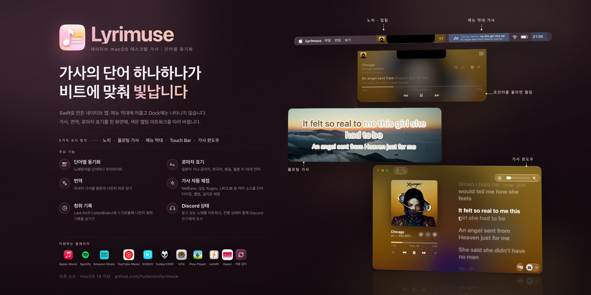

<div align="center">


# Lyrimuse

**Mac을 위해 새롭게 다시 만든 데스크탑 가사**

**Language / 语言 / 語言 / 言語 / 언어 / Idioma / Langue / Sprache / Lingua / Язык / Мова / ภาษา:** [English](README.md) | [简体中文](README.zh-CN.md) | [繁體中文](README.zh-Hant.md) | [日本語](README.ja.md) | **한국어** | [Español](README.es.md) | [Français](README.fr.md) | [Deutsch](README.de.md) | [Italiano](README.it.md) | [Português (Brasil)](README.pt-BR.md) | [Tiếng Việt](README.vi.md) | [Русский](README.ru.md) | [Українська](README.uk.md) | [ไทย](README.th.md)


[](https://github.com/Yudaotor/lyrimuse/releases/latest)
[](https://github.com/Yudaotor/lyrimuse/commits/dev)
[](LICENSE)
[](https://github.com/sponsors/Yudaotor)
[](https://discord.gg/N7gVy66Gp3)
[](https://t.me/lyrimuse)
[](https://qm.qq.com/q/Nb4TlwfnQy)

</div>

https://github.com/user-attachments/assets/88b951ee-4ecf-4985-b1cb-eee6afdd5510

Lyrimuse는 macOS용 오픈 소스 데스크탑 가사 앱입니다. 메뉴 막대에 상주하며, 노래가 재생되는 동안 가사를 단어 단위로 하이라이트합니다. 다른 윈도우 위에 항상 떠 있는 플로팅 가사, 메뉴 막대, 노치 아래의 다이내믹 아일랜드 스타일 캡슐, Touch Bar, 전체 가사 윈도우 중 원하는 곳에 표시할 수 있습니다. Apple Music, Spotify, Amazon Music, YouTube Music 앱 Kaset을 포함한 20개 플레이어와 브라우저의 웹 플레이어를 지원하고, 15개 가사 소스 중에서 가장 잘 맞는 가사를 골라 주며, 원하면 번역과 로마자 표기도 함께 표시합니다. Last.fm 청취 프로필을 보여 주고 재생 기록을 스크로블하는 기능도 갖추고 있습니다.

**LyricsX를 사용하셨습니까?** LyricsX는 2022년 4월 이후 새 버전이 나오지 않았습니다. Lyrimuse는 LyricsX가 하던 일을 모두 해내면서 꾸준히 업데이트되고 있으며, 중국어권 플레이어, KKBOX, Amazon Music, Kaset, Pear Desktop, reAMP, Pine Player, foobar2000, Plexamp, MyGo Music, WeRead, 웹 플레이어 지원도 더했습니다. 자세한 내용은 사실 확인을 거친 [LyricsX 및 Lyric Fever와의 비교](docs/lyrics-apps-comparison.md)를 참고하십시오.

Apple Silicon과 Intel 모두 Homebrew로 **설치**할 수 있습니다. 첫 실행 시 나타나는 Gatekeeper 경고도 함께 해결해 줍니다. 직접 다운로드하려면 [최신 릴리스](https://github.com/Yudaotor/lyrimuse/releases/latest)를 받은 다음 [시작하기](#시작하기)를 참고하십시오.

```bash
brew tap yudaotor/lyrimuse
brew trust --cask yudaotor/lyrimuse/lyrimuse   # one-time: Homebrew asks you to trust non-official taps
brew install --cask lyrimuse
```


<p align="center"><sub>가사를 보여 주는 네 가지 방식: 가사 윈도우, 다이내믹 아일랜드 스타일 캡슐, 단어별 하이라이트가 적용된 플로팅 가사, 메뉴 막대</sub></p>


<p align="center"><sub>가사 관리자, 모든 결과에 점수가 표시되는 수동 검색, 그리고 노래마다 왜 그 가사가 선택되었는지 보여 주는 패널</sub></p>


<p align="center"><sub>Last.fm 통계와 차트, 아무것도 재생하지 않을 때 보이는 개요, 그리고 GitHub 스타일의 연간 히트맵</sub></p>


<p align="center"><sub>모든 설정 페이지에서 실시간 미리보기를 볼 수 있고, 플레이어를 여러 개(웹 플레이어 포함) 고를 수 있으며, 나머지 기능은 메뉴 막대 드롭다운에 있습니다</sub></p>

## 기능

> 각 기능이 설정의 어디에 있는지, 설치 직후 켜져 있는지 꺼져 있는지는 [**기능 목록**](docs/feature-list.ko.md)에서 확인할 수 있습니다.

### 자동으로 찾아 주는 단어별 싱크 가사
- **단어별 하이라이트**가 재생 중인 노래를 그대로 따라갑니다.
- **15개 가사 소스를 대신 검색합니다**: NetEase Cloud Music, QQ Music, Kugou, Kuwo, Migu, Musixmatch, LRCLIB, LyricFind(YouTube Music 경유), Deezer, AMLL(직접 다듬은 단어별 가사 데이터베이스), Soda Music(자체 단어별 타이밍), VIBE와 Genie(둘 다 한국 노래에 강함), PetitLyrics(일본 노래에 강함), 그리고 설정에서 계정을 연결하면 Apple Music 가사까지 검색합니다. Apple Music 가사는 구독이 필요하며, 많은 곡에 단어별 타이밍이 있습니다. 직접 검색할 필요가 전혀 없습니다.
- 원문 가사 아래에 **번역과 로마자 표기**를 표시합니다. 소스에 커뮤니티 번역이 있으면 그것을 사용합니다. 없을 때는 설정에서 ‘시스템 대체 번역’을 켜면(기본값은 꺼짐) Mac이 Apple의 Translation 프레임워크로 가사를 번역하므로 가사가 컴퓨터 밖으로 나가지 않으며, 그것이 불가능할 때만 온라인 번역기가 대신합니다. 번역 대상 언어는 17개입니다. 로마자 표기는 줄 단위로 판단합니다. 일본어 한 줄이 섞인 중국어 노래라면 그 줄에만 읽는 법이 붙고, 나머지 줄 전체에 병음이 붙지는 않습니다. 광둥어 노래에는 단어 단위로 이해하는 Jyutping이 붙습니다. 일본어 노래는 로마자 대신 한자에만 히라가나 후리가나를 달 수도 있어, 노래로 일본어를 공부할 때 편합니다. 러시아어, 태국어, 그리스어, 힌디어 등 18개 언어도 각 언어의 공식 로마자 표기법이나 ISO 표준에 따라 읽는 법을 표시합니다.
- **듀엣은 가수별로 나눠 표시합니다.** 소스(또는 AMLL 항목)에 어느 줄을 누가 부르는지 표시되어 있으면, 두 목소리를 한 덩어리로 섞지 않고 파트마다 따로 보여 줍니다.
- **가사 윈도우의 Apple Music다운 디테일**: 배경 보컬은 메인 줄 아래에 따로 표시되고, 겹치는 듀엣 줄은 둘 다 끝날 때까지 함께 빛나며, 길게 끄는 영어 단어는 Apple Music처럼 부풀어 오르며 빛납니다.
- 가사를 **간체 또는 번체 중국어**로 표시할 수 있으며, 앱 자체의 언어와는 따로 설정합니다.
- 정리하고 싶을 때는 **가사 관리자**를 사용합니다. 어떤 노래든 둘러보고, 편집하고, 삭제하거나 다시 검색할 수 있고, 여러 곡을 한꺼번에 삭제하거나 광고와 팟캐스트가 남긴 빈 항목을 정리할 수도 있습니다. 한 곡만 타이밍이 어긋났다면 그 곡만 조정하면 됩니다. 버튼 하나로 아직 가사가 없는 모든 노래를 다시 시도하고, 전체 재검사를 하면 현재 매칭 규칙으로 보관함 전체의 가사를 다시 고릅니다. 직접 수정한 가사는 건드리지 않습니다. .lrc 파일이나 폴더 전체를 가져올 수도 있고(아직 재생하지 않은 노래도 미리 저장해 둘 수 있습니다), 폴더를 지켜보게 할 수도 있습니다.
- **한 노래에는 한 가지 가사.** 같은 노래를 다른 플레이어나 다른 음반으로 재생해도 같은 노래로 인식합니다. 이런 항목들은 가사와 직접 수정한 내용을 공유하고, 재생 횟수도 합산됩니다. 가사 관리자의 ‘같은 노래의 항목’에서는 이 항목들을 줄 단위로 비교하고, 잘못 매칭된 항목을 분리할 수 있습니다.
- **가사 윈도우에서 바로 가사를 고칩니다.** 다른 가사를 검색하거나, 노래를 다시 매칭하거나, 자주 쓰는 텍스트 편집기에서 편집할 수 있습니다. 단어별 가사를 편집하면 단어만 바뀌므로 모든 단어의 타이밍이 그대로 유지됩니다.
- 이미 가사가 캐시된 노래는 **오프라인에서도 작동합니다**.

### Last.fm 청취 프로필과 스크로블
- **완전한 청취 프로필.** ‘연결된 서비스’ 섹션에서 클릭 한 번으로 Last.fm을 연결하면(토큰을 복사해 붙여 넣을 필요 없음) 오늘, 최근 7일, 전체 기간의 합계, 실시간 ‘스크로블 중’ 표시, 아트워크가 붙은 최근 재생 목록을 볼 수 있으며, 각 항목의 하트로 Last.fm에서 좋아요를 표시하거나 취소할 수 있습니다. 기본적으로 각 재생은 Last.fm 카탈로그에서 일치하는 트랙으로 전송되므로, 듀엣 크레딧, 간체 / 번체 표기, ‘ - Single’이나 ‘(Remastered)’ 같은 꼬리말이 붙어 있어도 실제 트랙 페이지에 기록됩니다. 플레이어가 알려 준 그대로 보내고 싶다면 설정에서 ‘원본’으로 바꾸십시오. ListenBrainz에는 항상 원래 태그가 전송됩니다([스크로블 작동 방식](docs/scrobbling.ko.md)).
- 최근 7일, 30일, 1년, 전체 기간의 **인기 아티스트, 앨범, 트랙**과 함께 이전 기간보다 순위가 얼마나 변했는지 보여 줍니다. 아티스트를 클릭하면 그 아티스트의 노래 중 가장 많이 들은 곡을 볼 수 있습니다.
- **발자취**는 별도의 탭입니다. 맨 위에는 누적 기록이 있습니다. 첫 스크로블 이후 며칠이 지났는지, 그중 재생 기록이 있는 날은 며칠이고 하루 평균은 얼마인지, 가장 많이 들은 날, 현재 연속 기록과 최장 연속 기록, 올해 지금까지의 기록과 예전 연도 같은 기간의 비교, 다음 기념 숫자까지 남은 수를 보여 줍니다. 그 아래에는 GitHub 스타일의 연간 히트맵(날짜를 클릭하면 그날 가장 많이 들은 곡을 볼 수 있음), 시간대별·요일별 청취 패턴, 인기 아티스트의 출신 지역, 그리고 지난 여러 해의 같은 날짜에 들은 곡을 보여 주는 ‘오늘의 추억’이 있습니다.
- Last.fm을 연결하기 전이라도 **모든 재생은 먼저 Mac에 저장됩니다**. 나중에 연결하면 최근 2주가량의 기록을 클릭 한 번으로 전송할 수 있습니다(Last.fm은 그보다 오래된 재생을 받지 않습니다).
- **재생이 언제 기록될지 직접 정합니다**: Last.fm 기본값과 같은 50%, 75%나 90%, 또는 노래가 실제로 끝났을 때만. ListenBrainz에는 영향을 주지 않습니다. 특정 플레이어를 Last.fm에서 완전히 제외해 그 플레이어의 재생이 기록에 나타나지 않게 할 수도 있습니다.
- 아무것도 재생하지 않을 때는 **같은 기록이 가사 윈도우에도 표시되므로** 빈 화면 대신 개요를 볼 수 있습니다(아래에서 자세히 설명합니다).

### 플로팅 가사, 메뉴 막대 가사, 다이내믹 아일랜드, Touch Bar, 전체 가사 윈도우
- **여러 플레이어를 함께 쓰거나 자동으로 고르게 할 수 있습니다.** Apple Music, Spotify, Kaset은 자동화 권한으로 읽습니다. QQ Music, NetEase Cloud Music, Kugou Music, Soda Music, KKBOX, Amazon Music, LX Music은 macOS의 MediaRemote로 읽으며 권한이 필요 없습니다. 설정에서 원하는 조합을 켜거나, ‘자동 감지’로 두면 macOS가 ‘지금 재생 중’으로 표시하는 플레이어를 따라갑니다.
- **Apple Music 라디오도 지원합니다.** 방송국에서 나오는 노래마다 가사가 따라가며, 진행자가 말하는 동안에는 이전 노래가 아니라 방송국 이름과 로고를 보여 줍니다. 라디오에는 별도의 타이밍 오프셋이 있어서 방송국마다 한 번만 맞춰 두면 됩니다.
- **브라우저의 플레이어도 지원합니다.** 브라우저를 한 번 페어링하면 YouTube Music이나 Spotify 웹 플레이어도 다른 플레이어처럼 쓸 수 있고, 가사는 페이지 자체의 진행 막대에 맞춰 동기화됩니다. 클릭 한 번으로 하는 테스트로 브라우저를 제어할 수 있는지 미리 확인할 수 있습니다. 광고가 나오는 동안에는 캡슐이 검게 바뀌고 남은 시간과 전체 광고 중 몇 번째인지 보여 줍니다. YouTube Music 광고에는 건너뛰기 버튼이 나타나며, 자동으로 건너뛰게 할 수도 있습니다.
- **원하는 방식으로 표시합니다.** 어떤 조합이든, 아예 표시하지 않아도 됩니다:
  - 원하는 곳으로 드래그하거나, 화면 위쪽 가운데나 Dock 바로 위에 고정할 수 있는 데스크탑 플로팅 가사
  - 화면 위쪽의 다이내믹 아일랜드 스타일 캡슐. 앨범 아트를 표시하고 캡슐 뒤에 흐리게 깔 수도 있습니다. 포인터를 가사 줄에 올리면 흐려지면서 클릭이 아래로 통과하게 하거나, 잠금 화면에 표시할 수도 있습니다
  - Touch Bar가 있는 MacBook Pro의 Touch Bar. 부르는 대로 줄이 흘러가며, 원하면 앨범 아트와 재생 컨트롤도 표시합니다
  - Apple Music의 가사 페이지를 본뜬 크기 조절 가능한 가사 윈도우. 2단 레이아웃, 흐린 아트워크 배경, 현재 줄에 맞춰 스크롤되는 노래 전체 가사를 보여 주며, Apple Music에 움직이는 아트워크가 있는 음반이면 움직이는 앨범 아트를, Spotify Canvas 반복 영상이 있는 노래면 그 영상을 배경으로 씁니다. 단어는 부르는 대로 채워지며 굵기, 부른 부분의 색상, 정렬을 직접 정할 수 있고, HDR 디스플레이에서는 ‘HDR 하이라이트’로 부른 부분을 흰색보다 더 밝게 빛나게 할 수 있습니다.
- **메뉴 막대 가사(텍스트 모드).** 현재 줄이 메뉴 막대에 바로 표시됩니다. 긴 줄은 중간에 잘리지 않고 스크롤됩니다(자르도록 되돌릴 수도 있습니다). 두 번째 줄에 다음 줄, 번역 또는 로마자 표기를 표시할 수 있으며, 캡슐도 마찬가지입니다.
- 가사 윈도우와 캡슐에서 **진행 막대를 드래그해 탐색**할 수 있습니다.
- 플레이어가 허용하는 범위에서 **임의 재생, 반복 재생, 즐겨찾기, 음량**을 가사 윈도우에서 바로 조절합니다. Apple Music, Spotify, Kaset, QQ Music, Amazon Music, 브라우저의 YouTube Music은 각각 이 중 일부 또는 전부를 지원하며, NetEase Cloud Music, Kugou Music, Soda Music, LX Music은 즐겨찾기를 지원합니다. 즐겨찾기는 펼친 캡슐에도 있고 단축키를 지정할 수도 있습니다.
- ‘⋯’ 메뉴나 정보 패널에서 **노래를 원래 서비스에서 엽니다**. Apple Music은 앱에서 열리고, Spotify는 재생 중인 트랙으로 이동하며, KKBOX는 자체 앱에서 노래, 앨범, 아티스트를 엽니다. QQ Music, Soda Music, Spotify, Amazon Music, YouTube Music(Kaset에서 재생할 때)은 웹에서 노래, 앨범, 아티스트 페이지를 열고, NetEase Cloud Music은 노래 페이지를 엽니다. 링크는 Lyrimuse가 가사를 가져오면서 찾았거나 Mac에 있는 플레이어 자체 데이터에서 읽은 것이므로 따로 검색하지 않습니다.
- **아무것도 재생하지 않을 때** 가사 윈도우에는 오늘과 이번 주의 합계, ‘오늘의 추억’ 카드, 아트워크가 붙은 최근 재생 목록이 표시되며, 각 항목은 Apple Music의 앨범 또는 아티스트 페이지로 연결됩니다.
- **미니 가사 윈도우**: 한 줄, 두 줄 또는 스크롤되는 전체 가사를 보여 주는 작은 카드로, 배경, 글자 색상, 서체, 굵기, 부른 부분의 색상을 따로 설정할 수 있습니다. 단어별 노래방 효과를 미니 윈도우에서만 끌 수도 있습니다.
- **휴대폰, 태블릿, 방송에서 보는 웹 가사.** 다른 기기의 브라우저에서 가사 윈도우를 열어 보조 화면으로 쓸 수 있으며, 허용하면 재생 컨트롤과 탭해서 이동하기도 사용할 수 있습니다. ‘OBS 출력’은 플로팅 가사를 투명한 브라우저 소스로 방송 화면에 올립니다. 둘 다 로컬 네트워크 접근을 허용하기 전까지는 이 Mac 안에서만 열리며, 다른 기기는 QR 코드를 스캔해 연결합니다.
- **노래 소개, 앨범 소개, 아티스트 소개.** 가사 윈도우나 펼친 캡슐에서 제목, 아티스트, 앨범 이름을 클릭하면 관련 소개를 읽을 수 있습니다. 앨범 소개와 아티스트 소개는 Apple Music에서 가져오며, Apple Music에 없을 때는 Soda Music(Soda Music에서 재생한 노래, 중국어 인터페이스 한정), Kugou Music(Kugou Music에서 재생한 노래, 중국어 인터페이스 한정), NetEase Cloud Music(중국어 인터페이스 한정), YouTube Music에 표시되는 Wikipedia 문서(인터페이스 언어 기준) 또는 Last.fm에서 가져옵니다. 노래 소개는 QQ Music(중국어 인터페이스 한정)이나 Last.fm에서 가져옵니다.
- **원하는 모습으로 꾸밀 수 있습니다**: 서체(시스템 서체 또는 직접 가진 .ttf / .otf 파일), 크기, 글자 / 배경 / 그림자 색상, 저장한 테마나 현재 앨범 아트에서 뽑은 색상, 플로팅 가사의 너비, 그리고 흐르는 무지개색 가사.
- **스크린샷, 화면 녹화, 화면 공유에는 나타나지 않습니다.** 나에게는 보이지만 다른 사람에게는 보이지 않습니다.
- **일시 정지하면 저절로 숨겨지므로** 할 일 없이 데스크탑에 남아 있지 않습니다. 연주곡, 가사가 없는 노래, 전체 화면 앱에서도 비켜 줄 수 있고, 플로팅 가사가 사용 중인 윈도우가 있는 화면으로 따라오게 할 수도 있습니다.

### 일상의 세심한 부분
- **영어, 간체 중국어, 번체 중국어, 일본어, 한국어, 스페인어, 프랑스어, 독일어, 이탈리아어, 브라질 포르투갈어, 베트남어, 러시아어, 우크라이나어, 태국어**를 지원하며, 언어를 바꾸면 재시작 없이 바로 적용됩니다. 어색한 번역을 발견했다면 Pull Request를 환영합니다. 각 언어의 스타일 가이드는 `lyrimuse/Localization/`에 있습니다.
- **macOS 26의 Liquid Glass.** 설정, 메뉴 막대 패널, 가사 윈도우, 가사 관리자, 설정 가이드가 Liquid Glass로 만들어졌으며, 대부분은 시스템을 따르지 않고 라이트 또는 다크 모드로 고정할 수 있습니다.
- 모든 가사를 숨기는 것부터 노래에 좋아요를 표시하는 것까지 모든 동작에 **키보드 단축키**를 지정할 수 있습니다. 기본으로 설정된 단축키는 없으므로 원하는 키를 직접 고르면 됩니다. 모든 동작에는 단축어, Raycast, Alfred에서 호출할 수 있는 `lyrimuse://` 링크도 있으며, 단축어에서는 링크로 재생 중인 노래 정보를 받아 올 수도 있습니다([URL Scheme](docs/url-scheme.ko.md)).
- **설정 검색.** 사이드바에 입력하면 일치하는 행으로 스크롤해 강조 표시하며, 필요하면 접혀 있는 그룹도 펼칩니다.
- **스스로 업데이트합니다.** 자동으로 확인하거나 메뉴 막대에서 요청할 때 확인합니다. 업데이트는 설정의 ‘소프트웨어 업데이트’ 페이지에서 설치하며 릴리스 노트와 진행 상황도 그곳에서 볼 수 있고, 베타 빌드를 받도록 선택할 수도 있습니다.
- **플레이어와 함께 시작합니다.** 플레이어별로, 양방향으로 설정할 수 있습니다. Lyrimuse가 열릴 때 플레이어를 열거나, 플레이어가 열릴 때 Lyrimuse를 열 수 있고, 원하면 따라가는 플레이어가 모두 종료되었을 때 Lyrimuse도 종료할 수 있습니다.
- 윈도우 없이 메뉴 막대 아이콘만으로 시작하고 싶다면 **조용히 실행**을 켜십시오.
- **새 Mac으로 옮기십니까?** 전체 설정을 내보내 새 Mac에서 가져오면 됩니다. 문제가 생겼을 때를 위한 원클릭 진단 내보내기도 있습니다.

### 선택 기능

<details>
<summary>ListenBrainz, Discord 상태, 공유할 수 있는 지금 재생 중 페이지, 일간 / 주간 / 월간 / 연간 청취 요약</summary>

다음 기능은 모두 설정에서 켜기 전까지는 꺼져 있습니다:

- **[ListenBrainz](https://listenbrainz.org)에도 스크로블합니다.** 플레이어를 한 번 읽은 결과로 두 서비스에 모든 재생을 보내므로 두 기록이 어긋나지 않습니다. iPhone에서 들은 곡(Last.fm으로 기록된 것)도 ListenBrainz로 복사되므로, 기기마다 따로 쌓이지 않고 하나의 기록으로 모입니다.
- **공유할 수 있는 공개 ‘지금 재생 중’ 페이지**: 실시간 재생, 기록, 방명록, 반응, 방문자 수, 인기 아티스트 Top 10 보드, LP 레코드 스타일, 라이트·다크 테마를 갖추고 있으며, 채팅 앱에서 링크 미리보기도 제대로 표시됩니다. [**웹 기능 가이드**](https://github.com/Yudaotor/nowplaying-workers#readme)에서 스크린샷과 함께 설명합니다.
- **일간, 주간, 월간, 연간 청취 요약**을 원하는 만큼 여러 채널로 보낼 수 있습니다: Bark, ntfy, ServerChan, Feishu, DingTalk, WeCom, Telegram, Discord, Slack 또는 일반 Webhook. 채널마다 테스트를 보낼 수 있고, 전송 기록에서 무엇이 도착했는지 확인할 수 있습니다.
- **듣고 있는 곡을 Discord에 표시합니다.** 프로필과 친구 목록에 사용 중인 플레이어, 노래, 아티스트, 앨범 아트, 진행 막대가 표시되며, 노래 제목과 아티스트는 해당 플레이어 사이트의 페이지로 연결됩니다. 앨범 줄에 지금 부르는 가사 줄을 표시할 수 있고, 버튼을 최대 두 개까지 추가할 수 있습니다. 아트워크 모서리에는 작은 Lyrimuse 배지나 플레이어 배지를 붙이거나 아무것도 붙이지 않을 수 있고, 일시 정지한 노래를 일시 정지 아이콘과 함께 계속 표시할 수도 있습니다. 어떤 플레이어를 대상으로 할지 고를 수 있고, 노래 이름 없이 플레이어만 표시하거나 잠시 숨길 수도 있습니다.

ListenBrainz와 웹 푸시는 설정 사이드바의 **실험실**에, 푸시 알림은 다른 섹션들과 함께 있고, Discord는 위쪽에 별도 항목이 있습니다. 각 카드에는 API 키나 토큰을 받는 곳, 계정을 연결하는 방법, 푸시 서비스의 Webhook URL을 얻는 방법 등 설정 절차가 함께 안내되어 있습니다. 별도 가이드가 있는 것은 웹 페이지뿐이며, 그것도 전부 따라 할 필요는 없습니다. ListenBrainz만 설정해도 페이지에 실시간 재생과 기록이 표시되며 Cloudflare Worker는 필요 없습니다. 방명록, 반응, 방문자 수, Top 10 보드, 더 빠른 업데이트까지 원할 때만 Worker를 배포하면 되고, 방법은 가이드에 있습니다.

</details>

## 시작하기

릴리스는 Apple Developer ID가 아니라 프로젝트 자체 인증서로 서명되므로, 아래 어느 방법을 쓰든 Apple Developer 계정은 필요 없습니다. 대신 앱을 처음 열 때 Gatekeeper가 ‘확인되지 않은 개발자가 배포했다’고 경고합니다. Homebrew(방법 A)는 이 경고를 대신 처리해 줍니다. 다른 방법에서는 예상된 동작이며 버그가 아닙니다. 한 번 통과하는 방법은 방법 B에서 설명합니다.
### 방법 0: AI에게 설치 맡기기

Mac의 터미널을 사용할 수 있는 AI 에이전트(Claude Code, Codex CLI, Gemini CLI 등)를 쓰고 있다면, 아래 블록을 그대로 붙여 넣으십시오. 방법 A/B의 과정을 모두 대신 처리합니다. 이 지침은 이 앱 하나만 설치하도록 제한하며, `sudo`를 쓰거나 시스템 전체의 보안 설정을 건드리지 않습니다:

```text
Please install Lyrimuse — an open-source macOS menu-bar lyrics app
(https://github.com/Yudaotor/lyrimuse) — on this Mac, following these rules exactly:

1. Preferred path (if `brew` exists):
     brew tap yudaotor/lyrimuse
     brew trust --cask yudaotor/lyrimuse/lyrimuse
     brew install --cask lyrimuse
   If this Homebrew doesn't know the `trust` subcommand, skip that line — older
   versions don't need it.
2. If Homebrew is not installed, do NOT install Homebrew. Instead: check the CPU
   with `uname -m`, download the latest release asset from
   https://github.com/Yudaotor/lyrimuse/releases — `Lyrimuse-v<version>-macos.zip`
   for arm64, `Lyrimuse-v<version>-macos-intel.zip` for x86_64 — verify it against
   its `.sha256` file (`shasum -c`), unzip, move `Lyrimuse.app` into
   /Applications, then clear the Gatekeeper quarantine flag on that one app only:
     xattr -dr com.apple.quarantine /Applications/Lyrimuse.app
3. Safety rails: no `sudo` anywhere (nothing here needs it); never run
   `spctl --master-disable` or otherwise weaken Gatekeeper system-wide; never
   remove the quarantine flag from anything except /Applications/Lyrimuse.app.
4. Do not build from source unless I explicitly ask.
5. Launch it (`open -a Lyrimuse`) and verify it is running (`pgrep -x Lyrimuse`
   prints a PID).
6. A first-run wizard will appear — that part is mine to click through. Tell me
   it will ask me to pick a music player, to grant Automation access to
   Music.app and/or Spotify (only if I pick them), and to enable the background
   lyrics engine — then hand control back to me.
Finally, report what you did and anything that failed.
```

### 방법 A: Homebrew로 설치(권장)

```bash
brew tap yudaotor/lyrimuse
brew trust --cask yudaotor/lyrimuse/lyrimuse   # one-time: Homebrew asks you to trust non-official taps
brew install --cask lyrimuse
```

설치 과정에서 1회성 Gatekeeper 격리 표시가 자동으로 해제되므로 후속 작업이 필요 없습니다. `brew install`이 끝나면 바로 `/Applications`(또는 Spotlight)에서 Lyrimuse를 여십시오. 새 릴리스도 `brew upgrade --cask lyrimuse`로 같은 방식으로 받을 수 있습니다.

### 방법 B: 미리 빌드된 릴리스를 직접 다운로드

1. [Releases 페이지](https://github.com/Yudaotor/lyrimuse/releases)에서 받습니다. **먼저 사용 중인 Mac을 확인하십시오**( → 이 Mac에 관하여 → ‘칩’: `Apple M…`이면 Apple Silicon, `Intel Core…`이면 Intel):

   | 사용 중인 Mac | 다운로드 |
   | --- | --- |
   | Apple Silicon(M1 이후) | `Lyrimuse-*-macos.dmg` 또는 `.zip` |
   | Intel | `Lyrimuse-*-macos-intel.dmg` 또는 `.zip` |

   dmg는 더블 클릭해 마운트한 다음 `Lyrimuse.app`을 옆의 `Applications` 바로가기로 드래그하고, zip은 압축을 풀고 `Lyrimuse.app`을 `/Applications`로 드래그합니다. 두 형식 모두 완전히 같은 앱이 설치되며, 다운로드 파일을 검증하고 싶다면 zip과 함께 제공되는 `.sha256`을 사용하십시오(같은 폴더에서 `shasum -c Lyrimuse-*.zip.sha256` 실행).

   두 다운로드의 유일한 차이는 아키텍처입니다. 접미사가 없는 것은 Apple Silicon 전용이고, `-intel`에는 Intel과 Apple Silicon 코드가 모두 들어 있습니다. `-intel`도 Apple Silicon에서 실행되지만 그곳에서 쓸 이유는 없습니다. 크기가 두 배이고, macOS 27 이후에서는 Intel 코드가 들어 있다는 이유로 앱을 ‘업데이트해야 한다’고 경고하기 때문입니다(Apple은 macOS 28에서 Rosetta를 제거할 예정이며, 앱 자체에는 아무 문제가 없습니다).

   **두 아키텍처 모두 앱 내 자동 업데이트를 받습니다.** 업데이트 피드에는 같은 버전에 대해 아키텍처별로 두 항목이 있습니다. Apple Silicon에는 접미사 없는 빌드가, Intel에는 `-intel` 빌드가 제공되며, Sparkle이 기기에 맞는 것을 알아서 고릅니다. (v1.4.0 이전에는 Apple Silicon에만 제공되어 Intel 사용자는 여기로 직접 와서 받아야 했습니다.)
2. 처음 실행하면 macOS가 ‘Apple은 Lyrimuse에 악성 소프트웨어가 없는지 확인할 수 없기 때문에 열 수 없습니다’ 또는 ‘확인되지 않은 개발자가 배포했습니다’라며 열기를 거부합니다. 아래 중 편한 방법으로 한 번만 해제하십시오:

   - **터미널(권장, 항상 작동):**
     ```bash
     xattr -dr com.apple.quarantine /Applications/Lyrimuse.app
     ```
     그런 다음 평소처럼 앱을 엽니다. 다운로드할 때마다 한 번만 하면 됩니다.
   - **오른쪽 클릭 → 열기:** Finder에서 `Lyrimuse.app`을 오른쪽 클릭(또는 Control-클릭)하고 **열기**를 선택한 다음, 대화상자에서 다시 **열기**를 눌러 확인합니다. macOS 버전과 경고 종류에 따라 작동하지 않을 수 있으므로, 경고가 계속 나타나면 위의 터미널 명령을 사용하십시오.
   - **시스템 설정 → 개인정보 보호 및 보안:** 앱을 한 번 열어 본 다음(차단됨) **시스템 설정 → 개인정보 보호 및 보안**을 열고 맨 아래로 스크롤해 Lyrimuse 경고 옆의 **그래도 열기**를 클릭합니다. 다시 묻는 경우 한 번 더 확인합니다.

   이 작업은 실제로 신뢰하는 빌드, 즉 이 저장소의 Releases 페이지에서 받은 빌드나 직접 빌드한 것에만 하십시오.

### 방법 C: 소스에서 빌드

**최초 1회 준비 사항**(이미 있는 것은 건너뛰십시오):

```bash
xcode-select --install   # Xcode Command Line Tools, for Swift — skip if `swift --version` already works
brew install go          # any Go ≥ 1.21 — build.sh switches to 1.24.4 automatically via GOTOOLCHAIN
```

그다음 `build.sh`가 앱과 가사 엔진(`lyrimuse-engine`이라는 이름의 백그라운드 프로세스)을 한 번에 빌드합니다:

```bash
git clone https://github.com/Yudaotor/lyrimuse.git
cd lyrimuse/lyrimuse
./build.sh              # this machine's architecture
./build.sh --universal  # arm64 + x86_64 (the compatibility build shipped for Intel)
```

`build.sh`는 마지막에 번들 안의 모든 바이너리의 아키텍처를 나열하고, 슬라이스가 빠졌거나 남는 것이 있는 등 대상과 맞지 않는 것을 표시합니다. 릴리스 파일을 직접 조립하지 마십시오. `./package.sh`가 아키텍처마다 한 번씩 빌드해 각각 zip + sha256 + dmg를 만들며, 아키텍처가 맞지 않으면 패키징을 거부합니다.

QQ Music / NetEase Cloud Music / Kugou Music / Soda Music / KKBOX / Amazon Music / LX Music / Spotify / Kaset / 자동 감지를 지원하려면 [ungive/media-control](https://github.com/ungive/media-control)도 필요합니다. 없으면 `build.sh`가 Homebrew로 자동 설치하므로, 이것 역시 직접 할 필요는 없습니다.

### 어느 방법이든 설치한 다음

`/Applications`에서 Lyrimuse를 엽니다. 첫 실행 마법사가 플레이어 선택(Apple Music, QQ Music, NetEase Cloud Music, Kugou Music, Soda Music, KKBOX, Amazon Music, Spotify, Kaset, Pear Desktop, reAMP, VOX, Pine Player, foobar2000, Swinsian, Plexamp, MyGo Music, Audirvana, LX Music, WeRead 또는 자동 감지), Apple Music, Spotify, Kaset, VOX, Swinsian, Audirvana를 골랐을 때의 자동화 권한 허용(다른 플레이어는 기본 트랙 정보를 읽는 데 권한이 필요 없음), 가사 엔진 활성화(윈도우를 닫아도 가사와 아트워크를 계속 가져오기 위함)를 차례로 안내합니다. 마법사를 마치면 바로 가사가 나타납니다(다른 빌드 옵션은 [lyrimuse/README.md](lyrimuse/README.md)를 참고하십시오).

가사를 보는 데 필요한 것은 이것이 전부입니다. 선택 기능은 나중에 원할 때 설정에서 켜면 됩니다.

## FAQ

### Mac 데스크탑에서 Apple Music 가사를 항상 위에 떠 있게 하려면 어떻게 합니까?
설정에서 데스크탑 플로팅 가사를 켜십시오. 모든 윈도우 위, 모든 Space에 표시됩니다. 원하는 곳으로 드래그하거나 화면 위쪽 가운데 또는 Dock 바로 위에 고정할 수 있습니다. 가사에 단어별 타이밍이 있으면 부르는 대로 단어가 하나씩 채워집니다. 스크린샷, 화면 녹화, 화면 공유에서 숨기거나 음악을 일시 정지했을 때 사라지게 할 수도 있습니다. QQ Music, NetEase Cloud Music, Kugou Music, Soda Music, KKBOX, Amazon Music, LX Music, Spotify, Kaset, 웹 플레이어에서도 똑같이 작동합니다.

### Spotify 가사를 Mac 메뉴 막대에 표시할 수 있습니까?
예. 메뉴 막대 텍스트 모드를 켜면 Spotify든 다른 지원 플레이어든 현재 줄이 메뉴 막대에 나타납니다. 긴 줄은 잘리지 않고 스크롤되며, 두 번째 줄에 다음 줄, 번역 또는 로마자 표기를 표시할 수 있습니다. Spotify 계정을 연결할 필요는 없습니다. Lyrimuse는 Spotify에 대한 자동화 권한을 한 번 요청하며, 이 권한으로 정확한 재생 위치를 얻고 재생 버튼이 작동합니다. 허용하지 않아도 가사는 표시되지만, 타이밍을 macOS의 MediaRemote에서 가져오므로 1초 정도 어긋날 수 있습니다.

### QQ Music, NetEase Cloud Music, Kugou, Soda Music에서도 단어별 가사가 표시됩니까?
예, 가사에 단어별 타이밍이 있다면 표시됩니다. NetEase Cloud Music, QQ Music, Kugou, Soda Music, Musixmatch, AMLL, Apple Music에는 단어별 타이밍이 있는 경우가 많으며, 그런 줄은 단어 단위로 채워집니다. 줄 단위 타이밍만 있는 가사는 한 줄 전체가 한꺼번에 강조됩니다. 플레이어가 가사 출처를 제한하지도 않습니다. Soda Music에서 재생 중인 노래라도 QQ Music의 단어별 가사가 가장 높은 점수를 받으면 그것이 선택됩니다.

### 설치하려면 Apple Developer 계정이 필요합니까?
아니요. 릴리스는 Apple Developer ID 대신 프로젝트 자체 인증서로 서명되므로 사용자도 프로젝트도 계정이 필요 없습니다. 위의 ‘시작하기’에서 설명한 1회성 Gatekeeper 절차가 있는 것도 이 때문입니다.

### Lyrimuse는 Mac App Store에 있습니까?
아니요. Homebrew(위의 방법 A)로 설치하거나 [Releases 페이지](https://github.com/Yudaotor/lyrimuse/releases)에서 다운로드하십시오(방법 B). 어느 쪽이든 그 이후 업데이트는 앱을 통해 받습니다.

### Lyrimuse는 무료입니까?
예. GPL-3.0 라이선스의 오픈 소스입니다. 유료 버전, 앱 내 구입, 가입해야 하는 계정이 없습니다. Last.fm 등 다른 서비스 사용 여부는 자유입니다. 유용하게 쓰고 있고 지원하고 싶다면 [GitHub에서 후원](https://github.com/sponsors/Yudaotor)하거나 Alipay 또는 WeChat Pay로 [개발자에게 커피를 사 줄](https://yudaotor.github.io/donate/) 수 있습니다.

### 다른 앱이 시스템 미디어 포커스를 가지고 있을 때 QQ Music, NetEase Cloud Music, Soda Music을 제어할 수 있습니까?
예. 브라우저 영상 같은 것이 macOS의 ‘지금 재생 중’을 차지하고 있으면 시스템 미디어 키는 그쪽으로 갑니다. 이때 Lyrimuse는 QQ Music, NetEase Cloud Music, MyGo Music의 자체 메뉴 막대, 또는 Soda Music의 재생 막대에서 재생/일시 정지, 이전, 다음을 대신 눌러 주며, 플레이어는 백그라운드에 그대로 둡니다. 이 기능에는 손쉬운 사용 권한이 필요합니다(설정 → 플레이어). 권한이 없으면 해당 버튼을 눌렀을 때 그 페이지가 열립니다. 이 상태에서는 탐색을 사용할 수 없습니다. macOS 27에서는 이 권한이 **시스템 설정 → 개인정보 보호 및 보안 → 기기 제어 및 데이터 접근**에 있으며, 이전 버전에서는 **손쉬운 사용**이라고 부릅니다.

### Spotify, QQ Music, NetEase Cloud Music에서도 작동합니까, 아니면 Apple Music 전용입니까?
모두 작동합니다. 여기에 Kugou Music, Soda Music, KKBOX, Amazon Music, Kaset(YouTube Music 앱), 오픈 소스 YouTube Music 데스크톱 앱 Pear Desktop, Winamp 스타일 플레이어 reAMP, 무손실·하이레조 로컬 플레이어 VOX, 거의 모든 포맷을 재생하는 무료 로컬 플레이어 Pine Player, Windows에서 이식된 고전 로컬 플레이어 foobar2000, 대용량 라이브러리를 위한 로컬 플레이어 Swinsian, 직접 운영하는 서버의 라이브러리를 재생하는 Plex 음악 플레이어 Plexamp, 로컬 파일을 재생하고 다른 음원은 플러그인으로 추가하는 오픈 소스 MyGo Music, 오디오 애호가를 위한 하이레조 플레이어 Audirvana, 오픈 소스 LX Music, 오디오북을 듣는 WeRead까지 더해 모두 20개 플레이어를 지원합니다. 또는 macOS가 ‘지금 재생 중’으로 표시하는 것을 자동 감지하게 할 수도 있습니다. Apple Music, Spotify, Kaset, VOX, Swinsian, Audirvana는 자동화 권한을 요청합니다(Spotify, Kaset, VOX, Swinsian은 정확한 타이밍과 재생 버튼에 사용하고, Audirvana는 ‘지금 재생 중’에 아무것도 보고하지 않아 트랙 정보, 재생 위치, 재생 버튼을 모두 이 권한으로 처리). 나머지 14개는 macOS의 MediaRemote로 기본 트랙 정보를 읽으므로 권한이 필요 없습니다. QQ Music, NetEase Cloud Music, Kugou Music, Soda Music, Amazon Music의 임의 재생, 반복 재생, 좋아요 버튼과 reAMP, foobar2000의 임의 재생, 반복 재생, 음량에는 손쉬운 사용 권한이 필요하며, Pine Player는 재생 위치를 초 단위로만 알려 주므로 진행 막대를 읽는 데 이 권한을 사용합니다. KKBOX, Amazon Music, LX Music에서는 그 앱이 이미 저장해 둔 노래 가사도 후보로 고려하며, 이 앱들의 서버에는 전혀 접속하지 않습니다.

### Mac에서 KKBOX나 Amazon Music 가사를 표시할 수 있습니까?
예. 둘 다 macOS의 MediaRemote로 읽으므로 허용할 권한이 없으며, 다른 플레이어와 마찬가지로 플로팅 가사, 메뉴 막대, 캡슐, 가사 윈도우에 가사가 표시됩니다. KKBOX나 Amazon Music이 이미 그 노래의 가사를 저장해 두었다면 그 가사도 후보로 고려되며 가중치를 더 받습니다. Lyrimuse는 두 서비스 모두에 로그인하거나 무엇을 보내지 않습니다. 다른 소스도 여전히 검색하므로, 단어별 타이밍처럼 더 나은 가사가 있으면 그것이 선택됩니다.


### LX Music(洛雪音乐)에서도 작동합니까?
예. LX Music은 macOS의 MediaRemote로 읽으므로 허용할 권한이 없습니다. LX Music에서 노래를 재생하면 LX Music이 그 노래에 대해 저장한 가사(플랫폼에 있으면 단어별 가사)도 후보로 고려되어 가중치를 더 받으며, 재생 중인 목록의 다음 노래들은 미리 가사를 준비해 둡니다. Lyrimuse는 Mac에 있는 LX Music의 데이터를 읽기만 하며 LX Music에 아무것도 보내지 않습니다.

### YouTube Music 데스크탑 앱에서도 작동합니까?
예, Mac용 오픈 소스 네이티브 YouTube Music 앱인 [Kaset](https://github.com/sozercan/kaset)에서 작동합니다. Kaset은 자동화 권한으로 읽으므로 타이밍이 정확하고 재생 버튼도 작동하며, YouTube Music 자체 가사도 후보에 포함됩니다. 오픈 소스 데스크톱 클라이언트 [Pear Desktop](https://github.com/pear-devs/pear-desktop)도 지원하며, macOS의 ‘지금 재생 중’으로 읽으므로 추가 권한이 필요 없습니다. 브라우저의 YouTube Music도 지원합니다. 아래를 참고하십시오.

### 데스크탑 가사는 어떻게 보입니까?
데스크탑 위의 노래방과 같습니다. 현재 줄이 윈도우 위에 떠 있고, 가사에 단어별 타이밍이 있으면 부르는 대로 단어가 채워지며, 번역이나 로마자 표기를 함께 표시할 수 있습니다. 서체, 크기, 글자·배경·그림자 색상, 너비를 바꿀 수 있고, 글자 색상이 앨범 아트를 따르게 할 수도 있습니다. 같은 가사를 메뉴 막대, 노치 아래의 다이내믹 아일랜드 스타일 캡슐, Apple Music 스타일의 전체 가사 윈도우에도 원하는 조합으로 표시할 수 있습니다.

### 노치가 없는 Mac에서도 다이내믹 아일랜드 캡슐이 작동합니까?
예. 이전 MacBook이나 외장 디스플레이처럼 노치가 없는 화면에서는 캡슐이 화면 위쪽 가운데에 메뉴 막대와 같은 높이로 표시됩니다. 어느 화면에 표시할지는 설정에서 고릅니다.

### 인터넷 연결 없이도 가사가 표시됩니까?
예, 이미 가사를 찾은 노래라면 Mac에 캐시되어 있으므로 표시됩니다. 노래의 가사를 처음 찾을 때와 온라인 번역에는 연결이 필요합니다.

### 내 데이터가 Mac 밖으로 나갑니까?
가사를 찾으려면 재생 중인 노래에 대해 가사 소스에 물어봐야 합니다: NetEase, QQ, Kugou, Kuwo, Migu, Musixmatch, LRCLIB, LyricFind, Deezer, AMLL, Soda Music, VIBE, Genie, PetitLyrics, 그리고 연결했다면 Apple Music. 아트워크는 iTunes Search API에서 가져옵니다. 번역은 기본적으로 Mac에서 처리되며, 가사 텍스트는 대체 수단으로만 온라인 번역기(Google 웹 번역, 그다음 MyMemory)로 전송됩니다. 청취 기록, 캐시된 가사, 설정은 Last.fm, ListenBrainz 또는 선택 사항인 웹 릴레이를 연결하지 않는 한 Mac의 파일에만 남습니다. 익명 사용 데이터(버전, 켠 기능, 충돌 요약. 노래 제목이나 계정은 포함하지 않음)는 기본적으로 하루에 한 번 전송되며, 설정 › 정보에서 끌 수 있습니다. 전체 목록은 아래의 [라이선스 및 저작권](#라이선스-및-저작권)에 있습니다.

### 가사의 일본어/한국어 로마자 표기나 중국어 번역을 볼 수 있습니까?
예. 로마자 표기는 줄 단위로 판단하므로, 여러 언어가 섞인 노래에서도 필요한 줄에만 읽는 법이 붙습니다. 일본어는 로마자 대신 한자에만 후리가나를 달 수도 있습니다. 번역은 가사 소스에 커뮤니티 번역이 있으면 그것을 사용하고, 없으면 ‘시스템 대체 번역’(기본값은 꺼짐)을 켰을 때 기기 내 번역이나 온라인 기계 번역으로 17개 언어 중 원하는 언어로 번역합니다.

### 지원하는 macOS 버전은 무엇입니까?
Apple Silicon 또는 Intel에서 macOS 14 Sonoma 이상(Sequoia, Tahoe 및 이후 버전)을 지원합니다. Mac에서 번역하려면 macOS 15 Sequoia 이상이 필요하며, macOS 14에서는 온라인 번역기만 사용할 수 있습니다.

### Intel Mac을 지원합니까?
예, 별도의 유니버설 빌드로 지원합니다(위의 방법 B 참고). v1.5.0부터 Intel에서도 자동 업데이트가 작동하므로 Apple Silicon과 똑같이 새 버전을 받을 수 있습니다.

### 브라우저에서 재생하는 YouTube Music이나 Spotify의 가사도 표시할 수 있습니까?
예. 설정에서 브라우저를 한 번 페어링하면 YouTube Music이나 Spotify 웹 플레이어도 다른 플레이어처럼 쓸 수 있습니다. 가사는 추측하지 않고 페이지 자체의 진행 막대를 따르며, 클릭 한 번으로 하는 테스트로 브라우저를 제어할 수 있는지 미리 확인할 수 있습니다.

### Mac에서 Apple Music 재생 기록을 Last.fm에 스크로블할 수 있습니까?
예, 그것이 이 앱의 또 다른 절반입니다. 설정에서 클릭 한 번으로 Last.fm을 연결하면 Apple Music(또는 다른 지원 플레이어)의 모든 재생이 실시간 ‘지금 재생 중’ 상태와 함께 스크로블됩니다. 재생 기록은 먼저 Mac에 저장되므로 연결하기 전의 재생도 사라지지 않습니다. 연결한 뒤 ‘추가 전송’을 클릭하면 최근 2주가량의 기록을 보냅니다. 재생이 기록되는 시점(50%, 75%, 90% 또는 노래 전체)을 고를 수 있고, 일부 플레이어를 제외할 수 있으며, ListenBrainz에도 동시에 보낼 수 있습니다.

### Lyrimuse는 어떻게 잘못된 가사를 피합니까?
가장 먼저 응답한 소스를 그대로 쓰지 않습니다. 모든 소스의 모든 결과를 같은 기준으로 채점합니다. 제목, 아티스트, 앨범, 길이가 얼마나 일치하는지에 더해 단어별 타이밍 유무 같은 요소도 반영하며, 가장 높은 점수가 선택됩니다. 어떤 노래든 이 결정 과정을 모든 후보의 점수, 선택된 결과가 이긴 이유와 함께 확인할 수 있습니다. 나중에 더 잘 맞는 결과가 나타나면 Lyrimuse가 스스로 바꿀 수 있지만, 직접 고른 가사는 잠겨서 절대 교체되지 않습니다. 수동 검색에서도 같은 점수와 라벨이 표시되므로 잘못된 버전을 고르기 전에 쉽게 알아챌 수 있습니다.

### 가사가 어긋나거나 틀렸다면 어떻게 합니까?
타이밍이 어긋났다면 그 노래만 조정하십시오. 오프셋은 기억됩니다. 가사가 틀렸거나 버전이 다르다면 수동 검색을 여십시오. 모든 소스의 모든 결과가 점수와 함께 표시되며, 직접 고른 가사는 잠기므로 자동 매칭이 바꾸지 않습니다. 가사 관리자에서 어떤 노래의 가사든 직접 편집할 수도 있습니다.

### 가사를 .lrc 파일로 저장할 수 있습니까?
이미 저장되어 있습니다. 가사가 있는 모든 노래에는 줄 단위 타이밍의 `.lrc` 파일이 만들어지고, 번역과 로마자 표기가 있으면 `.tr.lrc`와 `.roma.lrc`도 만들어집니다. 단어별 타이밍은 별도로 저장되며 기본 형식은 TTML입니다. 설정에서 다른 플레이어가 읽을 수 있도록 `.yrc`(NetEase의 YRC 형식), Enhanced LRC, QRC, KRC로 바꿀 수 있고, 여러 형식을 함께 저장할 수도 있습니다. 파일은 `~/Library/Application Support/me.yudaotor.lyrimuse/lyrics/`에 있으며, 설정에서 폴더를 옮길 수 있습니다.

### LyricsX는 아직 관리되고 있습니까? Lyrimuse는 LyricsX나 Lyric Fever와 무엇이 다릅니까?
LyricsX의 마지막 릴리스는 2022년 4월의 v1.6.3입니다. macOS 10.11 이상에서 실행되며 Apple Music, Spotify, 그리고 몇몇 오래된 플레이어를 지원합니다. Lyric Fever는 Spotify와 Apple Music에 집중하며 macOS 15가 필요합니다. Lyrimuse는 macOS 14가 필요하며, QQ Music, NetEase Cloud Music, Kugou, Soda Music, KKBOX, Amazon Music, Kaset, Pear Desktop, reAMP, Pine Player, foobar2000, Plexamp, MyGo Music, WeRead, LX Music, 브라우저의 플레이어, 줄 단위 병음 / 광둥어 Jyutping / 일본어·한국어 로마자 표기와 러시아어, 태국어 등 18개 언어의 읽는 법, 그리고 자신의 청취 통계를 갖춘 Last.fm / ListenBrainz 스크로블을 더했습니다. 나란히 비교한 표는 [비교 페이지](docs/lyrics-apps-comparison.md)에 있습니다.
## 라이선스 및 저작권

- **Lyrimuse 자체는 [GPL-3.0](LICENSE)입니다.** 앱에 포함된 오픈 소스 구성 요소와 사전 데이터(media-control, Sparkle, KeyboardShortcuts, OpenCC 및 rime-cantonese 사전)는 각자의 라이선스를 따릅니다. 전문은 [THIRD_PARTY_LICENSES](THIRD_PARTY_LICENSES)에 있으며, 이 파일은 앱에도 포함되어 있어 **설정 → 정보 → 타사 라이선스**에서 열 수 있습니다.
- **가사, 아트워크, 트랙 메타데이터의 권리는 각 권리자에게 있습니다.** Lyrimuse는 이를 조회하고 캐시하고 표시할 뿐입니다. 공개 가사 API가 반환한 내용은 사용자 본인이 보기 위해 사용자의 Mac(`~/Library/Application Support/me.yudaotor.lyrimuse/`)에 저장됩니다. 가사나 아트워크를 호스팅, 중계, 재배포하지 않으며, 캐시는 가사 관리자에서 또는 해당 폴더를 삭제해 언제든 지울 수 있습니다.
- **Lyrimuse는 독립적인 오픈 소스 프로젝트입니다.** Apple, Tencent(QQ Music), NetEase(NetEase Cloud Music), Kugou, Kuwo, Douyin(Soda Music), KKBOX, Amazon(Amazon Music), China Mobile(Migu Music), Spotify, Kaset, LX Music, Google(YouTube Music, Google 번역), Last.fm, ListenBrainz, MusicBrainz, Musixmatch, LRCLIB, LyricFind, Deezer, Naver(VIBE), KT(Genie), SyncPower(PetitLyrics), AMLL, SponsorBlock과 제휴하거나 보증을 받거나 관계가 있지 않습니다. 이들의 이름과 상표는 각 소유자에게 속하며, 여기서는 어떤 플레이어, 가사 소스, 서비스가 관련되는지 밝히기 위해서만 언급합니다.
- **Mac 밖으로 나가는 데이터는 이것이 전부입니다.** 가사를 찾을 때는 트랙의 아티스트, 제목, 앨범(그리고 길이를 받는 소스에는 길이)을 위의 15개 가사 소스로 보냅니다. 어느 소스에서도 일치하는 결과가 없으면 별칭 조회를 위해 아티스트 이름을 MusicBrainz에도 보내며(Last.fm의 스마트 매칭도 처음 보는 아티스트에 대해 같은 일을 합니다), 차트는 국가/지역과 링크를 얻기 위해 MusicBrainz ID로 아티스트를 MusicBrainz에서 조회합니다. 아트워크와 재생 중이 아닐 때의 페이지는 아티스트 + 제목을 iTunes Search API로 보냅니다. Kaset과 Pear Desktop에서는 플레이어가 알려 준 아트워크를 YouTube Music의 이미지 서버(googleusercontent.com)에서 다운로드하고, 처음 재생하는 영상 ID마다 한 번씩 YouTube Music에 보내 팟캐스트 에피소드인지 확인합니다(팟캐스트는 노래로 취급하지 않습니다). LX Music의 Open API를 켜면 Lyrimuse는 이 Mac에 있는 LX Music 자체 포트하고만 통신하며, 시스템에 그 노래의 아트워크가 없을 때는 LX Music이 가리키는 아트워크를 한 번 다운로드합니다. 앨범 소개와 아티스트 소개는 Apple Music ID로 앨범과 아티스트의 공개 Apple Music 페이지를 요청하며, Apple 계정은 사용하지 않습니다. 인터페이스가 중국어이고 Apple Music에 아티스트 소개나 앨범 소개가 없으면, 노래의 NetEase Cloud Music ID로 크레딧에 오른 아티스트와 앨범을 조회한 다음 그 ID로 NetEase의 아티스트 또는 앨범 소개를 가져오며, 이때도 로그인하지 않습니다. 인터페이스가 중국어이면 노래 소개를 위해 QQ Music 노래 ID로 QQ Music에 노래의 상세 정보도 요청하며, 역시 로그인하지 않습니다. QQ Music이 재생 중일 때는 오디오북 등 말로 된 프로그램을 노래와 구분하기 위해 인터페이스 언어와 관계없이 노래마다 한 번 같은 상세 정보를 요청합니다(이런 프로그램의 자막은 계속 표시되지만 스크로블되거나 노래로 표시되지 않습니다). Apple Music에 그 앨범의 움직이는 아트워크가 없으면 QQ Music 앨범 ID를 QQ Music에 보내 움직이는 아트워크가 있는지 확인합니다. 있으면 가사 윈도우가 열려 있는 동안 QQ Music 영상 ID로 영상 주소를 요청하고, 로그인 없이 QQ Music의 영상 서버(tencentmusic.com)에서 영상을 다운로드합니다. QQ Music에도 없으면 노래의 NetEase Cloud Music ID를 NetEase에 보내 확인하며, 이때 NetEase가 계정 없는 방문자에게 부여하는 익명 게스트 신원을 사용합니다. 영상은 NetEase의 영상 서버(126.net)에서 가져옵니다. Kugou가 재생 중일 때는 노래의 웹 페이지를 찾기 위해 아티스트와 제목을 Kugou 웹 검색에 한 번 보내며, 로그인하지 않습니다. 가사 윈도우의 Spotify Canvas 배경은 Spotify가 Mac에 저장한 캐시를 읽기만 하고 Spotify에 아무것도 요청하지 않습니다. 그곳에서 찾은 영상은 Spotify의 CDN(canvaz.scdn.co)에서 한 번 다운로드하며, 이때 영상 주소만 보냅니다. 앨범 소개와 아티스트 소개를 위해 아티스트 이름과 앨범 이름으로 YouTube Music에서 앨범을 검색하고(Kaset이나 웹의 YouTube Music에서 재생한 노래는 플레이어가 알려 준 앨범 ID와 아티스트 ID를 사용) 앨범과 아티스트 페이지의 Wikipedia 설명을 가져올 수도 있습니다. Soda Music에서 재생한 노래는 Soda Music이 알려 준 ID로 앨범과 아티스트의 공개 공유 페이지를 요청합니다. 둘 다 계정이 필요 없습니다. 인터페이스가 중국어이면, LX Music이 Kuwo에서 재생하는 노래는 노래의 Kuwo ID를 Kuwo에 보내 앨범 ID와 아티스트 ID를 조회한 다음 그 ID로 앨범과 아티스트 소개를 요청하며, 역시 로그인하지 않습니다. Kugou Music에서 재생한 노래는 엔진이 재생 중인 파일이 어느 앨범에 속하는지 Kugou에 한 번 묻습니다. 인터페이스가 중국어이면 그 앨범 ID로 Kugou의 앨범 소개를, 앨범 아티스트의 ID로 아티스트 소개를 요청하며, 이때도 로그인하지 않습니다. 기계 번역 대체 기능(기본값은 꺼짐이며, 기기 내 Apple 번역을 사용할 수 없을 때만 사용)은 **가사 텍스트 자체**를 여러 덩어리로 나누어 먼저 Google 웹 번역 엔드포인트로 보내고, 그래도 번역되지 않은 부분은 MyMemory로 보냅니다. MyMemory 요청에는 무작위로 생성한 이메일 매개변수가 포함되며, 사용자의 이메일은 절대 사용하지 않습니다. YouTube Music에서 뮤직비디오가 재생되는 동안에는 가사를 화면과 맞추기 위해 영상 ID의 SHA-256 해시 앞 네 글자를 SponsorBlock에 보내 영상의 음악이 아닌 구간을 찾습니다. SponsorBlock은 이것만으로 어떤 영상인지 알 수 없습니다. Musixmatch의 도메인은 Cloudflare(1.1.1.1)와 Google(8.8.8.8)을 통한 DNS-over-HTTPS로 확인합니다. 정보 페이지는 GitHub API에 스타 수를 최대 6시간에 한 번, 베타 업데이트를 받도록 선택한 경우에는 릴리스 목록을 최대 1시간에 한 번 요청합니다. 업데이트 확인은 GitHub Releases에서 appcast를 가져오며 시스템 프로필은 보내지 않습니다. ‘익명 사용 데이터 보내기’는 기본적으로 켜져 있습니다(설정 › 정보 › 진단 및 데이터, 첫 실행 시의 시작 화면에도 같은 스위치가 있습니다). 하루에 최대 한 번, 개발자 자신의 서버(Cloudflare Worker인 telemetry.yudaotor.me)로 Mac에서 생성한 무작위 설치 ID, 새로 설치했는지 이전 버전에서 업데이트했는지, Lyrimuse와 macOS 버전, 칩, 인터페이스 언어와 시스템 언어, macOS 설정의 지역, 켜져 있는 기능(표시 방식, 선택한 플레이어, 켜져 있는 가사 소스 수, 번역 및 발음 스위치, Last.fm 같은 계정의 연결 여부, 신뢰한 서드파티 플레이어와 브라우저(번들 ID만), 웹 플레이어로 연결한 플랫폼, Homebrew로 설치했는지 직접 내려받았는지, 기본값에서 바꾼 설정의 이름(바꾼 값은 보내지 않음), 선택한 플레이어에 없는 권한), 이전 날짜에 어떤 플레이어로 음악을 재생했는지, 앱이 몇 번 응답 없음 상태가 되었는지(하루 처음 몇 번은 개요도: 멈춘 시간, 실행이나 잠자기 해제 후 경과 시간, 마지막으로 쓴 플레이어, 열려 있던 Lyrimuse 윈도우, 시스템 온도 상태, 메인 스레드 호출 스택[시스템 함수 이름과 Lyrimuse 안의 코드 오프셋]), 가사 윈도우를 열거나 가사를 직접 고르거나 싱크를 조정하거나 가사 카드를 공유한 횟수, 재생한 곡 가운데 단어 단위·줄 단위·텍스트만 있는 가사를 받은 곡과 연주곡, 가사를 찾지 못한 곡이 각각 몇 곡인지, 가사가 있는 곡을 가사로 판정한 언어별 곡 수를 보냅니다. Lyrimuse나 가사 엔진이 충돌하면 충돌 요약(예외 유형과 스택의 함수 이름, 경로는 제거됨)도 보냅니다. 노래 제목, 아티스트, 앨범, 로컬 경로, 계정 이름, 자격 증명은 절대 보내지 않으며, 서버는 IP 주소를 보관하지 않고 Cloudflare가 IP 주소에서 추정한 국가 또는 지역만 보관합니다. 끄면 아무것도 보내지 않습니다. 그 밖에는 사용자가 직접 연결한 서비스뿐입니다: Last.fm, ListenBrainz, 푸시 알림 플랫폼, 선택 사항인 웹 릴레이(인기 아티스트 Top 10 페이지는 Deezer에서 아티스트 이미지를 조회합니다). Discord 설정에서 ‘Discord에 표시’를 켜면 제목, 아티스트, 앨범, 플레이어 이름, 재생 진행 상황, 아트워크 URL, 노래와 아티스트 링크(켠 경우 지금 부르는 가사 줄과 버튼 링크도)가 Mac의 Discord 앱에 전달되고, Discord 앱이 이를 프로필에 표시합니다. 아트워크는 가능하면 플레이어 자체가 제공하는 것, 사용자의 웹 릴레이에 이미 있는 것, 또는 NetEase Cloud Music, QQ Music, Apple Music에 있는 같은 이미지를 사용합니다(엔진이 플레이어 자체 아트워크로 바꿀 때는 같은 이미지인지 확인하기 위해 그 이미지의 썸네일을 한 번 다운로드합니다). 그렇지 않으면 Apple Music 트랙 ID나 앨범 ID(또는 아티스트 + 제목)로 iTunes에서 조회하며, 다른 것이 없는 영상은 YouTube 썸네일 URL을 사용합니다. Apple Music에서는 아티스트 페이지를 얻기 위해 릴레이에 이미 아트워크가 있어도 트랙 ID 조회를 실행합니다. 연결하면 설정에 표시되는 Discord 아바타(그리고 아바타 장식을 쓰고 있다면 미리보기용 장식)를 Discord의 이미지 서버(cdn.discordapp.com)에서 다운로드하며, 설정의 Discord 페이지가 열려 있는 동안에는 미리보기를 그리기 위해 상태에 있는 URL에서 아트워크를 다운로드합니다. 플레이어 자체 아트워크가 작을 때 엔진은 NetEase Cloud Music, QQ Music, Apple Music의 일치하는 아트워크, 플레이어 자체가 보관하는 아트워크(KKBOX와 Amazon Music의 이미지 서버, LX Music 아트워크의 출처인 Kuwo와 Migu의 이미지 서버 포함), 가사 소스 결과에 딸린 아트워크(Kugou, Soda Music, Deezer, Musixmatch의 이미지 서버 등)의 썸네일을 다운로드해 같은 이미지인지 확인합니다. 아트워크 URL에 크기가 나와 있지 않으면 크기를 읽기 위해 이미지의 앞부분도 가져옵니다. 보내는 것은 이미지 URL뿐입니다. ‘웹 가사’나 ‘OBS 출력’을 켜면(둘 다 기본값은 꺼짐) Lyrimuse가 이 Mac에서 페이지를 제공합니다(변경하지 않았다면 포트 3939와 3940). ‘로컬 네트워크 접근 허용’을 켜기 전까지는 이 Mac에서만 열 수 있으며, 켠 다음에는 링크(무작위 키 포함)를 가진 같은 네트워크의 기기가 현재 가사, 아트워크, 진행 상황을 볼 수 있고, ‘원격 제어 허용’을 켜면 재생도 제어할 수 있습니다. 이 기능이 스스로 외부로 무언가를 보내지는 않습니다. 모든 외부 요청은 로컬 감사 로그에 기록되며(호스트와 작업만 기록하고 매개변수나 자격 증명은 기록하지 않음), ‘진단 내보내기’에 이 로그가 포함됩니다.

## 문제 해결

가사가 표시되지 않으면 설정에서 **가사 소스**를 열고 **테스트**를 클릭해 어느 소스에 연결할 수 없는지 확인하십시오. 그래도 해결되지 않으면 **진단 내보내기**로 만든 파일을 [이슈](https://github.com/Yudaotor/lyrimuse/issues)에 첨부하십시오. 이 파일에는 백그라운드 서비스의 전체 자가 진단 결과가 이미 포함되어 있습니다.

<details>
<summary>명령줄 자가 진단</summary>

같은 진단을 터미널에서 실행하는 방법입니다:

```sh
/Applications/Lyrimuse.app/Contents/Resources/lyrimuse-engine healthcheck
/Applications/Lyrimuse.app/Contents/Resources/lyrimuse-engine healthcheck -local-only  # no network
/Applications/Lyrimuse.app/Contents/Resources/lyrimuse-engine healthcheck -json
```

</details>

## 피드백

- **문제와 아이디어**: 앱에서 설정 › 정보 › **문제 신고**를 열거나, 메뉴 막대 아이콘을 오른쪽 클릭하고 **도움말 › 문제 신고…** 항목을 선택하십시오. 버전, macOS, 현재 플레이어가 미리 채워진 새 GitHub 이슈가 열립니다. 버그, 가사 없음 또는 틀림, 플레이어 지원 요청, 기능 요청 중에서 신고 종류를 고르십시오.
- **특정 노래의 가사가 틀렸을 때**: **가사 관리자**에서 그 노래의 **가사 후보 검색**을 열고 왼쪽 아래의 **올바른 가사를 찾을 수 없습니까? GitHub에서 신고하십시오**를 클릭하십시오. 노래 정보, 사용 중인 가사 소스, 결과를 반환한 소스가 함께 전달됩니다.
- **질문**: Discussions의 [Q&A 카테고리](https://github.com/Yudaotor/lyrimuse/discussions/categories/q-a)에 질문하십시오.
- **다른 사용자와 대화**: [Discord 서버](https://discord.gg/N7gVy66Gp3), [Telegram 그룹](https://t.me/lyrimuse), [QQ 그룹](https://qm.qq.com/q/Nb4TlwfnQy)(그룹 번호 791558369, 중국어)에 참여하십시오. 그곳에서도 질문, 문제 신고, 기능 제안을 할 수 있으며, Discord에는 중국어 전용 채팅 채널과 피드백 포럼이 있습니다.
- **GitHub 계정이 없을 때**: yudaotor@qq.com으로 이메일을 보내십시오. 설정 › 정보의 **문제 신고** 행에 있는 봉투 버튼을 누르면 버전과 macOS가 채워지며, 오른쪽 클릭하면 주소를 복사할 수 있습니다.
- **보안 문제**: 공개 이슈가 아니라 [SECURITY.md](SECURITY.md)에 설명된 방법으로 비공개로 신고하십시오.

## 제거

`Lyrimuse.app`을 휴지통으로 드래그하는 것만으로는 **충분하지 않습니다**. 가사 엔진(프로세스 이름 `lyrimuse-engine`)은
launchd에 `KeepAlive` 작업으로 등록되어 있어서 LaunchAgent가 남게 되고,
launchd는 더 이상 존재하지 않는 바이너리를 계속 시작하려고 합니다.

```sh
lyrimuse/scripts/uninstall.sh              # report only — shows what is installed
lyrimuse/scripts/uninstall.sh --services   # unregister both launchd jobs, keep your data
lyrimuse/scripts/uninstall.sh --purge      # also delete config, caches, logs and settings
```

인수 없이 실행하면 아무것도 변경하지 않고, 시스템에 무엇이 있는지만
알려 줍니다. `--purge`는 삭제할 항목을 모두 나열하고, 그중 내보낸 가사 파일이
몇 개인지 경고한 다음, `yes`를 입력해야 진행합니다.

`--services`는 설정을 그대로 둡니다. `--purge`는 설정도 삭제합니다
(`defaults delete me.yudaotor.lyrimuse`). 설정을 남겨 두면 재설치가 막다른
길에 빠지기 때문입니다. LaunchAgent가 없어져 가사 엔진은 설치되지 않은
상태인데, 앱은 여전히 초기 설정이 끝났다고 생각합니다. 그래서 엔진을 설치해 줄 마법사가
나타나지 않고, 데스크탑에는 ‘가사 검색 중’만 계속 표시됩니다.

## 프로젝트 구성

이 저장소는 앱입니다:

- [`lyrimuse/`](lyrimuse) — 앱 본체(Swift, SwiftUI + AppKit)
- [`lyrimuse-engine/`](lyrimuse-engine) — 가사와 아트워크를 찾아 앱에 전달하는 백그라운드 엔진(Go). 자동으로 빌드되어 앱에 포함됩니다

<details>
<summary>선택 사항인 웹 페이지: 두 개의 자매 저장소</summary>

선택 사항인 웹 기능은 두 개의 자매 저장소에 있으므로, 앱을 건드리지 않고 어느 쪽이든 포크할 수 있습니다:

| 저장소 | 역할 |
|---|---|
| [`Yudaotor/nowplaying`](https://github.com/Yudaotor/nowplaying) | 공유할 수 있는 ‘지금 재생 중’ 웹 페이지 자체와 바로 포크할 수 있는 템플릿 |
| [`Yudaotor/nowplaying-workers`](https://github.com/Yudaotor/nowplaying-workers) | 그 뒤에서 동작하는 Cloudflare Worker 릴레이 + 실시간 README 배지, 처음부터 따라 할 수 있는 전체 설정 가이드 포함 |

```
this repo (app + engine)  ──push──▶  nowplaying-workers (relay)  ◀──read──  nowplaying (web page)
```

</details>

## 크레딧

Mac의 데스크탑 가사가 어떤 모습일 수 있는지 보여 준 [LyricsX](https://github.com/ddddxxx/LyricsX)에 감사드립니다.

<details>
<summary>Lyrimuse의 기반이 된 오픈 소스 프로젝트와 커뮤니티 데이터</summary>

- [media-control](https://github.com/ungive/media-control)과 [mediaremote-adapter](https://github.com/ungive/mediaremote-adapter): macOS에서 재생 중인 항목 읽기
- [Sparkle](https://github.com/sparkle-project/Sparkle): 앱 내 업데이트
- [KeyboardShortcuts](https://github.com/sindresorhus/KeyboardShortcuts): 전역 단축키
- [OpenCC](https://github.com/BYVoid/OpenCC): 간체 / 번체 중국어 변환
- [rime-cantonese](https://github.com/rime/rime-cantonese): 광둥어 Jyutping
- [AMLL TTML DB](https://github.com/amll-dev/amll-ttml-db): 커뮤니티가 만든 단어별 가사
- [LRCLIB](https://lrclib.net): 공개 싱크 가사 데이터베이스
- [SponsorBlock](https://sponsor.ajay.app): 뮤직비디오의 음악이 아닌 구간

</details>

라이선스 전문은 [THIRD_PARTY_LICENSES](THIRD_PARTY_LICENSES)에 있습니다.
