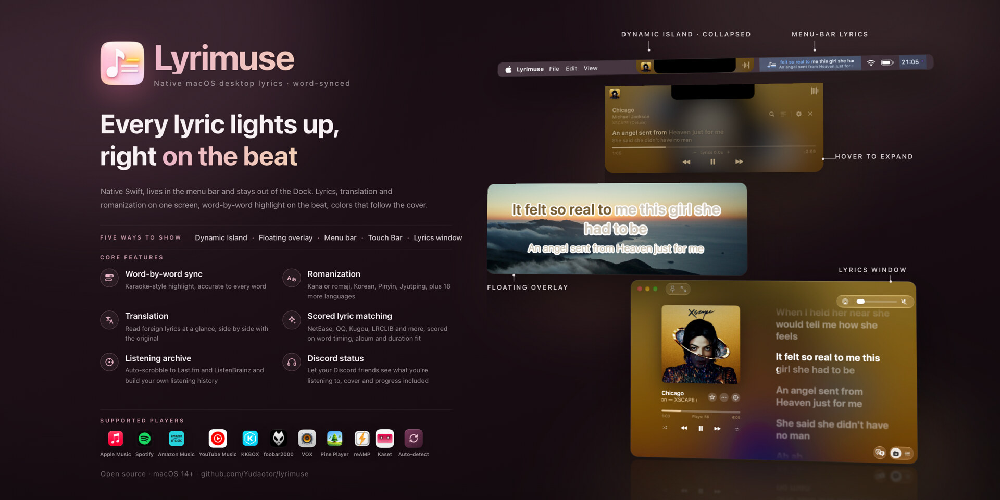

<div align="center">


# Lyrimuse

**เนื้อเพลงบนเดสก์ท็อป ออกแบบใหม่เพื่อ Mac**

**Language / 语言 / 語言 / 言語 / 언어 / Idioma / Langue / Sprache / Lingua / Язык / Мова / ภาษา:** [English](README.md) | [简体中文](README.zh-CN.md) | [繁體中文](README.zh-Hant.md) | [日本語](README.ja.md) | [한국어](README.ko.md) | [Español](README.es.md) | [Français](README.fr.md) | [Deutsch](README.de.md) | [Italiano](README.it.md) | [Português (Brasil)](README.pt-BR.md) | [Tiếng Việt](README.vi.md) | [Русский](README.ru.md) | [Українська](README.uk.md) | **ไทย**


[](https://github.com/Yudaotor/lyrimuse/releases/latest)
[](https://github.com/Yudaotor/lyrimuse/commits/dev)
[](LICENSE)
[](https://github.com/sponsors/Yudaotor)
[](https://discord.gg/N7gVy66Gp3)
[](https://t.me/lyrimuse)
[](https://qm.qq.com/q/Nb4TlwfnQy)

</div>

https://github.com/user-attachments/assets/88b951ee-4ecf-4985-b1cb-eee6afdd5510

Lyrimuse เป็นแอปเนื้อเพลงบนเดสก์ท็อปแบบโอเพนซอร์สสำหรับ macOS ที่อยู่ในแถบเมนูและไฮไลท์เนื้อเพลงทีละคำไปพร้อมกับเพลงที่เล่น จะให้ลอยอยู่เหนือหน้าต่างทั้งหมด อยู่ในแถบเมนู อยู่ในแคปซูลสไตล์ Dynamic Island ใต้รอยบาก บน Touch Bar หรือในหน้าต่างเนื้อเพลงเต็มรูปแบบก็ได้ ใช้ได้กับเครื่องเล่น 19 ตัว ทั้ง Apple Music, Spotify, Amazon Music และ Kaset ซึ่งเป็นแอป YouTube Music รวมถึงเครื่องเล่นบนเว็บในเบราว์เซอร์ และเลือกเนื้อเพลงที่ตรงที่สุดจากแหล่งเนื้อเพลง 15 แหล่ง พร้อมคำแปลและการออกเสียงเมื่อต้องการ นอกจากนี้ยังเก็บโปรไฟล์การฟังของ Last.fm และ Scrobble เพลงที่คุณเล่นด้วย

**ย้ายมาจาก LyricsX ใช่หรือไม่** LyricsX ไม่มีรุ่นใหม่ออกมาตั้งแต่เดือนเมษายน 2022 Lyrimuse ทำได้ทุกอย่างที่ LyricsX ทำ ยังได้รับการอัปเดตต่อเนื่อง และเพิ่มการรองรับเครื่องเล่นภาษาจีน ตลอดจน KKBOX, Amazon Music, Kaset, Pear Desktop, reAMP, VOX, Pine Player, foobar2000 และเครื่องเล่นบนเว็บ ดูรายละเอียดได้ใน[การเปรียบเทียบกับ LyricsX และ Lyric Fever](docs/lyrics-apps-comparison.md) ที่ตรวจสอบข้อเท็จจริงแล้ว

**ติดตั้ง**ด้วย Homebrew ได้ทั้งบน Apple Silicon และ Intel และ Homebrew ยังจัดการคำเตือนของ Gatekeeper ตอนเปิดครั้งแรกให้ด้วย หากต้องการดาวน์โหลดเอง ให้ไปที่[รุ่นล่าสุด](https://github.com/Yudaotor/lyrimuse/releases/latest) แล้วดู[เริ่มต้นใช้งาน](#เริ่มต้นใช้งาน)

```bash
brew tap yudaotor/lyrimuse
brew trust --cask yudaotor/lyrimuse/lyrimuse   # one-time: Homebrew asks you to trust non-official taps
brew install --cask lyrimuse
```


<p align="center"><sub>แสดงเนื้อเพลงได้ 4 แบบ: หน้าต่างเนื้อเพลง แคปซูลสไตล์ Dynamic Island เนื้อเพลงแบบลอยที่ไฮไลท์ทีละคำ และแถบเมนู</sub></p>


<p align="center"><sub>ตัวจัดการเนื้อเพลง การค้นหาด้วยตนเองที่ให้คะแนนทุกผลลัพธ์ และแผงที่บอกว่าทำไมเพลงหนึ่งจึงได้เนื้อเพลงชุดนั้น</sub></p>


<p align="center"><sub>ตัวเลขและอันดับจาก Last.fm ของคุณ ภาพรวมที่เห็นเมื่อไม่มีเพลงเล่น และฮีตแมปทั้งปีสไตล์ GitHub</sub></p>


<p align="center"><sub>ทุกหน้าการตั้งค่ามีตัวอย่างสด เลือกเครื่องเล่นได้มากกว่าหนึ่งตัว (รวมถึงเครื่องเล่นบนเว็บ) และส่วนที่เหลืออยู่ในเมนูของแถบเมนู</sub></p>

## ฟีเจอร์

> แต่ละฟีเจอร์อยู่ตรงไหนในการตั้งค่า และเปิดหรือปิดอยู่หลังติดตั้ง: ดู **[รายการฟีเจอร์](docs/feature-list.th.md)**

### เนื้อเพลงแบบคำต่อคำที่ตรงจังหวะ จับคู่ให้อัตโนมัติ
- **ไฮไลท์ทีละคำ** ไปพร้อมกับเพลงที่กำลังเล่น
- **ค้นหาจากแหล่งเนื้อเพลง 15 แหล่งให้อัตโนมัติ**: NetEase Cloud Music, QQ Music, Kugou, Kuwo, Migu, Musixmatch, LRCLIB, LyricFind (ผ่าน YouTube Music), Deezer, AMLL (คลังเนื้อเพลงแบบคำต่อคำที่คัดสรรด้วยมือ), Soda Music (มีเวลาแบบคำต่อคำของตัวเอง), VIBE และ Genie (ทั้งสองแหล่งเด่นเรื่องเพลงเกาหลี), PetitLyrics (เด่นเรื่องเพลงญี่ปุ่น) และเนื้อเพลงของ Apple Music หากเชื่อมต่อบัญชีในการตั้งค่า เนื้อเพลงของ Apple Music ต้องสมัครสมาชิก และหลายเพลงมีเวลาแบบคำต่อคำ ไม่ต้องค้นหาเองเลย
- **คำแปลและการออกเสียง** ใต้เนื้อเพลงต้นฉบับ หากแหล่งเนื้อเพลงมีคำแปลจากชุมชนก็จะได้คำแปลนั้น หากไม่มี ให้เปิด “การแปลสำรองของระบบ” ในการตั้งค่า (ปิดอยู่โดยค่าเริ่มต้น) แล้ว Mac จะแปลเนื้อเพลงด้วยเฟรมเวิร์ก Translation ของ Apple เนื้อเพลงจึงไม่ออกจากเครื่อง และเมื่อทำไม่ได้จะใช้ตัวแปลออนไลน์แทน แปลได้ 17 ภาษา การออกเสียงตัดสินทีละบรรทัด: เพลงจีนที่มีบรรทัดภาษาญี่ปุ่นอยู่บรรทัดเดียวจะได้คำอ่านเฉพาะบรรทัดนั้น ไม่ใช่พินอินทั้งเพลง เพลงกวางตุ้งได้ Jyutping ที่เข้าใจคำทั้งคำ สำหรับภาษาญี่ปุ่นเลือกฟุริงานะแทนได้: ฮิรางานะกำกับเฉพาะเหนือคันจิ เหมาะกับผู้ที่เรียนภาษาญี่ปุ่นจากเพลง อีก 18 ภาษา รวมถึงรัสเซีย ไทย กรีก และฮินดี ก็มีคำอ่านเช่นกัน ตามระบบถอดอักษรโรมันทางการของแต่ละภาษาหรือมาตรฐาน ISO
- **แยกท่อนร้องคู่ตามผู้ร้อง** เมื่อแหล่งเนื้อเพลง (หรือรายการใน AMLL) ระบุว่าใครร้องบรรทัดไหน แต่ละส่วนจะแสดงแยกกัน แทนที่จะรวมสองเสียงไว้เป็นก้อนเดียว
- **รายละเอียดแบบ Apple Music ในหน้าต่างเนื้อเพลง**: เสียงร้องประกอบแยกเป็นบรรทัดของตัวเองใต้บรรทัดหลัก บรรทัดร้องคู่ที่ซ้อนกันสว่างพร้อมกันจนกว่าทั้งคู่จะร้องจบ และคำภาษาอังกฤษที่ลากเสียงยาวจะขยายและเรืองแสงแบบเดียวกับ Apple Music
- **ภาษาจีนตัวย่อหรือตัวเต็ม** สำหรับเนื้อเพลง ตั้งแยกจากภาษาของแอปได้
- **ตัวจัดการเนื้อเพลง** สำหรับเวลาที่อยากจัดระเบียบ เรียกดู แก้ไข ลบ หรือค้นหาใหม่ได้ทุกเพลง ลบหลายเพลงพร้อมกัน และล้างรายการว่างที่โฆษณาและพอดแคสต์ทิ้งไว้ หากเวลาของเพลงใดคลาดเคลื่อนก็เลื่อนเฉพาะเพลงนั้นได้ กดปุ่มเดียวเพื่อลองหาเนื้อเพลงอีกครั้งให้ทุกเพลงที่ยังไม่มีเนื้อเพลง และการสแกนใหม่ทั้งหมดจะเลือกเนื้อเพลงให้ทั้งคลังใหม่ตามกฎการจับคู่ปัจจุบัน เพลงที่คุณแก้ด้วยมือจะไม่ถูกแตะต้อง นอกจากนี้ยังนำเข้าไฟล์ .lrc หรือทั้งโฟลเดอร์ได้ แม้เป็นเพลงที่ยังไม่เคยเล่น หรือให้คอยเฝ้าดูโฟลเดอร์ก็ได้
- **หนึ่งเพลง เนื้อเพลงชุดเดียว** เพลงเดียวกันที่เล่นจากเครื่องเล่นต่างกันหรือจากอัลบั้มต่างรุ่นจะถูกจดจำว่าเป็นเพลงเดียว: รายการเหล่านั้นใช้เนื้อเพลงและการแก้ไขด้วยมือร่วมกัน และนับจำนวนครั้งที่เล่นรวมกัน “รายการของเพลงนี้” ในตัวจัดการเนื้อเพลงจะเปรียบเทียบทีละบรรทัดและแยกรายการที่จับคู่ผิดออกไป
- **แก้เนื้อเพลงได้จากหน้าต่างเนื้อเพลงโดยตรง** ค้นหาเนื้อเพลงอื่น จับคู่เพลงใหม่ หรือแก้ไขในโปรแกรมแก้ไขข้อความของคุณเอง การแก้ไขเนื้อเพลงแบบคำต่อคำจะเปลี่ยนเฉพาะคำ ทุกคำจึงยังคงเวลาเดิม
- **ใช้งานแบบออฟไลน์ได้** กับทุกเพลงที่มีเนื้อเพลงอยู่ในแคชแล้ว

### โปรไฟล์การฟังและการ Scrobble ของ Last.fm
- **โปรไฟล์การฟังเต็มรูปแบบ** เชื่อมต่อ Last.fm ในคลิกเดียวจากส่วนบัญชี (ไม่ต้องคัดลอกและวางโทเค็น) แล้วจะได้ยอดรวมของวันนี้ 7 วันที่ผ่านมา และตลอดกาล ตัวบ่งชี้ “กำลัง Scrobble” แบบสด และเพลงที่เล่นล่าสุดพร้อมภาพหน้าปก แต่ละเพลงมีปุ่มหัวใจไว้กดชอบ (หรือเลิกชอบ) บน Last.fm โดยค่าเริ่มต้น การเล่นแต่ละครั้งจะส่งเป็นแทร็กที่ตรงกันในแค็ตตาล็อกของ Last.fm ชื่อผู้ร้องคู่ การสะกดแบบจีนตัวย่อ / ตัวเต็ม และส่วนท้ายอย่าง “- Single” หรือ “(Remastered)” จึงไปตรงกับหน้าแทร็กจริง เปลี่ยนเป็น “ต้นฉบับ” ในการตั้งค่าเพื่อส่งตามที่เครื่องเล่นรายงานทุกตัวอักษร ListenBrainz ได้รับแท็กต้นฉบับเสมอ ([การ Scrobble ทำงานอย่างไร](docs/scrobbling.th.md))
- **ศิลปิน อัลบั้ม และเพลงยอดนิยม** ของช่วง 7 วัน 30 วัน 1 ปี หรือตลอดกาล แต่ละรายการบอกว่าอันดับขยับไปเท่าใดเทียบกับช่วงก่อนหน้า คลิกศิลปินเพื่อดูเพลงของศิลปินนั้นที่คุณเล่นบ่อยที่สุด
- **ย้อนรอย** เป็นแท็บของตัวเอง เปิดมาจะเห็นยอดสะสม: นับจาก Scrobble ครั้งแรกมากี่วัน ในนั้นมีกี่วันที่ได้ฟังและเฉลี่ยวันละเท่าใด วันที่ฟังมากที่สุด สถิติต่อเนื่องปัจจุบันและยาวนานที่สุด ปีนี้จนถึงตอนนี้เทียบกับช่วงเดียวกันของปีก่อนๆ และอีกเท่าใดจะถึงหลักไมล์ตัวเลขกลมๆ ถัดไป ถัดลงมาเป็นฮีตแมปทั้งปีสไตล์ GitHub (คลิกวันใดก็ได้เพื่อดูว่าฟังอะไรมากที่สุด) ช่วงเวลาที่ฟังตามชั่วโมงและวันในสัปดาห์ ศิลปินยอดนิยมมาจากที่ใด และ “วันนี้ในอดีต” ที่บอกว่าเคยฟังอะไรในวันนี้ของปีก่อนๆ
- **การเล่นทุกครั้งบันทึกไว้ใน Mac ก่อน** แม้ยังไม่ได้เชื่อมต่อ Last.fm เชื่อมต่อทีหลังแล้วส่งการเล่นช่วงประมาณ 2 สัปดาห์ล่าสุดได้ในคลิกเดียว (Last.fm ไม่รับการเล่นที่เก่ากว่านั้น)
- **กำหนดเองว่าเมื่อใดจะนับเป็นการเล่น**: ที่ 50% ตามค่าเริ่มต้นของ Last.fm ที่ 75% หรือ 90% หรือเฉพาะเมื่อเพลงเล่นจบจริงๆ ไม่มีผลกับ ListenBrainz และยังกันเครื่องเล่นบางตัวออกจาก Last.fm ได้ทั้งหมด การเล่นจากเครื่องเล่นนั้นจะไม่ปรากฏในประวัติเลย
- **ประวัติเดียวกันนี้แสดงในหน้าต่างเนื้อเพลง** เมื่อไม่มีเพลงเล่น จึงเห็นภาพรวมแทนหน้าจอว่าง (ดูเพิ่มเติมด้านล่าง)

### เนื้อเพลงแบบลอย ในแถบเมนู ที่ Dynamic Island บน Touch Bar หรือในหน้าต่างเนื้อเพลงเต็มรูปแบบ
- **ใช้เครื่องเล่นหลายตัว หรือให้ Lyrimuse เลือกให้** Apple Music, Spotify และ Kaset อ่านผ่านสิทธิ์การทำงานอัตโนมัติ QQ Music, NetEase Cloud Music, Kugou Music, Soda Music, KKBOX, Amazon Music และ LX Music อ่านผ่าน MediaRemote ของ macOS โดยไม่ต้องขอสิทธิ์ใดๆ เปิดใช้ผสมกันอย่างไรก็ได้ในการตั้งค่า หรือปล่อยไว้ที่ “ตรวจหาอัตโนมัติ” ให้ตามสิ่งที่ macOS แสดงเป็น “กำลังเล่นอยู่”
- **วิทยุของ Apple Music ก็ใช้ได้** เนื้อเพลงตามทันทุกเพลงในสถานี ขณะที่ผู้จัดรายการพูดจะเห็นชื่อและโลโก้ของสถานีแทนเพลงก่อนหน้า วิทยุมีค่าชดเชยเวลาแยกของตัวเอง ปรับสถานีหนึ่งครั้งแล้วไม่ต้องกังวลอีก
- **เครื่องเล่นในเบราว์เซอร์ก็เช่นกัน** จับคู่เบราว์เซอร์ครั้งเดียว แล้ว YouTube Music หรือ Spotify Web จะทำงานเหมือนเครื่องเล่นอื่นๆ โดยเนื้อเพลงตรงกับแถบความคืบหน้าของหน้าเว็บเอง การทดสอบคลิกเดียวบอกล่วงหน้าว่าควบคุมเบราว์เซอร์ได้หรือไม่ ระหว่างโฆษณา แคปซูลจะเป็นสีดำและแสดงเวลาที่เหลือ และบอกว่าเป็นโฆษณาที่เท่าใดจากทั้งหมดกี่รายการ โฆษณาของ YouTube Music มีปุ่มข้าม หรือข้ามโดยอัตโนมัติก็ได้
- **เลือกวิธีแสดงได้ตามต้องการ** ผสมกันแบบใดก็ได้ หรือไม่แสดงเลย:
  - เนื้อเพลงบนเดสก์ท็อปที่ลากไปไว้ที่ใดก็ได้ หรือตรึงไว้กึ่งกลางด้านบนหรือเหนือ Dock
  - แคปซูลสไตล์ Dynamic Island ที่ด้านบนของหน้าจอ ซึ่งแสดงภาพหน้าปกอัลบั้มและเบลอไว้ด้านหลังแคปซูลได้ ทำให้แถวเนื้อเพลงจางลงเพื่อให้คลิกทะลุผ่านได้ และแสดงบนหน้าจอล็อคได้หากเปิดไว้
  - Touch Bar บน MacBook Pro รุ่นที่มี โดยบรรทัดจะเลื่อนไปตามการร้อง พร้อมภาพหน้าปกอัลบั้มและปุ่มควบคุมการเล่นหากต้องการ
  - หน้าต่างเนื้อเพลงที่ปรับขนาดได้ ออกแบบตามหน้าเนื้อเพลงของ Apple Music มี 2 คอลัมน์ ภาพหน้าปกเบลอเป็นพื้นหลัง เนื้อเพลงทั้งเพลงเลื่อนตามบรรทัดปัจจุบัน ภาพหน้าปกเคลื่อนไหวเมื่อ Apple Music มีภาพหน้าปกเคลื่อนไหวของอัลบั้มนั้น และวิดีโอ Spotify Canvas ที่เล่นวนของเพลงเป็นพื้นหลังเมื่อมี คำจะเติมสีไปตามการร้องด้วยน้ำหนักตัวอักษร สีที่ร้องแล้ว และการจัดแนวที่คุณกำหนดเอง และ “ไฮไลท์ HDR” ทำให้ส่วนที่ร้องแล้วสว่างกว่าสีขาวบนจอแสดงผล HDR ได้
- **เนื้อเพลงในแถบเมนู (โหมดข้อความ)** บรรทัดปัจจุบันอยู่ในแถบเมนูเลย บรรทัดยาวจะเลื่อนแทนที่จะถูกตัดกลางทาง (เปลี่ยนกลับเป็นแบบตัดได้) แถวที่สองแสดงบรรทัดถัดไป คำแปล หรือการออกเสียงได้ และแคปซูลก็ทำแบบเดียวกันได้
- **ลากแถบความคืบหน้าเพื่อข้ามไปยังตำแหน่งที่ต้องการ** ได้ทั้งในหน้าต่างเนื้อเพลงและในแคปซูล
- **สุ่ม เล่นซ้ำ รายการโปรด และระดับเสียง** ในหน้าต่างเนื้อเพลงโดยตรง เมื่อเครื่องเล่นรองรับ: Apple Music, Spotify, Kaset, QQ Music, Amazon Music และ YouTube Music ในเบราว์เซอร์รองรับบางส่วนหรือทั้งหมด ส่วน NetEase Cloud Music, Kugou Music, Soda Music และ LX Music มีรายการโปรด รายการโปรดยังอยู่ในแคปซูลแบบขยายด้วย และกำหนดปุ่มลัดได้
- **เปิดเพลงในแอปหรือเว็บต้นทาง** จากเมนู “⋯” หรือแผงข้อมูล Apple Music เปิดในแอป Spotify ข้ามไปยังแทร็กที่กำลังเล่น และ KKBOX เปิดเพลง อัลบั้ม หรือศิลปินในแอปของตัวเอง QQ Music, Soda Music, Spotify, Amazon Music และ YouTube Music (เมื่อเล่นใน Kaset) เปิดหน้าเพลง อัลบั้ม หรือศิลปินบนเว็บ และ NetEase Cloud Music เปิดหน้าเพลง Lyrimuse ได้ลิงก์มาระหว่างดึงเนื้อเพลง หรืออ่านจากข้อมูลของเครื่องเล่นเองใน Mac จึงไม่ต้องค้นหาอะไร
- **เมื่อไม่มีเพลงเล่น** หน้าต่างเนื้อเพลงจะแสดงยอดรวมของวันนี้และสัปดาห์นี้ การ์ด “วันนี้ในอดีต” และเพลงที่เล่นล่าสุดพร้อมภาพหน้าปก แต่ละเพลงลิงก์ไปยังหน้าอัลบั้มหรือศิลปินใน Apple Music
- **หน้าต่างเนื้อเพลงขนาดมินิ**: การ์ดเล็กที่แสดงบรรทัดเดียว สองบรรทัด หรือเนื้อเพลงเต็มแบบเลื่อน พร้อมพื้นหลัง สีตัวอักษร แบบอักษร น้ำหนักตัวอักษร และสีที่ร้องแล้วแยกของตัวเอง และปิดคาราโอเกะทีละคำเฉพาะขนาดนี้ได้
- **เนื้อเพลงในเบราว์เซอร์ บนโทรศัพท์ แท็บเล็ต หรือในไลฟ์สด** เปิดหน้าต่างเนื้อเพลงในเบราว์เซอร์บนอุปกรณ์อื่นแล้วใช้เป็นจอที่สอง พร้อมปุ่มควบคุมการเล่นและแตะเพื่อข้ามไปยังบรรทัดหากอนุญาต “เอาต์พุต OBS” นำเนื้อเพลงแบบลอยไปใส่ในไลฟ์สดเป็น Browser Source แบบโปร่งใส ทั้งสองอย่างอยู่เฉพาะใน Mac เครื่องนี้จนกว่าจะอนุญาตการเข้าถึงจากเครือข่ายในพื้นที่ และอุปกรณ์อื่นเชื่อมต่อด้วยการสแกนคิวอาร์โค้ด
- **ข้อมูลเพลง ข้อมูลอัลบั้ม และประวัติศิลปิน** คลิกชื่อเพลง ศิลปิน หรืออัลบั้มในหน้าต่างเนื้อเพลงหรือในแคปซูลแบบขยายเพื่ออ่านข้อมูล ข้อมูลอัลบั้มและประวัติศิลปินมาจาก Apple Music หรือเมื่อ Apple Music ไม่มี จะมาจาก Soda Music (เพลงที่เล่นใน Soda Music เฉพาะอินเทอร์เฟซภาษาจีน) Kugou Music (เพลงที่เล่นใน Kugou Music เฉพาะอินเทอร์เฟซภาษาจีน) NetEase Cloud Music (เฉพาะอินเทอร์เฟซภาษาจีน) บทความ Wikipedia ที่ YouTube Music แสดง (ตามภาษาอินเทอร์เฟซ) หรือ Last.fm ส่วนข้อมูลเพลงมาจาก QQ Music (เฉพาะอินเทอร์เฟซภาษาจีน) หรือ Last.fm
- **ปรับหน้าตาได้ตามชอบ**: แบบอักษร (ของระบบ หรือไฟล์ .ttf / .otf ของคุณเอง) ขนาด สีตัวอักษร / พื้นหลัง / เงา ชุดรูปแบบที่บันทึกไว้หรือสีที่ดึงจากภาพหน้าปกอัลบั้มปัจจุบัน ความกว้างของเนื้อเพลงแบบลอย และสีเนื้อเพลงแบบสายรุ้งที่ไหลไปมา
- **ซ่อนจากภาพหน้าจอ การบันทึกหน้าจอ และการแชร์หน้าจอ** คุณยังเห็นอยู่ แต่คนอื่นไม่เห็น
- **ซ่อนตัวเองเมื่อหยุดเล่นชั่วคราว** จึงไม่ค้างอยู่บนเดสก์ท็อปโดยไม่มีประโยชน์ และยังหลบให้ช่วงดนตรีบรรเลง เพลงที่ไม่มีเนื้อเพลง และแอปแบบเต็มหน้าจอได้ ส่วนเนื้อเพลงแบบลอยตามคุณไปยังหน้าจอของหน้าต่างที่กำลังใช้อยู่ได้

### รายละเอียดในการใช้งานประจำวัน
- **อังกฤษ จีนตัวย่อ จีนตัวเต็ม ญี่ปุ่น เกาหลี สเปน ฝรั่งเศส เยอรมัน อิตาลี โปรตุเกส (บราซิล) เวียดนาม รัสเซีย ยูเครน และไทย** สลับภาษาแล้วมีผลทันทีโดยไม่ต้องเริ่มแอปใหม่ หากพบคำแปลที่ไม่เป็นธรรมชาติ ยินดีรับ Pull Request ทุกภาษามีคู่มือสไตล์การแปลอยู่ใน `lyrimuse/Localization/`
- **Liquid Glass บน macOS 26** การตั้งค่า แผงแถบเมนู หน้าต่างเนื้อเพลง ตัวจัดการเนื้อเพลง และตัวช่วยตั้งค่าสร้างด้วย Liquid Glass และส่วนใหญ่ตั้งให้เป็นแบบสว่างหรือมืดตลอดแทนการตามระบบได้
- **ปุ่มลัด** สำหรับทุกการทำงาน ตั้งแต่ซ่อนเนื้อเพลงทั้งหมดไปจนถึงกดถูกใจเพลง ไม่มีปุ่มลัดตั้งไว้ล่วงหน้า คุณเลือกปุ่มเอง ทุกการทำงานยังมีลิงก์ `lyrimuse://` ที่เรียกใช้จากคำสั่งลัด Raycast หรือ Alfred ได้ และเมื่อเรียกจากคำสั่งลัด ลิงก์ส่งเพลงที่กำลังเล่นกลับมาได้ ([URL Scheme](docs/url-scheme.th.md))
- **ค้นหาในการตั้งค่า** พิมพ์ในแถบด้านข้างแล้วจะเลื่อนไปยังแถวที่ตรงกันและไฮไลท์ไว้ พร้อมเปิดกลุ่มที่ยุบอยู่หากจำเป็น
- **อัปเดตตัวเอง** ตรวจหาเองหรือเมื่อสั่งจากแถบเมนู การอัปเดตติดตั้งจากหน้า “รายการอัปเดตซอฟต์แวร์” ในการตั้งค่า พร้อมบันทึกประจำรุ่นและความคืบหน้าในหน้านั้น และเลือกรับรุ่นเบต้าได้
- **เปิดพร้อมเครื่องเล่น** ตั้งได้ทีละเครื่องเล่นและได้ทั้งสองทาง: เปิดเครื่องเล่นเมื่อ Lyrimuse เปิด เปิด Lyrimuse เมื่อเครื่องเล่นเปิด และหากต้องการ ให้ออกจาก Lyrimuse เมื่อเครื่องเล่นทั้งหมดที่ติดตามอยู่ออกแล้ว
- **เปิดแบบเงียบ** หากต้องการให้เริ่มโดยไม่มีหน้าต่างใดเลย มีแค่ไอคอนในแถบเมนู
- **ย้ายไปใช้ Mac เครื่องใหม่** ส่งออกการตั้งค่าทั้งหมดแล้วนำเข้าที่เครื่องนั้น หากมีปัญหา ยังส่งออกการวินิจฉัยได้ในคลิกเดียว

### ส่วนเสริมที่เลือกใช้ได้

<details>
<summary>ListenBrainz สถานะใน Discord หน้ากำลังเล่นอยู่ที่แชร์ได้ และสรุปการฟังรายวัน / รายสัปดาห์ / รายเดือน / รายปี</summary>

ทั้งหมดนี้ปิดอยู่จนกว่าจะเปิดในการตั้งค่า:

- **Scrobble ไปยัง [ListenBrainz](https://listenbrainz.org) ด้วย** การเล่นทุกครั้งส่งไปทั้งสองบริการจากการอ่านเครื่องเล่นครั้งเดียวกัน ประวัติทั้งสองจึงตรงกัน การเล่นจาก iPhone (ที่บันทึกผ่าน Last.fm) ก็คัดลอกไปยัง ListenBrainz ด้วย จึงได้ประวัติชุดเดียวครอบคลุมทั้งสองอุปกรณ์แทนที่จะเป็นสองชุด
- **หน้า “กำลังเล่นอยู่” สาธารณะที่แชร์ได้**: การเล่นแบบสด ประวัติ สมุดเยี่ยม รีแอ็กชัน ตัวนับผู้เข้าชม อันดับศิลปิน 10 อันดับแรก หน้าตาแบบแผ่นเสียงไวนิล ธีมสว่างและมืด และตัวอย่างลิงก์ที่แสดงอย่างถูกต้องในแอปแชท **[คู่มือฟีเจอร์บนเว็บ](https://github.com/Yudaotor/nowplaying-workers#readme)** อธิบายทีละขั้นพร้อมภาพหน้าจอ
- **สรุปการฟังรายวัน รายสัปดาห์ รายเดือน และรายปี** ส่งไปยังช่องทางได้หลายช่องทางตามต้องการ: Bark, ntfy, ServerChan, Feishu, DingTalk, WeCom, Telegram, Discord, Slack หรือ Webhook ทั่วไป แต่ละช่องทางส่งข้อความทดสอบได้ และมีประวัติการส่งให้ดูว่าอะไรส่งถึงแล้ว
- **แสดงเพลงที่กำลังฟังใน Discord** โปรไฟล์และรายชื่อเพื่อนจะแสดงเครื่องเล่นที่ใช้อยู่ เพลง ศิลปิน ภาพหน้าปกอัลบั้ม และแถบความคืบหน้า โดยชื่อเพลงและศิลปินลิงก์ไปยังหน้าบนเว็บไซต์ของเครื่องเล่นนั้น บรรทัดอัลบั้มแสดงบรรทัดที่กำลังร้องได้ และเพิ่มปุ่มได้สูงสุด 2 ปุ่ม ตราเล็กๆ ของ Lyrimuse หรือของเครื่องเล่นอยู่ที่มุมภาพหน้าปก (หรือไม่มีเลย) และเพลงที่หยุดชั่วคราวยังแสดงค้างไว้พร้อมไอคอนหยุดชั่วคราวได้ เลือกได้ว่าจะนับเครื่องเล่นใดบ้าง แสดงเฉพาะเครื่องเล่นโดยไม่บอกชื่อเพลงได้ และซ่อนไว้ชั่วคราวได้

ListenBrainz และพุชบนเว็บอยู่ใต้ **ทดลอง** ในแถบด้านข้างของการตั้งค่า การแจ้งเตือนแบบพุชอยู่รวมกับส่วนอื่นๆ และ Discord มีรายการของตัวเองใกล้ด้านบน แต่ละการ์ดมีขั้นตอนการตั้งค่าของตัวเอง: จะเอาคีย์ API หรือโทเค็นมาจากที่ใด จะเชื่อมต่อบัญชีอย่างไร จะได้ URL ของ Webhook สำหรับบริการพุชอย่างไร หน้าเว็บเป็นอย่างเดียวที่มีคู่มือแยก และไม่จำเป็นต้องทำตามทั้งหมด แค่ตั้งค่า ListenBrainz หน้าเว็บก็แสดงการเล่นแบบสดและประวัติได้แล้ว โดยไม่ต้องใช้ Cloudflare Worker ให้ติดตั้ง Worker หากต้องการสมุดเยี่ยม รีแอคชัน ตัวนับผู้เข้าชม อันดับศิลปิน 10 อันดับแรก และการอัปเดตที่เร็วขึ้นด้วย ซึ่งคู่มืออธิบายไว้แล้ว

</details>

## เริ่มต้นใช้งาน

รุ่นที่เผยแพร่ลงนามด้วยใบรับรองของโปรเจ็กต์เอง ไม่ใช่ Apple Developer ID ทุกวิธีด้านล่างจึงไม่เกี่ยวข้องกับบัญชี Apple Developer ข้อแลกเปลี่ยนคือเมื่อเปิดแอปครั้งแรก Gatekeeper จะแจ้งว่าแอป “มาจากนักพัฒนาที่ไม่ได้ระบุ” Homebrew (วิธี A) จัดการเรื่องนี้ให้ ส่วนวิธีอื่นถือเป็นเรื่องปกติ ไม่ใช่บั๊ก และวิธี B อธิบายวิธีผ่านไปครั้งเดียว
### วิธี 0: ให้ AI ติดตั้งให้

หากใช้ AI agent ที่สั่งงานเทอร์มินัลบน Mac ได้ (Claude Code, Codex CLI, Gemini CLI, …) ให้วางบล็อกด้านล่างลงไปตามที่เป็น แล้ว agent จะทำทุกอย่างในวิธี A/B ให้ คำสั่งเหล่านี้อนุญาตให้ติดตั้งแอปนี้แอปเดียวเท่านั้น จะไม่ใช้ `sudo` หรือแตะการตั้งค่าความปลอดภัยระดับระบบ:

```text
Please install Lyrimuse — an open-source macOS menu-bar lyrics app
(https://github.com/Yudaotor/lyrimuse) — on this Mac, following these rules exactly:

1. Preferred path (if `brew` exists):
     brew tap yudaotor/lyrimuse
     brew trust --cask yudaotor/lyrimuse/lyrimuse
     brew install --cask lyrimuse
   If this Homebrew doesn't know the `trust` subcommand, skip that line — older
   versions don't need it.
2. If Homebrew is not installed, do NOT install Homebrew. Instead: check the CPU
   with `uname -m`, download the latest release asset from
   https://github.com/Yudaotor/lyrimuse/releases — `Lyrimuse-v<version>-macos.zip`
   for arm64, `Lyrimuse-v<version>-macos-intel.zip` for x86_64 — verify it against
   its `.sha256` file (`shasum -c`), unzip, move `Lyrimuse.app` into
   /Applications, then clear the Gatekeeper quarantine flag on that one app only:
     xattr -dr com.apple.quarantine /Applications/Lyrimuse.app
3. Safety rails: no `sudo` anywhere (nothing here needs it); never run
   `spctl --master-disable` or otherwise weaken Gatekeeper system-wide; never
   remove the quarantine flag from anything except /Applications/Lyrimuse.app.
4. Do not build from source unless I explicitly ask.
5. Launch it (`open -a Lyrimuse`) and verify it is running (`pgrep -x Lyrimuse`
   prints a PID).
6. A first-run wizard will appear — that part is mine to click through. Tell me
   it will ask me to pick a music player, to grant Automation access to
   Music.app and/or Spotify (only if I pick them), and to enable the background
   lyrics engine — then hand control back to me.
Finally, report what you did and anything that failed.
```

### วิธี A: ติดตั้งผ่าน Homebrew (แนะนำ)

```bash
brew tap yudaotor/lyrimuse
brew trust --cask yudaotor/lyrimuse/lyrimuse   # one-time: Homebrew asks you to trust non-official taps
brew install --cask lyrimuse
```

การติดตั้งนี้ล้างสถานะกักกันของ Gatekeeper ที่เกิดครั้งเดียวให้โดยอัตโนมัติ จึงไม่มีขั้นตอนต่อ เปิด Lyrimuse จาก `/Applications` (หรือ Spotlight) ได้ทันทีหลัง `brew install` เสร็จ และ `brew upgrade --cask lyrimuse` ก็รับรุ่นใหม่ได้แบบเดียวกัน

### วิธี B: ดาวน์โหลดรุ่นที่สร้างไว้แล้วด้วยตนเอง

1. ดาวน์โหลดจาก[หน้า Releases](https://github.com/Yudaotor/lyrimuse/releases) **ตรวจดูก่อนว่าใช้ Mac แบบใด** ( → เกี่ยวกับ Mac เครื่องนี้ → “ชิป”: `Apple M…` คือ Apple Silicon ส่วน `Intel Core…` คือ Intel):

   | Mac ของคุณ | ดาวน์โหลด |
   | --- | --- |
   | Apple Silicon (M1 ขึ้นไป) | `Lyrimuse-*-macos.dmg` หรือ `.zip` |
   | Intel | `Lyrimuse-*-macos-intel.dmg` หรือ `.zip` |

   ถ้าใช้ dmg ให้ดับเบิลคลิกเพื่อเมานต์ แล้วลาก `Lyrimuse.app` ไปวางบนทางลัด `Applications` ที่อยู่ข้างๆ ถ้าใช้ zip ให้แตกไฟล์แล้วลาก `Lyrimuse.app` ไปไว้ใน `/Applications` ทั้งสองรูปแบบติดตั้งแอปเดียวกันทุกประการ และ zip มีไฟล์ `.sha256` มาด้วยหากต้องการตรวจสอบไฟล์ที่ดาวน์โหลด (รัน `shasum -c Lyrimuse-*.zip.sha256` ในโฟลเดอร์เดียวกัน)

   สองไฟล์นี้ต่างกันแค่สถาปัตยกรรม: ไฟล์ที่ไม่มีส่วนต่อท้ายรองรับเฉพาะ Apple Silicon ส่วน `-intel` มีโค้ดทั้ง Intel และ Apple Silicon `-intel` รันบน Apple Silicon ได้ แต่ไม่มีเหตุผลให้ใช้: ขนาดใหญ่เป็นสองเท่า และ macOS 27 ขึ้นไปจะเตือนว่าแอป “ต้องอัปเดต” เพราะมีโค้ด Intel อยู่ (Apple จะเลิกใช้ Rosetta ใน macOS 28 ตัวแอปไม่ได้มีปัญหาอะไรจริงๆ)

   **ทั้งสองสถาปัตยกรรมได้รับการอัปเดตอัตโนมัติในแอป** ฟีดมีสองรายการสำหรับเวอร์ชั่นเดียวกัน แยกตามสถาปัตยกรรม: Apple Silicon ได้รุ่นที่ไม่มีส่วนต่อท้าย Intel ได้รุ่น `-intel` และ Sparkle เลือกให้ตามเครื่องเอง (v1.4.0 และก่อนหน้ามีให้เฉพาะ Apple Silicon ผู้ใช้ Intel ต้องกลับมาดาวน์โหลดที่นี่เอง)
2. เมื่อเปิดครั้งแรก macOS จะไม่ยอมเปิดแอป โดยแจ้งว่า “ไม่สามารถเปิด Lyrimuse ได้เนื่องจาก Apple ไม่สามารถตรวจสอบหาซอฟต์แวร์ที่ประสงค์ร้ายได้” หรือ “มาจากนักพัฒนาที่ไม่ได้ระบุ” ปลดล็อคครั้งเดียวด้วยวิธีใดก็ได้ที่สะดวก:

   - **เทอร์มินัล (แนะนำ ใช้ได้เสมอ):**
     ```bash
     xattr -dr com.apple.quarantine /Applications/Lyrimuse.app
     ```
     จากนั้นเปิดแอปตามปกติ ทำเพียงครั้งเดียวต่อการดาวน์โหลดหนึ่งครั้ง
   - **คลิกขวา → เปิด:** ใน Finder ให้คลิกขวา (หรือกด Control ค้างแล้วคลิก) `Lyrimuse.app` แล้วเลือก **เปิด** จากนั้นยืนยัน **เปิด** อีกครั้งในหน้าต่างโต้ตอบ วิธีนี้ใช้ไม่ได้กับคำเตือนทุกแบบใน macOS ทุกเวอร์ชั่น หากคำเตือนยังอยู่ ให้ใช้คำสั่งเทอร์มินัลด้านบน
   - **การตั้งค่าระบบ → ความเป็นส่วนตัวและความปลอดภัย:** ลองเปิดแอปหนึ่งครั้ง (จะถูกบล็อก) แล้วเปิด **การตั้งค่าระบบ → ความเป็นส่วนตัวและความปลอดภัย** เลื่อนลงไปด้านล่างสุด แล้วคลิก **ยืนยันจะเปิด** ข้างคำเตือนของ Lyrimuse ยืนยันอีกครั้งหากมีการถาม

   ทำเช่นนี้เฉพาะกับรุ่นที่เชื่อถือได้จริงเท่านั้น: รุ่นจากหน้า Releases ของ repo นี้ หรือรุ่นที่คุณสร้างเอง

### วิธี C: สร้างจากซอร์สโค้ด

**สิ่งที่ต้องมีก่อน ทำครั้งเดียว** (ข้ามสิ่งที่มีอยู่แล้ว):

```bash
xcode-select --install   # Xcode Command Line Tools, for Swift — skip if `swift --version` already works
brew install go          # any Go ≥ 1.21 — build.sh switches to 1.24.4 automatically via GOTOOLCHAIN
```

จากนั้น `build.sh` จะสร้างทั้งแอปและเอนจินเนื้อเพลง (โปรเซสเบื้องหลังชื่อ `lyrimuse-engine`) ในครั้งเดียว:

```bash
git clone https://github.com/Yudaotor/lyrimuse.git
cd lyrimuse/lyrimuse
./build.sh              # this machine's architecture
./build.sh --universal  # arm64 + x86_64 (the compatibility build shipped for Intel)
```

`build.sh` จบด้วยการแสดงสถาปัตยกรรมของไบนารีทุกตัวในบันเดิล และแจ้งสิ่งที่ไม่ตรงกับเป้าหมาย ไม่ว่าจะขาด slice หรือมี slice เกินมา อย่าประกอบไฟล์สำหรับเผยแพร่ด้วยมือ: `./package.sh` สร้างแต่ละสถาปัตยกรรมครั้งเดียว และสร้าง zip + sha256 + dmg ให้แต่ละสถาปัตยกรรม โดยจะไม่ยอมแพ็กหากสถาปัตยกรรมไม่ถูกต้อง

การรองรับ QQ Music / NetEase Cloud Music / Kugou Music / Soda Music / KKBOX / Amazon Music / LX Music / Spotify / Kaset / การตรวจหาอัตโนมัติ ต้องใช้ [ungive/media-control](https://github.com/ungive/media-control) เพิ่มเติม `build.sh` จะติดตั้งผ่าน Homebrew ให้อัตโนมัติหากยังไม่มี จึงไม่ใช่ขั้นตอนที่ต้องทำเองเช่นกัน

### หลังติดตั้งด้วยวิธีใดก็ตาม

เปิด Lyrimuse จาก `/Applications` ตัวช่วยตั้งค่าครั้งแรกจะพาเลือกเครื่องเล่น (Apple Music, QQ Music, NetEase Cloud Music, Kugou Music, Soda Music, KKBOX, Amazon Music, Spotify, Kaset, Pear Desktop, reAMP, VOX, Pine Player, foobar2000, Swinsian, Plexamp, MyGo Music, LX Music, WeRead หรือตรวจหาอัตโนมัติ) ให้สิทธิ์การทำงานอัตโนมัติหากเลือก Apple Music, Spotify, Kaset, VOX หรือ Swinsian (เครื่องเล่นอื่นไม่ต้องขอสิทธิ์เพื่ออ่านข้อมูลเพลงพื้นฐาน) และเปิดใช้บริการเนื้อเพลง (เพื่อให้ยังค้นหาเนื้อเพลง/ภาพหน้าปกต่อไปได้แม้ปิดหน้าต่างแล้ว) ทำตามตัวช่วยจนเสร็จแล้วเนื้อเพลงจะแสดงทันที (ดูตัวเลือกการสร้างเพิ่มเติมใน [lyrimuse/README.md](lyrimuse/README.md))

แค่นี้ก็พอสำหรับเนื้อเพลงแล้ว ส่วนเสริมที่เลือกใช้ได้ตั้งค่าภายหลังจากการตั้งค่าได้ทุกเมื่อที่ต้องการ

## คำถามที่พบบ่อย

### จะแสดงเนื้อเพลง Apple Music แบบลอยบนเดสก์ท็อป Mac ให้อยู่บนสุดเสมอได้อย่างไร
เปิดเนื้อเพลงแบบลอยในการตั้งค่า เนื้อเพลงจะอยู่เหนือทุกหน้าต่างในทุก Space ลากไปไว้ที่ใดก็ได้ หรือตรึงไว้กึ่งกลางด้านบนหรือเหนือ Dock หากเนื้อเพลงมีเวลาแบบคำต่อคำ แต่ละคำจะเติมสีตามการร้อง ซ่อนจากภาพหน้าจอ การบันทึกหน้าจอ และการแชร์หน้าจอได้ และให้หายไปขณะหยุดเพลงชั่วคราวได้ ใช้งานแบบเดียวกันกับ QQ Music, NetEase Cloud Music, Kugou Music, Soda Music, KKBOX, Amazon Music, LX Music, Spotify, Kaset และเครื่องเล่นบนเว็บ

### แสดงเนื้อเพลง Spotify ในแถบเมนูของ Mac ได้หรือไม่
ได้ เปิดโหมดข้อความของเนื้อเพลงในแถบเมนู แล้วบรรทัดปัจจุบันจะแสดงในแถบเมนู ทั้งสำหรับ Spotify และเครื่องเล่นอื่นที่รองรับ บรรทัดยาวจะเลื่อนแทนการถูกตัด และแถวที่สองแสดงบรรทัดถัดไป คำแปล หรือการออกเสียงได้ ไม่ต้องเชื่อมต่อบัญชี Spotify Lyrimuse จะขอสิทธิ์การทำงานอัตโนมัติสำหรับ Spotify ครั้งเดียว ซึ่งให้ตำแหน่งการเล่นที่แม่นยำและทำให้ปุ่มควบคุมการเล่นใช้งานได้ หากปฏิเสธ เนื้อเพลงก็ยังแสดง แต่เวลาจะมาจาก MediaRemote ของ macOS และอาจคลาดเคลื่อนประมาณหนึ่งวินาที

### แสดงเนื้อเพลงแบบคำต่อคำสำหรับ QQ Music, NetEase Cloud Music, Kugou หรือ Soda Music ได้หรือไม่
ได้ ตราบใดที่เนื้อเพลงมีเวลาแบบคำต่อคำ NetEase Cloud Music, QQ Music, Kugou, Soda Music, Musixmatch, AMLL และ Apple Music มักมี และบรรทัดเหล่านั้นจะเติมสีทีละคำ เนื้อเพลงที่มีเวลาแค่ระดับบรรทัดจะสว่างทั้งบรรทัดพร้อมกัน เครื่องเล่นไม่ได้จำกัดว่าเนื้อเพลงจะมาจากแหล่งใด: เพลงที่เล่นใน Soda Music อาจได้เนื้อเพลงแบบคำต่อคำของ QQ Music หากได้คะแนนสูงสุด

### ต้องมีบัญชี Apple Developer เพื่อติดตั้งหรือไม่
ไม่ต้อง รุ่นที่เผยแพร่ลงนามด้วยใบรับรองของโปรเจกต์เองแทน Apple Developer ID ทั้งคุณและโปรเจกต์จึงไม่ต้องมีบัญชีนี้ และนี่คือเหตุผลที่มีขั้นตอน Gatekeeper ครั้งเดียว ตามที่อธิบายไว้ใน “เริ่มต้นใช้งาน” ด้านบน

### Lyrimuse มีใน Mac App Store หรือไม่
ไม่มี ติดตั้งด้วย Homebrew (วิธี A ด้านบน) หรือดาวน์โหลดจาก[หน้า Releases](https://github.com/Yudaotor/lyrimuse/releases) (วิธี B) ไม่ว่าทางใด หลังจากนั้นการอัปเดตจะมาทางแอป

### Lyrimuse ใช้ฟรีหรือไม่
ฟรี เป็นโอเพนซอร์สภายใต้ GPL-3.0 ไม่มีเวอร์ชั่นเสียเงิน ไม่มีการซื้อภายในแอป และไม่ต้องสมัครบัญชี จะใช้ Last.fm และบริการอื่นหรือไม่ก็แล้วแต่คุณ หากแอปมีประโยชน์และอยากสนับสนุน สามารถ[สนับสนุนบน GitHub](https://github.com/sponsors/Yudaotor) หรือ[เลี้ยงกาแฟผู้พัฒนา](https://yudaotor.github.io/donate/) ผ่าน Alipay หรือ WeChat Pay

### เมื่อแอปอื่นครองโฟกัสสื่อของระบบ ยังควบคุม QQ Music, NetEase Cloud Music หรือ Soda Music ได้หรือไม่
ได้ เมื่อมีบางอย่าง เช่น วิดีโอในเบราว์เซอร์ ครอง “กำลังเล่นอยู่” ของ macOS ปุ่มสื่อของระบบจะไปที่สิ่งนั้น Lyrimuse จึงกดเล่น/หยุดพัก ก่อนหน้า และถัดไปในแถบเมนูของ QQ Music, NetEase Cloud Music หรือ MyGo Music เอง หรือบนแถบการเล่นของ Soda Music แทน โดยปล่อยเครื่องเล่นไว้เบื้องหลัง ต้องใช้สิทธิ์การช่วยการเข้าถึง (การตั้งค่า → เครื่องเล่น) หากไม่มี ปุ่มเหล่านั้นจะเปิดหน้านั้นขึ้นมา ในสถานะนี้จะข้ามไปยังตำแหน่งในเพลงไม่ได้ ใน macOS 27 สิทธิ์นี้อยู่ที่ **การตั้งค่าระบบ → ความเป็นส่วนตัวและความปลอดภัย → การควบคุมอุปกรณ์และการเข้าถึงข้อมูล** ส่วนรุ่นก่อนหน้าเรียกว่า **การช่วยการเข้าถึง**

### ใช้กับ Spotify, QQ Music หรือ NetEase Cloud Music ได้หรือไม่ หรือใช้ได้แค่ Apple Music
ได้ทั้งหมด รวมถึง Kugou Music, Soda Music, KKBOX, Amazon Music, Kaset (แอป YouTube Music), Pear Desktop แอป YouTube Music บนเดสก์ท็อปแบบโอเพนซอร์ส, reAMP เครื่องเล่นสไตล์ Winamp, VOX เครื่องเล่นไฟล์ในเครื่องแบบ Lossless และ Hi-Res, Pine Player เครื่องเล่นไฟล์ในเครื่องที่ใช้ฟรีและเล่นได้แทบทุกฟอร์แมต, foobar2000 เครื่องเล่นไฟล์ในเครื่องรุ่นคลาสสิกที่พอร์ตมาจาก Windows, Swinsian เครื่องเล่นไฟล์ในเครื่องสำหรับคลังเพลงขนาดใหญ่, Plexamp เครื่องเล่นเพลงของ Plex สำหรับเซิร์ฟเวอร์ของตัวเอง, MyGo Music เครื่องเล่นโอเพนซอร์สที่เล่นไฟล์ในเครื่องและเพิ่มแหล่งเพลงอื่นผ่านปลั๊กอิน, LX Music แบบโอเพนซอร์ส และ WeRead สำหรับฟังหนังสือเสียง รวมเป็นเครื่องเล่น 19 ตัว หรือให้ตรวจหาอัตโนมัติตามสิ่งที่ macOS แสดงเป็น “กำลังเล่นอยู่” ก็ได้ Apple Music, Spotify, Kaset, VOX และ Swinsian ขอสิทธิ์การทำงานอัตโนมัติ (Spotify, Kaset, VOX และ Swinsian ใช้เพื่อเวลาที่แม่นยำและปุ่มควบคุมการเล่น) เครื่องเล่นอีก 14 ตัวไม่ต้องขอสิทธิ์ใดๆ เพื่ออ่านข้อมูลเพลงพื้นฐานผ่าน MediaRemote ของ macOS ส่วนปุ่มสุ่ม เล่นซ้ำ และรายการโปรดของ QQ Music, NetEase Cloud Music, Kugou Music, Soda Music และ Amazon Music รวมถึงการสุ่ม เล่นซ้ำ และระดับเสียงของ reAMP และ foobar2000 ต้องใช้สิทธิ์การช่วยการเข้าถึง Pine Player ใช้สิทธิ์นี้อ่านแถบความคืบหน้า เพราะรายงานตำแหน่งละเอียดแค่ระดับวินาที สำหรับ KKBOX, Amazon Music หรือ LX Music เนื้อเพลงที่แอปนั้นบันทึกไว้สำหรับเพลงจะนำมาพิจารณาด้วย และไม่มีการติดต่อบริการเหล่านั้นเลย

### แสดงเนื้อเพลงของ KKBOX หรือ Amazon Music บน Mac ได้หรือไม่
ได้ ทั้งสองแอปอ่านผ่าน MediaRemote ของ macOS จึงไม่ต้องให้สิทธิ์ใดๆ และเนื้อเพลงแสดงในเนื้อเพลงแบบลอย แถบเมนู แคปซูล และหน้าต่างเนื้อเพลงเหมือนเครื่องเล่นอื่นๆ หาก KKBOX หรือ Amazon Music บันทึกเนื้อเพลงของเพลงนั้นไว้แล้ว ก็จะนำมาพิจารณาด้วยและได้น้ำหนักเพิ่ม Lyrimuse ไม่เคยลงชื่อเข้าใช้บริการทั้งสองหรือส่งสิ่งใดไปให้ แหล่งอื่นยังคงถูกค้นหาตามปกติ หากแหล่งใดมีสิ่งที่ดีกว่า เช่น เวลาแบบคำต่อคำ แหล่งนั้นจะชนะ


### ใช้กับ LX Music (洛雪音乐) ได้หรือไม่
ได้ LX Music อ่านผ่าน MediaRemote ของ macOS จึงไม่ต้องให้สิทธิ์ใดๆ เมื่อเล่นเพลงใน LX Music เนื้อเพลงที่แอปบันทึกไว้สำหรับเพลงนั้น (แบบคำต่อคำเมื่อแพลตฟอร์มมี) จะนำมาพิจารณาด้วยและได้น้ำหนักเพิ่ม และเพลงถัดไปในรายการที่กำลังเล่นจะเตรียมเนื้อเพลงไว้ล่วงหน้า Lyrimuse อ่านเฉพาะข้อมูลของ LX Music ใน Mac และไม่เคยส่งสิ่งใดไปให้

### ใช้กับแอป YouTube Music บนเดสก์ท็อปได้หรือไม่
ได้ ใช้กับ [Kaset](https://github.com/sozercan/kaset) ซึ่งเป็นแอป YouTube Music แบบเนทีฟและโอเพนซอร์สสำหรับ Mac Kaset อ่านผ่านสิทธิ์การทำงานอัตโนมัติ ซึ่งให้เวลาที่แม่นยำและปุ่มควบคุมการเล่นที่ใช้งานได้ และเนื้อเพลงของ YouTube Music เองก็อยู่ในผลลัพธ์ที่นำมาพิจารณา [Pear Desktop](https://github.com/pear-devs/pear-desktop) ไคลเอนต์เดสก์ท็อปแบบโอเพนซอร์สก็ใช้ได้เช่นกัน ผ่าน “กำลังเล่นอยู่” ของ macOS โดยไม่ต้องขอสิทธิ์เพิ่ม ส่วน YouTube Music ในเบราว์เซอร์ก็ใช้ได้ ดูด้านล่าง

### เนื้อเพลงบนเดสก์ท็อปหน้าตาเป็นอย่างไร
เหมือนคาราโอเกะบนเดสก์ท็อป บรรทัดปัจจุบันลอยอยู่เหนือหน้าต่าง แต่ละคำเติมสีตามการร้องเมื่อเนื้อเพลงมีเวลาแบบคำต่อคำ และแสดงคำแปลหรือการออกเสียงคู่กันได้ เปลี่ยนแบบอักษร ขนาด สีตัวอักษร พื้นหลัง และเงา รวมถึงความกว้างได้ และให้สีตัวอักษรตามภาพหน้าปกอัลบั้มได้ เนื้อเพลงเดียวกันยังแสดงในแถบเมนู ในแคปซูลสไตล์ Dynamic Island ใต้รอยบาก หรือในหน้าต่างเนื้อเพลงเต็มรูปแบบสไตล์ Apple Music ได้ ผสมกันแบบใดก็ได้

### แคปซูล Dynamic Island ใช้กับ Mac ที่ไม่มีรอยบากได้หรือไม่
ได้ บนหน้าจอที่ไม่มีรอยบาก เช่น MacBook รุ่นเก่าหรือจอภายนอก แคปซูลจะอยู่กึ่งกลางด้านบน สูงเท่าแถบเมนู เลือกได้ในการตั้งค่าว่าจะให้แสดงบนหน้าจอใด

### เนื้อเพลงใช้งานได้โดยไม่ต้องเชื่อมต่ออินเทอร์เน็ตหรือไม่
ได้ สำหรับเพลงที่เคยหาเนื้อเพลงเจอแล้ว เพราะเนื้อเพลงเหล่านั้นแคชไว้ใน Mac การค้นหาครั้งแรกของแต่ละเพลงต้องเชื่อมต่ออินเทอร์เน็ต และการแปลออนไลน์ก็เช่นกัน

### มีข้อมูลใดออกจาก Mac บ้างหรือไม่
การหาเนื้อเพลงต้องถามแหล่งเนื้อเพลงเกี่ยวกับเพลงที่กำลังเล่น: NetEase, QQ, Kugou, Kuwo, Migu, Musixmatch, LRCLIB, LyricFind, Deezer, AMLL, Soda Music, VIBE, Genie, PetitLyrics และ Apple Music หากเชื่อมต่อไว้ ภาพหน้าปกมาจาก iTunes Search API การแปลทำบน Mac โดยค่าเริ่มต้น และข้อความเนื้อเพลงจะส่งไปยังตัวแปลออนไลน์ (การแปลบนเว็บของ Google แล้วจึง MyMemory) เฉพาะเมื่อต้องใช้เป็นตัวสำรอง ประวัติการฟัง เนื้อเพลงที่แคชไว้ และการตั้งค่าอยู่ในไฟล์บน Mac เว้นแต่จะเชื่อมต่อ Last.fm, ListenBrainz หรือรีเลย์บนเว็บที่เลือกใช้ได้ ข้อมูลการใช้งานแบบไม่ระบุตัวตน (เวอร์ชั่น ฟีเจอร์ที่เปิดอยู่ สรุปการขัดข้อง ไม่รวมชื่อเพลงและบัญชี) ส่งวันละครั้งโดยค่าเริ่มต้น และปิดได้ใน “การตั้งค่า › เกี่ยวกับ” รายการทั้งหมดอยู่ใน[สัญญาอนุญาตและลิขสิทธิ์](#สัญญาอนุญาตและลิขสิทธิ์)ด้านล่าง

### แสดงการออกเสียงภาษาญี่ปุ่น/เกาหลี หรือคำแปลภาษาจีนของเนื้อเพลงได้หรือไม่
ได้ การออกเสียงตัดสินทีละบรรทัด เพลงที่ผสมหลายภาษาจึงได้คำอ่านเฉพาะบรรทัดที่ควรมี ภาษาญี่ปุ่นแสดงเป็นโรมะจิหรือฟุริงานะ (ฮิระกะนะเหนือคันจิ) ได้ คำแปลมาจากคำแปลของชุมชนจากแหล่งเนื้อเพลงหากมี มิฉะนั้นจะใช้การแปลด้วยเครื่องบน Mac หรือออนไลน์เมื่อเปิด “การแปลสำรองของระบบ” (ปิดอยู่โดยค่าเริ่มต้น) แปลได้ 17 ภาษา

### รองรับ macOS เวอร์ชั่นใดบ้าง
macOS 14 Sonoma ขึ้นไป (Sequoia, Tahoe และใหม่กว่า) บน Apple Silicon หรือ Intel การแปลบน Mac ต้องใช้ macOS 15 Sequoia ขึ้นไป บน macOS 14 ใช้ได้เฉพาะตัวแปลออนไลน์

### รองรับ Mac ที่ใช้ Intel หรือไม่
รองรับ โดยใช้รุ่น Universal แยกต่างหาก (ดูวิธี B ด้านบน) การอัปเดตอัตโนมัติใช้ได้บน Intel ด้วยตั้งแต่ v1.5.0 เวอร์ชั่นใหม่จึงปรากฏเหมือนบน Apple Silicon

### แสดงเนื้อเพลงของ YouTube Music หรือ Spotify ที่เล่นในเบราว์เซอร์ได้หรือไม่
ได้ จับคู่เบราว์เซอร์ครั้งเดียวในการตั้งค่า แล้ว YouTube Music หรือ Spotify Web จะทำงานเหมือนเครื่องเล่นอื่นๆ เนื้อเพลงตามแถบความคืบหน้าของหน้าเว็บเองแทนการเดา และการทดสอบคลิกเดียวบอกได้ก่อนตัดสินใจว่าควบคุมเบราว์เซอร์ได้หรือไม่

### Scrobble จาก Apple Music ไปยัง Last.fm บน Mac ได้หรือไม่
ได้ นั่นคืออีกครึ่งหนึ่งของแอป เชื่อมต่อ Last.fm ในคลิกเดียวจากการตั้งค่า แล้วการเล่นทุกครั้งจาก Apple Music (หรือเครื่องเล่นอื่นที่รองรับ) จะถูก Scrobble พร้อมสถานะ “กำลังเล่นอยู่” แบบสด การเล่นบันทึกไว้ใน Mac ก่อน การเล่นก่อนเชื่อมต่อจึงไม่หาย: เมื่อเชื่อมต่อแล้ว คลิก “ส่งย้อนหลัง” เพื่อส่งการเล่นในช่วงประมาณ 2 สัปดาห์ล่าสุด เลือกได้ว่าเมื่อใดจะนับเป็นการเล่น (50%, 75%, 90% หรือทั้งเพลง) กันเครื่องเล่นบางตัวออกได้ และส่งไปยัง ListenBrainz พร้อมกันได้

### Lyrimuse ป้องกันการเลือกเนื้อเพลงผิดอย่างไร
ไม่ได้เลือกแหล่งแรกที่ตอบกลับมา ทุกผลลัพธ์จากทุกแหล่งให้คะแนนด้วยเกณฑ์เดียวกัน: ชื่อเพลง ศิลปิน อัลบั้ม และความยาวตรงกันแค่ไหน รวมถึงปัจจัยอย่างการมีเวลาแบบคำต่อคำหรือไม่ คะแนนสูงสุดชนะ ดูการตัดสินใจนั้นได้ทุกเพลง พร้อมคะแนนของผลลัพธ์ทุกรายการและเหตุผลที่ผลลัพธ์ที่ชนะได้รับเลือก หากภายหลังพบผลลัพธ์ที่ตรงกว่า Lyrimuse เปลี่ยนไปใช้เองได้ แต่เนื้อเพลงที่คุณเลือกด้วยมือจะถูกล็อคและไม่ถูกแทนที่ การค้นหาด้วยตนเองแสดงคะแนนและป้ายกำกับเดียวกัน จึงเห็นเวอร์ชั่นที่ผิดได้ง่ายก่อนเลือก

### ถ้าเนื้อเพลงไม่ตรงจังหวะหรือผิดเพลงจะทำอย่างไร
หากเวลาคลาดเคลื่อน ให้เลื่อนเวลาของเพลงนั้น ค่าชดเชยจะถูกจดจำไว้ หากเนื้อเพลงผิดหรือผิดเวอร์ชั่น ให้เปิดการค้นหาด้วยตนเอง จะเห็นทุกผลลัพธ์จากทุกแหล่งพร้อมคะแนน และสิ่งที่เลือกจะถูกล็อค การจับคู่อัตโนมัติจึงไม่สลับออก นอกจากนี้ยังแก้ไขเนื้อเพลงของเพลงใดก็ได้ด้วยมือในตัวจัดการเนื้อเพลง

### บันทึกเนื้อเพลงเป็นไฟล์ .lrc ได้หรือไม่
บันทึกไว้อยู่แล้ว ทุกเพลงที่มีเนื้อเพลงจะมีไฟล์ `.lrc` ที่มีเวลาระดับบรรทัด พร้อม `.tr.lrc` สำหรับคำแปลและ `.roma.lrc` สำหรับการออกเสียงเมื่อมี เวลาแบบคำต่อคำบันทึกแยกต่างหาก เป็น TTML โดยค่าเริ่มต้น ในการตั้งค่าเปลี่ยนเป็น `.yrc` (รูปแบบ YRC ของ NetEase) Enhanced LRC, QRC หรือ KRC ได้เพื่อให้เครื่องเล่นอื่นอ่านได้ และเก็บไว้มากกว่าหนึ่งรูปแบบได้ ไฟล์อยู่ใน `~/Library/Application Support/me.yudaotor.lyrimuse/lyrics/` และย้ายโฟลเดอร์ได้ในการตั้งค่า

### LyricsX ยังได้รับการดูแลอยู่หรือไม่ และ Lyrimuse ต่างจาก LyricsX หรือ Lyric Fever อย่างไร
LyricsX ออกรุ่นล่าสุดคือ v1.6.3 เมื่อเดือนเมษายน 2022 ทำงานบน macOS 10.11 ขึ้นไป และรองรับ Apple Music, Spotify และเครื่องเล่นรุ่นเก่าอีกไม่กี่ตัว Lyric Fever เน้น Spotify และ Apple Music และต้องใช้ macOS 15 Lyrimuse ต้องใช้ macOS 14 และเพิ่ม QQ Music, NetEase Cloud Music, Kugou, Soda Music, KKBOX, Amazon Music, Kaset, Pear Desktop, reAMP, VOX, Pine Player, foobar2000 และ LX Music รวมถึงเครื่องเล่นในเบราว์เซอร์ การออกเสียงทีละบรรทัดทั้งพินอิน / Jyutping ภาษากวางตุ้ง / การถอดอักษรโรมันภาษาญี่ปุ่นและเกาหลี พร้อมคำอ่านอีก 18 ภาษา เช่น รัสเซียและไทย และการ Scrobble ไปยัง Last.fm / ListenBrainz พร้อมสถิติการฟังของคุณเอง ตารางเปรียบเทียบแบบเคียงข้างอยู่ใน[หน้าเปรียบเทียบ](docs/lyrics-apps-comparison.md)
## สัญญาอนุญาตและลิขสิทธิ์

- **ตัว Lyrimuse ใช้สัญญาอนุญาต [GPL-3.0](LICENSE)** คอมโพเนนต์โอเพนซอร์สและข้อมูลพจนานุกรมที่มาพร้อมแอป (media-control, Sparkle, KeyboardShortcuts และพจนานุกรม OpenCC และ rime-cantonese) ใช้สัญญาอนุญาตของตัวเอง ข้อความฉบับเต็มอยู่ใน [THIRD_PARTY_LICENSES](THIRD_PARTY_LICENSES) ซึ่งรวมอยู่ในแอปด้วยและเปิดได้จาก **การตั้งค่า → เกี่ยวกับ → ใบอนุญาตของบริษัทอื่น**
- **เนื้อเพลง ภาพหน้าปก และข้อมูลเพลงเป็นของผู้ถือสิทธิ์แต่ละราย** Lyrimuse เพียงค้นหา แคช และแสดงผล: สิ่งที่ API เนื้อเพลงสาธารณะส่งกลับมาจะเก็บไว้ใน Mac ของคุณเอง (`~/Library/Application Support/me.yudaotor.lyrimuse/`) เพื่อการดูส่วนตัว ไม่ได้โฮสต์ ส่งต่อ หรือเผยแพร่เนื้อเพลงหรือภาพหน้าปกซ้ำ และลบแคชได้ทุกเมื่อจากตัวจัดการเนื้อเพลงหรือโดยลบโฟลเดอร์นั้น
- **Lyrimuse เป็นโปรเจกต์โอเพนซอร์สอิสระ** ไม่มีส่วนเกี่ยวข้อง ไม่ได้รับการรับรอง และไม่มีความเชื่อมโยงกับ Apple, Tencent (QQ Music), NetEase (NetEase Cloud Music), Kugou, Kuwo, Douyin (Soda Music), KKBOX, Amazon (Amazon Music), China Mobile (Migu Music), Spotify, Kaset, LX Music, Google (YouTube Music, Google Translate), Last.fm, ListenBrainz, MusicBrainz, Musixmatch, LRCLIB, LyricFind, Deezer, Naver (VIBE), KT (Genie), SyncPower (PetitLyrics), AMLL หรือ SponsorBlock ชื่อและเครื่องหมายการค้าเป็นของเจ้าของแต่ละราย และปรากฏที่นี่เพียงเพื่อบอกว่าเกี่ยวข้องกับเครื่องเล่น แหล่งเนื้อเพลง และบริการใดบ้าง
- **นี่คือทุกสิ่งที่ออกจาก Mac ของคุณ** การค้นหาเนื้อเพลงส่งศิลปิน ชื่อเพลง และอัลบั้มของแทร็ก (รวมถึงความยาวสำหรับแหล่งที่รับข้อมูลนี้) ไปยังแหล่งเนื้อเพลง 15 แหล่งข้างต้น เมื่อไม่มีแหล่งใดตรงกัน ชื่อศิลปินจะถูกส่งไปยัง MusicBrainz เพื่อค้นหาชื่อแทนด้วย (การจับคู่แบบ “อัจฉริยะ” ของ Last.fm ทำแบบเดียวกันกับศิลปินที่ยังไม่เคยพบ) และอันดับยอดนิยมจะค้นหาศิลปินที่นั่นด้วย MusicBrainz ID เพื่อหาประเทศ/ภูมิภาคและลิงก์ ภาพหน้าปกและหน้าขณะไม่มีเพลงเล่นส่งศิลปิน + ชื่อเพลงไปยัง iTunes Search API สำหรับ Kaset หรือ Pear Desktop ภาพหน้าปกที่แอปรายงานจะดาวน์โหลดจากเซิร์ฟเวอร์รูปภาพของ YouTube Music (googleusercontent.com) และ ID วิดีโอใหม่แต่ละรายการที่เล่นจะส่งไปยัง YouTube Music ครั้งเดียวเพื่อตรวจว่าเป็นตอนของพอดแคสต์หรือไม่ (ตอนพอดแคสต์จะไม่ถือเป็นเพลง) เมื่อเปิด Open API ของ LX Music Lyrimuse จะติดต่อเฉพาะพอร์ตของ LX Music เองบน Mac เครื่องนี้ และเมื่อระบบไม่มีภาพหน้าปกของเพลง จะดาวน์โหลดภาพที่ LX Music ชี้ไปครั้งเดียว ข้อมูลอัลบั้มและประวัติศิลปินจะขอหน้า Apple Music สาธารณะของอัลบั้มและศิลปินด้วย Apple Music ID — ไม่เกี่ยวข้องกับบัญชี Apple เมื่ออินเทอร์เฟซเป็นภาษาจีนและ Apple Music ไม่มีประวัติศิลปินหรือข้อมูลอัลบั้ม จะใช้ NetEase Cloud Music ID ของเพลงค้นหาศิลปินที่ระบุชื่อในเพลงและอัลบั้มของเพลง แล้วดึงข้อมูลแนะนำศิลปินหรืออัลบั้มนั้นของ NetEase ด้วย ID โดยไม่ต้องลงชื่อเข้าใช้เช่นกัน เมื่ออินเทอร์เฟซเป็นภาษาจีน ข้อมูลเพลงจะขอรายละเอียดเพลงจาก QQ Music ด้วย song ID ของ QQ Music โดยไม่ต้องลงชื่อเข้าใช้เช่นกัน ขณะที่ QQ Music กำลังเล่น จะขอรายละเอียดเดียวกันนี้เพลงละครั้งในทุกภาษาอินเทอร์เฟซ เพื่อแยกหนังสือเสียงและรายการพูดอื่นๆ ออกจากเพลง (คำบรรยายยังแสดงอยู่ แต่จะไม่ถูก Scrobble หรือแสดงเป็นเพลง) เมื่อ Apple Music ไม่มีภาพหน้าปกเคลื่อนไหวของอัลบั้ม album ID ของ QQ Music จะถูกส่งไปยัง QQ Music เพื่อตรวจหาภาพหน้าปกเคลื่อนไหว หากมี จะขอที่อยู่ของวิดีโอด้วย video ID ของ QQ Music ขณะที่หน้าต่างเนื้อเพลงเปิดอยู่ และดาวน์โหลดวิดีโอจากเซิร์ฟเวอร์วิดีโอของ QQ Music (tencentmusic.com) โดยไม่ต้องลงชื่อเข้าใช้ หาก QQ Music ก็ไม่มี NetEase Cloud Music ID ของเพลงจะถูกส่งไปยัง NetEase เพื่อตรวจหา ภายใต้ตัวตนผู้เยี่ยมชมแบบไม่ระบุตัวตนที่ NetEase ให้กับผู้เข้าชมที่ไม่มีบัญชี และวิดีโอมาจากเซิร์ฟเวอร์วิดีโอของ NetEase (126.net) ขณะที่ Kugou กำลังเล่น ศิลปินและชื่อเพลงจะถูกส่งไปยังการค้นหาบนเว็บของ Kugou ครั้งเดียวเพื่อหาหน้าเว็บของเพลง โดยไม่ต้องลงชื่อเข้าใช้ พื้นหลัง Spotify Canvas ของหน้าต่างเนื้อเพลงอ่านเฉพาะแคชที่ Spotify เก็บไว้ใน Mac และไม่ขอสิ่งใดจาก Spotify วิดีโอที่พบในแคชจะดาวน์โหลดครั้งเดียวจาก CDN ของ Spotify (canvaz.scdn.co) โดยส่งเพียงที่อยู่ของวิดีโอ ข้อมูลอัลบั้มและประวัติศิลปินอาจค้นหาอัลบั้มใน YouTube Music ด้วยชื่อศิลปินและชื่ออัลบั้มด้วย (เพลงที่เล่นใน Kaset หรือ YouTube Music บนเว็บใช้ ID อัลบั้มและศิลปินที่เครื่องเล่นรายงาน) และดึงคำอธิบายจาก Wikipedia ในหน้าอัลบั้มและหน้าศิลปิน สำหรับเพลงที่เล่นใน Soda Music จะขอหน้าแชร์สาธารณะของอัลบั้มและศิลปินด้วย ID ที่ Soda Music รายงาน ทั้งสองอย่างไม่ต้องใช้บัญชี เมื่ออินเทอร์เฟซเป็นภาษาจีน สำหรับเพลงที่ LX Music เล่นจาก Kuwo จะส่ง Kuwo ID ของเพลงไปยัง Kuwo เพื่อค้นหา ID อัลบั้มและศิลปิน แล้วขอคำแนะนำอัลบั้มและศิลปินด้วย ID เหล่านั้น โดยไม่ต้องลงชื่อเข้าใช้เช่นกัน สำหรับเพลงที่เล่นใน Kugou Music เอนจินจะถาม Kugou ครั้งเดียวว่าไฟล์ที่กำลังเล่นอยู่ในอัลบั้มใด เมื่ออินเทอร์เฟซเป็นภาษาจีน จะขอคำแนะนำอัลบั้มของ Kugou ด้วย album ID นั้น และขอคำแนะนำศิลปินด้วย ID ของศิลปินอัลบั้ม โดยไม่ต้องลงชื่อเข้าใช้เช่นกัน การแปลด้วยเครื่องแบบสำรอง (ปิดโดยค่าเริ่มต้น และใช้เฉพาะเมื่อการแปลของ Apple บนเครื่องใช้ไม่ได้) ส่ง**ตัวข้อความเนื้อเพลง**เป็นช่วงๆ ไปยังปลายทางการแปลบนเว็บของ Google ก่อน และส่งส่วนที่ยังไม่ได้แปลไปยัง MyMemory คำขอไปยัง MyMemory มีพารามิเตอร์อีเมลที่สุ่มสร้างขึ้น — ไม่ใช่อีเมลของคุณ ขณะที่มิวสิกวิดีโอเล่นใน YouTube Music อักขระ 4 ตัวแรกของแฮช SHA-256 ของ ID วิดีโอจะถูกส่งไปยัง SponsorBlock เพื่อหาช่วงที่ไม่ใช่ดนตรีในวิดีโอ เพื่อให้เนื้อเพลงตรงกับภาพ SponsorBlock ไม่สามารถรู้ได้จากข้อมูลนั้นว่าเป็นวิดีโอใด โดเมนของ Musixmatch ถูกแปลงที่อยู่ผ่าน DNS-over-HTTPS ทาง Cloudflare (1.1.1.1) และ Google (8.8.8.8) หน้าเกี่ยวกับจะขอจำนวนดาวจาก GitHub API ไม่เกินทุก 6 ชั่วโมงครั้ง และหากเลือกรับอัปเดตเบต้า จะขอรายการรุ่นไม่เกินชั่วโมงละครั้ง การตรวจหาอัปเดตดึง appcast จาก GitHub Releases และไม่ส่งโปรไฟล์ระบบ “แชร์ข้อมูลการใช้งานแบบไม่ระบุตัวตน” เปิดอยู่โดยค่าเริ่มต้น (การตั้งค่า › เกี่ยวกับ › การวินิจฉัยและข้อมูล หน้าต้อนรับเมื่อเปิดครั้งแรกก็มีสวิตช์เดียวกัน) วันละไม่เกินครั้งเดียว แอปจะส่งข้อมูลต่อไปนี้ไปยังเซิร์ฟเวอร์ของผู้พัฒนาเอง (telemetry.yudaotor.me ซึ่งเป็น Cloudflare Worker): ID การติดตั้งแบบสุ่มที่สร้างขึ้นบน Mac ของคุณ ข้อมูลว่า Lyrimuse ติดตั้งใหม่หรืออัปเกรดจากเวอร์ชั่นเก่า เวอร์ชั่นของ Lyrimuse และ macOS ชิป ภาษาอินเทอร์เฟซและภาษาของระบบ ภูมิภาคที่ตั้งไว้ในการตั้งค่า macOS ฟีเจอร์ที่เปิดอยู่ (รูปแบบการแสดงเนื้อเพลง เครื่องเล่นที่เลือก จำนวนแหล่งเนื้อเพลงที่เปิดใช้ สวิตช์การแปลและการออกเสียง เชื่อมต่อบัญชีอย่าง Last.fm หรือไม่ เครื่องเล่นและเบราว์เซอร์ของบริษัทอื่นที่คุณเชื่อถือ (เฉพาะ Bundle ID) เครื่องเล่นบนเว็บที่จับคู่ไว้ Lyrimuse มาจาก Homebrew หรือดาวน์โหลดโดยตรง ชื่อของการตั้งค่าที่เปลี่ยนจากค่าเริ่มต้น (ไม่รวมค่า) และสิทธิ์ที่เครื่องเล่นที่เลือกยังขาดอยู่) เครื่องเล่นที่เล่นเพลงในวันก่อนๆ จำนวนครั้งที่แอปค้าง (ไม่กี่ครั้งแรกของแต่ละวันมีสรุปด้วย: ค้างนานเท่าไร ห่างจากตอนเปิดแอปหรือตื่นจากสลีปเท่าไร เครื่องเล่นที่ใช้ล่าสุด หน้าต่าง Lyrimuse ที่เปิดอยู่ สถานะความร้อนของระบบ และสแตกการเรียกของเธรดหลัก ได้แก่ชื่อฟังก์ชันของระบบและออฟเซ็ตโค้ดใน Lyrimuse) จำนวนครั้งที่เปิดหน้าต่างเนื้อเพลง เลือกเนื้อเพลงเอง ปรับเวลา หรือแชร์การ์ดเนื้อเพลง จำนวนเพลงที่เล่นซึ่งมีเนื้อเพลงแบบคำต่อคำ แบบรายบรรทัด หรือแบบข้อความธรรมดา เป็นดนตรีบรรเลง หรือไม่ได้เนื้อเพลง และจำนวนเพลงที่มีเนื้อเพลงในแต่ละภาษา (ตัดสินจากเนื้อเพลง) เมื่อ Lyrimuse หรือเอนจินเนื้อเพลงปิดตัวลงโดยไม่ทราบสาเหตุ จะส่งสรุปการปิดตัวลงด้วย (ประเภทข้อยกเว้นและชื่อฟังก์ชันในสแต็ก โดยตัดพาธออก) ไม่เคยส่งชื่อเพลง ศิลปิน อัลบั้ม พาธในเครื่อง ชื่อบัญชี หรือข้อมูลรับรอง เซิร์ฟเวอร์ไม่เก็บที่อยู่ IP เก็บเพียงประเทศหรือภูมิภาคที่ Cloudflare ระบุจากที่อยู่นั้น ปิดตัวเลือกนี้แล้วจะไม่มีสิ่งใดถูกส่ง นอกเหนือจากนี้มีเพียงบริการที่คุณเชื่อมต่อเอง: Last.fm, ListenBrainz แพลตฟอร์มการแจ้งเตือนแบบพุช และรีเลย์บนเว็บที่เลือกใช้ได้ (ซึ่งหน้าศิลปิน 10 อันดับแรกจะค้นหารูปโปรไฟล์ศิลปินบน Deezer) เมื่อเปิด “แสดงใน Discord” ในการตั้งค่า Discord ชื่อเพลง ศิลปิน อัลบั้ม ชื่อเครื่องเล่น ความคืบหน้าการเล่น URL ภาพหน้าปก และลิงก์ไปยังเพลงและศิลปิน (รวมถึงบรรทัดที่กำลังร้องและลิงก์ของปุ่ม หากเปิดไว้) จะส่งให้แอป Discord บน Mac ซึ่งแสดงข้อมูลเหล่านี้ในโปรไฟล์ ภาพหน้าปกคือภาพที่เครื่องเล่นให้มาเอง ภาพที่อยู่บนรีเลย์บนเว็บของคุณแล้ว หรือภาพเดียวกันบน NetEase Cloud Music, QQ Music หรือ Apple Music เมื่อทำได้ (เมื่อเอนจินเปลี่ยนไปใช้ภาพหน้าปกของเครื่องเล่น จะดาวน์โหลดภาพขนาดย่อของภาพนั้นครั้งเดียวเพื่อตรวจว่าตรงกัน) มิฉะนั้นจะค้นหาบน iTunes ด้วย track ID หรือ album ID ของ Apple Music (หรือด้วยศิลปิน + ชื่อเพลง) และสำหรับวิดีโอที่ไม่มีภาพอื่น จะใช้ URL ภาพขนาดย่อ YouTube ของวิดีโอ สำหรับ Apple Music การค้นหาด้วย track ID ยังทำงานแม้รีเลย์มีภาพหน้าปกอยู่แล้ว เพื่อหาหน้าของศิลปิน เมื่อเชื่อมต่อแล้ว รูปโปรไฟล์ Discord ที่แสดงในการตั้งค่า (และของตกแต่งรูปโปรไฟล์สำหรับตัวอย่าง หากคุณใช้อยู่) จะดาวน์โหลดจากเซิร์ฟเวอร์รูปภาพของ Discord (cdn.discordapp.com) และขณะที่หน้า Discord ในการตั้งค่าเปิดอยู่ ตัวอย่างจะดาวน์โหลดภาพหน้าปกจาก URL ในสถานะเพื่อวาดภาพ เมื่อภาพหน้าปกของเครื่องเล่นมีขนาดเล็ก เอนจินจะดาวน์โหลดภาพขนาดย่อของภาพหน้าปกที่ตรงกันบน NetEase Cloud Music, QQ Music หรือ Apple Music ภาพขนาดย่อของภาพหน้าปกที่เครื่องเล่นเก็บไว้เอง (รวมถึงเซิร์ฟเวอร์รูปภาพของ KKBOX และ Amazon Music และเซิร์ฟเวอร์รูปภาพของ Kuwo และ Migu ที่อยู่เบื้องหลังภาพหน้าปกของ LX Music) และของภาพหน้าปกที่มากับผลลัพธ์จากแหล่งเนื้อเพลง (เช่น เซิร์ฟเวอร์รูปภาพของ Kugou, Soda Music, Deezer และ Musixmatch) เพื่อตรวจว่าเป็นภาพเดียวกันหรือไม่ เมื่อ URL ภาพหน้าปกไม่ระบุขนาด จะดึงส่วนต้นของรูปภาพมาอ่านขนาดด้วย โดยส่งเพียง URL ของรูปภาพ เมื่อเปิด “เนื้อเพลงในเบราว์เซอร์” หรือ “เอาต์พุต OBS” (ปิดทั้งคู่โดยค่าเริ่มต้น) Lyrimuse จะให้บริการหน้าเว็บบน Mac เครื่องนี้ (พอร์ต 3939 และ 3940 หากไม่ได้เปลี่ยน) เฉพาะ Mac เครื่องนี้ที่เปิดได้จนกว่าจะเปิด “อนุญาตการเข้าถึงจากเครือข่ายในพื้นที่” หลังจากนั้นอุปกรณ์ในเครือข่ายที่มีลิงก์ (ซึ่งมีคีย์สุ่มอยู่) จะเห็นเนื้อเพลง ภาพหน้าปก และความคืบหน้าปัจจุบัน และเมื่อเปิด “อนุญาตการควบคุมระยะไกล” ก็ควบคุมการเล่นได้ด้วย หน้านี้ไม่ส่งสิ่งใดไปที่ใดเอง คำขอขาออกทุกรายการจะถูกบันทึกในบันทึกการตรวจสอบภายในเครื่อง — เฉพาะโฮสต์และการทำงาน ไม่รวมพารามิเตอร์หรือข้อมูลรับรอง — ซึ่งรวมอยู่ในไฟล์ที่ได้จาก “ส่งออกการวินิจฉัย”

## การแก้ไขปัญหา

หากเนื้อเพลงไม่แสดง ให้เปิด **แหล่งเนื้อเพลง** ในการตั้งค่า แล้วคลิก **ทดสอบ** เพื่อดูว่าแหล่งใดเชื่อมต่อไม่ได้ หากยังแก้ไม่ได้ ให้ใช้ **ส่งออกการวินิจฉัย** แล้วแนบไฟล์ไปกับ [issue](https://github.com/Yudaotor/lyrimuse/issues) ไฟล์นี้รวมผลการตรวจสอบตัวเองทั้งหมดของบริการเบื้องหลังไว้แล้ว

<details>
<summary>การตรวจสอบตัวเองผ่านบรรทัดคำสั่ง</summary>

การตรวจสอบเดียวกัน แต่รันจากเทอร์มินัล:

```sh
/Applications/Lyrimuse.app/Contents/Resources/lyrimuse-engine healthcheck
/Applications/Lyrimuse.app/Contents/Resources/lyrimuse-engine healthcheck -local-only  # no network
/Applications/Lyrimuse.app/Contents/Resources/lyrimuse-engine healthcheck -json
```

</details>

## ความคิดเห็น

- **ปัญหาและไอเดีย**: ในแอป เปิด การตั้งค่า › เกี่ยวกับ › **แจ้งปัญหา** หรือคลิกขวาที่ไอคอนแถบเมนูแล้วเลือก **วิธีใช้ › แจ้งปัญหา…** ระบบจะเปิด issue ใหม่บน GitHub ที่กรอกเวอร์ชั่น macOS และเครื่องเล่นปัจจุบันไว้ให้แล้ว จากนั้นเลือกประเภทรายงาน: บั๊ก เนื้อเพลงหายไปหรือผิด ขอให้รองรับเครื่องเล่น หรือขอฟีเจอร์
- **เนื้อเพลงผิดเฉพาะเพลงเดียว**: เปิด **ค้นหาเนื้อเพลง** ของเพลงนั้นใน **ตัวจัดการเนื้อเพลง** แล้วคลิก **หากไม่พบเนื้อเพลงที่ถูกต้อง แจ้งได้ที่ GitHub** ที่มุมซ้ายล่าง รายละเอียดเพลง แหล่งเนื้อเพลงที่ใช้อยู่ และแหล่งที่ให้ผลลัพธ์จะแนบไปด้วย
- **คำถาม**: ถามได้ใน[หมวด Q&A](https://github.com/Yudaotor/lyrimuse/discussions/categories/q-a) ของ Discussions
- **พูดคุยกับผู้ใช้คนอื่น**: เข้าร่วม[เซิร์ฟเวอร์ Discord](https://discord.gg/N7gVy66Gp3) [กลุ่ม Telegram](https://t.me/lyrimuse) หรือ[กลุ่ม QQ](https://qm.qq.com/q/Nb4TlwfnQy) (791558369 ใช้ภาษาจีน) ถามคำถาม แจ้งปัญหา หรือเสนอฟีเจอร์ที่นั่นได้เช่นกัน ภาษาจีนมีช่องแชทและฟอรัมรับความคิดเห็นแยกใน Discord
- **ไม่มีบัญชี GitHub**: ส่งอีเมลไปที่ yudaotor@qq.com ปุ่มรูปซองจดหมายในแถว **แจ้งปัญหา** ใน การตั้งค่า › เกี่ยวกับ จะกรอกเวอร์ชั่นและ macOS ให้ คลิกขวาที่ปุ่มเพื่อคัดลอกที่อยู่
- **ปัญหาด้านความปลอดภัย**: แจ้งแบบส่วนตัวตามที่อธิบายใน [SECURITY.md](SECURITY.md) ไม่ใช่ใน issue สาธารณะ

## การถอนการติดตั้ง

การลาก `Lyrimuse.app` ไปที่ถังขยะ**ไม่**เพียงพอ เอนจินเนื้อเพลง (ชื่อโปรเซส `lyrimuse-engine`) ลงทะเบียนกับ launchd เป็นงาน `KeepAlive` LaunchAgent จึงค้างอยู่ และ launchd จะพยายามเริ่มไบนารีที่ไม่มีอยู่แล้วต่อไปเรื่อยๆ

```sh
lyrimuse/scripts/uninstall.sh              # report only — shows what is installed
lyrimuse/scripts/uninstall.sh --services   # unregister both launchd jobs, keep your data
lyrimuse/scripts/uninstall.sh --purge      # also delete config, caches, logs and settings
```

รันโดยไม่ใส่อาร์กิวเมนต์จะไม่เปลี่ยนแปลงสิ่งใด เพียงบอกว่ามีอะไรติดตั้งอยู่ในระบบ `--purge` จะแสดงรายการทุกอย่างที่กำลังจะลบ เตือนว่ามีไฟล์เนื้อเพลงที่ส่งออกไว้อยู่ในนั้นกี่ไฟล์ และต้องพิมพ์ `yes` เพื่อยืนยัน

`--services` ไม่แตะการตั้งค่าของคุณ `--purge` จะลบการตั้งค่าด้วย (`defaults delete me.yudaotor.lyrimuse`) เพราะหากทิ้งไว้ การติดตั้งใหม่จะติดทางตัน: LaunchAgent หายไปแล้ว เอนจินเนื้อเพลงจึงไม่ได้ติดตั้งอยู่ แต่แอปยังคิดว่าทำตามตัวช่วยตั้งค่าเสร็จแล้ว — ตัวช่วยที่จะติดตั้งเอนจินจึงไม่ปรากฏ และเดสก์ท็อปก็ค้างอยู่ที่ “กำลังค้นหาเนื้อเพลง”

## โครงสร้างโปรเจกต์

repo นี้คือตัวแอป:

- [`lyrimuse/`](lyrimuse) — ตัวแอป (Swift, SwiftUI + AppKit)
- [`lyrimuse-engine/`](lyrimuse-engine) — เอนจินเบื้องหลังที่ค้นหาเนื้อเพลง/ภาพหน้าปกแล้วส่งให้แอป (Go) สร้างและรวมเข้าไปในแอปโดยอัตโนมัติ

<details>
<summary>หน้าเว็บที่เลือกใช้ได้: repo ที่แยกออกไป 2 repo</summary>

ประสบการณ์บนเว็บที่เลือกใช้ได้อยู่ใน repo คู่ขนาน 2 แห่ง จึง fork แห่งใดก็ได้โดยไม่ต้องแตะตัวแอป:

| Repo | หน้าที่ |
|---|---|
| [`Yudaotor/nowplaying`](https://github.com/Yudaotor/nowplaying) | หน้าเว็บ “กำลังเล่นอยู่” ที่แชร์ได้ พร้อมเทมเพลตที่ fork ไปใช้ได้ทันที |
| [`Yudaotor/nowplaying-workers`](https://github.com/Yudaotor/nowplaying-workers) | รีเลย์ Cloudflare Worker + ป้าย README แบบสดที่อยู่เบื้องหลัง พร้อมคู่มือตั้งค่าตั้งแต่ศูนย์ฉบับสมบูรณ์ |

```
this repo (app + engine)  ──push──▶  nowplaying-workers (relay)  ◀──read──  nowplaying (web page)
```

</details>

## ขอบคุณ

ขอบคุณ [LyricsX](https://github.com/ddddxxx/LyricsX) ที่แสดงให้เห็นว่าเนื้อเพลงบนเดสก์ท็อปของ Mac เป็นได้แค่ไหน

<details>
<summary>โปรเจกต์โอเพนซอร์สและข้อมูลจากชุมชนที่ Lyrimuse ใช้เป็นพื้นฐาน</summary>

- [media-control](https://github.com/ungive/media-control) และ [mediaremote-adapter](https://github.com/ungive/mediaremote-adapter): อ่านสิ่งที่กำลังเล่นบน macOS
- [Sparkle](https://github.com/sparkle-project/Sparkle): การอัปเดตในแอป
- [KeyboardShortcuts](https://github.com/sindresorhus/KeyboardShortcuts): ปุ่มลัดที่ใช้ได้ทั้งระบบ
- [OpenCC](https://github.com/BYVoid/OpenCC): แปลงจีนตัวย่อ / ตัวเต็ม
- [rime-cantonese](https://github.com/rime/rime-cantonese): Jyutping ภาษากวางตุ้ง
- [AMLL TTML DB](https://github.com/amll-dev/amll-ttml-db): เนื้อเพลงแบบคำต่อคำที่ชุมชนสร้าง
- [LRCLIB](https://lrclib.net): ฐานข้อมูลเนื้อเพลงแบบตรงจังหวะที่เปิดให้ใช้ได้
- [SponsorBlock](https://sponsor.ajay.app): ช่วงที่ไม่ใช่ดนตรีในมิวสิกวิดีโอ

</details>

ข้อความสัญญาอนุญาตอยู่ใน [THIRD_PARTY_LICENSES](THIRD_PARTY_LICENSES)
