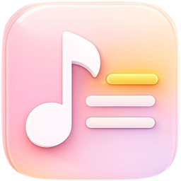
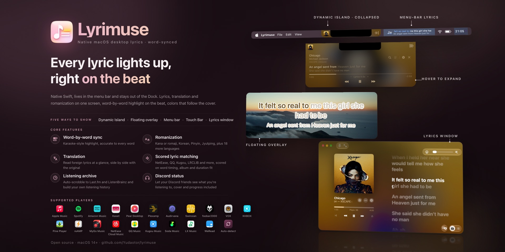
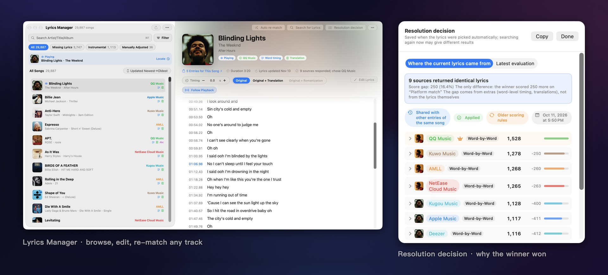
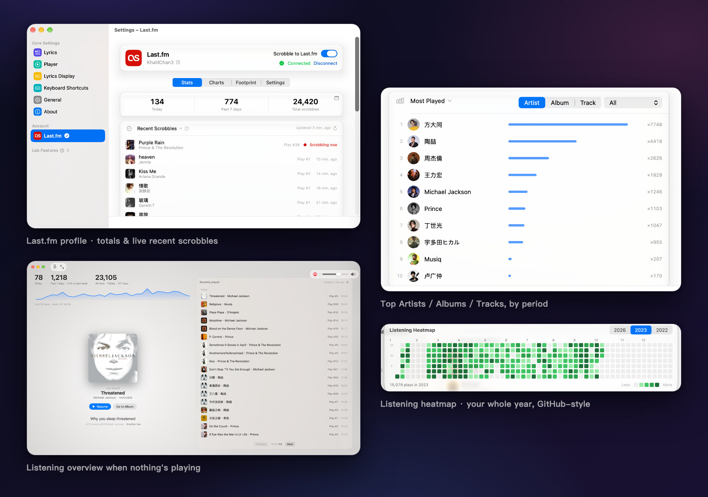
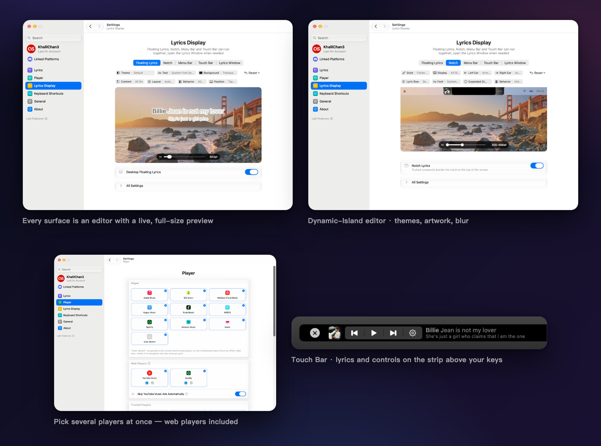

<div align="center">



# Lyrimuse

**Mac için yeniden düşünülmüş masaüstü şarkı sözleri.**

**Language / 语言 / 語言 / 言語 / 언어 / Idioma / Langue / Sprache / Lingua / Язык / Мова / ภาษา / Dil / भाषा:** [English](README.md) | [简体中文](README.zh-CN.md) | [繁體中文](README.zh-Hant.md) | [日本語](README.ja.md) | [한국어](README.ko.md) | [Español](README.es.md) | [Français](README.fr.md) | [Deutsch](README.de.md) | [Italiano](README.it.md) | [Português (Brasil)](README.pt-BR.md) | [Tiếng Việt](README.vi.md) | [Русский](README.ru.md) | [Українська](README.uk.md) | [ไทย](README.th.md) | **Türkçe** | [हिन्दी](README.hi.md)


[](https://github.com/Yudaotor/lyrimuse/releases/latest)
[](https://github.com/Yudaotor/lyrimuse/commits/dev)
[](LICENSE)
[](https://github.com/sponsors/Yudaotor)
[](https://discord.gg/N7gVy66Gp3)
[](https://t.me/lyrimuse)
[](https://qm.qq.com/q/Nb4TlwfnQy)

</div>

https://github.com/user-attachments/assets/88b951ee-4ecf-4985-b1cb-eee6afdd5510

Lyrimuse, macOS için açık kaynaklı bir masaüstü şarkı sözü uygulamasıdır. Menü çubuğunda çalışır ve parça çalarken şarkı sözlerini kelime kelime vurgular: pencerelerinizin her zaman üstünde yüzerek, menü çubuğunda, çentiğin altındaki Dynamic Island tarzı bir kapsülde, Touch Bar’da ya da tam bir şarkı sözü penceresinde. Apple Music, Spotify, Amazon Music ve YouTube Music uygulaması Kaset dahil toplam 22 çalarla ve tarayıcınızdaki web çalarlarla çalışır; en iyi eşleşmeyi 16 şarkı sözü kaynağından seçer, isterseniz çeviri ve telaffuz da ekler. Ayrıca bir Last.fm dinleme profili tutar ve dinlemelerinizi skroplar.

**LyricsX’ten mi geçiyorsunuz?** Nisan 2022’den beri yeni sürümü çıkmadı. Lyrimuse onun yaptıklarını karşılar, güncellenmeye devam eder ve Çin müzik uygulamaları, KKBOX, Amazon Music, Kaset, Pear Desktop, reAMP, Pine Player, foobar2000, Cog, Plexamp, MyGo Music, WeRead ve web çalarlar için destek ekler. Ayrıntılar için doğruluğu denetlenmiş [LyricsX ve Lyric Fever karşılaştırmasına](docs/lyrics-apps-comparison.md) bakın.

Apple Silicon veya Intel’de Homebrew ile **kurun**. İlk açılıştaki Gatekeeper uyarısını da sizin yerinize aşar. Kendiniz indirmeyi mi tercih edersiniz? [Son sürümü](https://github.com/Yudaotor/lyrimuse/releases/latest) alın ve [Başlarken](#başlarken) bölümüne bakın.

```bash
brew tap yudaotor/lyrimuse
brew trust --cask yudaotor/lyrimuse/lyrimuse   # one-time: Homebrew asks you to trust non-official taps
brew install --cask lyrimuse
```


<p align="center"><sub>Şarkı sözlerini göstermenin dört yolu: Şarkı Sözü Penceresi, Dynamic Island tarzı kapsül, kelime kelime vurgulu yüzen şarkı sözleri ve menü çubuğu</sub></p>


<p align="center"><sub>Şarkı Sözü Yöneticisi, her sonuca puan veren elle arama ve bir parçanın neden o şarkı sözlerini aldığını gösteren panel</sub></p>


<p align="center"><sub>Last.fm rakamlarınız ve listeleriniz, hiçbir şey çalmazken gördüğünüz özet ve yılınızın GitHub tarzı ısı haritası</sub></p>


<p align="center"><sub>Her ayar sayfasında canlı önizleme var, birden fazla çalar seçebilirsiniz (web çalarları da) ve geri kalanı menü çubuğundaki açılır menüde</sub></p>

## Özellikler

> Her özelliğin Ayarlar’da nerede olduğu ve kurulumdan sonra açık mı kapalı mı geldiği için **[özellik listesine](docs/feature-list.tr.md)** bakın.

### Otomatik eşleşen, kelime kelime eşzamanlı şarkı sözleri
- Parça çalarken ona ayak uyduran **kelime kelime vurgulama**.
- **16 şarkı sözü kaynağında sizin yerinize arama**: NetEase Cloud Music, QQ Music, Kugou, Kuwo, Migu, LRCLIB, LyricFind (YouTube Music üzerinden), Deezer, AMLL (elle derlenmiş bir kelime kelime şarkı sözü veritabanı), Soda Music (kendi kelime kelime zamanlamasıyla), VIBE ve Genie (ikisi de Korece şarkılarda güçlü), PetitLyrics (Japonca şarkılarda güçlü), Zing MP3 (Vietnamca şarkılarda güçlü), Megalobiz (kullanıcıların senkronladığı sözler, yalnızca dinlediğiniz şarkılar için sorulur) ve hesabınızı Ayarlar’da bağlarsanız Apple Music’in şarkı sözleri. Apple Music’in şarkı sözleri abonelik gerektirir ve parçalarının birçoğunda kelime zamanlaması vardır. Hiçbir zaman kendiniz aramanız gerekmez.
- Özgün sözlerin altında **çeviri ve telaffuz**. Kaynakta topluluk çevirisi varsa o gelir. Yoksa Ayarlar’da “Yedek Sistem Çevirisi” ayarını açın (saptanmış olarak kapalıdır); Mac’iniz şarkı sözlerini Apple’ın Translation çerçevesiyle çevirir, böylece sözler bilgisayarınızdan hiç çıkmaz; bu mümkün olmadığında çevrimiçi bir çevirmen devreye girer. 17 hedef dil vardır. Telaffuz satır satır belirlenir: içinde tek bir Japonca satır olan Çince bir şarkıda yalnızca o satıra okunuş eklenir, geri kalanına pinyin yağmaz. Kantonca şarkılar, kelimeleri bütün olarak tanıyan Jyutping alır. Japonca için bunun yerine furigana seçebilirsiniz: yalnızca kanjilerin üzerinde hiragana; şarkılardan Japonca öğreniyorsanız kullanışlıdır. Rusça, Tayca, Yunanca ve Hintçe dahil 18 dil daha, her dilin resmî Latin harfli yazımına ya da bir ISO standardına göre okunuş alır.
- **Düetler şarkıcıya göre ayrılır.** Kaynak (ya da bir AMLL kaydı) hangi satırı kimin söylediğini belirtiyorsa, iki ses tek bir bloğa karışmak yerine her bölüm ayrı gösterilir.
- **Şarkı Sözü Penceresi’nde Apple Music dokunuşları**: ana satırın altında kendi satırında arka vokaller, ikisi de bitene kadar birlikte yanan üst üste binen düet satırları ve Apple Music’teki gibi büyüyüp parlayan uzun tutulan İngilizce kelimeler.
- Şarkı sözleri için **Basitleştirilmiş veya Geleneksel Çince**; uygulamanın kendi dilinden ayrı olarak ayarlanır.
- Ortalığı toparlamak istediğinizde **Şarkı Sözü Yöneticisi**. Her parçanın sözlerine göz atın, onları düzenleyin, silin ya da yeniden arayın; çok sayıda kaydı tek seferde silin, reklamların ve podcast’lerin geride bıraktığı boş kayıtları temizleyin. Bir parçanın zamanlaması kaymışsa yalnızca o parçayı kaydırın. Tek bir düğme hâlâ şarkı sözü olmayan her parçayı yeniden dener; tam yeniden tarama ise tüm arşivinizin şarkı sözlerini geçerli eşleştirme kurallarıyla yeniden seçer. Elle düzelttiğiniz hiçbir şeye dokunulmaz. Henüz çalmadığınız parçalar için bile .lrc dosyalarını ya da bütün bir klasörü içe aktarabilir veya bir klasörü izlemeye alabilirsiniz. Yerel bir MP3, M4A, FLAC veya başka bir ses dosyası çalarken şarkı sözlerini dosyaya da yazabilirsiniz; böylece diğer çalarlar da bunları gösterir.
- **Bir parçaya tek şarkı sözü.** Farklı çalarlarda ya da farklı yayımlardan çalınan aynı parça tek parça olarak tanınır: kayıtları şarkı sözlerini ve elle yaptığınız düzenlemeleri paylaşır, dinleme sayıları toplanır. Şarkı Sözü Yöneticisi’ndeki “Bu Parçanın Kayıtları” bunları satır satır karşılaştırır ve yanlışlıkla eşleşmiş olanı ayırır.
- **Şarkı sözlerini doğrudan Şarkı Sözü Penceresi’nden düzeltin.** Başka şarkı sözleri arayın, parçayı yeniden eşleştirin ya da sözleri kendi metin düzenleyicinizde düzenleyin. Kelime kelime şarkı sözlerini düzenlemek yalnızca kelimeleri değiştirir, böylece her kelime zamanlamasını korur.
- Şarkı sözleri zaten önbellekte olan her parça için **çevrimdışı çalışır**.

### Last.fm dinleme profili ve skroplama
- **Eksiksiz bir dinleme profili.** Last.fm’i hesaplar bölümünden tek tıkla bağlayın (kopyalayıp yapıştıracak jeton yok); bugünün, son 7 günün ve tüm zamanların toplamlarını, canlı bir “şu an skroplanıyor” göstergesini ve kapaklarıyla son dinlemelerinizi görürsünüz; her birinin yanında Last.fm’de beğenmek (ya da beğeniyi geri almak) için bir kalp vardır. Saptanmış olarak her dinleme Last.fm kataloğundaki eşleşen parça olarak gönderilir; böylece düet künyeleri, Basitleştirilmiş / Geleneksel yazımlar ve “ - Single” ya da “(Remastered)” gibi ekler gerçek parça sayfasına düşer; çaların bildirdiğini aynen göndermek için Ayarlar’da “Ham” seçeneğine geçin. ListenBrainz her zaman özgün etiketleri alır ([skroplama nasıl çalışır](docs/scrobbling.tr.md)).
- Son 7 gün, 30 gün, yıl ya da tüm zamanlar için **en çok dinlenen sanatçılar, albümler ve parçalar**; her birinin önceki döneme göre ne kadar yükselip düştüğüyle birlikte. Bir sanatçıya tıklayarak onun en çok çaldığınız parçalarını görün.
- Kendi sekmesi olan **Geçmişe Bakış**. Birikmiş toplamlarınızla açılır: ilk skroplamanızdan bu yana kaç gün geçtiği, bunların kaçında dinleme olduğu ve günlük ortalama, en yoğun gününüz, mevcut ve en uzun seriniz, bu yılın şimdiye kadarki kısmının önceki bir yılın aynı dönemiyle karşılaştırması ve bir sonraki yuvarlak sayılı dönüm noktasına ne kadar kaldığı. Altında yılın GitHub tarzı ısı haritası (en çok ne çaldığınızı görmek için bir güne tıklayın), saate ve haftanın gününe göre ne zaman dinlediğiniz, en çok dinlediğiniz sanatçıların nereli olduğu ve geçmiş yıllarda bu tarihte ne çaldığınızı gösteren “Geçmişte Bugün” yer alır.
- **Her dinleme önce Mac’inize kaydedilir**, Last.fm’i bağlamadan önce bile. Sonradan bağlayın ve yaklaşık son iki haftanın dinlemelerini tek tıkla gönderin (Last.fm daha eski dinlemeleri kabul etmez).
- **Bir dinlemenin ne zaman sayılacağına siz karar verirsiniz**: Last.fm’in saptanmış ayarı gibi %50’de, %75 ya da %90’da veya yalnızca parça gerçekten bittiğinde. ListenBrainz bundan etkilenmez. Bir çaları Last.fm’in tamamen dışında da tutabilirsiniz; böylece onun dinlemeleri geçmişinizde hiç görünmez.
- Hiçbir şey çalmazken **aynı geçmiş Şarkı Sözü Penceresi’nde de görünür**; böylece boş bir ekran yerine bir özet görürsünüz (aşağıda daha fazlası var).

### Yüzen sözler, menü çubuğu sözleri, Dynamic Island, Touch Bar ya da tam bir şarkı sözü penceresi
- **Birkaç çalar kullanın ya da seçimi ona bırakın.** Apple Music, Spotify ve Kaset, Otomasyon erişimiyle okunur. QQ Music, NetEase Cloud Music, Kugou Music, Kuwo Music, Soda Music, KKBOX, Amazon Music ve LX Music, macOS’in MediaRemote’u üzerinden okunur ve izin gerektirmez. Ayarlar’da istediğiniz birleşimi açın ya da otomatik algılamada bırakın; macOS’in Şu An Çalınan olarak gösterdiği neyse onu izler.
- **Apple Music radyosu da çalışır.** Şarkı sözleri bir istasyondaki her parçaya ayak uydurur. Sunucu konuşurken önceki parçayı değil, istasyonun adını ve logosunu görürsünüz. Radyonun kendi zamanlama kaydırması vardır; bir istasyonu bir kez düzeltip unutabilirsiniz.
- **Tarayıcınızdaki çalarlar da.** Tarayıcınızı bir kez eşleyin; YouTube Music ya da Spotify Web diğer çalarlar gibi çalışır; şarkı sözleri sayfanın kendi ilerleme çubuğuyla eşzamanlanır. Tek tıklık bir test, tarayıcının denetlenip denetlenemeyeceğini baştan söyler. Reklam sırasında kapsül siyaha döner, ne kadar kaldığını ve bunun kaç reklamdan kaçıncısı olduğunu gösterir. YouTube Music reklamlarında bir atlama düğmesi çıkar ya da reklamlar otomatik atlanabilir.
- **Nasıl görmek istediğinizi seçin**; istediğiniz birleşimle ya da hiçbiriyle:
  - istediğiniz yere sürükleyebileceğiniz ya da üst ortaya veya Dock’un hemen üstüne sabitleyebileceğiniz bir masaüstü katmanı;
  - ekranın üstünde Dynamic Island tarzı bir kapsül; albüm kapağını gösterip kapsülün arkasında bulanıklaştırabilir, tıklamalar içinden geçsin diye şarkı sözü satırını soldurabilir, açarsanız Kilitli Ekran’da görünebilir; ayrıca düzenini kendiniz belirlediğiniz bir sıra hızlı işlem düğmesi vardır;
  - Touch Bar’ı olan bir MacBook Pro’da Touch Bar; satır söylendikçe kayar, isterseniz albüm kapağı ve oynatma denetimleri de eklenir; yazarken yazma önerileri görünsün diye kenara çekilir;
  - Apple Music’in şarkı sözü sayfası örnek alınarak tasarlanmış, yeniden boyutlandırılabilen bir Şarkı Sözü Penceresi: iki sütun, arka planda bulanık bir kapak, geçerli satıra doğru kayan şarkının tamamı, Apple Music’te albümün hareketli kapağı varsa hareketli albüm kapağı ve parçanın döngüsel Spotify Canvas videosu varsa arka plan olarak o video. Kelimeler söylendikçe sizin seçtiğiniz kalınlık, söylenmiş kısım rengi ve hizalamayla dolar; HDR Vurgusu da HDR ekranda söylenmiş kısmı beyazın ötesine taşıyarak parlatabilir.
- **Menü çubuğu sözleri (metin modu).** Geçerli satır doğrudan menü çubuğunda durur. Uzun satırlar yarıda kesilmek yerine kayar (kesmeye geri dönebilirsiniz). İkinci bir satır sonraki satırı, çeviriyi ya da telaffuzu gösterebilir; kapsül de aynısını yapabilir.
- **Denetim Merkezi gibi düzenlediğiniz bir menü çubuğu paneli.** Parça, oynatma denetimleri ve bir kutucuk ızgarası için menü çubuğu simgesine tıklayın. Kutucukları sürükleyin, yeniden boyutlandırın, ekleyin ya da kaldırın; ayarları için birine uzun basın ve alt çubuğu yeniden düzenleyin. Paneli bir klavye kestirmesi açar ve panel klavyeyle de kullanılabilir.
- Şarkı Sözü Penceresi’nde ve kapsülde **ilerleme çubuğunu sürükleyerek konum değiştirin**.
- Çaların izin verdiği her durumda doğrudan Şarkı Sözü Penceresi’nde **karıştırma, yineleme, Favori ve ses yüksekliği**: Apple Music, Spotify, Kaset, QQ Music, Kuwo Music, Amazon Music ve tarayıcıdaki YouTube Music bunların bir kısmını ya da tümünü destekler; NetEase Cloud Music, Kugou Music, Kuwo Music, Soda Music ve LX Music’te Favori vardır. Favori genişletilmiş kapsülde de vardır ve ona bir klavye kestirmesi atanabilir.
- **Parçayı bulunduğu yerde açın**: “⋯” menüsünden ya da bilgi panelinden. Apple Music uygulamada açılır, Spotify çalan parçaya atlar, KKBOX ise parçayı, albümü ya da sanatçıyı kendi uygulamasında açar. QQ Music, Soda Music, Spotify, Amazon Music ve YouTube Music (Kaset’te çaldığınızda) parça, albüm ya da sanatçı sayfasını web’de açar; NetEase Cloud Music parça sayfasını açar. Lyrimuse bağlantıyı şarkı sözlerini getirirken bulmuş ya da Mac’inizdeki çaların kendi verilerinden okumuştur; yani aranacak bir şey yok.
- **Hiçbir şey çalmazken** Şarkı Sözü Penceresi bugünün ve bu haftanın toplamlarını, bir “Geçmişte Bugün” kartını ve kapaklarıyla son dinlemelerinizi gösterir; her biri Apple Music’teki albüm ya da sanatçı sayfasına bağlanır.
- **Mini Şarkı Sözü Penceresi**: tek satır, iki satır ya da kayan tam şarkı sözlerini gösteren, kendi arka planı, metin rengi, fontu, kalınlığı ve söylenmiş kısım rengi olan küçük bir kart; kelime kelime karaoke yalnızca onun için kapatılabilir.
- **Tarayıcıda Şarkı Sözleri: telefonunuzda, tabletinizde ya da yayınınızda.** Şarkı Sözü Penceresi’ni başka bir aygıttaki tarayıcıda açıp ikinci ekran olarak kullanın; izin verirseniz oynatma denetimleri ve dokunarak atlama da olur. OBS Çıkışı, yüzen şarkı sözlerini yayınınıza saydam bir tarayıcı kaynağı olarak koyar. İkisi de siz yerel ağ erişimine izin verene kadar bu Mac’te kalır; diğer aygıtlar bir QR kodunu tarayarak bağlanır.
- **Parça notları, albüm notları ve sanatçı biyografileri.** Haklarında bilgi almak için Şarkı Sözü Penceresi’nde ya da genişletilmiş kapsülde parça adına, sanatçıya veya albüm adına tıklayın. Albüm notları ve sanatçı biyografileri Apple Music’ten gelir; orada bir şey yoksa Soda Music’ten (Soda Music’te çalınan parçalar, yalnızca Çince arayüz), Kugou Music’ten (Kugou Music’te çalınan parçalar, yalnızca Çince arayüz), NetEase Cloud Music’ten (yalnızca Çince arayüz), YouTube Music’in gösterdiği Wikipedia makalelerinden (arayüz dilinde) ya da Last.fm’den gelir; parça notları QQ Music’ten (yalnızca Çince arayüz) ya da Last.fm’den gelir.
- **İstediğiniz görünüme getirin**: font (sistem fontu ya da kendi .ttf / .otf dosyalarınız), boyut, metin / arka plan / gölge renkleri, kaydedilmiş temalar ya da geçerli albüm kapağından alınan bir renk ve katmanın genişliği; ayrıca akan gökkuşağı renginde şarkı sözleri.
- **Ekran görüntülerinde, kayıtlarda ve ekran paylaşımlarında gizli.** Siz görürsünüz. Başka kimse görmez.
- **Duraklattığınızda kendini gizler**, böylece masaüstünüzde boşuna durmaz. Enstrümantal parçalarda, şarkı sözü olmayan parçalarda ve tam ekran uygulamalarda da kenara çekilebilir; katman, kullandığınız pencerenin bulunduğu ekrana sizinle birlikte geçebilir.

### Günlük ayrıntılar
- **İngilizce, Basitleştirilmiş Çince, Geleneksel Çince, Japonca, Korece, İspanyolca, Fransızca, Almanca, İtalyanca, Brezilya Portekizcesi, Vietnamca, Rusça, Ukraynaca, Tayca, Türkçe ve Hintçe**; dil değişikliği yeniden başlatma gerektirmeden hemen etkili olur. Kulağa tuhaf gelen bir çeviri mi gördünüz? Çekme isteklerinizi bekliyoruz; her dilin `lyrimuse/Localization/` içinde bir stil kılavuzu var.
- **macOS 26’da Liquid Glass.** Ayarlar, menü çubuğu paneli, Şarkı Sözü Penceresi, Şarkı Sözü Yöneticisi ve kurulum kılavuzu onunla yapılmıştır; çoğu, sistemi izlemek yerine açık ya da koyu kalabilir.
- Tüm şarkı sözlerini gizlemekten parçayı beğenmeye kadar her işlem için **klavye kestirmeleri**. Başlangıçta hiçbiri atanmamıştır, tuşları siz seçersiniz. Her işlemin Kestirmeler, Raycast ya da Alfred’den çağırabileceğiniz bir `lyrimuse://` bağlantısı da vardır; Kestirmeler’den çağrılan bir bağlantı çalan parçayı geri döndürebilir ([URL şeması](docs/url-scheme.tr.md)).
- **Ayarlar’da arama.** Kenar çubuğuna yazın; eşleşen satıra kayar ve onu vurgular, gerekirse daraltılmış bir grubu açar.
- **Kendini günceller.** Kendiliğinden ya da siz menü çubuğundan istediğinizde denetler. Güncellemeler Ayarlar’daki Yazılım Güncelleme sayfasından kurulur, sürüm notları ve ilerleme de hemen oradadır; beta sürümlerine katılmayı da seçebilirsiniz.
- **Çalarlarınızla birlikte başlatın**; her çalar için ayrı ve iki yönde de ayarlanır: Lyrimuse açılınca onlar da açılsın, onlar açılınca Lyrimuse açılsın ve isterseniz izlediği tüm çalarlar kapanınca Lyrimuse da kapansın.
- Hiç pencere olmadan, yalnızca menü çubuğu simgesiyle başlamasını isterseniz **Sessizce Başlat**.
- **Yeni bir Mac’e mi geçiyorsunuz?** Tüm kurulumunuzu dışa aktarın ve orada içe aktarın. Bir şeyler ters giderse tanıları tek tıkla dışa aktarma seçeneği de var.

### Ek özellikler (isteğe bağlı)

<details>
<summary>ListenBrainz, Discord durumu, paylaşılabilir bir “şu an çalınan” sayfası ve günlük / haftalık / aylık / yıllık raporlar</summary>

Bunların hepsi siz Ayarlar’da açana kadar kapalıdır:

- **[ListenBrainz](https://listenbrainz.org)’e de skroplayın.** Her dinleme, çalarınızdan yapılan aynı okumayla iki hizmete de gider; böylece iki geçmiş uyumlu kalır. iPhone’unuzdaki dinlemeler (Last.fm üzerinden kaydedilenler) de ListenBrainz’e kopyalanır; böylece iki ayrı geçmiş yerine iki aygıtı kapsayan tek bir geçmişiniz olur.
- **Paylaşabileceğiniz herkese açık bir “şu an çalınan” sayfası**: canlı oynatma, geçmiş, ziyaretçi defteri, tepkiler, ziyaretçi sayacı, ilk 10 sanatçı panosu, plak görünümü, açık ve koyu temalar ve sohbet uygulamalarında düzgün bağlantı önizlemeleri. **[Web Özellikleri Kılavuzu](https://github.com/Yudaotor/nowplaying-workers#readme)** bunu ekran görüntüleriyle adım adım anlatır.
- İstediğiniz kadar kanala gönderilen **günlük, haftalık, aylık ve yıllık dinleme raporları**: Bark, ntfy, ServerChan, Feishu, DingTalk, WeCom, Telegram, Discord, Slack ya da genel bir webhook. Her kanal bir test gönderebilir; gönderim geçmişi neyin ulaştığını gösterir.
- **Ne dinlediğinizi Discord’da gösterin.** Profiliniz ve arkadaş listeniz kullandığınız çaları, parçayı, sanatçıyı, albüm kapağını ve bir ilerleme çubuğunu gösterir; parça adı ve sanatçı, o çaların sitesindeki sayfalarına bağlanır. Albüm satırı söylenmekte olan satırı gösterebilir ve en fazla iki düğme ekleyebilirsiniz. Kapağın köşesinde küçük bir Lyrimuse ya da çalar rozeti durur (ya da hiçbiri); duraklatılan bir parça, duraklatma simgesiyle görünmeye devam edebilir. Hangi çalarların sayılacağını siz seçersiniz; parçanın adını vermeden yalnızca çaları gösterebilir ve bir süreliğine gizleyebilirsiniz.

ListenBrainz ve “Web Anlık Bildirimleri”, Ayarlar kenar çubuğunda **Deneysel** altındadır; “Anlık Bildirimler” diğer bölümlerle birlikte durur, Discord’un ise en üste yakın kendi girişi vardır. Her kart kendi kurulum adımlarıyla gelir: API anahtarını ya da jetonu nereden alacağınız, bir hesabı nasıl bağlayacağınız, anlık bildirim hizmetiniz için webhook URL’sini nasıl alacağınız. Ayrı bir kılavuzu olan tek şey web sayfasıdır ve onun tamamına ihtiyacınız yok. Yalnızca ListenBrainz kurulu olsa bile sayfa canlı oynatmayı ve geçmişi zaten gösterir; Cloudflare Worker gerekmez. Ziyaretçi defteri, tepkiler, ziyaretçi sayacı, ilk 10 panosu ve daha hızlı güncellemeler de istiyorsanız bir tane kurun; kılavuz bunu anlatır.

</details>

## Başlarken

Sürümler bir Apple Developer ID ile değil, projenin kendi sertifikasıyla imzalanır; bu yüzden aşağıdaki seçeneklerin hiçbiri Apple Developer hesabı gerektirmez. Bunun bedeli, uygulamayı ilk açtığınızda Gatekeeper’ın onun “kimliği belirsiz bir geliştiriciden” geldiğini söylemesidir. Homebrew (Seçenek A) bunu sizin yerinize halleder. Diğer seçeneklerde bu beklenen bir durumdur, hata değildir; Seçenek B bunu bir kerelik nasıl aşacağınızı gösterir.
### Seçenek 0: Kurulumu bir yapay zekâya bırakın

Mac’inizde terminali kullanabilen bir yapay zekâ ajanı mı çalıştırıyorsunuz (Claude Code, Codex CLI, Gemini CLI, …)? Aşağıdaki bloğu olduğu gibi ona yapıştırın; Seçenek A/B’deki her şeyi sizin yerinize yapar. Talimatlar yalnızca bu tek uygulamayı kurmasına izin verir. `sudo` kullanmaz, sistem genelindeki güvenlik ayarlarına dokunmaz:

```text
Please install Lyrimuse — an open-source macOS menu-bar lyrics app
(https://github.com/Yudaotor/lyrimuse) — on this Mac, following these rules exactly:

1. Preferred path (if `brew` exists):
     brew tap yudaotor/lyrimuse
     brew trust --cask yudaotor/lyrimuse/lyrimuse
     brew install --cask lyrimuse
   If this Homebrew doesn't know the `trust` subcommand, skip that line — older
   versions don't need it.
2. If Homebrew is not installed, do NOT install Homebrew. Instead: check the CPU
   with `uname -m`, download the latest release asset from
   https://github.com/Yudaotor/lyrimuse/releases — `Lyrimuse-v<version>-macos.zip`
   for arm64, `Lyrimuse-v<version>-macos-intel.zip` for x86_64 — verify it against
   its `.sha256` file (`shasum -c`), unzip, move `Lyrimuse.app` into
   /Applications, then clear the Gatekeeper quarantine flag on that one app only:
     xattr -dr com.apple.quarantine /Applications/Lyrimuse.app
3. Safety rails: no `sudo` anywhere (nothing here needs it); never run
   `spctl --master-disable` or otherwise weaken Gatekeeper system-wide; never
   remove the quarantine flag from anything except /Applications/Lyrimuse.app.
4. Do not build from source unless I explicitly ask.
5. Launch it (`open -a Lyrimuse`) and verify it is running (`pgrep -x Lyrimuse`
   prints a PID).
6. A first-run wizard will appear — that part is mine to click through. Tell me
   it will ask me to pick a music player, to grant Automation access to
   Music.app and/or Spotify (only if I pick them), and to enable the background
   lyrics engine — then hand control back to me.
Finally, report what you did and anything that failed.
```

### Seçenek A: Homebrew ile kurun (önerilir)

```bash
brew tap yudaotor/lyrimuse
brew trust --cask yudaotor/lyrimuse/lyrimuse   # one-time: Homebrew asks you to trust non-official taps
brew install --cask lyrimuse
```

Bu, kurulumun bir parçası olarak tek seferlik Gatekeeper karantinasını otomatik kaldırır, dolayısıyla ek bir adım yoktur. `brew install` biter bitmez Lyrimuse’u `/Applications` klasöründen (ya da Spotlight ile) açın. `brew upgrade --cask lyrimuse` yeni sürümleri de aynı şekilde alır.

### Seçenek B: Hazır derlenmiş bir sürümü elle indirin

1. [Sürümler sayfasından](https://github.com/Yudaotor/lyrimuse/releases) indirin. **Önce hangi Mac’e sahip olduğunuzu denetleyin** ( → Bu Mac Hakkında → “Çip”: `Apple M…` Apple Silicon, `Intel Core…` Intel demektir):

   | Mac’iniz | İndirilecek dosya |
   | --- | --- |
   | Apple Silicon (M1 ve sonrası) | `Lyrimuse-*-macos.dmg` veya `.zip` |
   | Intel | `Lyrimuse-*-macos-intel.dmg` veya `.zip` |

   dmg’de bağlamak için çift tıklayın ve `Lyrimuse.app` dosyasını yanındaki `Applications` kısayoluna sürükleyin; zip’te arşivi açın ve `Lyrimuse.app` dosyasını `/Applications` klasörüne sürükleyin. İki biçim de tamamen aynı uygulamayı kurar; indirmeyi doğrulamak isterseniz zip’in yanında bir `.sha256` dosyası gelir (aynı klasörde `shasum -c Lyrimuse-*.zip.sha256`).

   İki indirme arasındaki tek fark mimaridir: soneki olmayan yalnızca Apple Silicon içindir, `-intel` ise hem Intel hem Apple Silicon kodu taşır. `-intel` Apple Silicon’da da çalışır ama orada kullanmak için bir neden yok: boyutu iki katıdır ve macOS 27 ve sonrası, Intel kodu içerdiği için uygulamanın “güncellenmesi gerektiği” uyarısını verir (Apple, Rosetta’yı macOS 28’de kaldırıyor; uygulamada aslında bir sorun yoktur).

   **İki mimari de uygulama içi otomatik güncelleme alır.** Akış aynı sürüm için mimari başına bir tane olmak üzere iki kayıt listeler: Apple Silicon’a soneksiz derleme, Intel’e `-intel` olanı sunulur ve Sparkle her makine için kendiliğinden seçer. (v1.4.0 ve öncesi yalnızca Apple Silicon’a sunuluyordu; Intel kullanıcılarının elle buraya dönmesi gerekiyordu.)
2. İlk açılışta macOS, “Lyrimuse açılamıyor çünkü Apple kötü amaçlı yazılım içerip içermediğini denetleyemiyor” ya da “kimliği belirsiz bir geliştiriciden geliyor” diyerek açmayı reddeder. Bunu bir kez, aşağıdakilerden hangisi size daha rahat geliyorsa onunla aşın:

   - **Terminal (önerilir, her zaman çalışır):**
     ```bash
     xattr -dr com.apple.quarantine /Applications/Lyrimuse.app
     ```
     Sonra uygulamayı normal şekilde açın. Bunu her indirme için yalnızca bir kez yapmanız gerekir.
   - **Sağ tık → Aç:** Finder’da `Lyrimuse.app` dosyasına sağ tıklayın (ya da Control tuşuna basarak tıklayın) ve **Aç**’ı seçin, sonra iletişim kutusunda **Aç** ile bir kez daha onaylayın. Her macOS sürümünde her uyarı türü için çalışmaz; uyarı kalırsa yukarıdaki Terminal komutunu kullanın.
   - **Sistem Ayarları → Gizlilik ve Güvenlik:** Uygulamayı bir kez açmayı deneyin (engellenecektir), sonra **Sistem Ayarları → Gizlilik ve Güvenlik**’i açın, en alta kaydırın ve Lyrimuse uyarısının yanındaki **Yine de Aç**’a tıklayın. Sorulursa bir kez daha onaylayın.

   Bunu yalnızca gerçekten güvendiğiniz bir derleme için yapın: bu deponun Sürümler sayfasındaki ya da kendi derlediğiniz bir derleme.

### Seçenek C: Kaynak koddan derleyin

**Tek seferlik ön koşullar** (zaten olanları atlayın):

```bash
xcode-select --install   # Xcode Command Line Tools, for Swift — skip if `swift --version` already works
brew install go          # any Go ≥ 1.21 — build.sh switches to 1.27.4 automatically via GOTOOLCHAIN
```

Sonra `build.sh` hem uygulamayı hem de şarkı sözü motorunu (`lyrimuse-engine` adlı arka plan işlemi) tek seferde derler:

```bash
git clone https://github.com/Yudaotor/lyrimuse.git
cd lyrimuse/lyrimuse
./build.sh              # this machine's architecture
./build.sh --universal  # arm64 + x86_64 (the compatibility build shipped for Intel)
```

`build.sh` sonunda paketteki her ikili dosyanın mimarilerini listeler ve hedefle uyuşmayan her şeyi, eksik bir dilim de olsa fazladan bir dilim de olsa işaretler. Sürüm dosyalarını elle hazırlamayın: `./package.sh` her mimariyi bir kez derler ve her biri için zip + sha256 + dmg üretir; mimariler yanlışsa paketlemeyi reddeder.

QQ Music / NetEase Cloud Music / Kugou Music / Kuwo Music / Soda Music / KKBOX / Amazon Music / LX Music / Spotify / Kaset / Pear Desktop / reAMP / VOX / Pine Player / foobar2000 / Cog / Swinsian / Plexamp / MyGo Music / WeRead / otomatik algılama desteği ayrıca [ungive/media-control](https://github.com/ungive/media-control) gerektirir. Eksikse `build.sh` onu Homebrew ile otomatik kurar; yani bu da kendiniz yapmanız gereken bir adım değildir.

### Hangi seçenekten sonra olursa olsun

Lyrimuse’u `/Applications` klasöründen açın. İlk açılış sihirbazı şu adımlarda size yol gösterir: bir çalar seçme (Apple Music, QQ Music, NetEase Cloud Music, Kugou Music, Kuwo Music, Soda Music, KKBOX, Amazon Music, Spotify, Kaset, Pear Desktop, reAMP, VOX, Pine Player, foobar2000, Cog, Swinsian, Plexamp, MyGo Music, Audirvana, LX Music, WeRead ya da otomatik algılama), Apple Music, Spotify, Kaset, VOX, Swinsian veya Audirvana’yı seçtiyseniz Otomasyon erişimi verme (diğerleri temel parça bilgilerini okumak için izin gerektirmez) ve şarkı sözü motorunu etkinleştirme (pencere kapalıyken bile şarkı sözleri/kapaklar çözülmeye devam etsin diye). Sihirbazı tamamlayın, şarkı sözleri hemen görünür (daha fazla derleme seçeneği için [lyrimuse/README.md](lyrimuse/README.md) dosyasına bakın).

Şarkı sözleri için gereken bu kadar. İsteğe bağlı ek özellikleri daha sonra, istediğiniz zaman Ayarlar’dan kurabilirsiniz.

## SSS

### Mac masaüstümde her zaman üstte duran yüzen Apple Music şarkı sözlerini nasıl gösterebilirim?
Ayarlar’da masaüstü katmanını açın. Her pencerenin üstünde, tüm masaüstü alanlarında kalır. İstediğiniz yere sürükleyin ya da üst ortaya veya Dock’un hemen üstüne sabitleyin. Şarkı sözlerinde kelime zamanlaması varsa her kelime söylendikçe dolar. Onu ekran görüntülerinden, kayıtlardan ve ekran paylaşımlarından gizleyebilir, müzik duraklatıldığında kaybolmasını sağlayabilirsiniz. QQ Music, NetEase Cloud Music, Kugou Music, Kuwo Music, Soda Music, KKBOX, Amazon Music, LX Music, Spotify, Kaset, Pear Desktop, reAMP, VOX, Pine Player, foobar2000, Cog, Swinsian, Plexamp, MyGo Music, Audirvana, WeRead ve web çalarlarla da aynı şekilde çalışır.

### Spotify şarkı sözlerini Mac menü çubuğunda gösterebilir miyim?
Evet. Menü çubuğu metin modunu açın; geçerli satır Spotify ya da desteklenen başka herhangi bir çalar için menü çubuğunda görünür. Uzun satırlar kesilmek yerine kayar; ikinci bir satır sonraki satırı, çeviriyi ya da telaffuzu gösterebilir. Bir Spotify hesabı bağlamanız gerekmez. Lyrimuse, Spotify için bir kez Otomasyon erişimi ister; bu ona tam oynatma konumunu verir ve oynatma düğmelerini çalışır hâle getirir. Hayır derseniz şarkı sözleri yine görünür, ama zamanlama macOS’in MediaRemote’undan gelir ve yaklaşık bir saniye kayabilir.

### QQ Music, NetEase Cloud Music, Kugou ya da Soda Music için kelime kelime şarkı sözü gösteriyor mu?
Evet, şarkı sözlerinde kelime zamanlaması olduğu sürece. NetEase Cloud Music, QQ Music, Kugou, Soda Music, AMLL ve Apple Music’te çoğu zaman vardır ve o satırlar kelime kelime dolar. Yalnızca satır zamanlaması olan şarkı sözlerinde satırın tamamı bir anda yanar. Çalar, şarkı sözlerinin nereden geldiğini de sınırlamaz: Soda Music’te çalan bir parça, en yüksek puanı onlar alırsa QQ Music’in kelime kelime şarkı sözlerini alabilir.

### Bunu kurmak için Apple Developer hesabı gerekir mi?
Hayır. Sürümler Apple Developer ID yerine projenin kendi sertifikasıyla imzalanır; bu yüzden ne sizin ne de projenin bir hesaba ihtiyacı var. Yukarıda Başlarken bölümünde anlatılan tek seferlik Gatekeeper adımının nedeni de budur.

### Lyrimuse Mac App Store’da var mı?
Hayır. Homebrew ile kurun (yukarıdaki Seçenek A) ya da [Sürümler sayfasından](https://github.com/Yudaotor/lyrimuse/releases) indirin (Seçenek B). Her iki durumda da sonraki güncellemeler uygulama üzerinden gelir.

### Lyrimuse ücretsiz mi?
Evet. GPL-3.0 altında açık kaynaklıdır. Ücretli sürümü, uygulama içi satın alması ve kaydolunacak bir hesabı yoktur. Last.fm ve diğer hizmetler size kalmış. İşinize yarıyorsa ve desteklemek isterseniz [GitHub’da sponsor olabilir](https://github.com/sponsors/Yudaotor) ya da Alipay veya WeChat Pay ile [geliştiriciye bir kahve ısmarlayabilirsiniz](https://yudaotor.github.io/donate/).

### Sistemin medya odağını başka bir uygulama tutarken QQ Music, NetEase Cloud Music ya da Soda Music’i denetleyebilir miyim?
Evet. Tarayıcıdaki bir video gibi bir şey macOS’in Şu An Çalınan’ını tuttuğunda sistemin medya tuşları ona gider; Lyrimuse bu durumda bunun yerine QQ Music’in, NetEase Cloud Music’in, Kuwo Music’in, MyGo Music’in ya da Cog’un kendi menü çubuğundaki veya Soda Music’in oynatma çubuğundaki oynat/duraklat, önceki ve sonraki düğmelerine basar ve çaları arka planda bırakır. Bunun için Erişilebilirlik erişimi gerekir (Ayarlar → Çalar); bu erişim olmadan o düğmeler ilgili sayfayı açar. Bu durumda konum değiştirme kullanılamaz. macOS 27’de bu izin **Sistem Ayarları → Gizlilik ve Güvenlik → Aygıt Denetimi ve Veri Erişimi** altındadır; önceki sürümler ona **Erişilebilirlik** der.

### Spotify, QQ Music ya da NetEase Cloud Music ile çalışıyor mu, yoksa yalnızca Apple Music ile mi?
Hepsiyle; ayrıca Kugou Music, Kuwo Music, Soda Music, KKBOX, Amazon Music, Kaset (bir YouTube Music uygulaması), açık kaynaklı YouTube Music masaüstü uygulaması Pear Desktop, Winamp tarzı çalar reAMP, kayıpsız ve yüksek çözünürlüklü yerel çalar VOX, neredeyse her biçimi çalan ücretsiz yerel çalar Pine Player, Windows’tan taşınmış klasik yerel çalar foobar2000, chiptune ve tracker biçimlerini de çalan açık kaynaklı yerel çalar Cog, büyük arşivler için yapılmış yerel çalar Swinsian, Plex’in kendi sunucunuz için müzik çaları Plexamp, yerel dosyaları çalan ve eklentilerle başka kaynaklar ekleyen açık kaynaklı MyGo Music, odyofiller için yüksek çözünürlüklü çalar Audirvana, açık kaynaklı LX Music ve sesli kitaplar için WeRead ile; yani toplam 22 çalar. Ya da macOS’in Şu An Çalınan olarak gösterdiği neyse onu otomatik algılamasına izin verin. Apple Music, Spotify, Kaset, VOX, Swinsian ve Audirvana Otomasyon erişimi ister (Spotify, Kaset, VOX ve Swinsian bunu tam zamanlama ve oynatma düğmeleri için kullanır; Audirvana Şu An Çalınan’a hiçbir şey bildirmez, bu yüzden parça, konumu ve oynatma düğmelerinin hepsi bu erişimden geçer). Geri kalan 16 çalar, temel parça bilgilerini macOS’in MediaRemote’u üzerinden okumak için izin gerektirmez; QQ Music, NetEase Cloud Music, Kugou Music, Kuwo Music, Soda Music ve Amazon Music’in karıştırma, yineleme ve beğenme düğmeleri ile reAMP, foobar2000 ve Cog’un karıştırma, yineleme ve ses yüksekliği denetimleri Erişilebilirlik erişimi gerektirir; Pine Player konumu yalnızca saniye hassasiyetinde bildirdiği için bu erişimi ilerleme çubuğunu okumak için kullanır. KKBOX, Amazon Music ya da LX Music’te o uygulamanın parça için zaten kaydettiği şarkı sözleri de değerlendirilir ve bu uygulamaların hiçbirine bağlanılmaz.

### KKBOX ya da Amazon Music şarkı sözlerini Mac’imde gösterebilir miyim?
Evet. İkisi de macOS’in MediaRemote’u üzerinden okunur, yani verilecek bir izin yoktur; şarkı sözleri de diğer çalarlarınki gibi yüzen katmanda, menü çubuğunda, kapsülde ve Şarkı Sözü Penceresi’nde görünür. KKBOX ya da Amazon Music parça için zaten şarkı sözü kaydettiyse bunlar da değerlendirilir ve ek ağırlık alır. Lyrimuse iki hizmete de asla giriş yapmaz ve onlara hiçbir şey göndermez. Diğer kaynaklarda da aramaya devam edilir; bunlardan biri kelime kelime zamanlama gibi daha iyi bir şey sunarsa o kazanır.


### LX Music (洛雪音乐) ile çalışıyor mu?
Evet. LX Music, macOS’in MediaRemote’u üzerinden okunur, yani verilecek bir izin yoktur. LX Music’te bir parça çaldığınızda, onun o parça için kaydettiği şarkı sözleri (platformda varsa kelime kelime) de değerlendirilir ve ek ağırlık alır; çaldığınız listedeki sonraki parçaların şarkı sözleri de önceden hazırlanır. Lyrimuse yalnızca Mac’inizdeki LX Music verilerini okur ve ona asla bir şey göndermez.

### Bir YouTube Music masaüstü uygulamasıyla çalışıyor mu?
Evet, Mac için yerel ve açık kaynaklı bir YouTube Music uygulaması olan [Kaset](https://github.com/sozercan/kaset) ile. Kaset, Otomasyon erişimiyle okunur; bu tam zamanlama ve çalışan oynatma düğmeleri sağlar, YouTube Music’in kendi şarkı sözleri de adaylar arasındadır. Açık kaynaklı bir masaüstü istemcisi olan [Pear Desktop](https://github.com/pear-devs/pear-desktop) da ek izin olmadan macOS Şu An Çalınan üzerinden çalışır. Tarayıcıdaki YouTube Music de çalışır, aşağıya bakın.

### Masaüstü şarkı sözleri neye benziyor?
Masaüstünüzde karaoke gibi. Geçerli satır pencerelerinizin üzerinde yüzer, şarkı sözlerinde kelime zamanlaması varsa her kelime söylendikçe dolar; çeviri ya da telaffuz da yanında durabilir. Fontu, boyutu, metin, arka plan ve gölge renklerini ve genişliği değiştirebilir, metin renginin albüm kapağını izlemesini sağlayabilirsiniz. Aynı şarkı sözleri menü çubuğunda, çentiğin altındaki Dynamic Island tarzı bir kapsülde ya da Apple Music tarzı tam bir şarkı sözü penceresinde de, istediğiniz birleşimle gösterilebilir.

### Dynamic Island kapsülü çentiği olmayan bir Mac’te çalışır mı?
Evet. Eski bir MacBook ya da harici ekran gibi çentiği olmayan bir ekranda kapsül, menü çubuğu yüksekliğinde üst ortada durur. Hangi ekranda görüneceğini Ayarlar’da seçersiniz.

### Şarkı sözleri internet bağlantısı olmadan çalışır mı?
Evet, şarkı sözlerini daha önce bulduğu her parça için; bunlar Mac’inizde önbelleğe alınır. Bir parçanın ilk araması için bağlantı gerekir, çevrimiçi çeviri için de.

### Verilerim Mac’imin dışına çıkıyor mu?
Şarkı sözü bulmak için çalan parçayı şarkı sözü kaynaklarına sorması gerekir: NetEase, QQ, Kugou, Kuwo, Migu, LRCLIB, LyricFind, Deezer, AMLL, Soda Music, VIBE, Genie, PetitLyrics, Zing MP3, Megalobiz ve bağladıysanız Apple Music. Kapaklar iTunes Search API’den gelir. Çeviri saptanmış olarak Mac’inizde yapılır; şarkı sözü metni yalnızca yedek olarak çevrimiçi bir çevirmene (Google’ın web çevirisi, ardından MyMemory) gider. Dinleme geçmişiniz, önbelleğe alınmış şarkı sözleri ve ayarlarınız, Last.fm’i, ListenBrainz’i ya da isteğe bağlı web aktarıcısını bağlamadıkça Mac’inizdeki dosyalarda kalır. Anonim kullanım verileri (sürümler, hangi özelliklerin açık olduğu, çökme özetleri; asla parça adları ya da hesaplar değil) saptanmış olarak günde bir kez gönderilir; bunu Ayarlar › Hakkında’dan kapatabilirsiniz. Tam liste aşağıda, [Lisans ve telif hakkı](#lisans-ve-telif-hakkı) bölümündedir.

### Şarkı sözlerinin Japonca/Korece telaffuzunu ya da Çince çevirisini alabilir miyim?
Evet. Telaffuz satır satır belirlenir; böylece dilleri karıştıran bir parça yalnızca gereken yerlerde okunuş alır. Japonca için romaji ya da furigana (kanjilerin üzerinde hiragana) gösterilebilir. Çeviri, varsa şarkı sözü kaynağının topluluk çevirisinden gelir; yoksa “Yedek Sistem Çevirisi” ayarını açtığınızda (saptanmış olarak kapalı) aygıt üzerinde ya da çevrimiçi makine çevirisiyle 17 dilden herhangi birine yapılır.

### Hangi macOS sürümlerini destekliyor?
Apple Silicon ya da Intel’de macOS 14 Sonoma veya sonrası (Sequoia, Tahoe ve daha yenileri). Mac’inizde çeviri için macOS 15 Sequoia veya sonrası gerekir; macOS 14’te yalnızca çevrimiçi çevirmenler kullanılabilir.

### Intel Mac’leri destekliyor mu?
Evet, ayrı bir universal derlemeyle (yukarıdaki Seçenek B’ye bakın). Otomatik güncellemeler v1.5.0’dan beri Intel’de de çalışır; yeni sürümler tıpkı Apple Silicon’daki gibi görünür.

### Tarayıcıda çalan YouTube Music ya da Spotify için şarkı sözü gösterebilir mi?
Evet. Ayarlar’da tarayıcınızı bir kez eşleyin; YouTube Music ya da Spotify Web diğer çalarlar gibi çalışır. Şarkı sözleri tahmin yürütmek yerine sayfanın kendi ilerleme çubuğunu izler; tek tıklık bir test de siz karar vermeden önce tarayıcınızın denetlenip denetlenemeyeceğini söyler.

### Mac’te Apple Music’i Last.fm’e skroplayabilir mi?
Evet, bu uygulamanın diğer yarısı. Last.fm’i Ayarlar’dan tek tıkla bağlayın; Apple Music’ten (ya da desteklenen başka herhangi bir çalardan) her dinleme, canlı bir “şu an çalınan” durumuyla skroplanır. Dinlemeler önce Mac’inize kaydedilir, böylece bağlanmadan önceki dinlemeler kaybolmaz: bağlandıktan sonra yaklaşık son iki haftadaki dinlemeleri göndermek için “Sonradan Gönder” düğmesine tıklayın. Bir dinlemenin ne zaman sayılacağını (%50, %75, %90 ya da parçanın tamamı) seçer, bazı çalarları dışarıda bırakabilir ve aynı anda ListenBrainz’e de gönderebilirsiniz.

### Lyrimuse yanlış şarkı sözünü seçmekten nasıl kaçınıyor?
Yanıt veren ilk kaynağı alıp geçmez. Her kaynaktan gelen her sonuç aynı şekilde puanlanır: parça adı, sanatçı, albüm ve süre ne kadar iyi eşleşiyor, ayrıca kelime zamanlaması olup olmadığı gibi şeyler. En yüksek puan kazanır. Herhangi bir parça için bu kararı, her adayın puanı ve kazananın neden kazandığıyla birlikte görebilirsiniz. Sonradan daha iyi bir eşleşme çıkarsa Lyrimuse kendiliğinden ona geçebilir, ama elle seçtiğiniz şarkı sözleri kilitlenir ve asla değiştirilmez. Elle arama da aynı puanları ve etiketleri gösterir; böylece yanlış bir sürümü seçmeden önce kolayca fark edersiniz.

### Şarkı sözleri eşzamanlı değilse ya da yanlışsa ne yapmalı?
Zamanlama kaymışsa o parça için kaydırın; kaydırma hatırlanır. Şarkı sözleri ya da sürüm yanlışsa elle aramayı açın. Her kaynaktan gelen her sonucu puanıyla birlikte görürsünüz; ne seçerseniz kilitlenir, otomatik eşleştirme onu değiştirmez. Herhangi bir parçanın şarkı sözlerini Şarkı Sözü Yöneticisi’nde elle de düzenleyebilirsiniz.

### Şarkı sözlerini .lrc dosyası olarak kaydedebilir miyim?
Zaten öyle kaydediliyorlar. Şarkı sözü olan her parça için satır zamanlamalı bir `.lrc` dosyası, varsa çeviri için `.tr.lrc` ve telaffuz için `.roma.lrc` oluşturulur. Kelime kelime zamanlama ayrıca kaydedilir; saptanmış biçim TTML’dir. Ayarlar’da başka çalarlar okuyabilsin diye bunu `.yrc` (NetEase’in YRC biçimi), Enhanced LRC, QRC ya da KRC olarak değiştirebilir ve birden fazlasını tutabilirsiniz. Dosyalar `~/Library/Application Support/me.yudaotor.lyrimuse/lyrics/` içindedir; klasörü Ayarlar’dan taşıyabilirsiniz.

### LyricsX hâlâ geliştiriliyor mu, Lyrimuse’un LyricsX ya da Lyric Fever’dan farkı ne?
LyricsX’in son sürümü Nisan 2022’de çıkan v1.6.3’tür. macOS 10.11 ve sonrasını destekler; Apple Music, Spotify ve birkaç eski çalarla çalışır. Lyric Fever Spotify ve Apple Music’e odaklanır ve macOS 15 gerektirir. Lyrimuse macOS 14 gerektirir ve QQ Music, NetEase Cloud Music, Kugou, Kuwo, Soda Music, KKBOX, Amazon Music, Kaset, Pear Desktop, reAMP, Pine Player, foobar2000, Cog, Plexamp, MyGo Music, WeRead ve LX Music’i, tarayıcınızdaki çalarları, satır bazında pinyin / Kantonca Jyutping / Japonca ve Korece telaffuzu, bunlara ek olarak Rusça ve Tayca gibi 18 dil daha için okunuşları ve kendi dinleme istatistiklerinizle birlikte Last.fm / ListenBrainz skroplamayı ekler. Yan yana karşılaştırma tablosu [karşılaştırma sayfasındadır](docs/lyrics-apps-comparison.md).
## Lisans ve telif hakkı

- **Lyrimuse’un kendisi [GPL-3.0](LICENSE) lisanslıdır.** Uygulamayla birlikte gelen açık kaynak bileşenler ve sözlük verileri (media-control, Sparkle, KeyboardShortcuts ve OpenCC ile rime-cantonese sözlükleri) kendi lisanslarını korur; tam metinler [THIRD_PARTY_LICENSES](THIRD_PARTY_LICENSES) dosyasındadır; bu dosya uygulamaya da eklenmiştir ve **Ayarlar → Hakkında → Üçüncü Taraf Lisansları** yoluyla açılabilir.
- **Şarkı sözleri, kapaklar ve parça meta verileri ilgili hak sahiplerine aittir.** Lyrimuse onları yalnızca arar, önbelleğe alır ve gösterir: herkese açık şarkı sözü API’lerinin döndürdüğü her şey, kendi görüntülemeniz için kendi Mac’inizde (`~/Library/Application Support/me.yudaotor.lyrimuse/`) saklanır. Önbellek istediğiniz zaman Şarkı Sözü Yöneticisi’nden ya da o klasör kaldırılarak silinebilir. Şarkı sözleri Mac’inizden yalnızca sizin açtığınız özellikler üzerinden çıkar: ListenBrainz’e gönderilen dinlemeler şarkının sözlerini içerir, web aktarıcısı geçerli sözleri kendi şimdi çalıyor sayfanıza gönderir Discord durumunuz söylenen satırı gösterebilir ve yedek çevrimiçi çeviri satırları çeviri hizmetine gönderir. Megalobiz’in şarkı sözleri, yalnızca kişisel ve ticari olmayan kullanım için sunulan herkese açık API’si üzerinden gelir: Lyrimuse ona yalnızca dinlediğiniz ya da kendiniz aradığınız şarkıları sorar, kataloğunu asla toplu indirmez ve şarkı sözü penceresindeki şarkı bilgilerinde, web’deki sözlerde, Şarkı Sözü Yöneticisi’nde ve şarkı sözü aramasında şarkının megalobiz.com’daki söz sayfasına bağlantı verir.
- **Lyrimuse bağımsız bir açık kaynak projesidir.** Apple, Tencent (QQ Music), NetEase (NetEase Cloud Music), Kugou, Kuwo, Douyin (Soda Music), KKBOX, Amazon (Amazon Music), China Mobile (Migu Music), Spotify, Kaset, LX Music, Google (YouTube Music, Google Çeviri), Last.fm, ListenBrainz, MusicBrainz, LRCLIB, LyricFind, Deezer, Naver (VIBE), KT (Genie), SyncPower (PetitLyrics), VNG (Zing MP3), Megalobiz, AMLL ya da SponsorBlock ile bağlantılı değildir, onlar tarafından onaylanmamıştır ve onlarla ilişkili değildir. Adları ve ticari markaları sahiplerine aittir ve burada yalnızca hangi çalarların, şarkı sözü kaynaklarının ve hizmetlerin söz konusu olduğunu belirtmek için geçer.
- **Mac’inizden çıkan her şey bu kadar.** Şarkı sözü çözümleme, parçanın sanatçısını, adını ve albümünü (kabul eden kaynaklar için süresini de) yukarıdaki 16 şarkı sözü kaynağına gönderir; hiçbiri eşleşmezse sanatçı adı takma ad araması için MusicBrainz’e de gönderilir (Last.fm’in “Akıllı Eşleştirme” seçeneği daha önce görmediği sanatçılar için aynısını yapar), listeler de ülke/bölge ve bağlantılar için sanatçılarını orada MusicBrainz kimliğiyle arar. Kapaklar ve boşta sayfası sanatçı + parça adını iTunes Search API’ye gönderir; Kaset ya da Pear Desktop’ta, çaların bildirdiği kapak YouTube Music’in görsel sunucusundan (googleusercontent.com) indirilir ve çaldığı her yeni video kimliği, bir podcast bölümü olup olmadığını denetlemek için bir kez YouTube Music’e gönderilir (bunlar parça olarak işlenmez). LX Music’in Open API’si açıkken Lyrimuse yalnızca LX Music’in bu Mac’teki kendi bağlantı noktasıyla konuşur; sistemde parçanın kapağı yoksa LX Music’in gösterdiği kapağı bir kez indirir. Albüm notları ve sanatçı biyografileri, albümün ve sanatçının herkese açık Apple Music sayfalarını Apple Music kimlikleriyle ister — hiçbir Apple hesabı kullanılmaz; arayüz Çince olduğunda ve Apple Music’te sanatçı biyografisi ya da albüm notu yoksa, parçanın NetEase Cloud Music kimliğiyle künyedeki sanatçıları ve albümü bulunur, ardından NetEase’in o sanatçı ya da albüm için yazdığı tanıtım, sanatçının ya da albümün kimliğiyle yine giriş yapmadan getirilir. Arayüz Çince olduğunda parça notları da parçanın ayrıntılarını QQ Music şarkı kimliğiyle QQ Music’ten ister, aynı şekilde giriş yapmadan. QQ Music çalarken, sesli kitapları ve diğer sözlü programları parçalardan ayırt etmek için aynı ayrıntılar her arayüz dilinde parça başına bir kez istenir (bunların altyazıları yine görünür, ama skroplanmaz ve parça olarak gösterilmez). Apple Music’te albümün hareketli albüm kapağı yoksa, albümün QQ Music albüm kimliği hareketli kapak olup olmadığını denetlemek için QQ Music’e gönderilir; varsa, Şarkı Sözü Penceresi açıkken videonun adresi QQ Music video kimliğiyle istenir ve video, giriş yapmadan QQ Music’in video sunucusundan (tencentmusic.com) indirilir. QQ Music’te de yoksa, parçanın NetEase Cloud Music kimliği, NetEase’in hesabı olmayan ziyaretçilere verdiği anonim misafir kimliğiyle, hareketli kapak olup olmadığını denetlemek için NetEase’e gönderilir; video NetEase’in video sunucusundan (126.net) gelir. Kugou çalarken, parçanın web sayfasını bulmak için sanatçı ve parça adı bir kez, giriş yapmadan Kugou’nun web aramasına gider. Kuwo Music albüm bildirmeden bir şey çalarken, masallar ve sesli kitaplar gibi sözlü içerikleri (bunlar skroplanmaz ve parça olarak ele alınmaz) ayırt etmek için sanatçı ve parça adı Kuwo’nun aramasına gider ve orada bulunan albüm kimliği, o albümün ayrıntıları için bir kez, giriş yapmadan Kuwo’ya gönderilir. Şarkı Sözü Penceresi’nin Spotify Canvas arka planı yalnızca Spotify’ın Mac’inizde tuttuğu önbelleği okur ve Spotify’dan hiçbir şey istemez; orada bulunan bir video, yalnızca videonun adresi gönderilerek Spotify’ın CDN’inden (canvaz.scdn.co) bir kez indirilir. Albüm notları ve sanatçı biyografileri ayrıca albümü sanatçı ve albüm adıyla YouTube Music’te arayabilir (Kaset’te ya da web’deki YouTube Music’te çalınan parçalar, çaların bildirdiği albüm ve sanatçı kimliklerini kullanır) ve albüm ile sanatçı sayfalarındaki Wikipedia açıklamasını getirebilir; Soda Music’te çalınan parçalar için albümün ve sanatçının herkese açık paylaşım sayfaları, Soda Music’in bildirdiği kimliklerle istenir. İkisi de hesap gerektirmez. Arayüz Çince olduğunda, LX Music’in Kuwo’dan çaldığı parçalar için parçanın Kuwo kimliği, albüm ve sanatçı kimliklerini bulmak üzere Kuwo’ya gönderilir; ardından albümün ve sanatçının tanıtımları bu kimliklerle, yine giriş yapmadan istenir. Kugou Music’te çalınan parçalar için motor, çalan dosyanın hangi albüme ait olduğunu Kugou’ya bir kez sorar; arayüz Çince olduğunda Kugou’nun albüm tanıtımı bu albüm kimliğiyle, sanatçı tanıtımı da albüm sanatçısının kimliğiyle, yine giriş yapmadan istenir. Makine çevirisi yedeği (saptanmış olarak kapalıdır ve yalnızca aygıt üzerindeki Apple çevirisi kullanılamadığında devreye girer) **şarkı sözü metninin kendisini** parçalar hâlinde önce Google’ın web çevirisi uç noktasına, hâlâ çevrilmemiş kalanı da MyMemory’ye gönderir; MyMemory isteği rastgele üretilmiş bir e-posta parametresi taşır — asla sizinkini değil. YouTube Music’te bir müzik videosu oynatılırken, şarkı sözlerinin görüntüyle hizalanması için videonun müzik dışı bölümlerini bulmak üzere video kimliğinin SHA-256 özetinin ilk dört karakteri SponsorBlock’a gider; SponsorBlock bundan hangi video olduğunu anlayamaz. Sistem DNS’i bir şarkı sözü kaynağının alan adını çözemediğinde, alan adı Cloudflare (1.1.1.1) ve Google (8.8.8.8) üzerinden DNS-over-HTTPS ile çözülür. Hakkında sayfası yıldız sayısını GitHub API’sine en fazla altı saatte bir, beta güncellemelerine katıldıysanız sürüm listesini de en fazla saatte bir sorar; güncelleme denetimleri appcast’i GitHub Releases’ten getirir ve sistem profili göndermez. “Anonim Kullanım Verilerini Paylaş” saptanmış olarak açıktır (Ayarlar › Hakkında › Tanılar ve Veriler; ilk açılıştaki karşılama ekranında da aynı anahtar vardır). Günde en fazla bir kez geliştiricinin kendi sunucusuna (telemetry.yudaotor.me, bir Cloudflare Worker) şunları gönderir: Mac’inizde üretilmiş rastgele bir kurulum kimliği, Lyrimuse’un yeni mi kurulduğu yoksa eski bir sürümden mi yükseltildiği, Lyrimuse ve macOS sürümleri, çip, arayüz ve sistem dilleri, macOS ayarlarında belirlenmiş bölge, hangi özelliklerin açık olduğu (gösterim yüzeyleri, seçili çalarlar, kaç şarkı sözü kaynağının etkin olduğu, çeviri ve telaffuz anahtarları, Last.fm gibi hesapların bağlı olup olmadığı, hangi üçüncü taraf çalarlara ve tarayıcılara güvendiğiniz (yalnızca paket kimlikleri), hangi web çalarlarını eşlediğiniz, Lyrimuse’un Homebrew’dan mı yoksa doğrudan indirmeyle mi geldiği, kelime kelime zamanlamanın hangi biçimlerde kaydedildiği (TTML, YRC vb.), saptanmış değerinden değiştirdiğiniz ayarların adları (değerleri değil) ve seçili çalarların hangi izinlerinin eksik olduğu), önceki günlerde hangi çalarların müzik çaldığı, uygulamanın kaç kez donduğu (her günün ilk birkaç donması için ayrıca ne kadar sürdüğü, açılıştan ya da uykudan uyanıştan ne kadar sonra olduğu, en son kullanılan çalar, hangi Lyrimuse pencerelerinin açık olduğu, sistemin ısıl durumu ve bellek baskısı, bu sırada Lyrimuse’un diskten kaç bellek sayfasını geri okumak zorunda kaldığı, ana iş parçacığının bu sırada ne kadar CPU süresi harcadığı, ekranın kilitli olup olmadığı ya da macOS’un Lyrimuse’un önceliğini düşürüp düşürmediği ve ana iş parçacığının çağrı yığını: sistem işlev adları ve Lyrimuse içindeki kod konumları), bu donmalardan kaçının ekran kilitliyken ya da öncelik düşükken olduğu, macOS’un bir Lyrimuse penceresinde bitmeyen bir yerleşim döngüsünü kaç kez kestiği (hangi pencere, sınıf adı ve yerleşim aşaması) ve şarkı sözü penceresini kaç kez açtığınız, şarkı sözünü kaç kez kendiniz seçtiğiniz, zamanlamayı kaç kez ayarladığınız ya da bir şarkı sözü kartı paylaştığınız, çaldığınız parçaların kaçında kelime eşzamanlı, satır eşzamanlı ya da düz metin şarkı sözü olduğu, kaçının enstrümantal olduğu ya da şarkı sözü bulunamadığı, kelime eşzamanlı, satır eşzamanlı ve düz metin şarkı sözlerinin hangi şarkı sözü kaynağından geldiği ve şarkı sözü olanların kaçının hangi dilde olduğu (şarkı sözlerinden belirlenir); Lyrimuse ya da şarkı sözü motoru çöktüğünde bir çökme özeti de gönderir (istisna türü ve yığındaki işlev adları, yollar çıkarılmış olarak). Asla parça adları, sanatçılar, albümler, yerel yollar, hesap adları ya da kimlik bilgileri göndermez; sunucu IP adreslerini saklamaz, yalnızca Cloudflare’in bunlardan çıkardığı ülke ya da bölgeyi saklar. Kapatırsanız hiçbir şey gönderilmez. Bunun dışında yalnızca kendi bağladığınız hizmetler: Last.fm, ListenBrainz, anlık bildirim platformları, isteğe bağlı web aktarıcısı (ilk 10 sanatçı sayfası sanatçı avatarlarını Deezer’da arar). Discord ayarlarında “Discord’da Göster” açıkken parça adı, sanatçı, albüm, çalar adı, oynatma ilerlemesi, kapak URL’si ve parçaya ve sanatçıya giden bağlantılar (açarsanız söylenmekte olan satır ve düğmelerinizin bağlantıları da) Mac’inizdeki Discord uygulamasına verilir; o da bunları profilinizde gösterir. Kapak, mümkün olduğunda çalarınızın kendisinin sağladığı kapak, kendi web aktarıcınızda zaten bulunan kapak ya da NetEase Cloud Music, QQ Music veya Apple Music’teki aynı resimdir (motor çalarınızın kendi kapağına geçtiğinde, eşleştiklerini denetlemek için o resmin küçük bir önizlemesini bir kez indirir); aksi hâlde Apple Music parça ya da albüm kimliğiyle (veya sanatçı + parça adıyla) iTunes’da aranır, başka hiçbir şeyi olmayan bir video için de videonun YouTube küçük resim URL’si kullanılır. Apple Music ile, sanatçının sayfasını almak için parça kimliği araması aktarıcıda kapak zaten olsa bile çalışır. Bağlandıktan sonra Ayarlar’da gösterilen Discord avatarı (ve takıyorsanız önizleme için avatar dekorasyonunuz) Discord’un görsel sunucusundan (cdn.discordapp.com) indirilir; Ayarlar’daki Discord sayfası açıkken önizleme, kapağı çizmek için durumunuzdaki URL’den indirir. Çaların kendi kapağı küçük olduğunda motor, NetEase Cloud Music, QQ Music ya da Apple Music’teki eşleşen kapağın, çaların kendi tuttuğu kapağın (KKBOX’ın ve Amazon Music’in görsel sunucuları ile LX Music kapaklarının arkasındaki Kuwo ve Migu görsel sunucuları dahil) ve şarkı sözü kaynaklarının sonuçlarıyla gelen kapakların (Kugou’nun, Soda Music’in ve Deezer’ın görsel sunucuları gibi) küçük resimlerini, aynı resim olup olmadıklarını denetlemek için indirir; bir kapak URL’si boyutunu belirtmiyorsa boyutlarını okumak için görselin başını da getirir. Yalnızca görsel URL’si gönderilir. Tarayıcıda Şarkı Sözleri ya da OBS Çıkışı açıkken (ikisi de saptanmış olarak kapalı) Lyrimuse bu Mac’te bir sayfa sunar (değiştirmediğiniz sürece 3939 ve 3940 numaralı bağlantı noktaları); “Yerel Ağ Erişimine İzin Ver” ayarını açana kadar onu yalnızca bu Mac açabilir, açtıktan sonra ağınızda olup bağlantıya sahip aygıtlar (bağlantı rastgele bir anahtar taşır) geçerli şarkı sözlerini, kapağı ve ilerlemeyi görebilir, “Uzaktan Denetime İzin Ver” açıkken oynatmayı da denetleyebilir. Kendiliğinden hiçbir yere bir şey göndermez. Her giden istek yerel bir denetim günlüğüne yazılır — yalnızca sunucu ve işlem, asla parametreler ya da kimlik bilgileri değil — ve “Tanıları Dışa Aktar” bu günlüğü de içerir.

## Sorun giderme

Şarkı sözleri görünmüyorsa Ayarlar’da **Şarkı Sözü Kaynakları**’nı açın ve hangi kaynağa ulaşılamadığını görmek için **Test Et**’e tıklayın. Bu sorunu çözmezse **Tanıları Dışa Aktar**’ı kullanın ve dosyayı bir [sorun kaydına](https://github.com/Yudaotor/lyrimuse/issues) ekleyin; dosya arka plan hizmetinin tam öz denetimini zaten içerir.

<details>
<summary>Komut satırından öz denetim</summary>

Aynı denetim, Terminal’den çalıştırılarak:

```sh
/Applications/Lyrimuse.app/Contents/Resources/lyrimuse-engine healthcheck
/Applications/Lyrimuse.app/Contents/Resources/lyrimuse-engine healthcheck -local-only  # no network
/Applications/Lyrimuse.app/Contents/Resources/lyrimuse-engine healthcheck -json
```

</details>

## Geri bildirim

- **Sorunlar ve fikirler**: uygulamada Ayarlar › Hakkında › **Sorun Bildir**’i açın ya da menü çubuğu simgesine sağ tıklayıp **Yardım › Sorun Bildir…** öğesini seçin. Sürümünüz, macOS’iniz ve geçerli çalarınız önceden doldurulmuş yeni bir GitHub sorun kaydı açılır; bildirim türünü seçin: hata, eksik ya da yanlış şarkı sözü, çalar isteği veya özellik isteği.
- **Bir parçanın şarkı sözleri yanlışsa**: **Şarkı Sözü Yöneticisi**’nde o parça için **Şarkı Sözü Ara**’yı açın ve sol alttaki **Doğru şarkı sözlerini bulamadınız mı? GitHub’da bildirin** bağlantısına tıklayın. Parça ayrıntıları, kullanılan şarkı sözü kaynağı ve sonuç döndüren kaynaklar da bildirime eklenir.
- **Sorular**: Discussions’taki [Q&A kategorisinde](https://github.com/Yudaotor/lyrimuse/discussions/categories/q-a) sorun.
- **Diğer kullanıcılarla sohbet**: [Discord sunucusuna](https://discord.gg/N7gVy66Gp3), [Telegram grubuna](https://t.me/lyrimuse) ya da [QQ grubuna](https://qm.qq.com/q/Nb4TlwfnQy) (791558369, Çince) katılın. Soru sormak, sorun bildirmek ya da özellik önermek için de oraları kullanabilirsiniz; Discord’da Çince için ayrı bir sohbet kanalı ve geri bildirim forumu var.
- **GitHub hesabınız yoksa**: yudaotor@qq.com adresine e-posta gönderin. Ayarlar › Hakkında’daki **Sorun Bildir** satırında bulunan zarf düğmesi sürümünüzü ve macOS’i doldurur; adresi kopyalamak için ona sağ tıklayın.
- **Güvenlik sorunları**: herkese açık bir sorun kaydında değil, [SECURITY.md](SECURITY.md) dosyasında anlatıldığı gibi gizlice bildirin.

## Kaldırma

`Lyrimuse.app` dosyasını Çöp Sepeti’ne sürüklemek yeterli **değildir**. Şarkı sözü motoru (işlem adı `lyrimuse-engine`)
launchd’ye bir `KeepAlive` işi olarak kaydedilir; bu yüzden LaunchAgent’ı geride kalır ve
launchd artık orada olmayan bir ikili dosyayı başlatmaya çalışmayı sürdürür.

```sh
lyrimuse/scripts/uninstall.sh              # report only — shows what is installed
lyrimuse/scripts/uninstall.sh --services   # unregister both launchd jobs, keep your data
lyrimuse/scripts/uninstall.sh --purge      # also delete config, caches, logs and settings
```

Argümansız çalıştırmak hiçbir şeyi değiştirmez; yalnızca sisteminizde neler olduğunu
söyler. `--purge` silmek üzere olduğu her şeyi listeler, aralarında kaç dışa aktarılmış
şarkı sözü dosyası olduğu konusunda uyarır ve `yes` yazmanızı ister.

`--services` ayarlarınıza dokunmaz. `--purge` onları da kaldırır
(`defaults delete me.yudaotor.lyrimuse`), çünkü geride kalmaları yeniden kurulumu
çıkmaza sokar: LaunchAgent silinmiştir, yani şarkı sözü motoru kurulu değildir, ama uygulama
hâlâ ilk kurulumun bittiğini sanır — bu yüzden motoru kuracak sihirbaz hiç görünmez ve
masaüstü öylece “şarkı sözleri aranıyor” durumunda kalır.

## Proje yapısı

Bu depo uygulamanın kendisidir:

- [`lyrimuse/`](lyrimuse) — uygulamanın kendisi (Swift, SwiftUI + AppKit)
- [`lyrimuse-engine/`](lyrimuse-engine) — şarkı sözlerini/kapakları çözüp uygulamaya ileten arka plan motoru (Go); otomatik olarak derlenip uygulamaya eklenir

<details>
<summary>İsteğe bağlı web sayfası: iki kardeş depo</summary>

İsteğe bağlı web deneyimi iki kardeş depoda yer alır; böylece uygulamaya dokunmadan ikisinden birini fork’layabilirsiniz:

| Depo | Görevi |
|---|---|
| [`Yudaotor/nowplaying`](https://github.com/Yudaotor/nowplaying) | Paylaşılabilir “şu an çalınan” web sayfasının kendisi, ayrıca fork’lamaya hazır bir şablon |
| [`Yudaotor/nowplaying-workers`](https://github.com/Yudaotor/nowplaying-workers) | Arkasındaki Cloudflare Worker aktarıcısı + canlı README rozeti; sıfırdan eksiksiz bir kurulum kılavuzuyla |

```
this repo (app + engine)  ──push──▶  nowplaying-workers (relay)  ◀──read──  nowplaying (web page)
```

</details>

## Teşekkürler

Mac’te masaüstü şarkı sözlerinin neler olabileceğini gösteren [LyricsX](https://github.com/ddddxxx/LyricsX)’e teşekkürler.

<details>
<summary>Lyrimuse’un üzerine kurulduğu açık kaynak projeler ve topluluk verileri</summary>

- [media-control](https://github.com/ungive/media-control) ve [mediaremote-adapter](https://github.com/ungive/mediaremote-adapter): macOS’te neyin çaldığını okuma
- [Sparkle](https://github.com/sparkle-project/Sparkle): uygulama içi güncellemeler
- [KeyboardShortcuts](https://github.com/sindresorhus/KeyboardShortcuts): sistem genelinde klavye kestirmeleri
- [OpenCC](https://github.com/BYVoid/OpenCC): Basitleştirilmiş / Geleneksel Çince dönüştürme
- [rime-cantonese](https://github.com/rime/rime-cantonese): Kantonca Jyutping
- [AMLL TTML DB](https://github.com/amll-dev/amll-ttml-db): topluluk yapımı kelime kelime şarkı sözleri
- [LRCLIB](https://lrclib.net): açık eşzamanlı şarkı sözü veritabanı
- [SponsorBlock](https://sponsor.ajay.app): müzik videolarındaki müzik dışı bölümler

</details>

Lisans metinleri [THIRD_PARTY_LICENSES](THIRD_PARTY_LICENSES) dosyasındadır.
